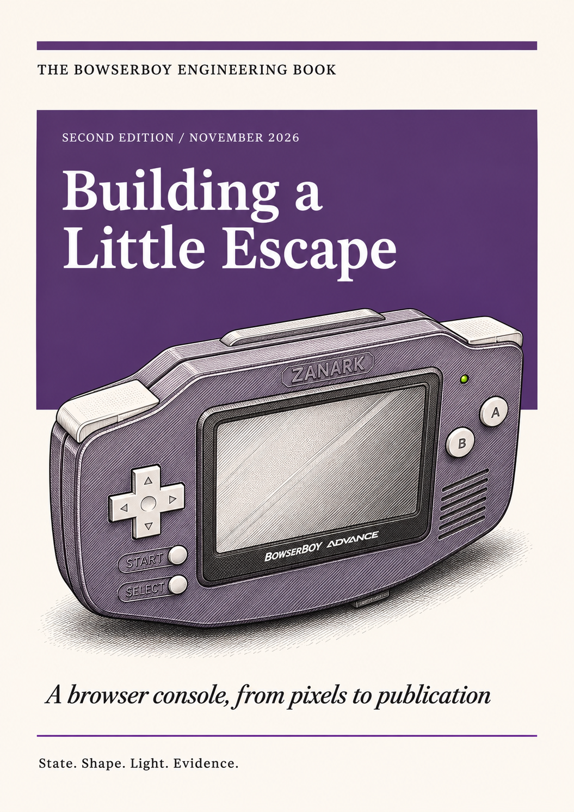
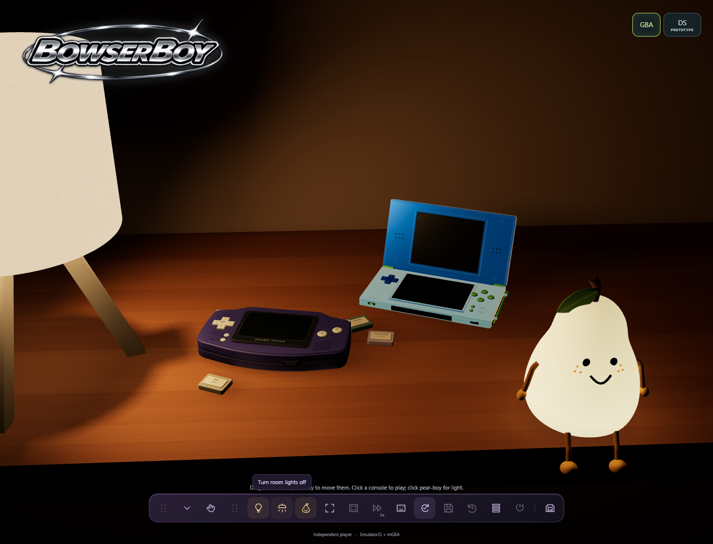
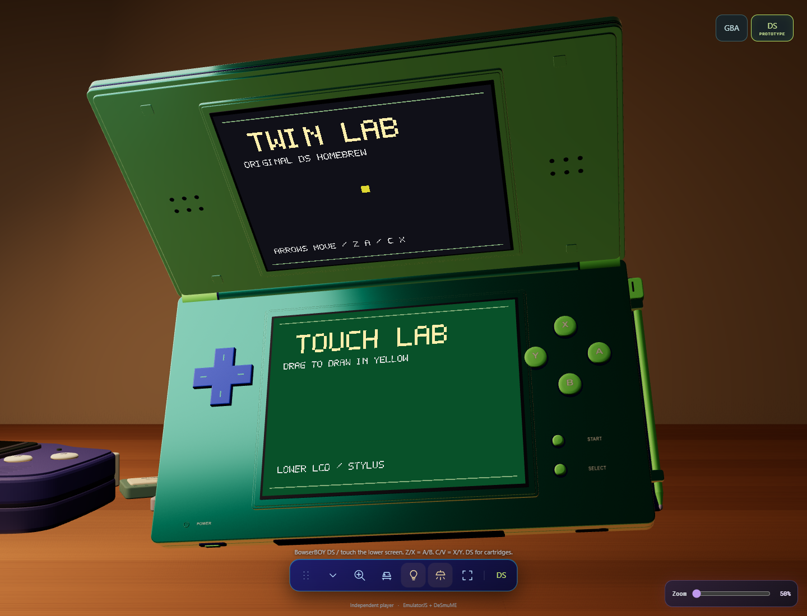
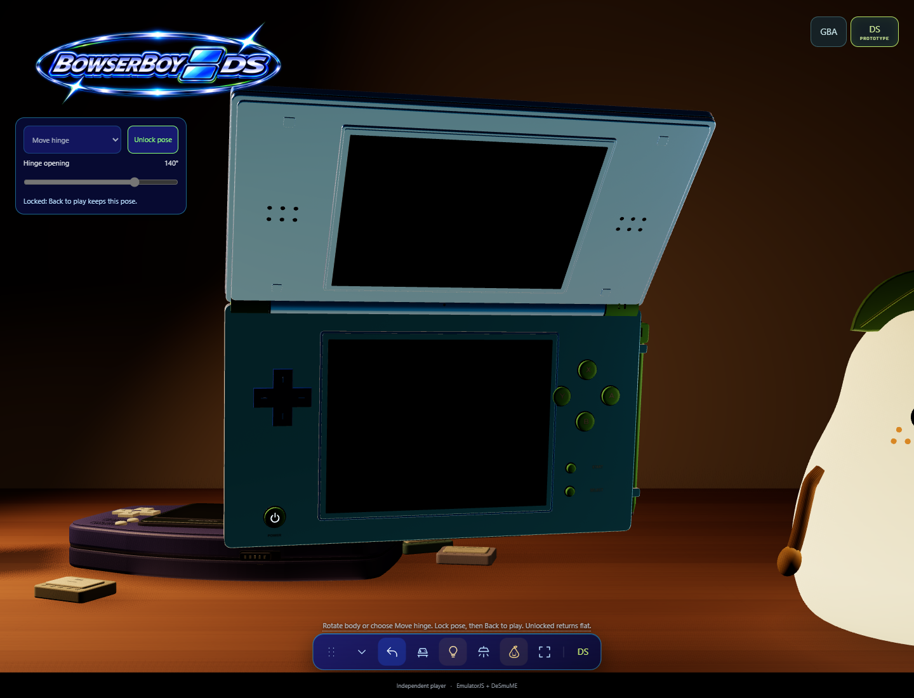
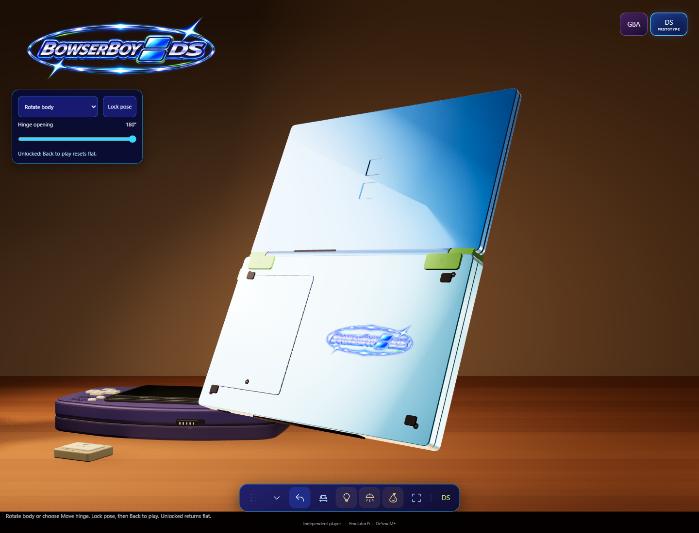
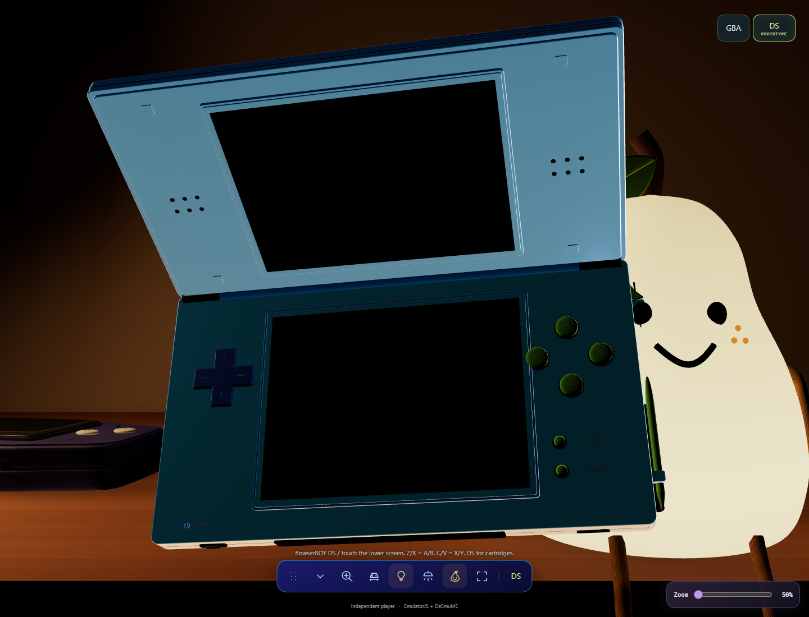
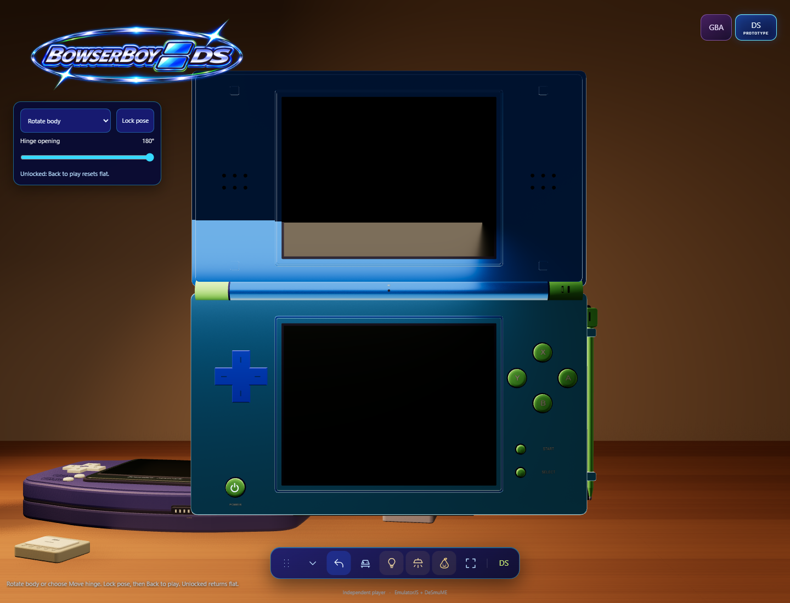
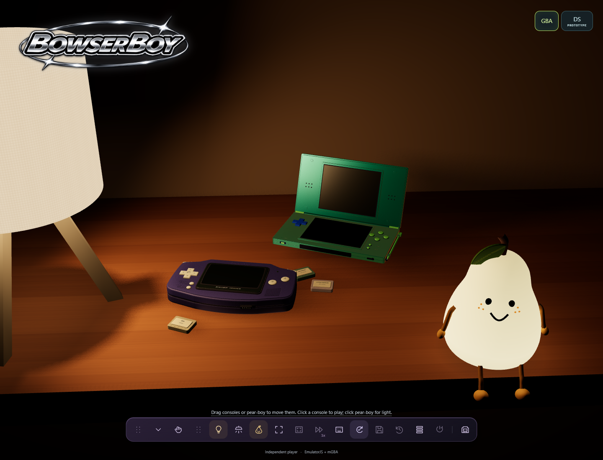
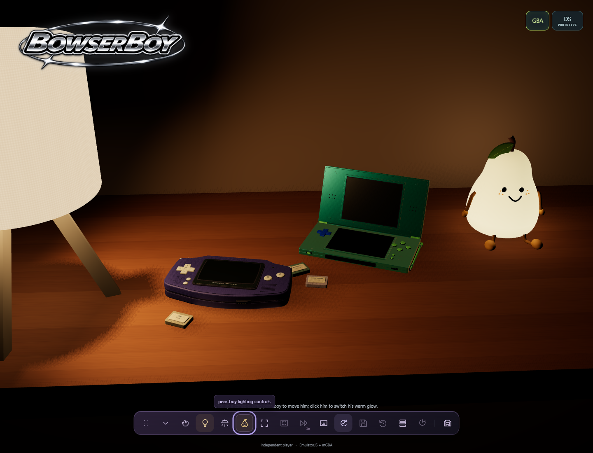
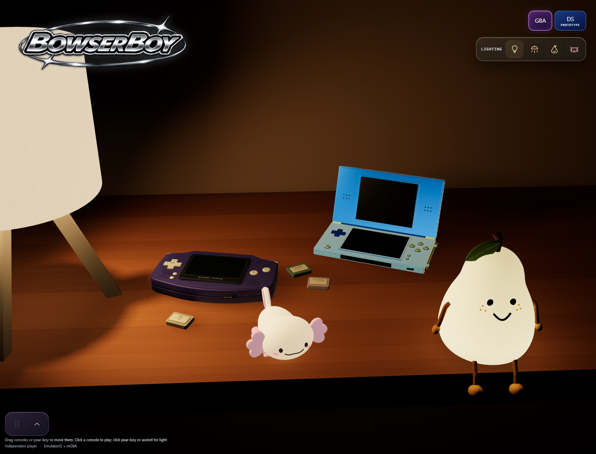

  <strong>A little escape, on your desk.</strong> 
  <a href="https://zanark.github.io/BowserBoyAdvance/"><strong>Play in your browser</strong></a>
  &nbsp;&middot;&nbsp; <a href="docs/GUIDE.md">Player guide &amp; local setup</a>
  &nbsp;&middot;&nbsp; <a href="docs/book/README.md">Engineering book</a>

**BowserBOY** is the umbrella project for browser-playable consoles, each with its own identity and showcase.

**First public release: [v1.0.0](docs/releases/v1.0.0/README.md)** - November 6, 2026 (Asia/Kolkata).
[Release archive and evidence](docs/releases/README.md) &middot;
[Documentation and repository map](docs/README.md) &middot;
[Workstream board](https://github.com/users/Zanark/projects/1).

## Read the engineering book

*Want to explore the documentation? [Read the 96-page engineering book](docs/book/published/Building-a-Little-Escape.pdf): architecture, saves, geometry, lighting, testing and releases. [Chapter sources and build instructions](docs/book/editions/2026-11/README.md). The PDF is also included as a separate companion asset by the manual release workflow.*

## Supported consoles

- [**BowserBOYADVANCED**](#bowserboyadvanced) - Game Boy Advance.
- [**BowserBOY DS**](#bowserboy-ds) - Nintendo DS.

*Both consoles share the BowserBOY desk. Showcase captions retain each
capture's original provenance; they do not define the current release status.*

## BowserBOY DS

<picture>
  <source media="(prefers-reduced-motion: reduce)" srcset="assets/ds-logo.png">
  
</picture>

*A moving reflection shimmers across the two DS screen rectangles here and in the
Inspect heading; the lettering, orbit and chrome borders stay still. Reduced motion
uses the original static artwork. The lower-body underside, loading LCD and DS tools
retain that static artwork. The inner lid has no emblem.*

*Two separate consoles on the same table. The blue-cyan DS faces the lamp,
clears the loose cartridges and keeps its lime stylus clipped to its side.
Actual local capture with optional Room lighting; not a deployed build.*

*The unlocked, fully open DS faces the camera, with a blue-cyan lid, slightly lighter blue
lower base, blue D-pad and
lime controls. Both screens show actual DeSmuME output: buttons move the
upper marker and pointer/stylus input draws on the lower LCD. Twin Lab is
original project homebrew, not a commercial game or simulated video.
Optional Room lighting is on; the front-left power button is functional.*

*Choose Rotate body or Move hinge, adjust the opening, then Lock pose and
Back to play. Both angles stay fixed for gameplay. Without a lock, gameplay
returns to a flat, camera-facing DS. Actual local capture; no deployment.*

*The two recessed squares are centered on the upper lid. The unchanged supplied
logo sits on the lower half's underside, beside rather than over the battery
cover. Actual local Inspect capture with Room lighting on; not a deployed build.*

*The shell in its earlier fixed lighting-reference pose, with Room lighting off and the displays dark. Warm lamps,
exposure and GBA materials are unchanged; the lower base alone uses a lighter
blue pigment than the lid. Actual local capture, not a published build.*

Open [BowserBOY online](https://zanark.github.io/BowserBoy/), or run
`npm run dev` from the repository and open **http://127.0.0.1:5173**.
Select **DS**, open **DS cartridges** and choose
**Try Twin Lab** or an authorized uncompressed `.nds` file. The game card
slides into the separate DS, and both LCDs display live output.

Use arrows for the D-pad; **Z/X = A/B**, **A/S = Y/X**, **Q/W = L/R**,
**Enter = Start**, **left Shift = Select**. Press the physical controls or
click/drag the lower LCD for touchscreen input at its current orientation
and zoom. Hover the side **stylus** to make it glow, then click to pick it up:
its tip follows the pointer while its back points toward you. **Escape**,
right-click or **Put back** docks it; otherwise Escape opens DS tools.
Gameplay hints stay on one bottom-left line instead of across the LCD.
Both DS screens cast soft, screen-colored light onto their surroundings.

*The entire button diamond sits clear of the actual touchscreen bezel, including
the recessed Y socket. D-pad clearance is preserved. Actual local Inspect capture;
DS A/S now send Y/X, Q/W retain the shoulders, and GBA bindings are unchanged.*
Switching GBA/DS pauses the inactive core rather than running both games.
The visible front-left **Power** button saves before powering off; press
it again to cold-boot the retained cartridge. Power-on plays an original
soft-glass chime, distinct from the GBA's chip arpeggio; DS mute silences it.
Power also works with an empty slot. The orientation lock survives
console switching and put-down/pickup, but resets on page reload.

DS checkpoints use a separate browser database and `.bbds-save` backups;
GBA saves and `.bba-save` files remain separate. Reselect the exact same
ROM after reload to resume its stored checkpoint. Power off saves a
checkpoint; **Power on** cold-boots from in-game save data rather than
resuming that checkpoint. Export before clearing browser data or changing
origins.

First launch needs internet for pinned EmulatorJS 4.2.3/DeSmuME. Original
DS direct boot is supported; DSi, BIOS-menu boot, networking and universal
game compatibility are not claimed. No ROM collection, BIOS or firmware
is included. Desktop Edge and a 390px responsive browser viewport are
tested; real-phone performance and commercial games remain unqualified.
The GBA's native shader/settings/fullscreen features are not all DS features.
[Full instructions and limits](docs/GUIDE.md#nintendo-ds).

## Rearrange the desk

*The DS after a real drag, depth adjustment and drop, captured before the
blue-cyan material update. Its desk orientation is unchanged; each console
remembers its own placement during this session.*

Drag either console to lift and move it in 3D; scroll for depth and release
to drop. Both keep their original desk orientation. **Move consoles** in
the dock also provides keyboard placement and reset. Click without dragging
to play; **Put down** returns to the moved position. **Inspect** still rotates
normally. Positions last until reload. [Movement controls and limits](docs/GUIDE.md#move-the-consoles).
This addition is local, not deployed.

Console tools start collapsed as a small grip at the bottom-left. Click either
console to reveal its actions, or use the grip's expand arrow. Lighting remains
in its separate dock.

## pear-boy - local desk companion

*Actual local capture: pear-boy spreads warm light across the right side of the
desk. He sits on the front-right edge with his rope legs dangling below it.*

Drag him upward or sideways, scroll for depth, then release to drop and bounce.
His whole face follows the cursor. While held or falling, his cute squeezed eyes
and rosy cheeks accompany closed/open scream mouths, each held for almost a
second. A hard landing brings small round angry eyes, then a squeezed-eye
pout, then his normal smile. All expressions
retain the signature three dots on each cheek. Reduced motion keeps the scream
mouth still.
Move him farther back to rest his feet on the table.
The pear dock button controls power, brightness, movement and reset.
[Controls and physics limits](docs/GUIDE.md#pear-boy).
This addition is local, not deployed.

## A smaller axolotl night-light - local addition

*Actual local tabletop capture: a smaller axolotl joins pear-boy, with pink
gills, tiny feet, a raised tail and a soft cream glow.*

Click it for power, or use its **Lighting** dock button for **Sleep 50%**
and **Bright 100%**. Drag, lift and drop it like pear-boy; the other lights remain
independent. [Controls and limits](docs/GUIDE.md#small-axolotl-night-light).
This addition is local, not deployed.

## BowserBOYADVANCED

*Your Game Boy Advance, on the BowserBOY tabletop. [Play BowserBOYADVANCED](https://zanark.github.io/BowserBoyAdvance/).*

*Animated console banner above; current local-build recordings and UI captures below. [Media origins](docs/MEDIA.md#clean-storsegel-style-lamp-and-complete-refresh-2026-11-06).*

### One table. More to come.

*The BowserBOY tabletop, featuring BowserBOYADVANCED.*

### Pick it up. Turn it over.

*Soft engraved A/B letters. Metallic-chroma bezel. Purple console branding with orbiting stars while you inspect.*

### Purple belongs to the console.

*Purple console identity. Larger lettering. Deeper engraving.*

### Press. Rock. Release.

*Softer recessed A/B letters. Deeper presses. Rocking D-pad. Snappier return.*

### A closer look.

*Same comfortable view at 50%. Move closer up to 100%. No fullscreen needed.*

### A little faster. Just while you hold.

*Hold **Space** for 2x. Let go for 1x.*

### A clearer little message.

*Frosted overlays. No shrinking or shifting the handheld. No header logo during play.*

### Power where it belongs.

*Underside slider. Clear front face. Real power-off and cold boot.*

### Power on. Make some waves.

*Purple console startup. Waving lettering. An 8-bit-style chime. Power remembered between visits.*

### Slot it in.

*Bring your own local ROMs. Game files stay on your device.*

### Your room, your light.

*A clean STORSEGEL-style shade. Warm ash legs. No visible cable. Cozy lamplight, room lights, or just the LCD.*

### Wave the light.

*Lamp off. Room lights off. Just the green power LED, the game screen, and its moving pool of light.*

*Audio-paced timing and a larger native reserve for steadier playback. [Audio notes and limits](docs/GUIDE.md).*

### Nine ways to glow.

*Nine native CRT presets. CRT Geom by default. Unfiltered, too.*

### Just the game.

*Full 3:2 picture. Dark margins. Adjustable 50-100% zoom.*

### Everything within reach.

*Desk or LCD fullscreen. 1x-4x speed. Sound, lighting and settings within reach.*

### Make a little room.

*Drag the grip. Collapse with the arrow. Move it where it suits you. Focus the grip and press Home to reset.*

### Keep your progress.

*Local in-game saves. Autosave + three checkpoint slots. Download a `.bba-save` backup. [Saving explained](docs/SAVING.md).*

### Back to your game.

*Click outside to close. Or use Escape. Your game keeps running.*

---

[Playing & setup](docs/GUIDE.md) &middot;
[Saving & backups](docs/SAVING.md) &middot;
[Architecture](docs/ARCHITECTURE.md) &middot;
[Engineering book](docs/book/README.md) &middot;
[Verification](docs/VERIFICATION.md) &middot;
[Media & motion](docs/MEDIA.md) &middot;
[Development journal](TODO/04_DEVELOPMENT_LEDGER.todo)

*Independent project; not affiliated with Nintendo. [Credits & licenses](THIRD_PARTY_NOTICES.md).*
