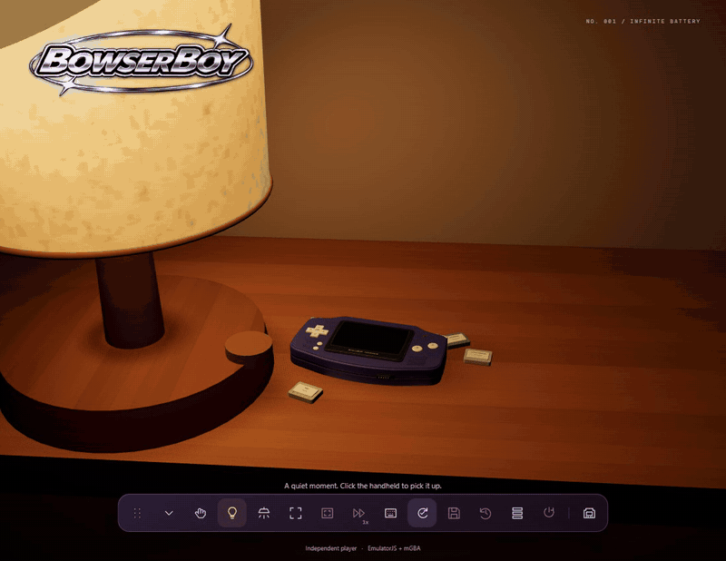
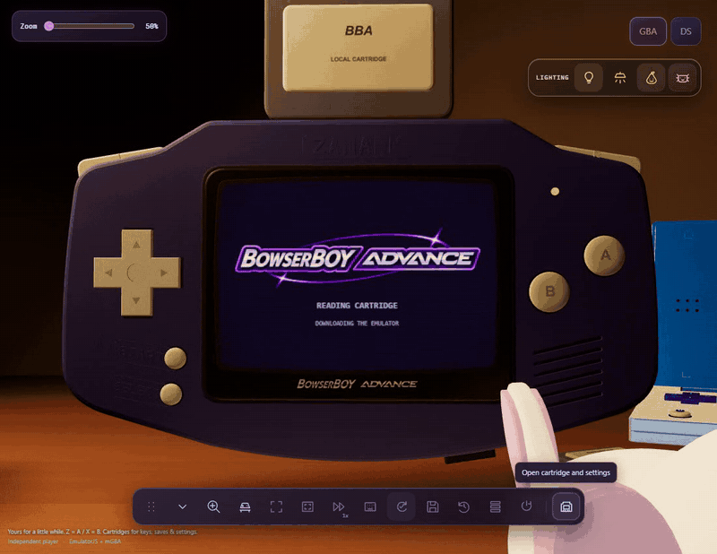
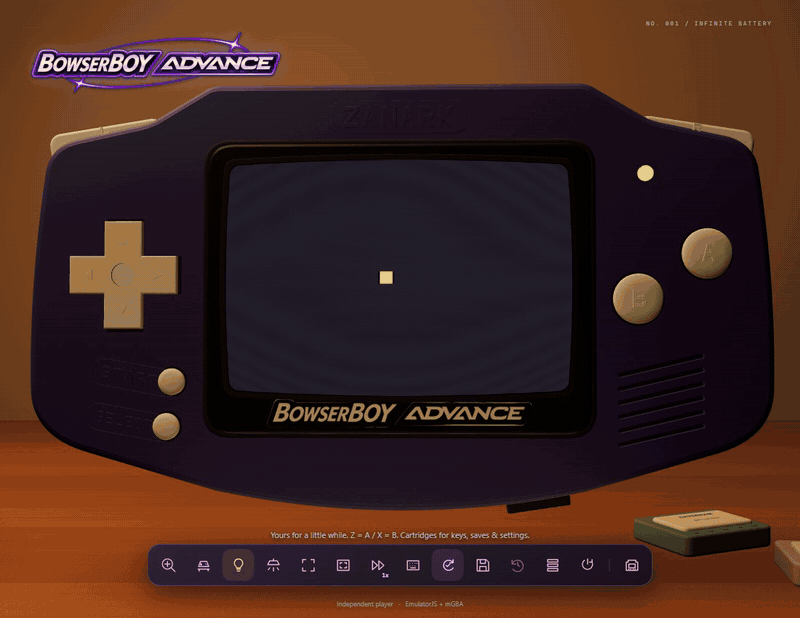

  <strong>A little escape, on your desk.</strong> 
  <a href="https://zanark.github.io/BowserBoyAdvance/"><strong>Play in your browser</strong></a>
  &nbsp;&middot;&nbsp; <a href="docs/GUIDE.md">Player guide &amp; local setup</a>

## Pick it up. Turn it over.

*A real 3D handheld, right down to the battery cover.*

## Power on. Let the stars orbit.

*A little stardust. A roomier orbit. Power remembered between visits.*

## Slot it in.

*Original demo footage. Bring your own local ROMs; nothing gets uploaded.*

## Your room, your light.

*Paper-lantern warmth, room lights, or just the LCD.*

## Everything within reach.

*1x-4x speed. Three checkpoint slots. Autosave. Fullscreen. Your controls.*

---

[Playing & setup](docs/GUIDE.md) &middot;
[Saving & backups](docs/SAVING.md) &middot;
[Architecture](docs/ARCHITECTURE.md) &middot;
[Verification](docs/VERIFICATION.md) &middot;
[Media & motion](docs/MEDIA.md) &middot;
[Development journal](TODO/04_DEVELOPMENT_LEDGER.todo)

*Independent prototype; not affiliated with Nintendo. [Credits & licenses](THIRD_PARTY_NOTICES.md).*
