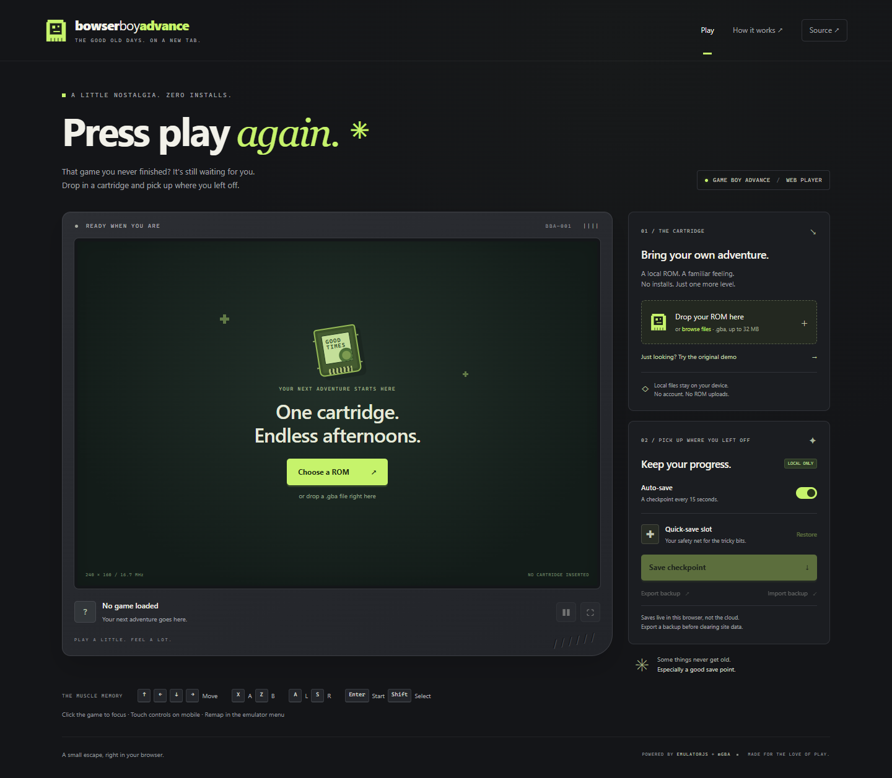
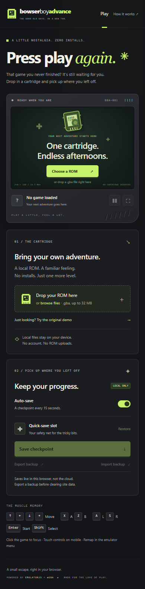

# BowserBoyAdvance

**Press play again.** A local-first Game Boy Advance player for the browser,
built for static hosting on GitHub Pages.



*The responsive cartridge player: local ROM selection, automatic checkpoints,
a separate quick-save slot, and portable backup controls.*

## Play locally

Node.js 22+ is required for the development commands, not for visitors to the
published website.

```powershell
cd C:\devdesk\homedesk\BowserBoyAdvance
npm ci
npm run dev
```

Open **http://127.0.0.1:5173**. Choose an uncompressed **`.gba`** ROM you have
the right to use, or select **Try the original demo**. Pixel Lab is an original
input-test cartridge: arrows move the square, **X** changes its color, and
**Z** stores its horizontal position in emulated cartridge SRAM.

ROM bytes are read locally, not uploaded. No account, server-side library,
commercial ROM or BIOS is included. ROM files are not retained; reselect yours
next time. Internet is required for the versioned EmulatorJS/mGBA runtime.

## Controls

| Action | Keyboard |
|---|---|
| Move | Arrow keys |
| A / B | X / Z |
| L / R | A / S |
| Start / Select | Enter / Shift |

Click the game for focus. The emulator menu contains audio/display settings and
control remapping. Touch devices get on-screen controls. Controller support is
provided by EmulatorJS; physical controller compatibility has not been tested.

## Keep your progress

- **Auto-save:** one rolling checkpoint every 15 seconds while a game is loaded;
  the newest stored checkpoint resumes when the same ROM is selected again.
- **Save checkpoint:** a separate manual slot, unaffected by rolling auto-saves.
  **Restore** rolls back to that slot.
- **Export / Import backup:** carry the current session in a `.bba-save` file.
  The exact ROM content and runtime version must match; checksums detect damaged
  backup data. Export works even if browser checkpoint writes fail.

Checkpoints include an instant emulator state and cartridge battery-save bytes
when the game provides them. Use the game's own save menu as usual.
This prototype does **not** import/export raw `.sav` files or sync to the cloud.

**Save manually before closing and export regularly.** Browser data can be
cleared or evicted, and private browsing may discard it. Saves belong to the
same browser profile and origin (scheme, hostname and port), not your account.
Changing to a new device, localhost port or custom domain requires a backup.
Renaming the ROM does not lose progress because identity is based on SHA-256.

See [the saving guide](docs/SAVING.md) for recovery and limitations.

## GitHub Pages

The repository is configured to publish through **GitHub Actions**. The workflow
in [`.github/workflows/pages.yml`](.github/workflows/pages.yml) checks, builds and
tests the site, then publishes **only `dist`** on a push to `main` or a manual
workflow dispatch. Pull requests run checks without deploying.

Expected Pages address: **https://zanark.github.io/BowserBoyAdvance/**.
Configuration is not a deployment: the workflow must be committed/pushed and
complete successfully before the new prototype is live.

All application paths are relative. The browser suite serves the build under
`/BowserBoyAdvance/`, rather than merely testing a domain-root development page.
The core runs single-threaded; no custom COOP/COEP headers are required.

```powershell
npm run build
npm run preview
```

`dist` is generated and replaced on each build. It contains only the static
application and generated original Pixel Lab cartridge, not dependencies,
project documentation or private session context.

## Development and evidence

```powershell
npm run check
npm test
npm run build
npm run test:browser
```

The browser suite uses installed Microsoft Edge by default. To use Playwright's
Chromium instead:

```powershell
npx playwright install chromium
$env:BROWSER_CHANNEL = 'chromium'
npm run test:browser
```

Real-core integration tests require internet. They use the original generated
cartridge, not commercial game data. See [architecture](docs/ARCHITECTURE.md),
[verification scope](docs/VERIFICATION.md) and the numbered [TODO index](TODO/00_INDEX.todo).

<details>
<summary>Mobile layout</summary>



*The same interface stacks the cartridge and progress panels beneath the player
without horizontal overflow.*

</details>

Independent prototype; not affiliated with Nintendo. See
[third-party notices](THIRD_PARTY_NOTICES.md) for runtime sources and licenses.