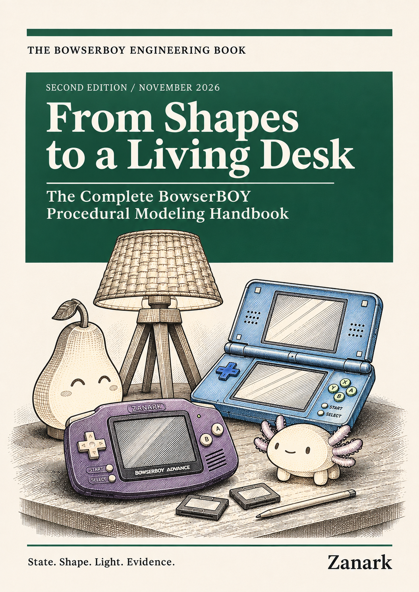
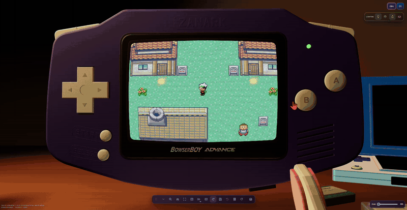
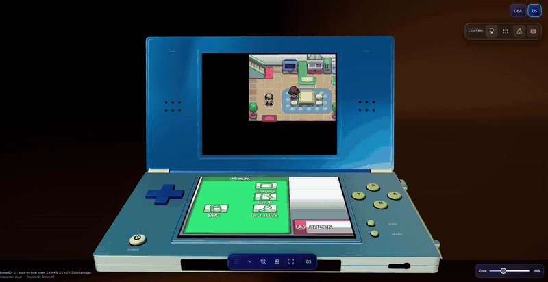

  <strong>A little escape, on your desk.</strong> 
  <a href="https://zanark.github.io/BowserBoy/"><strong>Play in your browser</strong></a>
  &nbsp;&middot;&nbsp; <a href="docs/GUIDE.md">Player guide &amp; local setup</a>
  &nbsp;&middot;&nbsp; <a href="docs/book/README.md">GBA book</a>
  &nbsp;&middot;&nbsp; <a href="docs/modeling-book/README.md">3D modeling book</a>
  &nbsp;&middot;&nbsp; <a href="docs/nds-book/README.md">NDS book</a>
  &nbsp;&middot;&nbsp; <a href="docs/README.md">All documentation</a>

<table>
  <tr>
    <td align="center" width="33%"></td>
    <td align="center" width="33%"></td>
    <td align="center" width="33%"></td>
  </tr>
  <tr>
    <td align="center"><a href="docs/book/published/Building-a-Little-Escape.pdf"><strong>GBA Book</strong></a></td>
    <td align="center"><a href="docs/modeling-book/published/From-Shapes-to-a-Living-Desk.pdf"><strong>3D Modeling Book</strong></a></td>
    <td align="center"><a href="docs/nds-book/published/Two-Screens-One-Little-Escape.pdf"><strong>NDS Book</strong></a></td>
  </tr>
</table>

Two consoles. Three desk lamps. Your own local games.

[Nintendo DS](#bowserboy-ds) &middot; [Game Boy Advance](#bowserboyadvanced) &middot; [The desk &amp; lamps](#make-the-desk-yours)

*One shared desk. Separate consoles, saves and controls.*

*GBA demo: the first 30 seconds of the supplied recording.*

*NDS demo: the first 30 seconds of the supplied recording.*

<h2>BowserBOY DS</h2>

<picture>
  <source media="(prefers-reduced-motion: reduce)" srcset="assets/ds-logo.png">
  
</picture>

*HeartGold's first 90 seconds, minus the initial 8. No game inputs.*

*Pick a cartridge. It slides in from below while the loading LCD animates; the full boot takes longer.*

*Real button travel. The opening keeps playing.*

*Hover. Pick up. Trace. Escape to put it back.*

*Turn the body. Open the hinge. Lock it your way.*

*Both screens, fitted together. Zoom from 50% to 100%.*

*Lamp only. Lamp + room. Room only. Your choice.*

*Lights out. Just the two LCDs lighting their surroundings.*

[DS controls, saves &amp; compatibility limits](docs/GUIDE.md#nintendo-ds) &middot; [Development journey &amp; PDF](docs/nds-book/README.md)

<h2>BowserBOYADVANCED</h2>

*The first 30 seconds, minus the initial 2.5. No game inputs.*

*Pick it up. Turn it over. Make it yours.*

*Press. Rock. Release.*

*50% to 100%. No fullscreen needed.*

*Hold Space. Release. Keep your hands on the keyboard.*

*Waving lettering. Sparkles. An original 8-bit-style chime.*

*Slot it in. Your game files stay on your device.*

*Warm woven shade. Ash tripod. Independent room light.*

*Every lamp off. Celia's GAME and the screen's moving pool of light.*

*Just the game. Full 3:2 picture, with adjustable zoom.*

*Drag the grip. Collapse it. Make a little room.*

*Click outside. Back to your game.*

[Controls &amp; settings](docs/GUIDE.md) &middot; [Saving &amp; backups](docs/SAVING.md)

<h2>Make the desk yours</h2>

*Tripod only. Both. Room only. All off. The tripod stays fixed.*

<h3>Pear boy</h3>

*A warm little glow. 10% to 100%, or off.*

*Scream. Bounce. Tiny angry eyes. Pout. Smile. Always three dots per cheek.*

<h3>The little axolotl</h3>

*Sleep at 50%. Shine at 100%. Tiny feet, pink gills, warm glow.*

*Move the lamp. Its light follows.*

[Desk movement](docs/GUIDE.md#move-the-consoles) &middot;
[Pear controls](docs/GUIDE.md#pear-boy) &middot;
[Axolotl controls](docs/GUIDE.md#small-axolotl-night-light)

---

[Architecture](docs/ARCHITECTURE.md) &middot;
[Engineering book](docs/book/README.md) &middot;
[Releases](docs/releases/README.md) &middot;
[Verification](docs/VERIFICATION.md) &middot;
[Recording details &amp; historical gallery](docs/MEDIA.md) &middot;
[Development journal](TODO/04_DEVELOPMENT_LEDGER.todo)

*The two demos above are supplied recordings. Earlier feature GIFs show real scene interactions with replayed, untouched Celia's GAME and HeartGold openings on the screens; not live game-input demonstrations. [Recording details](docs/MEDIA.md). Bring legally obtained games; no ROM collection or BIOS is included. Independent project, not affiliated with Nintendo. [Credits &amp; licenses](THIRD_PARTY_NOTICES.md).*
