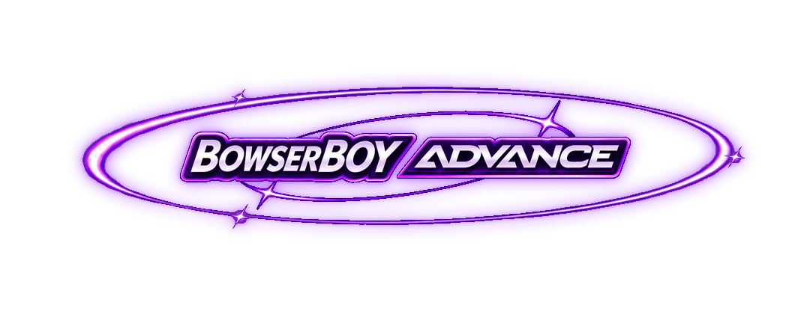

  <strong>A little escape, on your desk.</strong> 
  <a href="https://zanark.github.io/BowserBoyAdvance/"><strong>Play in your browser</strong></a>
  &nbsp;&middot;&nbsp; <a href="docs/GUIDE.md">Player guide &amp; local setup</a>
  &nbsp;&middot;&nbsp; <a href="book/README.md">Engineering book</a>

**BowserBOY** is the umbrella project for browser-playable consoles, each with its own identity and showcase.

**First public release: [v1.0.0](releases/v1.0.0/README.md)** - November 6, 2026 (Asia/Kolkata).
[Release archive and evidence](releases/README.md) &middot;
[Documentation and repository map](docs/README.md).

## Supported consoles

- [**BowserBOYADVANCED**](#bowserboyadvanced) - Game Boy Advance.

*More consoles are planned. Only BowserBOYADVANCED is available today.*

## BowserBOYADVANCED

*Your Game Boy Advance, on the BowserBOY tabletop. [Play BowserBOYADVANCED](https://zanark.github.io/BowserBoyAdvance/).*

*Animated console banner above; current local-build recordings and UI captures below. [Media origins](docs/MEDIA.md#clean-storsegel-style-lamp-and-complete-refresh-2026-11-06).*

### One table. More to come.

*The BowserBOY tabletop, featuring BowserBOYADVANCED.*

### Pick it up. Turn it over.

*Soft engraved A/B letters. Metallic-chroma bezel. Purple console branding with orbiting stars while you inspect.*

### Purple belongs to the console.

*Purple console identity. Larger lettering. Deeper engraving.*

### Press. Rock. Release.

*Softer recessed A/B letters. Deeper presses. Rocking D-pad. Snappier return.*

### A closer look.

*Same comfortable view at 50%. Move closer up to 100%. No fullscreen needed.*

### A little faster. Just while you hold.

*Hold **Space** for 2x. Let go for 1x.*

### A clearer little message.

*Frosted overlays. No shrinking or shifting the handheld. No header logo during play.*

### Power where it belongs.

*Underside slider. Clear front face. Real power-off and cold boot.*

### Power on. Make some waves.

*Purple console startup. Waving lettering. An 8-bit-style chime. Power remembered between visits.*

### Slot it in.

*Bring your own local ROMs. Game files stay on your device.*

### Your room, your light.

*A clean STORSEGEL-style shade. Warm ash legs. No visible cable. Cozy lamplight, room lights, or just the LCD.*

*Audio-paced timing and a larger native reserve for steadier playback. [Audio notes and limits](docs/GUIDE.md).*

### Nine ways to glow.

*Nine native CRT presets. CRT Geom by default. Unfiltered, too.*

### Just the game.

*Full 3:2 picture. Dark margins. Adjustable 50-100% zoom.*

### Everything within reach.

*Desk or LCD fullscreen. 1x-4x speed. Sound, lighting and settings within reach.*

### Make a little room.

*Drag the grip. Collapse with the arrow. Move it where it suits you. Focus the grip and press Home to reset.*

### Keep your progress.

*Local in-game saves. Autosave + three checkpoint slots. Download a `.bba-save` backup. [Saving explained](docs/SAVING.md).*

### Back to your game.

*Click outside to close. Or use Escape. Your game keeps running.*

---

[Playing & setup](docs/GUIDE.md) &middot;
[Saving & backups](docs/SAVING.md) &middot;
[Architecture](docs/ARCHITECTURE.md) &middot;
[Engineering book](book/README.md) &middot;
[Verification](docs/VERIFICATION.md) &middot;
[Media & motion](docs/MEDIA.md) &middot;
[Development journal](TODO/04_DEVELOPMENT_LEDGER.todo)

*Independent project; not affiliated with Nintendo. [Credits & licenses](THIRD_PARTY_NOTICES.md).*
