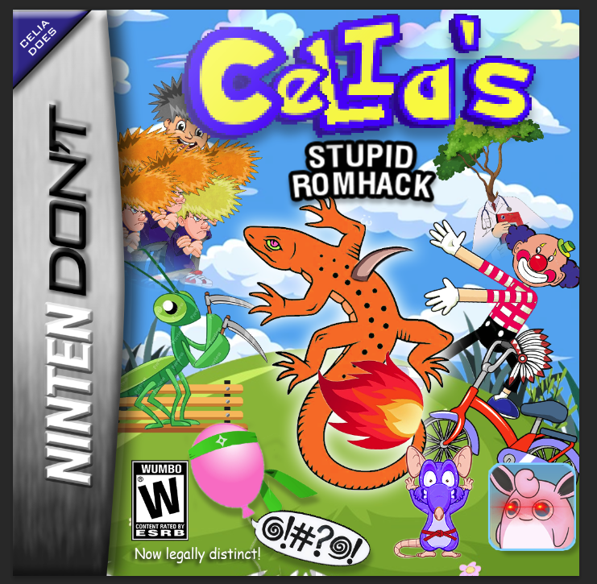

# Celia's game

*The supplied box art is preserved without resizing, recoloring or editing;
the display width above only controls its presentation.*

[Download the demo ROM](https://raw.githubusercontent.com/Zanark/BowserBoyAdvance/main/demos/celias-game/celias-game.gba)
and choose the downloaded file in
[BowserBOYADVANCED](https://zanark.github.io/BowserBoyAdvance/).
This is a repository download, not a new built-in player option.

## Credit and permission

The user attributes the game to Celia and supplied both the ROM and box art.
On 2026-11-05, the user explicitly authorized uploading the ROM to GitHub and
confirmed that it is fully original or licensed for public redistribution.
That is the user's confirmation, not an independent rights audit or a new
license grant. No separate upstream license text was supplied.

## Media only, not a test fixture

The ROM may be used for demo GIFs, README media and other showcases.
**Do not use it for automated or manual testing unless the user explicitly
asks.** The original Pixel Lab program remains the test fixture.
No gameplay capture or execution was performed as part of this upload.
Existing README gameplay recordings still show Pixel Lab.

## Exact supplied files

| File | Bytes | SHA-256 |
|---|---:|---|
| `celias-game.gba` | 30,091,948 | `81ac9b9d4e7bdd3bf06ed53954d784118a743372906c6c6fc62b3cbc19587148` |
| `box-art.png` | 585,329 | `b37150470ee70c88563f908dc4d5e569892f74eb6514ae882852693db25643c7` |

Both files are byte-for-byte copies of the supplied originals. They are kept
outside the static-site build and are not automatically loaded by the player.
