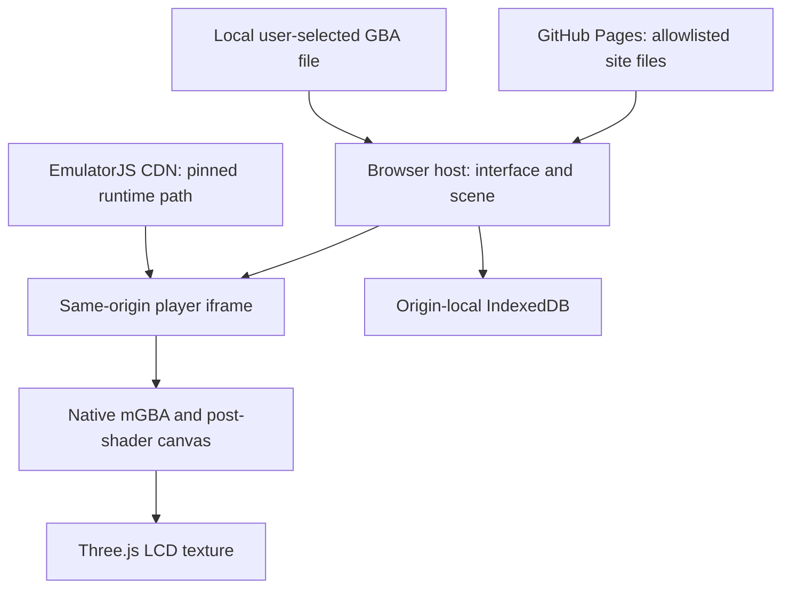

# 01 - A console on a static website

[Book index](../../README.md) | [Next: runtime and power](../02-runtime-and-power/README.md)

## Start with the ownership boundary

A static host serves bytes. It does not have to execute the emulator.
The browser downloads the shell, loads the native core through EmulatorJS,
reads a user-selected file and executes the game locally. The application has
no ROM-upload endpoint and no cloud-save service.

*Figure 01-01. Arrows mean data or code delivery, not remote execution.
Only the browser runs the game; CDN access is still a network dependency.*

The host owns the player's intent: which cartridge, whether power is on,
which save slot is selected and which physical view is active. The child
owns the emulator instance. Three.js owns presentation, not CPU emulation.
Keeping these responsibilities separate lets a change in desk lighting leave
the game untouched.

## Walk through the actual package

`siteFiles()` starts with named HTML/CSS and vendor entries, then selects
first-level JavaScript and artwork from `src` and `assets`. `siteSource()`
maps the public Three.js vendor names to installed package files. `build.mjs`
copies this allowlist to `dist`, generates the original Pixel Lab cartridge
and creates `.nojekyll`.

This is deliberately not "publish the repository." The engineering book,
tests, development ledger and private continuity are not site payloads.
A book link in the repository README is a GitHub documentation link, not a
claim that the Markdown has been deployed as a new Pages reader.

All application paths are relative. A project site under
`/BowserBoyAdvance/` therefore exercises a different condition from a page
served only at `/`. The browser suite uses the project prefix so that a
root-only success cannot conceal a broken Pages asset URL.

## Static is not offline or untrusted-code isolation

The pinned CDN URL identifies a runtime release path; it is not an integrity
hash of every returned byte. Runtime code runs with this site's origin
privileges. The same-origin iframe provides lifecycle isolation, not a
security sandbox against its own scripts. A statement that ROM bytes are not
uploaded by this application must not become "the browser makes no network
requests."

The single-threaded core avoids a requirement for custom cross-origin
isolation headers. That is a compatibility choice, not a performance promise
for every browser or phone. CDN failure, WebGL failure and unavailable browser
storage remain real, separately reported failure modes.

## Try it: distinguish the three claims

**Exercise.** The static build succeeds. Does this prove that the CDN is
reachable, that a game starts, or that the public site has this build?

**Answer.** None of the three. Build success proves that the local packaging
step completed. A real runtime test establishes startup in its tested
environment. Exact public-asset comparison and live interaction establish the
separate production boundary.

**Source trail:** [S-01, S-02 and S-10](../../SOURCES.md);
[Architecture](../../../docs/ARCHITECTURE.md).
