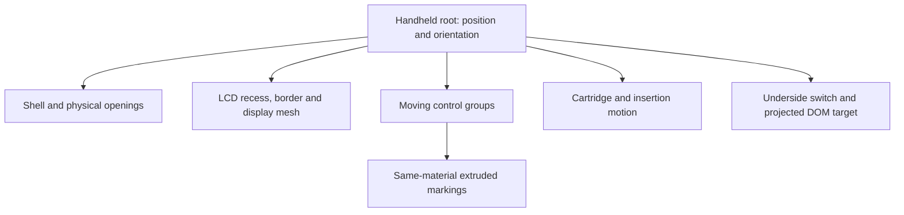
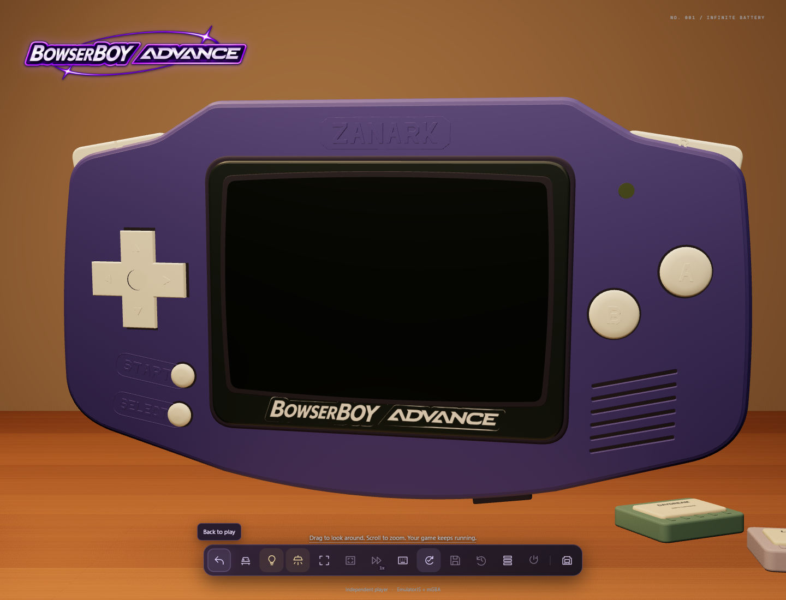

# 04 - Geometry and manufactured controls

[Previous](../03-saves-and-recovery/README.md) | [Book index](../../README.md) | [Next](../05-pixels-and-light/README.md)

## Shape must exist before shading can describe it

The handheld is an original hierarchy of Three.js meshes. The casing, shoulders,
apertures, caps, cartridge, lower-edge switch and LCD are spatial objects, not a
single screenshot decorated with CSS shadows. They can be inspected from the
back and side without revealing a flat front-only illusion.

*Figure 04-01. The hierarchy carries motion and material ownership. A
control's marking moves with its cap rather than floating over the casing.*

## Why relief is different from printed lettering

A texture changes surface color. Relief changes surface shape and therefore
silhouette, normals, highlights and self-occlusion. The shared polygon glyphs
are extruded with bevels; counters preserve holes inside letters. The A/B/L/R
markings and arrows use their cap's material. START/SELECT uses casing material.
This lets light reveal a manufactured mark instead of a separate white decal.

The top Zanark mark and lower bezel serve different visual roles. Molded
manufacturer lettering belongs to the shell. The bezel uses a star-free
monochrome derivative of the supplied wordmark. Saturated orbital accents are
removed in the derived texture; the original supplied PNG remains unchanged.
Fullscreen copies that same bezel texture rather than substituting a generic
font. A warm lamp can tint a neutral surface without making its source ink
colored.

*Figure 04-02. The public manufactured-control capture makes cap relief and
bezel artwork inspectable. It is not evidence that the later notice revision
was public when this image was recorded.*

## Coordinates become interaction targets

`project()` converts an object's world-space position into normalized device
coordinates through the active camera, then into CSS pixels. This allows a
physical switch to carry a usable DOM control while the console moves. Mesh
shape and accessible hit target are related but not identical: a tiny physical
detail still needs the required touch area.

Normal play, insertion, inspection and tabletop have different envelopes.
Insertion needs room above the slot; inspection allows deliberate rotation and
zoom. The closer normal-play revision must not silently change these other
poses or stretch the console to fill the screen.

## The bounding-box trap

An axis-aligned box includes empty corners and hidden space. Projecting it can
report a false collision even when the visible handheld is clear. Similarly,
the transparent website logo's rectangle is larger than its visible lettering.
The revised tests inspect actual visible geometry and actual logo alpha,
while separately retaining switch-target and dock-clearance requirements.

That is not permission to weaken a collision assertion until a screenshot
looks acceptable. It is choosing the physical quantity the requirement names.

**Exercise.** Why not make markings "3D" by adding a dark drop shadow?

**Answer.** The shadow would not change the mesh, material normals or inspected
silhouette. It could also detach from a moving cap. Real relief ties appearance
to geometry and shared motion; oblique inspection verifies that distinction.

**Source trail:** [S-05, S-06 and S-11](../../SOURCES.md).
