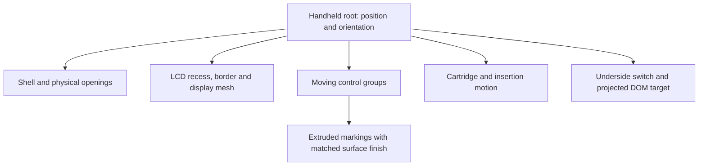

# 04 - Geometry and manufactured controls

[Previous](../03-saves-and-recovery/README.md) | [Book index](../../README.md) | [Next](../05-pixels-and-light/README.md)

## Shape must exist before shading can describe it

The handheld is an original hierarchy of Three.js meshes. The casing, shoulders,
apertures, caps, cartridge, lower-edge switch and LCD are spatial objects, not a
single screenshot decorated with CSS shadows. They can be inspected from the
back and side without revealing a flat front-only illusion.

*Figure 04-01. The hierarchy carries motion and material ownership. A
control's marking moves with its cap rather than floating over the casing.*

## Why relief is different from printed lettering

A texture changes surface color. Relief changes surface shape and therefore
silhouette, normals, highlights and self-occlusion. The shared polygon glyphs
are extruded with bevels; counters preserve holes inside letters. The pinned
source edition uses the cap's material for A/B/L/R markings and arrows;
START/SELECT uses casing material. This lets light reveal a manufactured mark
instead of a separate white decal.

The later contrast refinement in workstream 32 restores the earlier dark A/B
and arrow tones with tinted clones of the rubber material. The extrusion,
bevels, shadows and shared cap motion remain; only those six markings change
color. L/R and START/SELECT retain the original material relationship.

Workstream 36 supersedes the raised A/B letters only: the user wants dark
inward grooves. Their original polygon outlines cut the cap faces, while
counter polygons remain solid islands. Dark floors and sidewalls sit below
the original dome and move with the cap. Preserve the lathe's original rim
normals and blend the new face normals into them; truncating the profile
without doing this makes the center look like a separate disk. Raycasts must
hit the inset floor before any cap surface, and counter probes must still hit
cap height. Merely moving a dark letter below an uncut cap cannot pass that
test. D-pad, shoulder, shell and maker markings retain their prior relief.

Workstream 38 then softens **only** the A/B groove material to `#999d98`.
The original >3 contrast requirement is superseded by moderate 1.5-2.5
contrast against unchanged caps; actual contrast is 1.92740. Geometry, counters,
shadows, other markings and the warm lamp remain unchanged. A shade refinement
must not quietly turn a real groove back into paint or a raised letter.

The top Zanark mark and lower bezel serve different visual roles. Molded
manufacturer lettering belongs to the shell. The bezel uses a star-free
monochrome derivative of the supplied wordmark. Saturated orbital accents are
removed in the derived texture; the original supplied PNG remains unchanged.
Fullscreen copies that same bezel texture rather than substituting a generic
font. A warm lamp can tint a neutral surface without making its source ink
colored.

Workstreams 35 and 39 progressively reduce only that shared artwork: first to
75%, then to 60% of the unchanged canvas. The latter is another 20% reduction,
centered with the source aspect intact. Tighten real-alpha inset checks and
retain normal/fullscreen pixel identity; resizing the mesh or camera would
solve a different problem.

Workstream 41 removes the surviving light exterior contour. A stricter color
threshold damages the supplied letter gradients, so use solid alpha cores
and flood-fill their original connected pixels instead. The seed filter only
chooses components; it must not erode the reconstructed glyph edges or counters.
The shared size, neutral shade and original purple artwork remain unchanged.

*Figure 04-02. The public manufactured-control capture makes cap relief and
bezel artwork inspectable. It is not evidence that the later notice revision
was public when this image was recorded.*

## Coordinates become interaction targets

Workstream 37 strengthens physical feedback without changing those targets
or delaying native input. Increase cap travel by about 60%, D-pad rocking and
shoulder hinging, then use a more deliberate compression and quicker release.
The mesh still approaches a bounded pose: no overshoot, cap scaling or detached
lettering. Verify actual mapped-key displacement and equal-time compression/
release samples, not just renamed motion parameters. Recheck real pressed-cap
illumination inside the existing openings; deeper travel must not recreate
the socket-lid occlusion problem.

The existing adaptive-render contract still requires more than 99% compression
within 100ms, even while GPU paints are skipped. The first slower response
missed that bound. Correct the actual compression/release rates to 50/80,
not the deadline or assertions; stronger feedback must not become sluggish input.

`project()` converts an object's world-space position into normalized device
coordinates through the active camera, then into CSS pixels. This allows a
physical switch to carry a usable DOM control while the console moves. Mesh
shape and accessible hit target are related but not identical: a tiny physical
detail still needs the required touch area.

Normal play, insertion, inspection and tabletop have different envelopes.
Insertion needs room above the slot; inspection allows deliberate rotation and
zoom. The closer normal-play revision must not silently change these other
poses or stretch the console to fill the screen.

## The bounding-box trap

An axis-aligned box includes empty corners and hidden space. Projecting it can
report a false collision even when the visible handheld is clear. Similarly,
the transparent website logo's rectangle is larger than its visible lettering.
The revised tests inspect actual visible geometry and actual logo alpha,
while separately retaining switch-target and dock-clearance requirements.

That is not permission to weaken a collision assertion until a screenshot
looks acceptable. It is choosing the physical quantity the requirement names.

**Exercise.** Why not make markings "3D" by adding a dark drop shadow?

**Answer.** The shadow would not change the mesh, material normals or inspected
silhouette. It could also detach from a moving cap. Real relief ties appearance
to geometry and shared motion; oblique inspection verifies that distinction.

**Source trail:** [S-05, S-06 and S-11](../../SOURCES.md).
