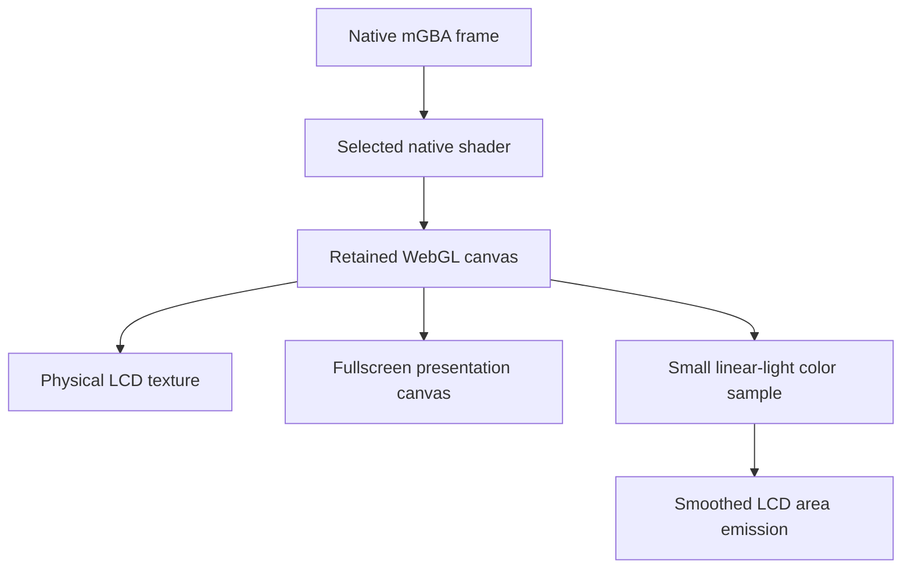

# 05 - Pixels, lighting and fullscreen

[Previous](../04-handheld-geometry/README.md) | [Book index](../../README.md) | [Next](../06-input-and-interaction/README.md)

## One native picture, several presentations

The native core produces the game. Its shader processes that output. The
shell consumes the retained post-shader canvas as a Three.js texture. It
does not recreate CRT Geom with CSS or run a second emulator for fullscreen.

*Figure 05-01. Presentation and illumination consume the same game output.
The lighting sampler is not part of game simulation.*

## Retaining the framebuffer is a scoped compatibility choice

The adapter overrides the native canvas's WebGL context request to preserve its
drawing buffer. Without retained output, the shell's later read can see an
already-cleared frame. This behavior is confined to that core canvas, not every
WebGL context on the page. It is version-sensitive integration, documented
beside the pinned adapter.

The checked preference list exposes nine native CRT presets plus Unfiltered.
CRT Geom is the default when no explicit choice exists. A valid saved preference
is not overwritten merely because the default changed. Applying the filter
does not require replacing the current cartridge.

Screen fullscreen draws the current picture inside a proportional decorative
bezel and dark surrounding space. The native picture remains 3:2. The bottom-right
50-100% slider scales the presentation frame, not the emulated resolution,
save state or CPU rate. The decorative wordmark uses the same derived image as
the physical bezel. Browser refusal of fullscreen is an explicit error.

## Lighting follows emitted content

`ScreenIllumination` samples a 24 by 16 image. It converts each sRGB channel
through a 256-entry linear-light lookup table before averaging. Averaging
display-encoded channel values directly would give a different, physically
misleading result.

Sampling is bounded to a 125 ms cadence for live content, with an immediate
sample when the source changes. The color converges using an exponential
factor based on elapsed time. The peak channel determines intensity; normalized
color preserves the tint. A black picture converges to no LCD emission.
This is a low-cost whole-screen approximation, not per-pixel global
illumination.

The paper lantern and room lights are independent scene systems. The lantern's
spot, transmitted area light and finite tabletop bounce approximate a warm
physical source. They are intentionally not a promise of unbiased path tracing.

**Fabric refinement, November 6, 2026.** The current shade uses a subtle
neutral white weave in both color and emission maps. Mapping emission matters:
an untextured luminous term can otherwise wash out the reflected fabric detail.
A warmer cream emission changes the glow, not the clean fabric into brown
stains. Actual rendered warmth, brightness and the existing no-seam bounds
are checked without reducing renderer resolution.

**Living implementation note, November 6, 2026.** The first-edition lantern
above is replaced by a clean STORSEGEL-style white drum shade and ash tripod.
An exterior transmitted-light plane avoids a hard seam on the fabric; soft
downward light through the open bottom reveals the legs. Lamp/room/LCD
independence and full-resolution rendering remain intact. See the current
[lighting architecture](../../../docs/ARCHITECTURE.md#dark-room-and-screen-colored-illumination)
for dimensions and source details; this note does not reissue the frozen book.

## Presentation performance is not game speed

The scene can defer expensive painting under load and skip tabletop rendering
while screen fullscreen is active. Those choices must not change the cartridge's
native simulation clock. Conversely, setting the fast-forward flag is not
sufficient if native VSync still caps the loop. The adapter explicitly reconciles
that interaction; tests measure the original cartridge's clock.

**Exercise.** If the desk renderer drops to 20 painted frames per second, has
the emulator necessarily slowed to one third speed?

**Answer.** No. Render cadence and native game progress are separate quantities.
Measure cartridge progress over wall time rather than infer it from scene
smoothness. Real system overload may affect both, but one is not proof of the
other.

**Source trail:** [S-01, S-02, S-06, S-07 and S-08](../../SOURCES.md).
