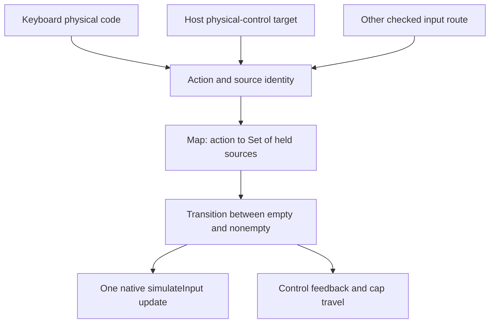

# 06 - Input and interaction

[Previous](../05-pixels-and-light/README.md) | [Book index](../../README.md) | [Next](../07-algorithms-and-data-structures/README.md)

## A button is the union of its input sources

Keyboard, pointer and other supported input routes can overlap. A single
`pressed` boolean loses ownership: releasing one source would release a
button still held by another source.

*Figure 06-01. Native transitions occur when aggregate state changes, not on
every duplicate press notification.*

`input()` validates the action, boolean state and bounded source string.
Each action maps to a `Set` of sources. Adding a source can change empty to
nonempty; removing one can change nonempty to empty. Only those aggregate
transitions call the native button API and notify the host.

For example, keyboard A and a pointer can both hold the same GBA action.
Releasing the pointer leaves the keyboard source in the set. The native
button stays down until that remaining source releases.

## Remember the action that was pressed

`bindKeyboard()` stores physical key codes and their assigned actions in a
`Map`. Keyup first checks that held map, even if the current mode would no
longer accept a new keydown. This is important when focus or view changes
between press and release.

Repeated keydown does not create repeated native presses. Blur releases all
held keys. The child also releases keyboard holds when the document becomes
hidden. Reconfiguration releases prior holds before replacing preferences,
so a rebind cannot strand the old action.

The host and child coordinate input enablement around playing, inspection,
transitions and native settings. Screen fullscreen deliberately retains
keyboard gameplay even if entered from another desk pose. Escape is reserved
for closing the active presentation or tools, not assigned as a game key.

## Configuration is checked, not trusted

The fixed control table defines IDs, native button numbers, default physical
codes and gamepad names. Preference validation rejects duplicate assignments
and reserved or malformed keys. The set used during validation represents
already-assigned codes; it is a different set from the runtime's held sources.

Advanced native settings are filtered so the shell retains ownership of
keyboard, save handling and virtual-control presentation. This is a division
of application responsibility, not proof that arbitrary third-party runtime
options are harmless.

## Visual feedback has a separate verification layer

A moving A cap proves visible response, not necessarily native input delivery.
A native button press proves game input, not that the cap remained visible
inside its aperture under lighting. The browser cases exercise both.
Similarly, a physical switch can be tiny in world units while its projected
DOM target still meets 44 CSS pixels.

**Exercise.** The user holds a key, opens settings and releases the key there.
Why cannot keyup simply return whenever gameplay is disabled?

**Answer.** It would discard the release for an existing hold. Process held
keyup and release ownership before rejecting new gameplay input. Mode changes
also explicitly clear input so losing the event does not leave a stuck button.

**Source trail:** [S-02, S-06, S-08 and S-11](../../SOURCES.md).
