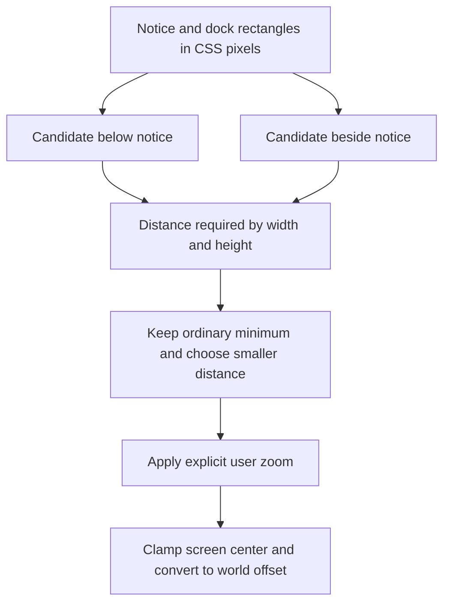

# 07 - Algorithms and data structures

[Previous](../06-input-and-interaction/README.md) | [Book index](../../README.md) | [Next](../08-design-principles/README.md)

This chapter collects the algorithms the earlier chapters use. Costs below
describe application-level work, not an unmeasured browser-engine guarantee.

## 7.1 Content addressing and bounded validation

For a ROM with `n` bytes, content hashing reads `O(n)` input and the current
implementation materializes an `O(n)` byte array. A fixed-length digest becomes
the record key. File-size checks happen before that allocation. The fixed
header check is `O(1)`; it is not comprehensive ROM validation.

Backup decoding first bounds the JSON file, then the encoded strings and
decoded arrays. The Base64 work and checksums are linear in save size.
Chunking the encoder into 8192-byte pieces bounds the argument list passed to
`String.fromCharCode`; it does not make the entire backup streaming or
constant-memory.

`latestSlot()` builds a candidate array, removes empty entries, sorts descending
ISO timestamps and selects the first. With `k` candidates, sorting is
`O(k log k)`, but this application has only four candidates: automatic and
three manual. A more complex priority queue would not improve this actual
bounded use case. Equal timestamps do not mean "prefer a manual slot."

## 7.2 Maps and sets encode ownership

| Structure | Key or element | Invariant |
|---|---|---|
| Game record | SHA-256 ROM ID | Filename changes do not change identity |
| Held-key Map | Physical code to action | Release uses the action actually pressed |
| Held-input Map | Action to source Set | Native pressed means at least one source remains |
| Assigned-key Set | Physical code | No two configured actions share a key |
| Pending command mapping | Request identity | A response belongs to its current request/session |

These are not interchangeable collections. The held-source set models
concurrent ownership; the assigned-key set enforces uniqueness at validation.
Map/Set operations provide typical efficient lookup, while control-table
searches scan only the fixed ten controls.

## 7.3 Perspective fitting with UI exclusions

Let `t = tan(verticalFov / 2)`, viewport height be `H` CSS pixels and camera
distance be `d` world units. The vertical scale is approximately:

```text
pixelsPerUnit = H / (2 * t * d)
requiredDistanceForWidth  = envelopeWidth  * H / (2 * t * availableWidth)
requiredDistanceForHeight = envelopeHeight * H / (2 * t * availableHeight)
```

Widths and heights of the envelope are world-space design bounds. Available
region dimensions are CSS pixels. Confusing these units is a reliable way to
produce a fit that works on only one viewport.



*Figure 07-01. A two-candidate optimization, not a general packing solver.
Default fitting and deliberate zoom have different contracts.*

The scene compares the below and beside candidates, includes its ordinary
minimum distance and selects the smaller fitted distance. Fewer world units
away means a larger useful console. It reserves dock/hint space and observes
notice-host size changes rather than reading layout every frame.

The original below-only fix shrank the console too far in short landscape.
The next version accidentally applied an unzoomed minimum after the gesture,
canceling explicit pinch zoom. The correction fits the baseline first and
then multiplies by `this.zoom`. Default framing stays clear; deliberate
inspection zoom can still crop. Thus "fully visible at default zoom" does
not become "users can never zoom in."

Screen Y grows downward; world Y grows upward. Moving the camera/look target
requires the correct sign to move the projected console into the safe region.
Actual projected geometry caught the initial sign error.

## 7.4 Linear-light sampling and time-based convergence

A 24 by 16 sample has 384 pixels. A 256-entry lookup table converts channel
values to linear light; three sums yield mean red, green and blue. Work is
`O(384)` per sample and constant relative to the native framebuffer size.
Live resampling is limited to 125 ms intervals.

The convergence factor is `1 - exp(-18 * deltaSeconds)`. Unlike a fixed
"move ten percent per frame" rule, it uses elapsed time, so refresh rate does
not directly set the adaptation speed. A settling threshold ends imperceptible
drift. This is smoothing, not recovery of missing native frames.

## 7.5 Smooth transitions and a sliced wordmark

The cubic easing curve `f*f*(3 - 2*f)` has zero slope at both endpoints.
It interpolates insertion position and view transitions without abrupt
start/stop velocity. Quaternion interpolation handles orientation.

The startup wave divides the wordmark into narrow source columns, offsets
each vertically by a sine and draws them to a higher-resolution canvas.
It deforms the supplied lettering instead of replacing it with a font.
Reduced-motion mode uses a settled unsliced presentation.

**Exercise.** A safe region is half as wide but equally tall. Which fit term
changes, and why is fitting only the console center insufficient?

**Answer.** The width-required distance doubles before other constraints are
considered. A center inside the region says nothing about the envelope edges;
fit size first, then clamp the center with half-envelope margins.

## 7.6 Alpha contours and nested engraved surfaces

The later [rear-logo delta](../../SOURCES.md#later-rear-logo-delta) reuses the
A/B marching-contour mechanism. Scan adjacent alpha samples, interpolate
threshold crossings and connect grid edges through a map. Every recovered
vertex must have two neighbors; an invalid loop reports an explicit error.
Keep A/B's threshold128and original coordinate projection; the rear mask
instead uses16to include colored orbital strokes, with separate physical sizing.

Sort rear contours by absolute area. Bounding boxes reject impossible parents;
a point-in-polygon crossing test identifies the smallest enclosing prior loop.
Even nesting depths belong to colored cavities; odd depths are plastic islands.
Attach each child as a hole in its parent, then triangulate both alternating
surface sets. Normalize winding so the shallow wall normals face the cavities.

**Worked example.** An opaque ring has an outer contour at depth0and a transparent
counter at depth1. Cut the outer loop out of the cover, but restore the counter
as plastic. An additional colored island at depth2cuts only that counter.
Painting a rectangle or treating every loop as a hole would lose this topology.

Raster scanning and loop traversal cost O(W*H+V), with O(V) contour storage.
Ordering C contours uses area-based comparisons; naive containment can cost O(C*V) in the
worst case before triangulation. This happens once during model construction,
not per frame. The mask only defines geometry: UVs sample the unchanged full
color texture, keeping color preservation separate from cavity construction.

**Source trail:** [S-02, S-03, S-05, S-06, S-07, S-08 and S-09](../../SOURCES.md).
