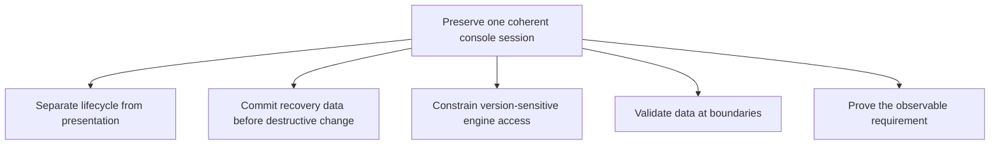

# 08 - Design principles and trade-offs

[Previous](../07-algorithms-and-data-structures/README.md) | [Book index](../../README.md) | [Next](../09-testing-and-delivery/README.md)

Principles are useful here only when tied to an actual failure or ownership
decision. This is not a catalogue of patterns applied retroactively by name.

*Figure 08-01. Each principle serves session coherence. None independently
establishes security, permanence or deployment.*

## Single ownership reduces conflicting behavior

The host owns progress, keyboard mapping and cartridge lifecycle. The adapter
owns native integration. The scene owns geometry and lighting. Managed native
settings prevent an upstream menu from independently re-enabling a second
save system or virtual gamepad.

The trade-off is more explicit integration code. There is no generic message
bus framework or server layer merely to express these boundaries. Small
modules and checked commands are enough for one active cartridge.

## An adapter contains change; it does not eliminate dependency risk

Pinned native internals include state capture, filesystem access, setting
changes, VSync and retained framebuffer behavior. Concentrating them in
`player.js` and the audio adapter makes upgrades reviewable. It does not make
an internal upstream API stable or certify the CDN's bytes.

The iframe allows complete teardown when a cartridge changes. Because it is
same-origin, it is not protection against the runtime reading that origin's
storage. Confusing lifecycle containment with hostile-code isolation would
misstate the design.

## Fail before discarding the escape route

ROM validation precedes replacement. Storage commit precedes power teardown.
Backup validation precedes restore. A failed operation retains an explicit
error rather than silently using an empty record and announcing success.

This ordering is a practical recovery principle, not a claim that the entire
UI is one ACID transaction. Native execution, IndexedDB and DOM state span
different systems. The implementation uses bounded operations and honest
failure states instead of promising global atomicity it does not possess.

## Presentation should not mutate simulation

Lighting, pickup, inspection and fullscreen change how the machine is seen.
They do not require a second core, a ROM reload or a save-state round trip.
The shared native picture and shared bezel derivative avoid divergent versions
of the same screen.

The intentional exception is power: it is a lifecycle operation, not a visual
toggle. Preserving that exception is more important than forcing every button
through one simplistic "show/hide" abstraction.

## Correctness follows the named quantity

A lit cap is not proof of native input. An enabled speed flag is not measured
acceleration. A bounding box is not visible shell geometry. A matching public
hash is not human approval. Tests become stronger when they measure the
requested boundary rather than a convenient proxy.

The notice revision is a useful counterexample to over-constraining a system.
Its first safe-fit minimum protected default clearance but destroyed explicit
pinch behavior. The final principle is narrower: preserve default fit and
honor deliberate user zoom. More constraints are not automatically more correct.

**Exercise.** Should a save-store read failure return an empty game record so
the player can proceed without seeing an error?

**Answer.** Not as an unannounced substitute. It would make existing progress
look absent and could mislead later writes. Report storage failure and explain
session-only/export recovery. Any continued play must not claim persistence.

**Source trail:** [S-01 through S-04, S-06 and S-11](../../SOURCES.md).
