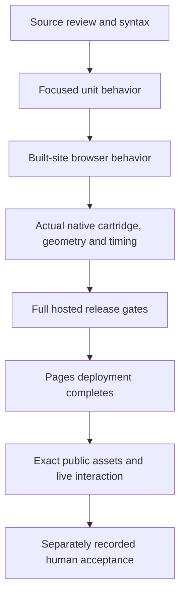

# 09 - Testing and delivery

[Previous](../08-design-principles/README.md) | [Book index](../../README.md) | [Next](../10-documentation-and-development/README.md)

## Build a ladder of evidence

*Figure 09-01. Later layers answer different questions. A lower-layer PASS
cannot be relabeled as deployment or user approval.*

The unit suite covers pure validation, backup, preferences and related
application logic. Browser tests load the built site under the actual project
prefix. Native cases run the original Pixel Lab cartridge through real
EmulatorJS/mGBA; a shell screenshot alone would not prove native gameplay.

The full workflow has 11 unit cases and 39 browser cases across three
13-case shards at this source revision. These counts describe the actual
edition, not a minimum that future tests must artificially preserve.

## Prefer a measurement over a flag

The speed regression uses the original cartridge's clock and wall time.
The VSync fix reconciles the native loop rather than merely changing an icon.
A hosted 2x sample later reported 4.5609x, above its unchanged 2.6x bound.
That observation is recorded without inventing a root cause or raising the
bound until the gate passes.

The notice regression measures actual visible handheld geometry, a separate
44px power target, dock clearance, computed glass styling and ordinary-fit
restoration. It includes five viewport shapes, a real invalid-file error and
an explicitly synthetic long-text fixture. Synthetic text proves wrapping and
bounded scrolling, not that a real native error produced that wording.

The later workstream 33 audio investigation shows a similar coverage gap.
Surviving one startup stall did not prove sustained buffering: actual private
playback exposed repeated roughly 100 ms underrun/restart gaps as the startup
cushion drained. The correction increases native buffer capacity, not speaker
volume or game speed. Its regression checks real allocated PCM budget as
well as the requested setting, and extended playback measures scheduling gaps.
Keep that later evidence separate from this book's pinned source edition.
Neither PCM measurements nor a green test establish human hearing quality on
every audio device; a larger reserve also trades additional audio latency.

The first public follow-up also catches a measurement mistake: allocated native
slots receive PCM lazily, so summing populated buffers can understate capacity
even after a bounded wait. Check the actual slot count and uniform positive
block size instead. The unchanged capacity bound still rejects the old source.
Distinguish reserved capacity, currently populated data and scheduled playback
headroom; those are three different quantities.

Workstream 44 later reproduces starvation even with the larger allocation.
An audio-only recording analysis and actual private playback lead to a clock
comparison, not another capacity increase. Removing repeated recovery pre-roll
worsens starvation; native VSync-off instead maintains 161-206 ms of live queued
sound in a 90s control. Default to existing native audio synchronization while
retaining explicit VSync choices. A new original-ROM regression measures real
scheduled gaps, steady-state hitch tolerance and the SRAM cartridge clock.
Four audio cases no longer need framebuffer screenshots for readiness. This
extends the earlier evidence rather than retroactively erasing its limits.
The added case makes the later suite 40 cases. Its first hosted run encounters
multi-second software-GPU draws rather than the intended bounded 40ms hitch.
Isolate graphics cost as the existing native clock regression does, retaining
all audio bounds; the old clock still fails measured reserve. Full-view private
playback remains separate evidence rather than claiming this isolated fixture
qualifies an arbitrarily slow renderer.
Fresh normal `42008857811` then passes all40cases and deployment. All28public
assets match; four actual public audio cases pass45.2s with >=189.9ms steady
reserve, a40ms hitch leaving154.2ms, zero gaps and a60.05fps SRAM clock.
Keep that public qualification distinct from the private full-view180s run.

Workstream 34 deliberately reverses an earlier product requirement: the user
now permits notices to overlap the handheld. Replace notice-separation checks
with ordinary camera-position/look-target invariants, while retaining viewport
fit, toolbar clearance, glass styling and dismissal checks. An intentional
behavior change should update its specific contract, not weaken unrelated gates.
The first hosted run then exposes a directly dependent user flow: the permitted
power-on notice intercepts a real shoulder-button click. Dismiss it through its
real close button before exercising every native input; retain the assertions
and avoid forced clicks. The fresh normal workflow and both actual public
overlay/input cases pass. A changed visual contract can require an explicit
interaction step without justifying weaker functional coverage.

## Let failure teach the requirement

The initial camera shift had the wrong vertical sign. Clearance tests caught
it. A below-only solution then passed geometry checks but made short-landscape
play unnecessarily tiny; actual visual review caught the usability trade-off.

Explicit SwiftShader later exposed a stale camera read immediately after a
notice moved into the drawer. The corrected test polls the unchanged ordinary
camera formula instead of blessing the sampled stale value. Timeouts and
clearance requirements were not loosened.

The first hosted notification run passed 37 of 39 cases and blocked deployment.
It found a genuine pinch regression as well as the separate speed outlier.
Applying zoom after baseline fitting repaired the actual interaction.
A fresh normal run then passed all 39 cases. This causal sequence belongs in
the ledger; replacing it with "all tests pass" would erase useful engineering
knowledge.

## Deployment is another boundary

At book authoring, corrected run `41875740589` has successful build and browser
jobs but a queued deployment. There are no deployment steps establishing a
published result. An empty pending-approval list does not identify a queue
cause. The public asset receipt still identifies the older application.

That observation is historical. Before finalizing the edition, the same healthy
run completes successfully; all 28 public assets match and five real public
native/notice/pinch/fullscreen/save/input cases pass in 2.0m. Desktop/phone
public notice captures are reviewed. Waiting and verifying closes the release
boundary; it does not change the earlier local recordings' capture origin.

The repository's recovery policy is to start a fresh normal workflow after a
failed run, never retry the failed attempt. A healthy queued deployment is not
itself a failure and does not justify duplicate dispatches, dummy commits or
weaker gates.

After deployment, independently compare the complete public payload with the
intended build and exercise the actual public application. Do not infer release
identity from a successful job title alone. Documentation-only changes can be
checked as published repository blobs without claiming the app redeployed.

**Exercise.** The corrected workflow's tests pass while deployment is queued.
Can the README describe local footage as a capture from the new public release?

**Answer.** No. Label it an actual-build local preview and retain its capture
origin. Later byte matching can qualify the deployed source, but it does not
retroactively change where the recording was made.

**Source trail:** [S-11 and S-12](../../SOURCES.md);
[current verification evidence](../../../docs/VERIFICATION.md).
