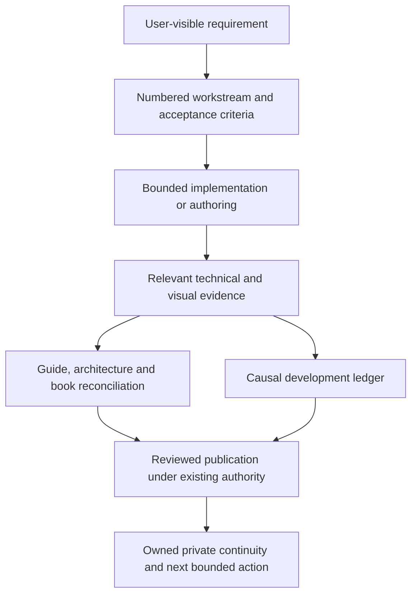
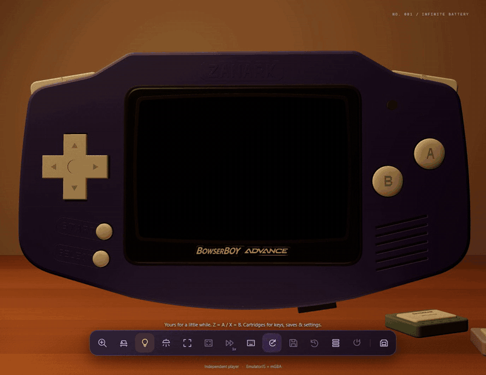

# 10 - Visual documentation and the development loop

[Previous](../09-testing-and-delivery/README.md) | [Book index](../../README.md)

## Documents serve different readers

The README is a visual invitation. The guide teaches actions. Architecture
explains ownership and contracts. This book teaches the mechanisms in sequence.
The ledger explains why changes happened. TODO files define bounded work and
completion criteria. Private continuity helps the next session resume; it is
not public product documentation.

*Figure 10-01. A complete development loop records both the result and the
reason. Publication remains an explicit boundary.*

## Capture an action, not an invented demonstration

`capture-readme.mjs` drives actual browser controls, records a WebM and writes
timed clip boundaries. It uses the original Pixel Lab demo. Pickup, inspection,
startup, cartridge insertion and light changes are actual application states,
not frames assembled to imply an interaction that never occurred.

The encoder uses those boundaries to create bounded GIFs at 10 fps and
800-pixel width. That is a repository-media trade-off, not the app's native
render rate. The transparent orbital banner has a separate generator; refreshing
interaction clips need not alter its approved alpha, composition or spacing.

The capture origin matters. A `BBA_CAPTURE_URL` override can record a local
build while production is queued. Such footage can document implemented
behavior, provided the caption and receipt do not call it a public capture.
Its source identity, actual URL, timing receipt and page errors belong in
Media. The book never turns a local receipt into production evidence.

The later BowserBOY refresh records those same interactions on the actual
public site. The capture checkout is a documentation revision; independently
matching the public application's assets to qualified `f5bc639` is what binds
the footage to deployed source. Current `readme-*` stills can replace the
visual front page without overwriting pinned first-edition geometry figures.
The chrome website logo and purple console logo are separate supplied assets,
not two color variants of one interchangeable global brand.

*Figure 10-02. Actual startup motion from the documentation-refresh recording.
See the current capture origin and edition in Media; this is not a BIOS movie
or a rendered mockup.*

## Review efficiently, but review the right thing

A GIF's first frame may identify its subject, yet a claim about a transition
requires seeing the relevant motion. A labeled first/middle/end contact sheet
helps find clipping and composition changes without repeatedly decoding every
frame. Additional samples should answer a concrete uncertainty, such as whether
the back or lights-off state is actually visible.

Hashes establish byte identity. They do not establish that orbit stars are
uncropped, button relief looks manufactured or a notification is readable.
Likewise, a correct diagram parser does not establish a readable chapter.

## Workstreams and causal history

Each numbered `.todo` keeps Status, Milestone, Dependencies, Purpose, Tasks,
Acceptance criteria, Completion evidence and Completion log. The index is
navigation, not a substitute for those fields. Actual prerequisites are listed;
file order does not create a dependency.

A useful ledger entry preserves the request, attempted approach, observed
failure, correction, reason, evidence and remaining boundary. In this project,
the notice sign error, landscape shrinkage, stale observer read and pinch
regression are distinct lessons. They should not collapse into one vague
"layout fixed" entry.

The first book's creation also corrects a documentation gap: earlier guides
and journals existed, but numbered teaching chapters did not. The earlier
incomplete-book note remains valid history. This edition explicitly supersedes
that present-state claim; it does not pretend a book existed all along.

**Exercise.** A workstream's code is committed and all browser cases pass, but
its acceptance criteria include independent public verification. Is it DONE?

**Answer.** Not yet. Record completed implementation and qualification
separately, retain the release criterion as pending and preserve the exact next
action. Publication queue time is not a reason to fabricate completion.

**Source trail:** [S-13](../../SOURCES.md);
[Media](../../../docs/MEDIA.md),
[TODO index](../../../TODO/00_INDEX.todo) and
[development ledger](../../../TODO/04_DEVELOPMENT_LEDGER.todo).
