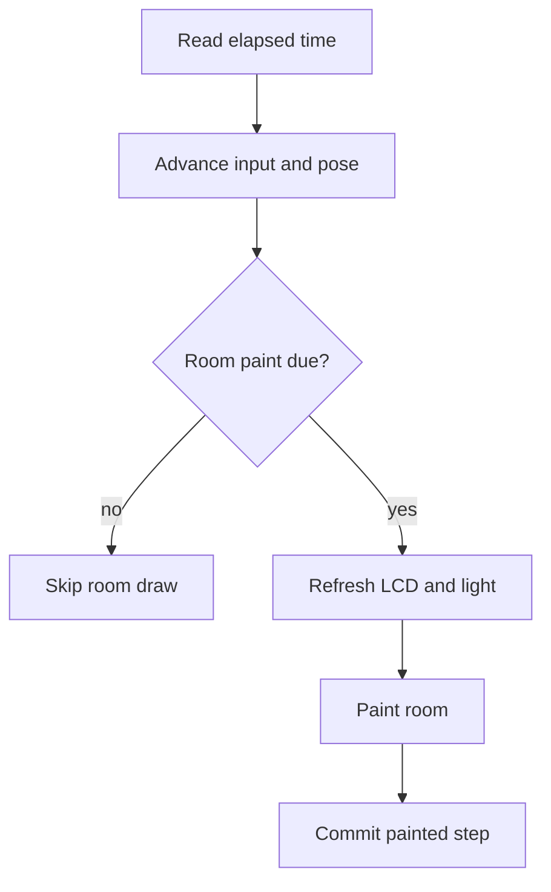

# 11 - Sharpness without confusing the clocks

## The question: can a slower desk still run a correct game?

The current scene preserves `min(devicePixelRatio, 2)`. It responds to expensive
GPU work by changing paint cadence, not secretly reducing resolution. This is
an important distinction: visual detail, simulation rate, input response and
wall-clock deadlines are different quantities.

This chapter extends Chapters 05 and 07 with the actual current scheduling
mechanism in `Scene.render`. Its explanation is source-backed; it is not a
new benchmark or a claim that the latest hosted timing failure has been solved.

*Figure 11-01. Skipping a room draw is not a command to pause the native
machine. Visible insertion progress has a paint-commit rule of its own.*

## Three clocks and one visible claim

Wall time measures deadlines. The native runtime advances emulation according
to its own scheduling and synchronization. Scene callbacks update physical
feedback and decide whether to paint. Calling all three "frame rate" makes a
diagnosis ambiguous.

The scene can skip the tabletop while screen fullscreen is active. It also
avoids room paints while native work is marked busy or a modal dialog is open.
After a slow rendered interval, its recovery decision can defer another draw.
The current code selects a larger recovery bound for settled play than for
transitions or cartridge motion. These are presentation policies, not a
license to stop accepting releases or falsify native speed.

Button compression uses elapsed-time damping before the paint-due return.
The physical pose can therefore keep approaching its bounded pressed state
even when the expensive room draw is skipped. This is why a visual-feedback
test must distinguish state evolution from the instant pixels were presented.
An independent native-input test is still required.

## Why insertion cannot simply jump to elapsed wall time

The cartridge animation is intentionally visible. If a browser stalls for
several seconds and its next callback immediately marks insertion complete,
the user may never see meaningful insertion motion. The current scheduler
computes an eligible step only when a paint is due, caps that step at 500 ms
and commits motion timing after an actual draw. The early camera motion
shares that clock.

This protects a visible sequence, but creates an engineering trade-off:
several actual paints are necessary to complete it. A wall-clock test that
waits fifteen seconds still expects seating within those fifteen seconds.
The code's mechanism explains why a paint schedule is relevant; it does not
by itself establish why a specific hosted run missed that deadline.

The latest recorded hosted failure is exactly that unresolved boundary.
Do not announce a root cause from a plausible reading of a condition.
Measure draw opportunities, committed insertion steps and dataset transitions
on the failing path before changing the implementation.

## CH11-W01 - Compute a visible step budget

Use a synthetic clock with insertion delay 850 ms and motion duration 1350 ms.
The total accumulated animation time needed is 2200 ms. If every eligible
draw contributes the maximum 500 ms, at least five such steps are needed
from zero. That is a lower bound under the stated assumptions, not a measured
number of callbacks on a real host.

Four maximum steps produce 2000 ms. The motion fraction is then
`(2000 - 850) / 1350`, about 0.852. Cubic easing maps that fraction to about
0.941 of the distance. The cartridge may look almost seated while its logical
completion predicate still correctly says `inserting`.

## CH11-R01 - Add a modal interval

Now place a dialog over the scene for part of the wall-clock observation.
A paint-free interval cannot be counted as visible insertion progress under
this rule. The changed condition alters the available committed steps, not
the emulated cartridge's CPU speed. A useful diagnostic records dialog state,
paint eligibility and accumulated motion time separately.

If the acceptance criterion requires insertion to finish while a modal is
open, that is a product-contract decision with consequences for visible
animation. Do not quietly reinterpret the existing criterion after a failure.

## CH11-Q01 - Pick the honest optimization

A software GPU is slow. Which proposed shortcut preserves this project's
current contract: halve pixel ratio, increase every deadline, or investigate
bounded scheduling while retaining resolution and assertions?

## CH11-A01 - Preserve the measured requirement

Investigate scheduling. Halving pixel ratio changes sharpness; larger
deadlines change what the suite accepts. Neither proves the named behavior
works as required. A scheduling change is not automatically correct either:
it must preserve native progress, responsiveness, visible motion and the
unchanged timing bound. The failed source remains unqualified until those
observations pass.

## What you can now diagnose

When a game sounds steady but the console moves in visible jumps, you can
ask separately about native reserve, room draws and presentation timing.
When insertion looks almost complete but the dataset is still `inserting`,
you can inspect the completion predicate instead of calling the test flaky
from appearance alone.

**Source:** current `src/scene.js`, especially `render` and
`insertCartridge`; historical performance contracts in `docs/ARCHITECTURE.md`;
exact current failure in `docs/VERIFICATION.md`. The edition's claim register
binds these paths to source and evidence epochs.
