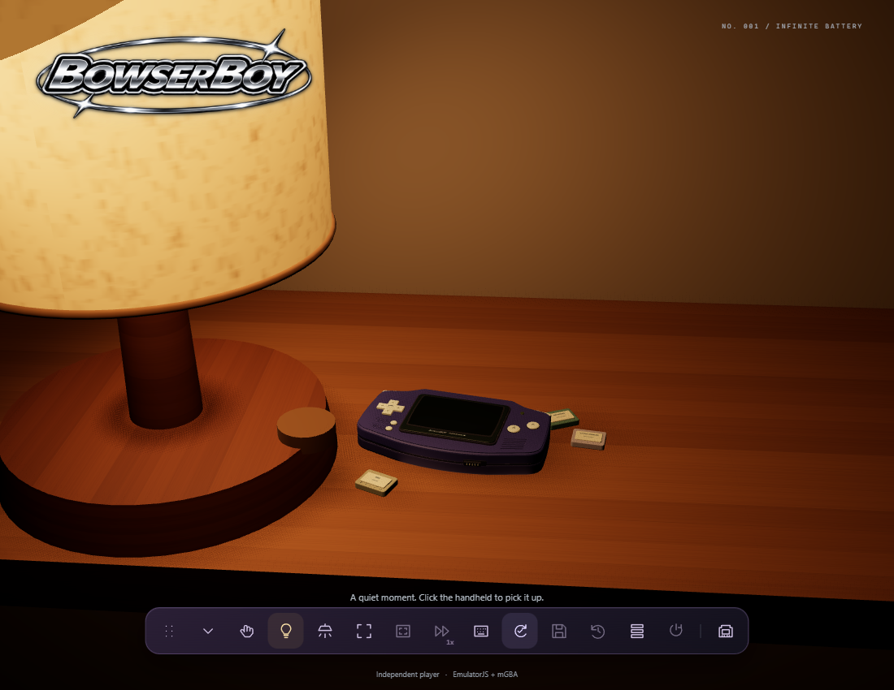
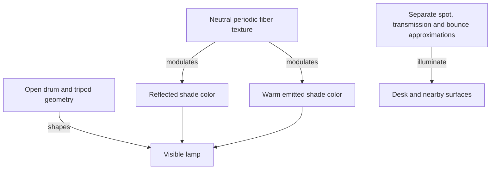

# 12 - Warm fabric, clean light and a genuinely green indicator

## The question: why can the correct material still look wrong?

A white shade can appear dirty if low-frequency brown variation is painted
into its texture. A finely woven material can disappear if its luminous term
is uniform and dominates reflected light. A green indicator can turn nearly
white when dark adaptation raises exposure. These are different failures
at different stages of the image pipeline.

The current lamp is an independently modeled STORSEGEL-style white drum shade
and ash tripod, with hidden wiring. That is a visual approximation in the
project, not an IKEA asset, product endorsement or calibrated digital twin.

*Figure 12-01. Current README still from the final November 6 capture edition.
The local capture origin is retained in Media; later public byte matching
qualifies application `1b0385b`, not every future source.*

## Separate shape, material and emitted energy

The open cylinder gives the shade its actual silhouette. Procedural warp and
weft create a fine neutral intensity pattern, not large brown stains.
The same texture modulates both the material map and emissive map. That second
connection matters: when the shade glows, the luminous term still carries
the weave instead of washing it into a solid bright cylinder.

Warmth comes from the chosen emission and light colors. A cream emission is
not a reason to tint the clean underlying fabric with irregular grime.
Geometry and material construction use a meters-per-unit conversion so the
lamp's proportions remain coherent with the handheld and table.

*Figure 12-02. Texture detail belongs to both shade terms. Actual room
illumination uses separate light approximations; an emissive material alone
is not a complete global-illumination solution.*

## A seam can be a placement problem

An area emitter crossing the shade can create a hard lighting seam. Making
the entire scene dimmer hides the symptom but changes unrelated surfaces.
The implemented correction places the transmitted-light plane outside the
fabric. A separate downward area source reveals the tripod through the open
bottom, and a finite upward patch approximates the first warm table bounce.

These are deliberate real-time approximations. They do not model every fiber's
transmission, spectral scattering or multiple bounce. Their usefulness is
judged against the visible requirement and independent light controls.
The lamp, room illumination and content-driven LCD remain separately
switchable; an LCD-only capture must not secretly add fill lighting.

## Exposure is a system-wide multiplier

The scene adapts between bright-room exposure 0.018 and dark-room exposure
0.45. That is a factor of twenty-five. Leaving a highly emissive indicator
unchanged under this increase can push it into a bright, desaturated result.
A source color labeled green is not proof of green pixels after tone mapping.

The current correction compensates only the lit indicator's emission:
`80 * 0.018 / currentExposure`. It preserves the established room adaptation
instead of changing every surface to rescue one small emitter. The indicator
also has a smaller physical size. Geometry, emission and final pixel color
are therefore separate checks.

## CH12-W01 - Preserve an emitter through adaptation

At exposure 0.018, the compensated emission is 80. At exposure 0.45 it is
3.2. In both cases the simple product is 1.44. This calculation explains
the intended compensation; it is not a complete tone-mapping derivation.
Reflected light, color management, material response and nonlinear display
mapping still require actual rendered inspection.

## CH12-R01 - Put the texture on only one term

Keep the weave on the reflected map but remove it from the emissive map.
As luminous contribution dominates, the shade increasingly looks smooth.
Adding dirtier contrast to the reflected map treats the wrong term. Restore
the detail on the emitted contribution and inspect at the actual warm exposure.

## CH12-Q01 - What proves LCD-only reflections?

A picture shows the console in a dark room. Is that enough to prove the LCD
casts moving content-colored light on nearby surfaces?

## CH12-A01 - Observe source and response together

No. Record actual lamp and room switches off, the real LCD active, changing
native content and motion of the console. Inspect the surroundings through the
transition. A still can show one state; it cannot establish temporal response
or rule out capture-only fill. The existing final media receipt describes that
actual interaction without claiming path tracing or exhaustive frame review.

## What you can now change safely

Choose the responsible layer first. A silhouette complaint calls for geometry.
Uniform glow calls for material-term inspection. A seam calls for placement.
Bleached green calls for the full exposure path. This avoids global lighting
edits that accidentally destroy the user's approved room.

**Source:** current `src/lighting.js:createDeskLamp`,
`src/lighting.js:ScreenIllumination`, `src/scene.js:render` and the final
capture receipt in `docs/MEDIA.md`. No new media capture is claimed here.
