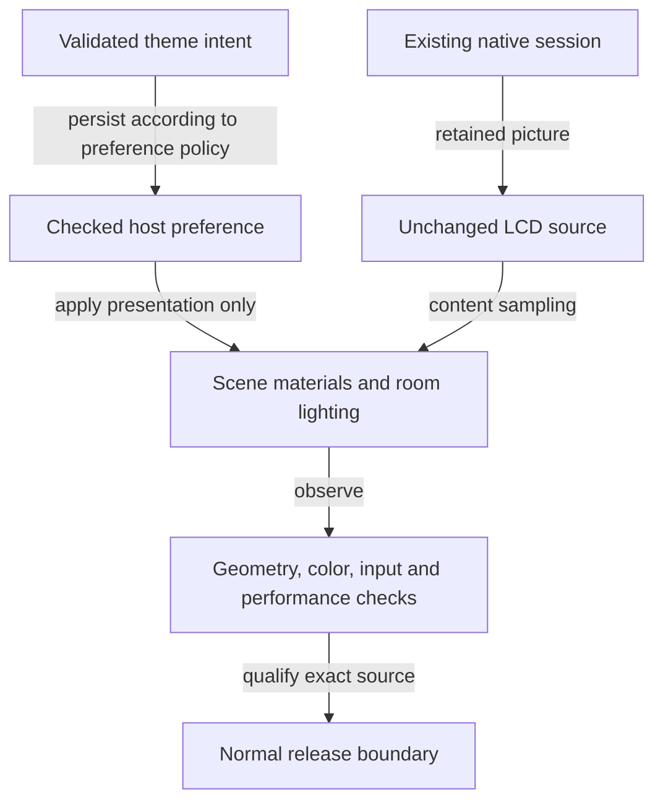

# 14 - Capstone: change one appliance without losing its promises

## A deliberately hypothetical assignment

Design a change that adds a second presentation theme to the same GBA console.
The new theme changes desk materials and lighting, not native execution,
cartridge identity, save format, power semantics or input mapping. It must
retain full-resolution rendering and an honest release gate.

This is a design exercise, not an implemented feature or a promise to add
another console. In particular, "another theme" does not establish support
for Nintendo DS or any additional emulation core.

## Locate the boundaries before writing code

Begin with a state table. Which values are persistent user preferences?
Which belong to the scene? Which native settings must remain unchanged?
Decide how an old preference record without a theme field is interpreted
without changing unrelated defaults. Decide how an invalid theme value is
reported or validated through the project's existing preference conventions.

Next draw the change path. A theme selection should update materials and
light configuration without tearing down the native child. The retained
framebuffer remains the LCD source. Existing input ownership survives or is
explicitly released according to current view-transition rules; it cannot
be stranded because a modal swallowed keyup.

*Figure 14-01. The proposed theme is intentionally outside native lifecycle
ownership. This diagram is a design exercise, not an executed code path.*

## CH14-W01 - An acceptance table that can fail

Write four explicit claims. First, changing theme does not restart the game:
observe native progress and session identity across the selection. Second,
the same save remains associated with the same ROM digest: round-trip a
checkpoint without changing its compatibility identity. Third, lamp, room
and LCD controls remain independent: inspect their actual state and rendered
response. Fourth, the scene retains the pixel-ratio contract: measure the
renderer, not only the CSS canvas size.

Add a failure case to each claim. A new iframe would violate the first.
Using a theme-qualified ROM ID would violate the second. An unconditional
ambient fill could violate LCD-only darkness. A hidden dynamic-resolution
shortcut could violate the fourth. Acceptance becomes useful when the
rejected implementation is concrete.

## CH14-R01 - Change theme during an unsuccessful save

Now the user requests theme change while a required save is failing. Should
the theme handler also own recovery and destroy the old child? No. Respect
existing serialization and error handling, and leave the runtime recovery
route intact. If theme changes are allowed during native work, document the
presentation ordering; if not, use the established disabled/queued behavior.
Do not invent a second lifecycle coordinator for a cosmetic feature.

The changed condition tests ownership under failure, not just normal visual
appearance. A polished screenshot alone cannot establish that the ordering
is safe.

## CH14-Q01 - Produce a defensible delivery plan

Submit a short design with five parts: state ownership, one normal/failure
diagram, source boundaries, focused regressions and release/evidence steps.
Include a media-update decision and a rollback story. What would a sound
answer have to defend?

## CH14-A01 - An explained assessment rubric

A strong answer keeps one native session, one content-addressed save identity
and the established power/checkpoint distinction. It uses the existing checked
preference and scene boundaries rather than a parallel settings system.
Its failure path reports persistence errors without inventing success.

Its tests measure actual quantities: native progress/session retention, save
identity, aggregate input release, independent lights, final pixels and
unchanged render resolution. It does not replace these with object names or
a theme flag. It states which environments were actually exercised.

Its delivery plan selects the exact implementation SHA, preserves all normal
gates and independently verifies deployment if required. New media containing
the theme is actually recaptured and labeled by origin. Old frozen editions
and approved unchanged assets are preserved. Private notes do not enter the
public allowlist.

Reasonable designs may apply the theme immediately or after an established
transition, but must justify ordering and failure behavior. A design that
reloads the ROM, silently discards a save error, lowers resolution or calls a
local preview publicly deployed fails the core constraints regardless of
its appearance.

## Final synthesis

The important skill is tracing a user-visible promise to its owner, state
transition, failure window and observable evidence. A browser console is a
particularly compact laboratory because those boundaries meet in one object:
a button, a pixel, a save, a light and a release all look simple until their
clocks or meanings diverge.

You can now ask not just whether a feature exists, but whether these exact
bytes deliver that exact behavior under the stated conditions. That question
is the bridge between an attractive demo and a maintainable appliance.
