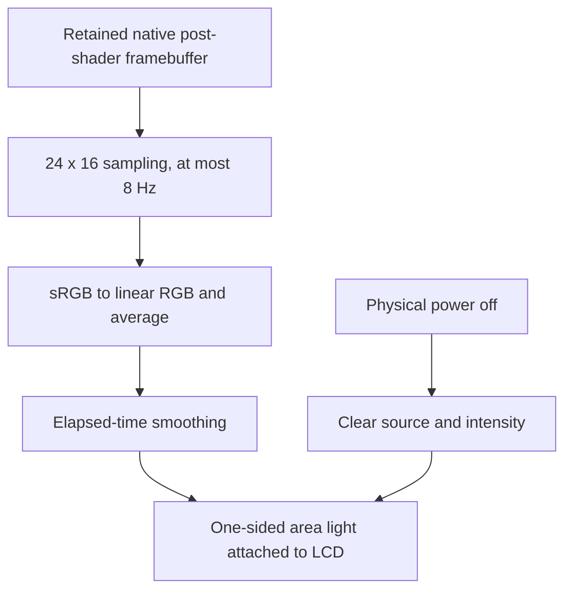

# Architecture

## One static site, one active cartridge

The application is vanilla HTML, CSS and JavaScript modules, with pinned
Three.js 0.186.1 for real-time 3D graphics. There is no
application backend or UI framework. Node is used for serving,
allowlisted static packaging, the original test ROM generator and tests.

The runtime boundary is:

```text
Local .gba File
      |
      v
Header/size validation -> SHA-256 game identity
      |
      v
Host UI + checked IndexedDB checkpoint store
      |
      v
Same-origin player iframe + message session ID
      |
      v
Pinned EmulatorJS 4.2.3 -> single-threaded mGBA WebAssembly
      |
      v
Native CRT Geom -> retained core WebGL canvas
      |
      v
Three.js CanvasTexture -> LCD mesh in the tabletop scene
```

`src/app.js` owns UI state and serializes user actions. File validation happens
before the running cartridge is replaced. Switching cartridges checkpoints the
old game if auto-save is enabled; otherwise it asks before discarding progress.
A new iframe removes the previous emulator's globals, listeners and DOM.

The file is structured-cloned to `player.html`. Only that child creates a
temporary ROM blob URL; the URL is revoked after loading. Both sides check
message origin, source window and session identity. Commands have timeouts;
late messages cannot resolve a different cartridge's requests.

**This is lifecycle isolation, not a security sandbox.** The third-party
emulator script runs with the website's origin privileges. The application does
not send ROM bytes to a backend, but loading CDN code remains a trust boundary.
The CDN receives ordinary request/network metadata. A future self-hosted runtime
would reduce that dependency and needs a deliberate license/provenance review.

## Pinned compatibility adapter

All version-sensitive engine access is in `src/player.js`. The runtime URL is
`https://cdn.emulatorjs.org/4.2.3/data/`; this pins the release path, not the
CDN operator's bytes with an integrity guarantee. GBA uses the `mgba` core and
the `gba` control scheme. Threads are explicitly off.

The documented loader globals configure ROM/name, controls, buttons, readiness
and start callbacks. The pinned source also supplies the internal operations
used by the adapter:

- `gameManager.getState()` and `getSaveFile()` capture a copied binary state
  and flushed cartridge save, respectively.
- `gameManager.FS`, `getSaveFilePath()`, `mkdir()` and `loadSaveFiles()` restore
  the cartridge save, then `loadState()` restores the instant checkpoint.
- A battery-only boot loads that cartridge save into a fresh runtime and calls
  `gameManager.restart()` to start the ROM with it; it never calls `loadState()`.
- `togglePlaying()`, `play()` and `pause()` preserve pause behavior.
- `simulateInput(0, button, value)` receives the shell's physical and keyboard
  input. Native virtual controls are disabled on all devices.
- `volume` and `setVolume()` apply sound preferences both to new playback and
  the current OpenAL sources. Runtime settings persistence remains disabled.
- A wrapped `startGameError()` reports startup failures to the host.

The adapter allows two animation frames after restoring before acknowledging
the operation. Browser animation frames are not proof that the emulated game
has finished displaying a state, especially with software graphics.
Restore/import therefore copy the exact validated source checkpoint into the
newest automatic slot instead of immediately recapturing a potentially stale
core state. Normal periodic captures continue afterward. When restoring while
paused the adapter temporarily runs the core and restores pause.
The upstream child `beforeunload` handler is suppressed: it otherwise resets
the core even when navigation is cancelled. Only the host prompts for leaving.
That reset also caused a real reload regression by contaminating the final
checkpoint; the browser suite covers restoration across navigation.

EmulatorJS expects all four controller-map objects, even for one-player GBA.
Omitting the unused player maps throws during construction. These assumptions
are version-specific: do not upgrade the URL without running the live-core tests.

Current online options describe `EJS_onSaveUpdate` and
`EJS_fixedSaveInterval`, but the 4.2.3 loader does not wire them. The application
therefore owns its timer and checked checkpoint persistence.

## Actual 3D handheld and native CRT screen

`src/handheld.js` constructs original beveled front/rear shells, a volumetric
bezel, buttons, speaker, ports, battery cover and screws. Lettering, the wood
grain and decorative cartridge labels are locally drawn canvas textures, not
reference photographs, commercial artwork or copied manufacturer logos.
`src/scene.js` owns the WebGL 2 renderer, lights/shadows, raycast picking and
animated table/play/inspection poses. Inspection supports dragging, touch
rotation/pinch, wheel zoom and keyboard rotation/reset. Reduced motion skips
the tween; unavailable/lost graphics contexts are reported explicitly.

The LCD is a front-facing plane on that model, textured directly from the
same-origin emulator canvas. It is not a CSS-transformed iframe, screenshot
loop or simulated game image. The source iframe normally has a nonzero 720x480
layout and opacity zero; it remains active behind the scene. The parent canvas
owns keyboard focus. Replacing a cartridge disposes its old screen texture
before removing the iframe.

Native CRT Geom is `crt-geom.glslp` in the pinned distribution's `shaders.js`.
`EJS_defaultOptions.shader` selects it at startup; validated preferences can
switch to `disabled` through `changeSettingOption`. Missing shader resources
fail explicitly rather than quietly substituting another CRT effect.
The core canvas normally uses `preserveDrawingBuffer: false`; an actual probe
produced all-black texture copies despite a working on-screen core. The adapter
therefore disables native auto-start, waits for `EJS_ready`, wraps only that
canvas instance's `getContext` to retain its WebGL framebuffer, then clicks the
native start control. This guarantees configuration before context creation;
it does not patch browser prototypes or the parent Three.js context.
The core can use WebGL 1 even though Three.js requires WebGL 2.

After startup the adapter marks its canvas with `data-bba-display`; the host
uses this owned DOM contract rather than reaching into engine globals.
The screen's `CanvasTexture` uploads the retained, post-shader framebuffer
each render frame, so curvature/scanlines follow the LCD around the 3D model
and are naturally occluded when its back faces the camera.

### Dark room and screen-colored illumination

`src/lighting.js` models the lamp and its light sources. The scene has no ambient,
hemisphere or hidden fill light. One scene unit represents 0.017 meters, making
the handheld roughly 144 mm wide. A warm spotlight uses inverse-square falloff,
no arbitrary distance cutoff and a 2048-square shadow map. A finite upward
6-by-6-unit rectangular patch approximates the first bounce from the wood.
The shade/diffuser use authored emission; the lamp starts on each visit and
its switch does not pause, power off or replace the cartridge.

The LCD has an attached rectangular area light matching its physical plane.
Three.js emits along local negative Z, so the light is rotated toward the LCD's
front. At most every 125 ms, a 24-by-16 CPU canvas samples the actual retained
post-shader framebuffer. Each sRGB channel is converted to linear light before
averaging; smoothed color and intensity then drive that one-sided source.
White is modeled at 120 cd/m², not calibrated against a physical GBA display.
The source follows pickup/inspection transforms and clears immediately on
power off. Static status textures are sampled once rather than every frame.



Scene exposure gradually adapts from 0.015 with the lamp on to 0.45 with it off;
the visible LCD remains unlit and is not tone-mapped. This is an authored
real-time approximation, not path tracing or full global illumination.
The spotlight casts shadows; rectangular LCD/bounce sources do **not** implement
occlusion or cast shadows. Do not interpret orientation/falloff checks as proof
that light can never leak through geometry.

Buttons use dielectric clearcoat materials. A/B move 0.045 units inward;
Start/Select move 0.025. The shared D-pad depresses and tilts, with opposing
directions cancelling tilt; shoulders move and hinge. Elapsed-time damping
drives real mesh transforms from the same input state as the actual core.

### Rendering without starving the core

Unchanged shadows are cached and idle static scenes stop painting once motion
and illumination settle. Model, lamp, power, resize and button changes invalidate
the relevant state. Modal tools suspend 3D uploads/readbacks and painting behind
their blurred backdrop, **not** the native game.

After six sustained painted frames slower than 50 ms, the renderer reduces only
its backing pixel ratio by a factor of 0.75, down to 0.5. CSS controls and native
core resolution do not change. A slow paint also leaves up to 200 ms of recovery
before the next 3D paint, giving native emulation scheduling headroom. Cheap
pose/button calculations still advance and retain dirty shadows across skipped
paints. Light damping uses elapsed time since the actual previous paint.

`player.html` hides the engine toolbar, context menu, virtual
gamepad and its separate mobile menu opener. The latter is not a child of the
gamepad wrapper, so hiding that wrapper alone leaves an unwanted LCD overlay.

Cartridges, the modeled top slot and Escape open a modal tools drawer. ROMs,
saves, backups, pause/fullscreen, key bindings, sound and shader choice live
there; the playing LCD contains no application buttons. Notices appear in
the scene's lower UI area or inside an open drawer. Opening tools releases held
keys but does not pause the core. Fullscreen retains the entire scene and its
tools, rather than only the source iframe.

Accessible, transparent DOM hit targets are projected onto the actual physical
mesh buttons each frame. They supply pointer capture, touch and keyboard
activation, not the artwork. Their positions track the real camera/model;
they are hidden during transitions, table view and inspection. The child
`setInputEnabled` command releases held sources and gates keyboard/host input
outside play view. The game continues and native gamepad mappings remain.

`src/preferences.js` defines the ten GBA controls, libretro button identifiers,
default physical key codes (Z=A, X=B), validation and versioned preference
storage. Duplicate keys, Escape/Tab and browser shortcut modifiers are not valid
bindings. Volume is an integer 0-100 and mute is independent of the chosen level.
The simple shader selector offers CRT Geom or unfiltered. Older version-1 preferences
without a shader field gain CRT Geom without losing sound/remapping.
Preferences use localStorage key `bowser-boy-advance-preferences`. Missing data
uses defaults; corrupt/denied reads and failed writes are reported explicitly.
Failed writes retain active session settings without claiming persistence.

`src/keyboard.js` is shared by the host and player iframe. It tracks the action
originally pressed, ignores repeated keydowns, and releases on keyup/blur even
if bindings change. The child intercepts native keyboard handling so old keys
cannot bypass a remap through upstream controls. Existing gamepad mappings remain.

Physical buttons use pointer capture and release on pointerup, cancellation or
lost capture. Very short taps are held for at least 40 ms to cross a core input
poll; each press has a unique source. The child combines held sources per action,
so releasing a touch/mouse press cannot cancel a still-held keyboard key.
Continuous game input is not disabled by a background checkpoint transaction.
Input messages and settings RPCs retain the existing origin/source/session checks.

### Native advanced settings

The existing runtime host is a native HTML dialog. An explicit `display:block`
keeps it and its iframe nonzero-sized even when closed; opacity, pointer gating
and `aria-hidden` keep the source out of the playing UI. `showModal()` exposes
that same element in the browser's top layer. The iframe is never moved,
recreated or detached to open settings, so its native game and canvas survive.
While open it fills the responsive panel; closing restores the source layout.

The child's `settings` command moves only the existing `settingsMenu` DOM
subtree from the hidden toolbar into its native game parent. Native event
handlers remain attached; bounded CSS overrides turn its floating menu into
a scrollable panel and leave the canvas rendering underneath. The adapter
adds keyboard button semantics to the native menu's clickable category rows.
Host and child gameplay-key paths are gated while settings are open. Escape
from either document returns to Cartridges; native modal focus/inertness handles
the rest of the scene. Opening/closing does not change the core's pause state.

Optional version-1 `emulatorOptions` preferences store validated native string
options on close, reporting failed writes as session-only. They feed the pinned
`EJS_defaultOptions` at the next launch, including restart-required choices.
The host's shader selector shows an advanced native shader when selected;
sound/remapping changes preserve it, and choosing a simple filter clears that
override. Native storage remains disabled. Host-owned save, keyboard, virtual
gamepad, core identity and thread controls are excluded from the native menu
through `EJS_hideSettings`; empty input/save/gamepad categories are removed.
This restores native settings, not the entire native toolbar or a second
unchecked save system. Runtime, save and backup identities remain unchanged.

The physical power switch is independent of pause. Power off flushes only
battery memory, commits it, removes the iframe and clears the live LCD texture.
The host retains the selected ROM File and battery bytes in memory. Power on
creates a new iframe, installs only battery memory and restarts the ROM. A
failed persistent write leaves the old runtime on for recovery/export. If
application save storage was unavailable initially but emulation remains
available, explicit session-only power cycling does not claim persistence.
Globally denied IndexedDB can also prevent the pinned native runtime starting;
the browser fixtures distinguish that boundary from denial of our save store.

## Persistent data

`src/save-store.js` opens database `bowser-boy-advance`, version 1, store `games`.
The primary key is the ROM's SHA-256 digest. A record contains public file
metadata, runtime identity and independent `automatic` / `manual` slots.
Each slot has binary `state`, optional binary `sram` and an ISO timestamp.
Optional `battery` contains nullable `sram` and its capture timestamp. A
`bootMode` of `battery` suppresses automatic checkpoint restoration after a
deliberate power off; checkpoint writes set it back to `checkpoint` and update
the battery copy atomically. Older records without these fields retain normal
checkpoint-selection behavior. The version-1 object store and backup/runtime
identities are unchanged. ROM bytes are not stored.

Writes read/update a record in one read-write transaction. Success is reported
only on transaction completion, not the individual request. This prevents
concurrent slots from erasing one another and treats aborted/quota-failed writes
as failures. The rolling slot never replaces the manual slot.

The engine also maintains its own Emscripten save filesystem. It is not the
application's checkpoint-success authority. Runtime ROM/core caches and settings
storage are disabled; the website's checked IndexedDB records and exported
backups define resume behavior.

`src/cartridge.js` validates ROM shape, identifies content, selects the newest
slot, and encodes/decodes versioned backups. Base64 is transport, not encryption.
Checksums detect accidental corruption, not authenticity. A backup should come
from a trusted copy of this application.

## Source and packaging map

| Path | Responsibility |
|---|---|
| `index.html`, `styles.css`, `assets/cartridge.svg` | Scene host, projected controls and hidden tools drawer |
| `src/handheld.js`, `src/scene.js` | Original 3D geometry/textures, live LCD, picking and inspection |
| `src/lighting.js` | Modeled lamp, shadowed spotlight, finite wood bounce and sampled LCD area light |
| `src/app.js` | File selection, host lifecycle, UI and user save actions |
| `src/player.js`, `player.html` | Pinned runtime adapter and child document |
| `src/cartridge.js`, `src/save-store.js` | Identity, backups and checked storage |
| `src/preferences.js`, `src/keyboard.js` | Shared controls, persistent sound/remapping/shader and held-key lifecycle |
| `scripts/demo-rom.mjs` | Original ARM7TDMI cartridge generator |
| `scripts/site-files.mjs`, `build.mjs`, `serve.mjs` | Explicit public-file allowlist, clean build, loopback serving |
| `tests` | Focused unit and real-browser checks |
| `.github/workflows/pages.yml` | Check/build/browser-test gates and Pages deployment |

The server is loopback-only and serves only public allowlisted files. The
build replaces only the generated `dist` directory and adds `.nojekyll`.
Documentation/private context cannot enter the deployed artifact through a
recursive repository copy.
Only `three.module.js`, its relative `three.core.js` dependency, the unmodified
`RectAreaLightUniformsLib.js` / `RectAreaLightTexturesLib.js` lookup helpers and
the exact MIT license are mapped from the pinned package to public `vendor` paths.
An import map resolves `three` relative to the document, preserving nested
GitHub Pages hosting. No `node_modules` directory is publicly served.
Pages deployment requires the separate syntax/unit/build job and both complete
test-level browser shards on Ubuntu 24.04, with one worker per runner.

## Upstream receipts

- [4.2.3 loader](https://github.com/EmulatorJS/EmulatorJS/blob/v4.2.3/data/loader.js)
- [4.2.3 emulator source](https://github.com/EmulatorJS/EmulatorJS/blob/v4.2.3/data/src/emulator.js)
- [4.2.3 game manager](https://github.com/EmulatorJS/EmulatorJS/blob/v4.2.3/data/src/GameManager.js)
- [4.2.3 bundled shaders](https://github.com/EmulatorJS/EmulatorJS/blob/v4.2.3/data/src/shaders.js)
- [Current option documentation](https://emulatorjs.org/docs/options/)
- [Control identifiers](https://emulatorjs.org/docs4devs/control-mapping/)

## Deliberately not in this prototype

No cloud accounts/sync, server ROM library, offline/PWA guarantee, raw `.sav`
interchange, multiple manual slots, GB/GBC support or complete game compatibility
matrix. Those are future product decisions, not hidden capabilities.
