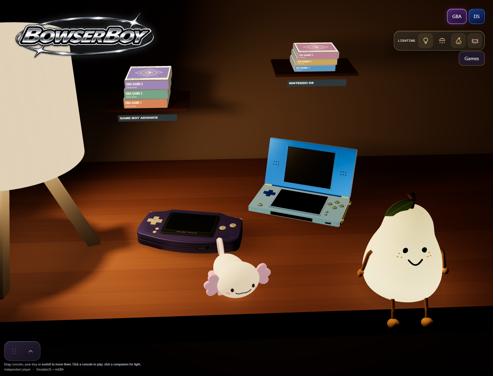
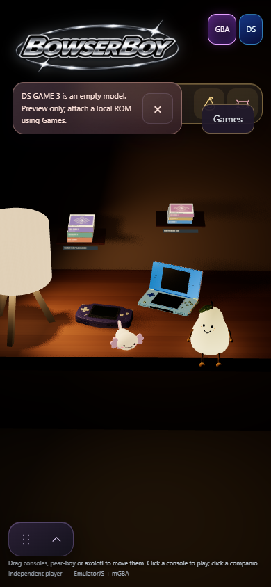
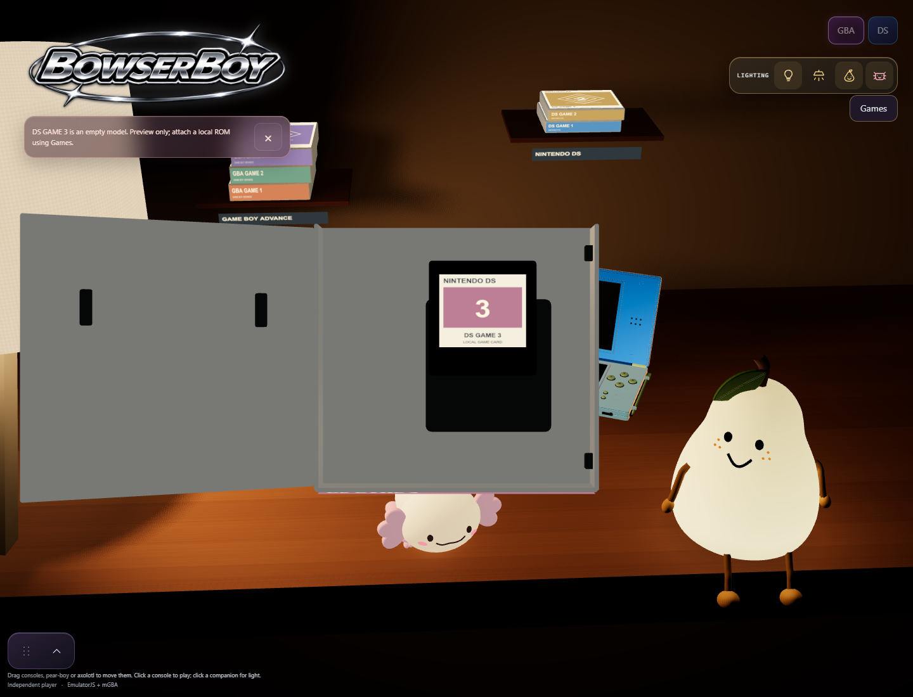

# Physical game shelves and local library

[Player guide](GUIDE.md) | [Architecture](ARCHITECTURE.md) | [Workstream 125](../TODO/125_GAME_SHELVES.todo)

The desk has two separate wall shelves: three original cardboard GBA boxes
and three hinged DS plastic cases. They are horizontally stacked, title
spines facing the player. Their numbered covers are original placeholders,
not commercial cover art. No favorite games are included.



Figure 1. The two wall shelves hold three original GBA cardboard boxes and
three DS cases, with their printed title spines facing the player.



Figure 2. The shelves remain visible in the mobile room framing; **Games**
also provides an accessible slot-selection and import interface.

## Attach a game on the website

Open **Games**, choose one of the six slots, then **Choose ROM**. Use `.gba`
for a GBA box and `.nds` for a DS case. **Cover PNG** accepts your cover;
edit **Game title** to change the printed spine and cartridge label.
Importing does not start the emulator. Choose **Load game** or click the
physical box when ready.

ROMs, covers and attached titles are cached in this browser's IndexedDB.
They are not uploaded to GitHub or a remote server. The cache belongs to
the site's exact origin; localhost, GitHub Pages, another browser profile
and another device do not share it. Clearing site data removes it.
If storage fails, the application reports the limitation explicitly.
An unattached box's title/cover is page-only until a ROM is attached.

Only use games and cover images you have permission to use. This feature
does not locate, download or distribute commercial ROMs.

## Optional private folders on this machine

The following directories already exist. Put one ROM and one cover in each
chosen folder; unused folders may remain empty.

| Box | Full folder path | Exact ROM filename | Exact cover filename |
|---|---|---|---|
| GBA 1 | `C:\devdesk\homedesk\BowserBoyAdvance\.local\game-library\gba\slot-1` | `game.gba` | `cover.png` |
| GBA 2 | `C:\devdesk\homedesk\BowserBoyAdvance\.local\game-library\gba\slot-2` | `game.gba` | `cover.png` |
| GBA 3 | `C:\devdesk\homedesk\BowserBoyAdvance\.local\game-library\gba\slot-3` | `game.gba` | `cover.png` |
| DS 1 | `C:\devdesk\homedesk\BowserBoyAdvance\.local\game-library\ds\slot-1` | `game.nds` | `cover.png` |
| DS 2 | `C:\devdesk\homedesk\BowserBoyAdvance\.local\game-library\ds\slot-2` | `game.nds` | `cover.png` |
| DS 3 | `C:\devdesk\homedesk\BowserBoyAdvance\.local\game-library\ds\slot-3` | `game.nds` | `cover.png` |

An optional UTF-8 `title.txt` in that same folder supplies a 1-100 character
display name. For example, the complete first GBA ROM path is
`C:\devdesk\homedesk\BowserBoyAdvance\.local\game-library\gba\slot-1\game.gba`;
its cover path is
`C:\devdesk\homedesk\BowserBoyAdvance\.local\game-library\gba\slot-1\cover.png`.

From `C:\devdesk\homedesk\BowserBoyAdvance`, run:

```powershell
npm run dev -- --library
```

The development server binds to `127.0.0.1`. Only this opt-in mode reads the
private folders. Refresh the page after changing files. Known ROM/PNG routes
and a generated discovery manifest are served, not an arbitrary directory.
Links, unknown filenames, oversized files and invalid titles are rejected.
Browser ROM header validation and PNG decoding still apply.

GBA ROMs must be 192 bytes to 32 MB; DS ROMs 512 bytes to 512 MB.
Covers must be genuine PNGs, at most 12 MB and no more than 8192 pixels in
either dimension. Keep the original cover's proportions: the front-cover
canvas fits it without stretching and adds the system/title framing.

**A disk folder is not a GitHub Pages upload location.** `.local` is ignored;
the public build always copies the empty public manifest and never scans
these folders. On Pages, use **Games** to import/cache your local files.
The normal development server also does not expose these private folders.

## Selection, animation and remembered cartridges

An empty box previews its model and explicitly reports that no ROM is
attached. It does not invent a game or create a last-played desk cartridge.

First or different selection presents the cover, opens the box/case,
extracts its cartridge, moves it to the matching console and returns the
empty packaging to its shelf. GBA opens a creased top flap and sliding
cardboard insert; DS opens its spine-hinged lid and retained card bay.
The original ROM identification, save, confirmation and power paths still
own game loading. The native ROM loader is invoked only after submitted room
frames finish visible insertion, not concurrently with cover presentation.
Failed or cancelled loads reset the physical pose and
do not mark the requested box as successfully selected.



Figure 3. A DS case opens around its spine hinge and exposes a separately
modelled card bay and square-labelled cartridge. This is original dummy art,
not an attached commercial game.

Returning A -> B -> A repeats the sequence. Clicking the already-current
box or its desk cartridge resumes the retained game without unpacking.
One last-played card per console rests on the table in a stable,
slot-derived casual position. It participates in the desk's existing
clearance system rather than clipping through moved consoles.

On reload, selected cached cartridges are restored without the shelf
sequence. GBA honors the existing remembered-console state. DS retains its
validated cartridge and battery save **powered off**; choose its box or
turn on DS power to boot. A retained DS cartridge is not an automatically
running/restored DS emulator session.

Animation advances only on submitted room frames, with bounded time steps;
a busy native runtime does not skip an unseen opening pose. Reduced motion
returns directly to the resting pose. Gameplay keyboard, hardware buttons
and DS touch are gated while the physical box owns the scene.

## Source and reversible archive

`src/game-boxes.js` uses the existing Three.js primitives, rounded geometry,
wood texture and cartridge helpers. Canvas-generated original art provides
the six distinct dummy covers, spines and square DS card labels. Printed
planes are unlit and not tone-mapped, keeping names readable under the
room's unusually low renderer exposure; cardboard/plastic remain shaded.
There are no imported commercial models or new rendering dependencies.

`src/game-library.js` owns the slot dialog, imports and selection.
`src/game-library-catalog.js` defines the six slot identities and validates
stored entries. `src/save-store.js` uses separate `shelf:<slot>` and
`shelf:last` keys in the existing device store; the old `console` key is
not renamed. `scripts/local-library.mjs` owns only the optional local routes.

The earlier DAYDREAM/LITTLE WORLDS/BBA decorative arrangement is preserved
in `src/archived-cartridges.js`, detached by default. Restoring it is an
intentional future scene change: instantiate that factory and register its
props with the existing desk/clearance ownership. Do not silently add both
layouts or treat the archived decorative props as playable games.

## Verification boundaries

Focused tests are `tests/unit/game-library.test.mjs` and
`tests/browser/game-library.spec.mjs`. The latter checks physical spine
picking, opening poses, empty previews, imports, title/cover persistence,
presented-frame motion and original Pixel Lab/Twin Lab loading.
On the final rebuilt local source, all five shelf browser cases and all
64 unit tests pass. The native case exercises both actual original-game
runtimes, A -> B -> A, same-current reuse and reload preloading; it records
the real loader invocation after visible insertion. These are local
qualification results, not deployment, user approval or commercial-game
compatibility claims. Workstream 125 records the actual failures and fixes.
