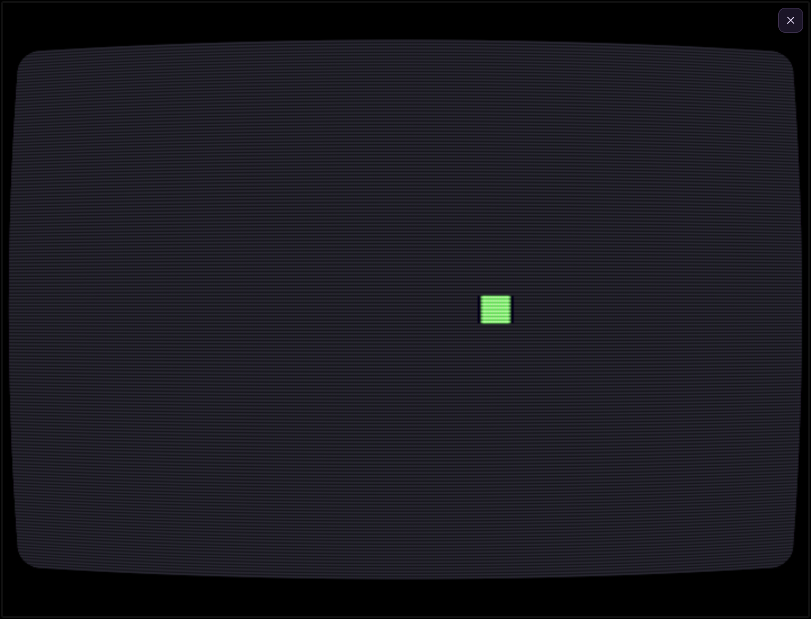

# Player and developer guide

[Visual showcase](../README.md) | [Play online](https://zanark.github.io/BowserBoyAdvance/)


*The supplied transparent purple orbital logo, preserved unchanged with its
white lettering, neon rim and orbit/star accents.*

**A little escape, on your desk.** A local-first browser GBA player inside an
actual 3D indigo handheld, built for static hosting on GitHub Pages.


*A full-width warm plaster wall and thick wooden tabletop, with open room
below its front edge. The closer resting view keeps the handheld's physical
size unchanged; the large paper lantern can extend beyond the frame.*

## Lights out

The room starts with a warm paper lantern on and **Room** lights off. Click the
modeled lamp or use **Lamp** to switch it independently of the game. **Room**
adds optional ceiling/reflected illumination without changing console power.
The original paper-and-wood lantern is roughly four handheld widths tall.
Its downward light casts shadows;
the LCD casts one-sided, screen-colored light as you lift or rotate the handheld.
Turning the power off extinguishes its screen light. These are real-time lighting
approximations, not a full global-illumination simulation.


*Left: the large clipped lantern and actual thick tabletop. Center: lantern-only
play view, with the larger LCD and enlarged dark power slider. Right: lamp off,
room lights on. The console remains off in all three views.*


*Lamp off: the original Pixel Lab framebuffer is mostly dark, so its tiny
colored square contributes little light. The screen glow follows its actual
orientation and colors, rather than a fixed room-wide fill.*

## Infinite battery

The first visit starts **powered off**, with a dark LCD. Pick up the handheld
and use its larger, visible lower-front power slider. Its projected touch target
is at least 44 by 44 pixels without covering the LCD.
A short orbital-logo reveal, revolving stars and synthesized chime play on the actual LCD only when switching
from off to on. The chime follows volume/mute; reduced motion uses a static reveal.
The supplied transparent wordmark also appears on the rear shell, idle/loading
LCD and settings panels. The front bezel instead has plain monochrome printed
lettering; an original geometric **ZANARK** badge is raised in the shell's own
plastic above the screen. The active favicon is an original indigo handheld whose
stepped shoulders and bowed lower edge match the actual 3D shell.


*The supplied purple wordmark with a gentle wave, original star-orbit motion
and a subtle starfield, not a Nintendo BIOS or recording. The startup renders
at 960x640 without the earlier added logo blur; game pixels are unchanged.
Reduced motion keeps a static
presentation. Infinite battery; no automatic power-off timer.*

Refresh remembers the switch position and the last inserted cartridge locally.
If it was on, the cartridge reloads using its latest committed resume point,
**without replaying startup**. If it was off, it stays off. Inserting a cartridge
does not turn it on. The physical switch and the explicit dock restart action
are the only ways to cycle power.
Browser refresh still creates a new emulator process; unsaved frames are not
continuous across navigation. Save a checkpoint before refreshing.

## Slot it in

A 3D cartridge slides into the top slot while the emulator loads, then stays
seated during play and inspection. The loading view briefly widens and lowers
the handheld into the lamp's light before returning to its normal position.


*The original BBA cartridge is part of the 3D scene, not an LCD overlay.
Reduced motion seats it immediately. Power cycling an already-loaded cartridge
does not replay insertion, and the animation never delays the emulator.*

## Play locally

Node.js 22+ is required for the development commands, not for visitors to the
published website.

```powershell
cd C:\devdesk\homedesk\BowserBoyAdvance
npm ci
npm run dev
```

Open **http://127.0.0.1:5173**. Click the handheld to pick it up, then open
**Cartridges** or press **Escape** for the tools drawer. Choose an uncompressed **`.gba`**
ROM you have the right to use, or select **Try the original demo**. If the
handheld is off, use its physical power switch to start.
Pixel Lab is an original input-test cartridge: arrows move the square, holding
**Z** changes its color, and **X** stores its horizontal position in cartridge SRAM.

ROM bytes are read locally, not uploaded. No account, server-side library,
commercial ROM or BIOS is included. Only the last inserted ROM is retained in
this browser's local storage so the console can survive refresh; it is not
uploaded or added to a server-side collection. Clearing site data removes it.
Internet is required for the versioned EmulatorJS/mGBA runtime.
The 3D scene requires WebGL 2. Its decorative cartridges are not supplied games.

## Pick it up

**Inspect** lets you drag the model to see its sides, ports and battery cover.
Scroll or pinch to zoom; keyboard inspection supports arrows, plus/minus and
Home to reset. **Back to play** restores the playable angle; **Put down** returns
the handheld to the table. Reduced-motion mode skips the pickup animation.


*The LCD and bezel lettering are surfaces on the mesh, not a floating iframe
or a flat photograph. The inner screen border follows CRT Geom's bowed sides
and corners; unfiltered mode restores a complete rectangular screen.
The larger screen keeps its native 3:2 proportions while approximately halving
the previous bezel gaps. Controls sit on the physical shell.*


*A pressed and D-pad up pressed: the caps move inside beveled shell openings.
Recessed floors replace raised socket discs that previously intersected the
caps and produced broken dark patches. Materials and lamp lighting stay intact.*

The revised shell uses stepped shoulders, straighter sides, a bowed lower edge,
low-profile buttons and recessed speaker slots. Its shape was informed by the
[user-supplied Sketchfab reference](https://sketchfab.com/3d-models/nintendo-gameboy-advance-gba-a0b6d1eb5ccb4c72a6944d77b3ac7c05);
that model was not imported. See [asset provenance](../THIRD_PARTY_NOTICES.md).

<details>
<summary>Turn it over</summary>


*The rear shell, battery cover, grip and recessed screws have their own geometry.
Rotating the model naturally hides its front-facing game display.*

</details>

## Controls


*Named, keyboard-accessible 44px icon controls, with hover/focus labels. On
narrow phones the same actions fit two rows without covering the LCD.*

The dock exposes inspection, put-down, lamp/room lighting and Cartridges, plus
whole-desk fullscreen, separate **Screen fullscreen**, **1x/2x/3x/4x native speed**,
keybindings, a persistent autosave toggle,
save/load for the selected checkpoint slot, slot selection and **safe off/on
restart**. Restart commits in-game battery data and creates a fresh runtime;
it never restores an instant checkpoint. Actual fast-forward throughput depends
on the browser/device. The drawer and real EmulatorJS panel share the purple theme.

| Action | Keyboard |
|---|---|
| Move | Arrow keys |
| A / B | Z / X |
| L / R | A / S |
| Start / Select | Enter / Left Shift |
| Cartridge and settings / exit screen fullscreen | Escape |

Click the game for keyboard focus. The console's D-pad, A/B, L/R and Start/Select
buttons work with mouse, touch and keyboard activation. Their meshes visibly
depress: the D-pad rocks and the shoulder buttons hinge. The lower-front power
slider turns the emulator off: the LCD goes dark and the runtime is removed.
Turn it back on to boot the loaded ROM from the beginning with its in-game
save data, **not an instant checkpoint**. Pause/resume remains in Cartridges.
Rotate a phone for a
larger handheld. Keyboard and mouse/touch gameplay controls are active in play
view, not while inspecting or resting on the table. Screen fullscreen is the
exception: existing keyboard controls work there even from table view.
The game itself continues
until paused.

**Screen fullscreen** enlarges only the live game image, preserving its aspect
ratio and current filter. It hides the shell's touch controls; use your keyboard.
Escape or the top-right close button returns to the same desk view and running
cartridge, without a reset. Browser fullscreen support is required; unavailable
or refused requests display an explicit notice.
Scene notices appear directly below the website logo; open tools retain notices
inside their own panel.



*The original demo's square on the actual native CRT output: no handheld
overlay, second emulator or reset. Escape or the top-right close button returns.*

The hidden drawer contains ROM loading, every save/backup action, pause,
fullscreen, key remapping, volume, mute and screen filtering. **CRT Geom** is
the default, using the actual shader bundled with the pinned emulator, not a
CSS imitation. Choose **Unfiltered** in the drawer if preferred.
Click a key binding and press its
replacement; duplicate assignments and reserved browser keys are rejected.
Keys, sound and filter settings persist in checked local browser storage; failed writes
explicitly apply only to the current session. Escape remains reserved for tools
or exiting screen fullscreen.
Opening the drawer does not automatically pause gameplay.

Audio automatically uses a short playback cushion, smooth volume/mute changes
and peak compression to reduce crackles and overload distortion. The cushion
adds about 0.1 seconds of sound latency. This cannot guarantee glitch-free sound
under sustained system overload or fix an operating-system/audio-device problem.

**Advanced EmulatorJS settings**, at the top of the sidebar, opens the actual native graphics, speed,
screen-capture settings and backend core options in a separate panel. It keeps
the current game and pause state intact; Escape or Close returns to Cartridges.
Selections are remembered when the panel closes, including other native shaders.
Options marked **Requires restart** apply on the next power on. Keys, sound,
save handling and the uncluttered LCD remain owned by this application.


*The original native menu is accessible without showing a toolbar on the LCD
or replacing the running cartridge.*

Controller support remains provided by EmulatorJS; physical controller
compatibility has not been tested.

<details>
<summary>Inside the cartridge slot</summary>


*The drawer keeps ROMs, checkpoints, backups and controls out of the playing
view. Scroll within it for sound settings and help.*

</details>

## Keep your progress

- **Auto-save:** one rolling checkpoint every 15 seconds while enabled;
  its on/off choice is remembered across refreshes.
  The newest stored checkpoint resumes when the same ROM is selected again.
- **Save checkpoint:** three independent manual slots, unaffected by rolling
  auto-saves. Original quick saves remain in **Slot 1**. Choose a slot in
  Cartridges or through the dock's slot icon; save/load uses that selection.
- **Export / Import backup:** carry the current session in a `.bba-save` file.
  The exact ROM content and runtime version must match; checksums detect damaged
  backup data. Export works even if browser checkpoint writes fail. Each backup
  contains one session, not every slot; import replaces only the selected manual slot.

Checkpoints include an instant emulator state and cartridge battery-save bytes
when the game provides them. Use the game's own save menu as usual.
This prototype does **not** import/export raw `.sav` files or sync to the cloud.

**Save manually before closing and export regularly.** Browser data can be
cleared or evicted, and private browsing may discard it. Saves belong to the
same browser profile and origin (scheme, hostname and port), not your account.
Changing to a new device, localhost port or custom domain requires a backup.
Renaming the ROM does not lose progress because identity is based on SHA-256.

See [the saving guide](SAVING.md) for recovery and limitations.

## GitHub Pages

The repository is configured to publish through **GitHub Actions**. The workflow
in [`.github/workflows/pages.yml`](../.github/workflows/pages.yml) checks, builds and
tests the site, then publishes **only `dist`** on a push to `main` or a manual
workflow dispatch. Pull requests run checks without deploying.

Pages address: **https://zanark.github.io/BowserBoyAdvance/**.
The icon-dock/orbital-startup release is
`1785a15936b9bb7328a415bdb6fae12204c6bcdc`, Pages run `41803699865`:
build, 11 units, both complete browser shards (35 cases) and deployment succeeded.
Independent production checks matched all 26 public assets and passed eight
real dock/slot/speed/autosave/restart/native/startup/power cases before these
documentation updates. This is technical release evidence, not user visual approval.

The dark-room, 3D, native-settings and real-power redesign was deployed from
`d551f4269b58fc31e496c4d1bc8d9d6110817f79` on 2026-11-04, following successful
build and both browser shards (Pages run `41746728238`). A fresh live-browser
check verified all 19 public assets and the lamp, native demo, CRT, settings,
button travel and power lifecycle before this documentation was finalized.
The original branding/startup and remembered-power follow-up was deployed from
`ab4fc8850d0b67870dd431d4a398c5a3e98ac47d` in Pages run `41753762933`.
Both complete browser shards (22 cases), build and deployment passed. A fresh
live browser verified all 22 public asset hashes and the actual startup,
cartridge/power refresh behavior and prominent native-settings entry before
this follow-up documentation.
Final startup-notice cleanup `78887d7` also passed the complete gate, deployed
in Pages run `41755029718` and passed fresh live verification.

All application paths are relative. The browser suite serves the build under
`/BowserBoyAdvance/`, rather than merely testing a domain-root development page.
The core runs single-threaded; no custom COOP/COEP headers are required.

```powershell
npm run build
npm run preview
```

`dist` is generated and replaced on each build. It contains the static
application, the two pinned Three.js build modules, two rectangular-light
lookup helpers and their MIT license,
and the generated original Pixel Lab cartridge. The complete dependency tree,
project documentation and private session context are not deployed.

## Development and evidence

```powershell
npm run check
npm test
npm run build
npm run test:browser
```

The browser suite uses installed Microsoft Edge by default. To use Playwright's
Chromium instead:

```powershell
npx playwright install chromium
$env:BROWSER_CHANNEL = 'chromium'
npm run test:browser
```

Real-core integration tests require internet. They use the original generated
cartridge, not commercial game data. See [architecture](ARCHITECTURE.md),
[verification scope](VERIFICATION.md) and the numbered [TODO index](../TODO/00_INDEX.todo).

<details>
<summary>Mobile layout</summary>


*The same handheld fits a narrow viewport without horizontal overflow. Touch
controls are its physical shell buttons, not overlays on the game.*

</details>

Independent prototype; not affiliated with Nintendo. See
[third-party notices](../THIRD_PARTY_NOTICES.md) for runtime sources and licenses.