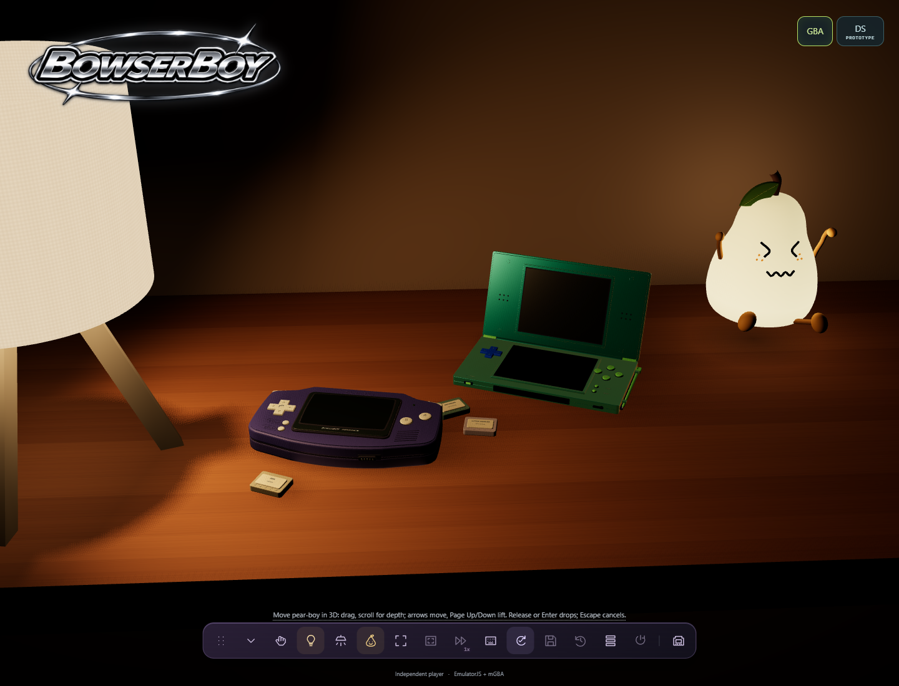
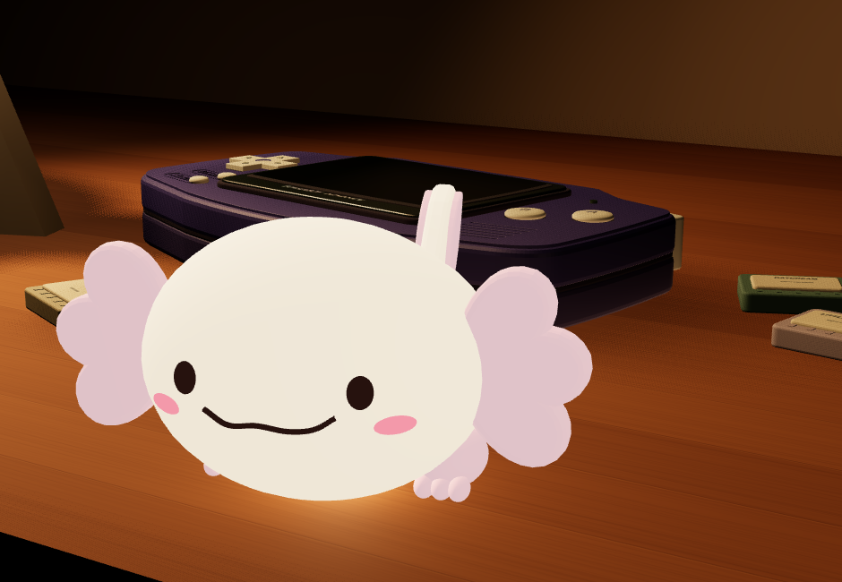

# BowserBOY player and developer guide

[Visual showcase](../README.md) | [Play online](https://zanark.github.io/BowserBoy/) | [Engineering book](book/README.md)

**First public release: [v1.0.0](releases/v1.0.0/README.md), 2026-11-06.**
The owner designated the independently qualified `c3d9dbd` application as this
milestone. Full-resolution rendering, all53 hosted browser cases and five
affected public cases are qualified; no automatic downscaling remains.
See the [documentation/repository map](README.md) and
[current verification](VERIFICATION.md#full-resolution-handheld-rendering-2026-11-06).

## Website and console names

**BowserBOY** is the website/table, using the supplied chrome sparkle logo
on the table. GBA tools/settings use the static Advance logo instead.
**BowserBOY ADVANCED** is the first
console: the current GBA handheld. Its original purple artwork still reads
BowserBOY ADVANCE and stays unchanged on its rear and idle/loading/startup LCD.
The physical bezel lettering also stays unchanged. **BowserBOY DS** is the
separate Nintendo DS console, with a metallic blue-cyan/green shell, clipped
stylus, its own runtime and a shared console selector.

The DS uses bright pale-pistachio green instead of neon lime.
Green hinge trim has metallic room reflections; buttons retain a softer finish
and dark navy legends. START/SELECT/POWER labels stay light against the blue
shell. L/R now sit on the top edge, with the original Q/W bindings retained.
Four matte green square rubber pads replace the black underside feet.
Its runtime, controls and saved progress remain separate from the GBA.

The repository is now `Zanark/BowserBoy`; historical Pages URLs and the local
`BowserBoyAdvance` checkout name are retained. The DS does not rename or
modify GBA storage.

**Earlier release and picture provenance:** source `f5bc639` was independently verified
live after the full 41-case hosted gate and exact 29-public-asset match.
It recovers the original soft Arial A/B shapes, size and placement with shallow
genuine inward engraving, replacing the rejected custom rounded shapes.
It retains deeper presses, stronger
D-pad/shoulder movement and snappier returns; the centered bezel wordmark is
another 20% smaller in both views, now without the exterior light contour.
Frosted overlays do not move the camera;
sustained audio buffering, darker D-pad arrows and play-only header hiding remain.
The README's current interaction recordings and dedicated stills are actual
local-build captures, with their actual source editions recorded in Media, including the chrome
website header, original A/B contours, metallic bezel and larger etched rear
logo. Earlier `8a1d6a3` local recordings remain documented as a previous edition.
Most inherited guide motion/pose/detail figures belong
to the earlier `ab912d5` edition and were captured locally before its deployment;
the notice and lighting/power-off figures were captured on that public edition.
See [current release evidence](VERIFICATION.md#bowserboy-website-brand-separation-2026-11-05)
and [capture origins](MEDIA.md#bowserboy-public-refresh-2026-11-05).

Normal playback now defaults to audio-paced timing to address reproduced
intermittent dropouts; bounded measurements are not a guarantee for every device.

The bezel letters now have a metallic chroma finish: light/dark chrome bands
with restrained iridescent color, not an animated RGB glow. Their original
shape, smaller size and borderless silhouette stay unchanged; the bezel and
other logos are untouched. Fullscreen shares the exact lettering canvas.
Current [qualification](VERIFICATION.md#metallic-chroma-lettering-2026-11-05)
is separate from historical pictures explicitly labeled below.


*The supplied transparent chrome website logo, preserved byte-for-byte.
A restrained neutral shadow separates it from the warm room without tinting
the silver artwork purple. It is hidden in play view and returns on the desk.
Inspect instead shows the approved purple console logo with orbiting stars;
reduced motion uses static purple artwork. Notifications retain their existing
header position. A soft
silver highlight and glow sweep left to right for 1.8 seconds every six seconds.
The shimmer pauses while hidden and is disabled for reduced-motion users.*

**A little escape, on your desk.** The published GBA player is inside an actual
3D indigo handheld, built for GitHub Pages. The following GBA figures predate
the separate DS console described below.


*The earlier GBA-only desk: chrome BowserBOY header, first purple console and
clean STORSEGEL-style white shade and ash tripod. The other objects are
cartridges, not additional consoles.*

## Move the consoles

On the table, drag either GBA or DS upward or sideways to lift and translate
it without rotating. Scroll while holding to move nearer or farther; release
to drop with gravity, bounded throw momentum and a small bounce. The camera
does not orbit. Occupied spots are rejected with a hint; lift above props
before moving across them.

The **Move consoles** dock button offers **Move GBA**, **Move DS** and
**Reset console positions**. After selecting a move, arrows move across the
desk, **Page Up/Down** change height, **Enter** drops and **Escape** cancels.
Keyboard steps do not throw. Cancellation, pointer capture loss, blur and
resize restore the pickup position. Reset reports an error if pear-boy
occupies an original console position. The phone dock may occupy three rows,
retaining 44px touch targets and access to the physical power switch.

Dragging does not change the selected system or restart either emulator.
Clicking without dragging still selects and plays that console. **Put down**
returns it to its independently remembered desk position; **Inspect** remains
the separate mode for rotation. Positions are session-only and reset on reload.
The bounded workspace prevents desk-edge falls. Collisions use fixed
world-axis-aligned bounding boxes, not arbitrary rotating rigid bodies;
moving supports, stacking stability and dynamic prop pushing are not simulated.
Console movement is available on the published desk.

Clearance depends on the view: **play/Inspect prioritizes the selected console
and other console before pear-boy**; **table prioritizes pear-boy, then loose
cartridges, then consoles**. Lower-priority objects move sideways to free space,
without changing height or console orientation. Temporary focus displacement
does not replace a console's saved table position. Pear-boy also returns to his
chosen table position, unless you explicitly move or reset him. This is physical
spacing, not drawing through objects. Game boxes are not implemented yet.

<a id="nintendo-ds-local-prototype"></a>

## Nintendo DS

Open [BowserBOY online](https://zanark.github.io/BowserBoy/), or start the
development server with `npm run dev` and open **http://127.0.0.1:5173**.
Both consoles share the desk but are separate models.
Use the **GBA / DS** selector or click either console on the table.
With DS selected, **DS cartridges** opens its own tools; **Escape** also opens
them during play. Pick up, put down, Inspect, zoom and room/lamp controls
operate on the selected console. Inspection drags repaint immediately.
The table DS faces the lamp without covering the loose cartridges; its pickup
and return path stay beside the GBA rather than passing through it.

The latest shell specification supersedes the earlier teal paint:
**#0077FF blue-cyan lid and #40A0FF lighter lower base,
metalness 0.80, roughness 0.35**, with fine-grain bump/roughness
and clearcoat. The D-pad is electric blue; face/system buttons, hinge caps and
clipped stylus are lime. The resting table hinge opens to approximately 110 degrees;
unlocked gameplay opens fully to 180 degrees, flat and facing the camera.
The two small square recesses are centered on the outer lid and are actual
geometry. The supplied emblem is on the lower half's underside, in the clear
area beside the battery cover, now approximately41%larger without changing
its proportions; neither lid face carries the colorful logo. The selected
DS header has a steady blue halo and darker blue edge to separate it from
the warm lantern; this does not add a scene light or animate the glow.
Only the two screen rectangles shimmer in the README and DS Inspect header.
Reduced motion selects the original static logo; the physical underside,
loading LCD and DS tools retain their static artwork.
GBA settings use the static Advance logo and
the action dock changes from GBA purple to DS blue/cyan.

The existing warm lamp, optional **Room** lighting and background are unchanged:
no studio-light rig or white backdrop was added. Those warm sources still
shift the metallic appearance and leave shadowed faces dark. Exact material
values do not imply a lighting-independent match to the white-background
reference photographs. The straight DS play pose sits inside the table lamp's
actual light pool rather than in front of its emitting surface, revealing the
blue lid and lighter lower shell without adding a camera light or brightening
the LCDs. The lamp switch still removes that illumination.

**Set your gameplay angle:** enter **Inspect**, then choose **Rotate body**
or **Move hinge**. Drag to rotate the body; in hinge mode, drag upward to
open or downward to fold. The hinge slider accepts 30-180 degrees.
With the canvas focused, arrows rotate the body or change the selected hinge
by five degrees; scroll/pinch or plus/minus zoom. **Home** resets an unlocked
DS to its flat pose.

Choose **Lock pose**, then **Back to play** to keep both angles. Locked
controls cannot accidentally change the pose; **Unlock pose** enables editing.
If you leave Inspect unlocked, gameplay resets the body and hinge flat.
The lock survives put-down/pickup, console switches and resizing for this
session only. Reload clears it. The saved desk position/orientation and its
110-degree resting hinge remain separate. The held console frames its actual
pose, stays above the GBA and clear of the default pear placement; the controls
panel fits a 390px viewport. This is bounded articulation, not a simulation of
hinge torque or a fully closed clamshell. Extreme/back-facing poses can hide
screens or controls; covered buttons and touch input do not click through
the lid. Existing warm lighting means brightness changes with orientation.

Choose **Try Twin Lab** for the original dual-CPU homebrew or **Choose .nds**.
You can also drop an authorized uncompressed `.nds` file onto the page.
Only original DS headers with valid ARM9/ARM7 ranges and files from
512 bytes through 512 MiB are accepted. DSi-enhanced/DSi-only files are
rejected explicitly; filename/header checks do not certify game compatibility.
Selecting a cartridge powers on the DS.
The cartridge sidebar closes immediately after upload selection and the DS
enters play view before reading the ROM. An original looping cartridge graphic
on the lower LCD covers local identification and native startup, then yields to
the game. Reduced motion keeps the loading cartridge still. This feedback does
not make the core download faster. Open DS cartridges to cancel native startup
or retry an error; a rejected replacement file retains the current DS session.

First launch downloads the pinned
non-threaded EmulatorJS 4.2.3 DeSmuME runtime. External BIOS and BIOS-menu boot
are disabled. Twin Lab boots without supplied BIOS/firmware, not proof that
every game will. No commercial games are included or used as test fixtures.

| DS input | Keyboard / pointer |
|---|---|
| D-pad | Arrow keys |
| A / B | Z / X |
| Y / X | A / S |
| L / R | Q / W |
| Start / Select | Enter / left Shift |
| Touchscreen | Click or touch and drag the lower physical LCD |

The face-button diamond and its recessed sockets clear the touchscreen bezel.
Projected buttons follow the physical DS caps. Pointer release, cancellation
and focus loss release inputs. DS keyboard mappings are fixed;
GBA remapping does not change them. Native gamepad behavior is not
independently qualified. Twin Lab's upper marker moves with the D-pad;
press/drag the lower LCD to draw yellow marks.

The DS D-pad rocks toward the held arrow: the pressed edge lowers and the
opposite edge rises. The held direction's existing mark lights lime so it stays
readable in the dark room. Diagonals lean between directions; opposite arrows
cancel that axis. Release clears the marks and springs the cross back to neutral.

Touch coordinates follow the lower LCD in flat, tilted or upside-down gameplay
poses and at different zoom levels. Twin Lab's 8px brush surrounds the clicked
native pixel, staying inside the LCD at its edges; drawing is not confined below
the instruction text. The hidden runtime does not take focus from the desk
while drawing. Releasing the pointer ends native touch, but keeps a picked-up
pen in your hand. Hover the docked side stylus for a glow, then click/tap to
pick it up. Its nib stays at the pointer; its back faces you to avoid hiding
the screen. Direct mouse/touch drawing still works without picking it up.
**Escape**, right-click or **Put back** docks the pen. Cancellation, focus loss,
tools, Inspect or console changes dock it and release native input.
Hints use one bottom-left line; narrow screens truncate long hints.

Each DS LCD casts its own soft framebuffer-colored light, like the GBA.
Black screens and power-off leave no residual screen light. These local
emitters follow the lid hinge and body pose without raising room lighting.

The physical DS Power switch plays an original, soft-glass startup arpeggio,
not the GBA tune or a manufacturer's recording. **Mute DS** silences it.
It plays only on explicit power-on, not page load, console selection or
power-off. An empty-slot power-on shows cartridge guidance; Power off still works.

The corrected Twin Lab is a newly generated ROM with a different content hash.
Older demo checkpoints remain associated with the older ROM and do not resume
into this revision. Other cartridges' checkpoints and GBA saves are unchanged.

Each native LCD is 256x192. The adapter verifies stacked, gap-free 256x384
native output, separately from its integer-scaled WebGL canvas, then copies
the two halves to the matching physical screens. Unsupported layouts fail
explicitly. This does not lower the Three.js renderer's resolution.

**Progress:** the independent `bowserboy-ds` IndexedDB database stores one
checkpoint per exact ROM SHA-256 and runtime identity. Running, unpaused
sessions auto-save every 30 seconds; **Save checkpoint** saves immediately.
**Restore checkpoint** replaces current progress with that stored checkpoint.
Reopening the same ROM after a page reload resumes it; the ROM itself is
not persisted. Selecting another cartridge saves the old session first.
Storage errors are visible, disable browser checkpoint controls, and leave
**Export checkpoint** available while the runtime is healthy.

**Portable backup:** export downloads `.bbds-save` with binary core state,
optional in-game save data, ROM/runtime identities and SHA-256 checksums.
Load the matching ROM before importing and confirm replacement. Wrong ROMs,
GBA backups, raw `.sav` files, corrupted data and incompatible runtime
identities are rejected. There are no accounts or cloud saves. Browser
storage is tied to the exact origin; export before clearing it or moving
between local and public URLs.

**Power and selection:** Pause preserves the running instance. Power off
checkpoints and removes the DS iframe; Power on starts a fresh core using
retained in-game save data, not the instant checkpoint. Selecting the same ROM
instead resumes its stored checkpoint. Switching consoles checkpoints and
pauses the inactive DS or pauses the inactive GBA; switching back resumes it
without replacing either ROM. GBA and DS databases/backups are never mixed.
With DS storage unavailable, switching to GBA retains the paused DS only in
memory and warns that export is needed; saving/replacing/powering off is
blocked rather than silently discarding progress.
The visible front-left power button has a minimum 44px pointer target and
uses the same lifecycle as **Power off/on DS** in tools. Without a cartridge,
it opens DS tools with an insertion explanation rather than pretending to boot.

**Scope:** original Nintendo DS direct boot with local cartridge files.
No DSi, wireless/multiplayer, firmware-menu boot, offline-first guarantee or
universal commercial-game compatibility. The GBA's CRT presets, advanced
settings, three save slots, speed controls and LCD-only fullscreen are not
promised for DS. Desktop Edge and a 390px responsive viewport are checked;
real-phone touch/performance, microphone/camera support, commercial
compatibility and long-duration audio remain unqualified. Runtime CDN code
still executes with the page's origin privileges.

## pear-boy

The pear character sitting on the front-right desk edge is a separate movable warm lamp.
Click him to switch his glow, or use the pear dock button for power,
10-100% brightness, **Move** and **Reset position**. Lighting and position last
for this page session only. Reset returns him to the edge without changing brightness.
His feet hang below the tabletop when placed close enough to its front edge;
move him farther back to let them rest on the table.

Drag to move in a camera-facing plane; upward movement lifts him. While holding
him, scroll for depth. Alternatively choose **Move**, use arrows across the desk,
**Page Up/Page Down** for height and **Enter** to drop. **Escape** cancels the
move and restores its starting position. Releasing a drag drops him with
gravity, bounded throwing inertia, a small bounce and friction.
Keyboard steps place him deliberately without accumulating throwing speed.

The longer, thick braided rope arms and legs swing and settle. His entire face
(eyes, smile and freckles together) tracks
mouse/pen movement. Horizontal travel is now 2.5 times wider, wrapping around
the curved shell rather than sliding into it. Vertical travel and smooth
tracking remain unchanged. While held or falling, his squeezed eyes and pink cheeks
accompany alternating wobbly closed and peanut-shaped open scream mouths,
with each mouth held for 900ms rather than flickering rapidly.
A hard landing brings small round angry eyes with short furrowed brows,
then squeezed eyes and a tiny puckered pout, then his normal smile;
a small drop does not trigger that reaction. The signature three freckles on
each cheek remain visible throughout. Reduced motion removes decorative
swinging and mouth alternation, not gravity or the static recovery expressions.



*Actual local rendering of the scared expression and hanging rope limbs,
not an edited reference image.*

Movement stays within a bounded tabletop workspace and rejects the tripod
and the axolotl's current position.
On the table, loose props and consoles yield to pear-boy rather than blocking
his chosen position. Clearance uses current-orientation boxes and keeps him
upright; this is not a rotating rigid-body engine or full cloth simulation.
Ropes collide with the pear body and the desk's top/front edge, not every prop
surface. Reduced motion keeps a settled edge-aware pose rather than swinging.
Physical-phone performance and owner visual acceptance remain unqualified.

## Small axolotl night-light

The smaller cream axolotl in front of the consoles has three pink gills on
each side, four tiny pink feet, a raised pink-tipped tail and a wavy smile.
Click its model to switch its warm glow, or open **Axolotl** in the separate
**Lighting** dock. **Sleep 50%** and **Bright 100%** select its two brightness
levels without changing the other lamps or console power. Selecting brightness
while off leaves it off.



*Actual local render, cropped from an explicitly staged close camera to show
the face, gills, feet and tail. This is not a new user-facing Inspect mode.*

It starts on at 50%. Position, power and brightness reset on reload.
Drag its body to lift and move it in 3D; scroll while holding it for depth.
Release to drop it with gravity and a soft bounce. A short click still only
switches the light. **Move axolotl** also supports arrows and Page Up/Down,
with Enter to drop and Escape to cancel. **Reset position** restores its
original spot, unless another lamp occupies it. Cancellation, focus loss and
resizing restore the pickup position without changing power. The lamp keeps
its orientation; it does not gain pear-boy's animated face or rope limbs.
The tripod and pear-boy block occupied placements, tabletop consoles yield,
and GBA/DS view changes preserve the chosen tabletop position.
Clicking it leaves the console tools collapsed and does not pick up a console.
The lamp and its movement are available online; physical-phone performance
and owner visual acceptance remain unqualified.

## Lights out

Use the separate warm **Lighting** dock at the upper right for **Lamp**,
**Room**, **Pear Boy** and **Axolotl**. These shared controls stay available when you
switch GBA/DS or move/collapse the console tools dock. On phones during play,
lighting sits directly below the header, above the handheld.

The room starts with the warm STORSEGEL-style lamp, pear-boy and the axolotl
on; the axolotl starts at 50%, and **Room** lights start off. For LCD-only
darkness, switch all three lamps and Room off.
Click the tripod shade or use **Lamp** to switch it independently of the game. **Room**
adds optional ceiling/reflected illumination without changing console power.
The lamp has a clean white open drum shade and three splayed ash legs, modeled
at approximately 30 cm high with an 18 cm shade diameter. No cable is visible.
Its warm downward light casts shadows;
the LCD casts one-sided, screen-colored light as you lift or rotate the handheld.
Turning the power off extinguishes its screen light. These are real-time lighting
approximations, not a full global-illumination simulation.

An experimental, very faint screen-colored bounce also reveals the nearby
D-pad, A/B, Start/Select and shoulder controls in darkness. It follows the
picture's brightness/color rather than giving the buttons permanent glow,
and vanishes on a black screen or power-off. The experiment is isolated for
removal if its appearance is rejected. The revised balance dims the wooden
desk reflection and preserves faint control visibility with darker pictures.


*Earlier capture, before the axolotl addition. Put the handheld down to see
the clean shade and warm wooden legs; switch room
and lamp light independently, then pick it up again. This local working-tree
capture is newer than the frozen v1.0.0 release.*


*Lamp off: the original Pixel Lab framebuffer is mostly dark, so its tiny
colored square contributes little light. The screen glow follows its actual
orientation and colors, rather than a fixed room-wide fill.*

## Infinite battery

The first visit starts **powered off**, with a dark LCD. Pick up the handheld
and use its enlarged dark power slider on the **lower underside edge**, not the
front face. Its projected touch target follows the cap and is at least 44 by 44
pixels, clear of the LCD and bottom dock. Inspect and tilt the console to see
the ribbed cap, track and label on that edge.


*The actual public handheld in Inspect mode: the dark ribbed slider is on the
lower shell edge, with no switch on the front face. Room lights reveal its
physical cap, track and label; this is not a mockup.*

A short orbital-logo reveal, revolving stars and synthesized chime play on the actual LCD only when switching
from off to on. The chime uses crisp 8-bit-style square tones and a short rising
arpeggio. It follows volume/mute; reduced motion uses a static reveal.
The supplied purple console wordmark also appears on the rear shell and
idle/loading LCD. Website tools/settings panels use the separate chrome logo.
The front bezel uses the purple logo's distinctive
lettering with a metallic chroma finish, without stars; screen-only fullscreen shares that artwork.
The rear logo is now another 17% wider, with four-times-deeper cutouts inset
into the battery-cover plastic. Its original purple color and bright lettering are
preserved, not darkened to imply engraving; see
[current qualification](VERIFICATION.md#deeper-rear-engraving-2026-11-05).


*The purple artwork belongs to this console, including its animated inspection
header; chrome remains the table identity. The local capture includes the enlarged, deeper cutouts,
without changing the cover or artwork.*

A/B letters are softer gray grooves cut into the unchanged cap faces, with inset floors and
sidewalls rather than raised or printed lettering. D-pad arrows retain their
raised rubber geometry and darker tones. Shoulder letters retain their cap material;
START/SELECT and the geometric **ZANARK** badge are molded in the shell's plastic.
There is no front POWER or BBA-001 print; the power light remains.
Normal play is slightly closer while retaining the whole handheld and clear UI;
inspection and cartridge insertion retain their separate framing.
Notifications use translucent frosted glass in the header area and may overlap
the console. Showing, changing or dismissing a notice does not shift or shrink
the handheld; its ordinary close view stays in place.
Long messages scroll inside the card; errors keep a distinct warm tint.
The active favicon is an original indigo handheld whose
stepped shoulders and bowed lower edge match the actual 3D shell.


*Room lights and a slight inspection tilt reveal the earlier same-material raised letters
and their edges. The star-free bezel uses the original logo's typography;
the front has no POWER or BBA-001 print. This capture precedes the darker
A/B and D-pad marking refinement.*


*The supplied purple wordmark with a gentle wave, original star-orbit motion
and a subtle starfield, not a Nintendo BIOS or recording. The startup renders
at 960x640 without the earlier added logo blur; game pixels are unchanged.
Reduced motion keeps a static
presentation. Infinite battery; no automatic power-off timer.*

Refresh remembers the switch position and the last inserted cartridge locally.
If it was on, the cartridge reloads using its latest committed resume point,
**without replaying startup**. If it was off, it stays off. Inserting a cartridge
does not turn it on. The physical switch and the explicit dock restart action
are the only ways to cycle power.
Browser refresh still creates a new emulator process; unsaved frames are not
continuous across navigation. Save a checkpoint before refreshing.

## Slot it in

A 3D cartridge slides into the top slot while the emulator loads, then stays
seated during play and inspection. The loading view briefly widens and lowers
the handheld into the lamp's light before returning to its normal position.


*The original BBA cartridge is part of the 3D scene, not an LCD overlay.
Reduced motion seats it immediately. Power cycling an already-loaded cartridge
does not replay insertion, and the animation never delays the emulator.*

## Play locally

Node.js 22+ is required for the development commands, not for visitors to the
published website.

```powershell
cd C:\devdesk\homedesk\BowserBoyAdvance
npm ci
npm run dev
```

Open **http://127.0.0.1:5173**. Click the handheld to pick it up, then open
**Cartridges** or press **Escape** for the tools drawer. Choose an uncompressed **`.gba`**
ROM you have the right to use, or select **Try the original demo**. If the
handheld is off, use its physical power switch to start.
Pixel Lab is an original input-test cartridge: arrows move the square, holding
**Z** changes its color, and **X** stores its horizontal position in cartridge SRAM.

ROM bytes are read locally, not uploaded. No account, server-side library,
commercial ROM or BIOS is included. Only the last inserted ROM is retained in
this browser's local storage so the console can survive refresh; it is not
uploaded or added to a server-side collection. Clearing site data removes it.
Internet is required for the versioned EmulatorJS/mGBA runtime.
The 3D scene requires WebGL 2. Its decorative cartridges are not supplied games.

## Pick it up

In ordinary play, **Zoom** adjusts the entire handheld from **50% to 100%**
without entering fullscreen. **50%** is the default and preserves the existing
fitted view; **100%** moves the camera twice as close. Higher zoom can crop the
handheld. The slider is bottom-right on wide screens and top-left on narrow
or short screens. Its percentage survives
Inspect/table returns and resizing for this page session. It is hidden on the
table, in Inspect, during pickup and in screen-only fullscreen.

**Inspect** lets you drag the model to see its sides, ports and battery cover.
Scroll or pinch to zoom; keyboard inspection supports arrows, plus/minus and
Home to reset. **Back to play** restores the GBA playable angle; DS uses its
locked body/hinge pose or the unlocked flat default. **Put down** returns
the handheld to the table. Reduced-motion mode skips the pickup animation.
Inspection and screen-only fullscreen keep their own independent zoom settings.


*The LCD and bezel lettering are surfaces on the mesh, not a floating iframe
or a flat photograph. The inner screen border follows CRT Geom's bowed sides
and corners; unfiltered mode restores a complete rectangular screen.
The larger screen keeps its native 3:2 proportions while approximately halving
the previous bezel gaps. Controls sit on the physical shell.*


*A pressed and D-pad up pressed: the caps move inside beveled shell openings.
Recessed floors replace raised socket discs that previously intersected the
caps and produced broken dark patches. Materials and lamp lighting stay intact.*

The revised shell uses stepped shoulders, straighter sides, a bowed lower edge,
low-profile buttons and recessed speaker slots. Its shape was informed by the
[user-supplied Sketchfab reference](https://sketchfab.com/3d-models/nintendo-gameboy-advance-gba-a0b6d1eb5ccb4c72a6944d77b3ac7c05);
that model was not imported. See [asset provenance](../THIRD_PARTY_NOTICES.md).

<details>
<summary>Turn it over</summary>


*The rear shell, battery cover, grip and recessed screws have their own geometry.
Rotating the model naturally hides its front-facing game display.*

</details>

## Controls


*Named, keyboard-accessible 44px icon controls, with hover/focus labels. On
phones the same actions fit two rows; 320px uses three after adding dock controls.*

The tools dock starts collapsed at the bottom-left on each reload. Clicking
either console reveals its actions; the expand arrow also opens it manually.
Lighting and Pear controls do not expand console tools.
Drag the dotted grip with mouse or touch to move the dock. Its arrow collapses
the actions into a small movable grip/expander; click again to restore them.
Focus the grip and use arrows to move, Shift for larger steps, or Home to
restore the default position. Escape cancels an active drag instead of opening
settings. Position and collapse last for this page session, not across reloads.
Expansion, resize and fullscreen changes keep the dock within the player.
The settings drawer's chrome logo is centered independently of this position.

The dock exposes inspection, put-down and Cartridges, plus
whole-desk fullscreen, separate **Screen fullscreen**, **1x/2x/3x/4x native speed**,
keybindings, a persistent autosave toggle,
save/load for the selected checkpoint slot, slot selection and **safe off/on
restart**. Restart commits in-game battery data and creates a fresh runtime;
it never restores an instant checkpoint. Actual fast-forward throughput depends
on the browser/device. Fast-forward temporarily releases native VSync's timing
cap; returning to 1x restores your selected VSync preference.
The drawer and real EmulatorJS panel share the purple theme.

**Hold Space for 2x; release it for 1x.** This is enabled by default in play
and screen-only fullscreen, without changing your saved speed while held.
Release returns to 1x even if you previously selected 3x or 4x. Opening tools,
leaving play, losing focus or hiding the page also releases the boost.
Space retains normal button/form behavior in settings. If you explicitly map
Space to a GBA button, that custom binding takes priority over this shortcut.
Actual 2x throughput still depends on the device.

**Screen fullscreen** fits the complete game picture and black bezel, including
the printed wordmark, without cropping or stretching. Unused space stays black.
Use **Zoom** at the bottom right to shrink the whole screen to 50-100%;
100% is the largest fit that keeps everything visible. Keyboard users can focus
the slider and use arrow keys, Home (50%) or End (100%). Click the picture to
resume keyboard gameplay; Escape or the top-right close button returns to the desk.

| Action | Keyboard |
|---|---|
| Move | Arrow keys |
| A / B | Z / X |
| L / R | A / S |
| Start / Select | Enter / Left Shift |
| Temporary 2x / return to 1x | Hold / release Space |
| Cartridge and settings / exit screen fullscreen | Escape |

Click the game for keyboard focus. The console's D-pad, A/B, L/R and Start/Select
buttons work with mouse, touch and keyboard activation. Their meshes visibly
depress with deeper travel and a snappy return: the D-pad rocks more strongly
and the shoulder buttons visibly hinge. Recessed A/B letters move with their
caps; the animation does not delay game input. The lower-edge power
slider turns the emulator off: the LCD goes dark and the runtime is removed.
Turn it back on to boot the loaded ROM from the beginning with its in-game
save data, **not an instant checkpoint**. Pause/resume remains in Cartridges.
Rotate a phone for a
larger handheld. Keyboard and mouse/touch gameplay controls are active in play
view, not while inspecting or resting on the table. Screen fullscreen is the
exception: existing keyboard controls work there even from table view.
The game itself continues
until paused.

**Screen fullscreen** fits the complete live game picture and its black bezel,
preserving the 3:2 picture and current filter. The surrounding space stays dark;
use the bottom-right **Zoom** slider to shrink the whole frame without cropping.
It hides the shell's touch controls; use your keyboard.
Escape or the top-right close button returns to the same desk view and running
cartridge, without a reset. Browser fullscreen support is required; unavailable
or refused requests display an explicit notice.
Scene notices appear directly below the website logo; open tools retain notices
inside their own panel.


*The original demo on the actual native CRT output, surrounded by the matching
black bezel and metallic-chroma lettering. No second emulator or reset; zoom only changes
the presentation. Escape or the top-right close button returns.*

The hidden drawer contains ROM loading, every save/backup action, pause,
fullscreen, key remapping, volume, mute and screen filtering. **CRT Geom** is
the default, using the actual shader bundled with the pinned emulator, not a
CSS imitation. **Screen shader** offers all nine native CRT presets:
Geom (default), Aperture, Beam, Caligari, Easymode, Lottes, Mattias, Yeetron
and ZFast, plus **Unfiltered**. Choices apply without restarting the game and
are remembered; an explicit saved choice is not overwritten by the default.
Before a game supplies video, the built-in startup and empty/loading LCDs
have their own subtle scanlines, phosphor texture and edge shading. This
static treatment is baked into those placeholder images and disappears
with them when EmulatorJS takes over; it never stacks with your chosen
native filter, including **Unfiltered**.
Click a key binding and press its
replacement; duplicate assignments and reserved browser keys are rejected.
Keys, sound and filter settings persist in checked local browser storage; failed writes
explicitly apply only to the current session. Escape remains reserved for tools
or exiting screen fullscreen.
Opening the drawer does not automatically pause gameplay.
Click the blurred area outside the drawer, press Escape or use its close button
to return to the console. Clicking inside or dragging from inside does not dismiss it.

Audio automatically uses a larger native playback reserve, a short startup
cushion, smooth volume/mute changes and peak compression to reduce dropouts and
overload distortion. More buffering trades additional audio latency for stability;
the 256 ms native budget is not a measured end-to-end delay. This cannot guarantee glitch-free sound
under sustained system overload or fix an operating-system/audio-device problem.
Native **VSync defaults off** so audio synchronization can pace normal gameplay.
Explicit saved VSync preferences are preserved. If you previously enabled it in
Advanced settings and still get interruptions, switch it off; the measured enabled
configuration can drain the playback queue despite its allocated capacity.
Enabling VSync now shows a warning immediately in the native settings panel:
display-paced timing can cause audio crackling, stutter and dropouts. Disable
VSync to restore audio-paced playback. Opening that panel with a saved enabled
choice repeats the warning; it does not silently change your selection.

**Advanced EmulatorJS settings**, at the top of the sidebar, opens the actual native graphics, speed,
screen-capture settings and backend core options in a separate panel. It keeps
the current game and pause state intact; Escape or Close returns to Cartridges.
Selections are remembered when the panel closes, including other native shaders.
Options marked **Requires restart** apply on the next power on. Keys, sound,
save handling and the uncluttered LCD remain owned by this application.


*The original native menu is accessible without showing a toolbar on the LCD
or replacing the running cartridge.*

Controller support remains provided by EmulatorJS; physical controller
compatibility has not been tested.

<details>
<summary>Inside the cartridge slot</summary>


*The drawer keeps ROMs, checkpoints, backups and controls out of the playing
view. Scroll within it for sound settings and help.*

</details>

## Keep your progress

- **Auto-save:** one rolling checkpoint every 15 seconds while enabled;
  its on/off choice is remembered across refreshes.
  The newest stored checkpoint resumes when the same ROM is selected again.
- **Save checkpoint:** three independent manual slots, unaffected by rolling
  auto-saves. Original quick saves remain in **Slot 1**. Choose a slot in
  Cartridges or through the dock's slot icon; save/load uses that selection.
- **Export / Import backup:** carry the current session in a `.bba-save` file.
  The exact ROM content and runtime version must match; checksums detect damaged
  backup data. Export works even if browser checkpoint writes fail. Each backup
  contains one session, not every slot; import replaces only the selected manual slot.

Checkpoints include an instant emulator state and cartridge battery-save bytes
when the game provides them. Use the game's own save menu as usual.
BowserBOY does **not** import/export raw `.sav` files or sync to the cloud.

**Save manually before closing and export regularly.** Browser data can be
cleared or evicted, and private browsing may discard it. Saves belong to the
same browser profile and origin (scheme, hostname and port), not your account.
Changing to a new device, localhost port or custom domain requires a backup.
Renaming the ROM does not lose progress because identity is based on SHA-256.

See [the saving guide](SAVING.md) for recovery and limitations.

## Learning the implementation

The [first chaptered engineering book](book/README.md) explains the static
runtime boundary, cartridge/power lifecycle, save transactions, original 3D
geometry, native pixels and lighting, input ownership, actual algorithms/data
structures, design trade-offs and delivery evidence. Its ten numbered chapters
include diagrams, source references and worked exercises. This is a Markdown
edition, not a separately built PDF or Pages reader.

## GitHub Pages

The repository is configured to publish through **GitHub Actions**. The workflow
in [`.github/workflows/pages.yml`](../.github/workflows/pages.yml) checks, builds and
tests the site, then publishes **only `dist`** on a push to `main` or a manual
workflow dispatch. Pull requests run checks without deploying.
If a deployment run fails, start a **fresh workflow run**, not a retry of the
failed run: `gh workflow run pages.yml --ref main`. Keep the full build/browser
gate intact; report permission failures rather than bypassing them. This is the
user's recovery policy for this repository only.

Pages address: **https://zanark.github.io/BowserBoyAdvance/**.
Latest independently verified application: notification source
`ab912d51ecc615f7aa55a4d27f6a876673739cdf`, fresh normal Pages `41875740589`.
Build, 11 units, all 39 browser cases and deployment succeed. Independent
verification matches 28 public assets; five actual public native/notice/pinch/
fullscreen/save/input cases pass in 2.0m. Desktop/phone public notice captures
are reviewed. The healthy deployment was allowed to finish without duplicate
dispatches or retrying the earlier failed run.

The following paragraphs retain historical release evidence. The
icon-dock/orbital-startup release was
`1785a15936b9bb7328a415bdb6fae12204c6bcdc`, Pages run `41803699865`:
build, 11 units, both complete browser shards (35 cases) and deployment succeeded.
Independent production checks matched all 26 public assets and passed eight
real dock/slot/speed/autosave/restart/native/startup/power cases before these
documentation updates. This is technical release evidence, not user visual approval.

The dark-room, 3D, native-settings and real-power redesign was deployed from
`d551f4269b58fc31e496c4d1bc8d9d6110817f79` on 2026-11-04, following successful
build and both browser shards (Pages run `41746728238`). A fresh live-browser
check verified all 19 public assets and the lamp, native demo, CRT, settings,
button travel and power lifecycle before this documentation was finalized.
The original branding/startup and remembered-power follow-up was deployed from
`ab4fc8850d0b67870dd431d4a398c5a3e98ac47d` in Pages run `41753762933`.
Both complete browser shards (22 cases), build and deployment passed. A fresh
live browser verified all 22 public asset hashes and the actual startup,
cartridge/power refresh behavior and prominent native-settings entry before
this follow-up documentation.
Final startup-notice cleanup `78887d7` also passed the complete gate, deployed
in Pages run `41755029718` and passed fresh live verification.

All application paths are relative. The browser suite serves the build under
`/BowserBoyAdvance/`, rather than merely testing a domain-root development page.
The core runs single-threaded; no custom COOP/COEP headers are required.

```powershell
npm run build
npm run preview
```

`dist` is generated and replaced on each build. It contains the static
application, the two pinned Three.js build modules, two rectangular-light
lookup helpers and their MIT license,
and the generated original Pixel Lab cartridge. The complete dependency tree,
project documentation and private session context are not deployed.

## Development and evidence

```powershell
npm run check
npm test
npm run build
npm run test:browser
```

The browser suite uses installed Microsoft Edge by default. To use Playwright's
Chromium instead:

```powershell
npx playwright install chromium
$env:BROWSER_CHANNEL = 'chromium'
npm run test:browser
```

Real-core integration tests require internet. They use the original generated
cartridge, not commercial game data. See [architecture](ARCHITECTURE.md),
[verification scope](VERIFICATION.md) and the numbered [TODO index](../TODO/00_INDEX.todo).

<details>
<summary>Mobile layout</summary>


*The same handheld fits a narrow viewport without horizontal overflow. Touch
controls are its physical shell buttons, not overlays on the game.*

</details>

Independent emulator project; not affiliated with Nintendo. See
[third-party notices](../THIRD_PARTY_NOTICES.md) for runtime sources and licenses.