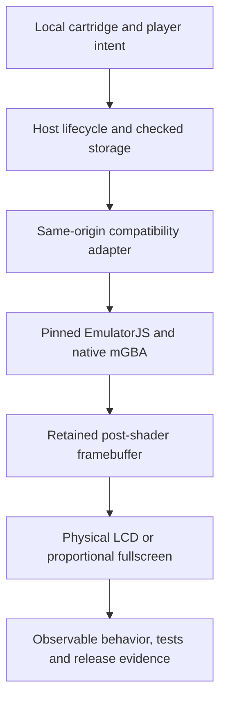

# Building a Little Escape

## The BowserBOY engineering book

**Second rendered edition, 2026-11-06:** the
[fourteen-chapter BookMaker edition](editions/2026-11/README.md) adds current
sharpness, lamp/LED and release-engineering lessons, a capstone, worked
practice and references. [Read the96-page PDF](published/Building-a-Little-Escape.pdf),
now using the owner's supplied illustrated cover. The cover lettering is raster
artwork; the book's interior remains searchable. The tracked PDF is the reading
copy and separate manual-release companion; it becomes public when pushed.
An instant offline reader is also built locally. The linked edition explains
how to reproduce the delivery.
The [review record](editions/2026-11/REVIEW.md) states the exact artifact and
bounded inspection. The first Markdown edition below remains preserved.

**Public release milestone, 2026-11-06:** the owner designates
[v1.0.0](../releases/v1.0.0/README.md), based on qualified application
`c3d9dbd`, as the first publicly available release. The
[documentation map](../README.md) locates current guides and release
receipts. This does not reissue the pinned first book edition or recapture its
historical figures.

**First Markdown edition, 2026-11-04.** This is the first actual chaptered
engineering book for this project, not a renamed collection of guides. It
explains the implementation at application revision
`ab912d51ecc615f7aa55a4d27f6a876673739cdf`.

**Current reading note, 2026-11-05:** BowserBOY is the website; BowserBOY
ADVANCED is the first GBA console, retaining its original purple ADVANCE
artwork. The website now uses the separate chrome logo. More consoles are
planned, not implemented. Later notes cover audio-paced playback, original
soft A/B engraving, metallic-chroma bezel lettering and the larger colored
rear engraving. [Sources](SOURCES.md) distinguishes those later qualified
revisions from the pinned first edition; the earlier source links stay intact.

*Figure B-01. Refreshed local console capture, application source `6fb1890`. This later
figure is not a capture of the first-edition `ab912d5` source.*

The central engineering problem is not writing a GBA CPU from scratch. It is
making an existing native emulator behave like one coherent, recoverable,
physical-feeling browser appliance on a static host.

*Figure B-02. Reading the system from intent to visible evidence. Storage is
owned by the host; the adapter owns version-sensitive emulator access.*

## Read in this order

| Chapter | The question it answers |
|---|---|
| [01 - A console on a static website](chapters/01-static-console/README.md) | What runs where, and what does static hosting not provide? |
| [02 - Runtime, cartridge and power](chapters/02-runtime-and-power/README.md) | Why are power, pause, loading and restoring different operations? |
| [03 - Saves and recovery](chapters/03-saves-and-recovery/README.md) | How can progress survive a refresh without pretending browser storage is permanent? |
| [04 - Geometry and manufactured controls](chapters/04-handheld-geometry/README.md) | What makes this an actual 3D handheld rather than a flat illustration? |
| [05 - Pixels, lighting and fullscreen](chapters/05-pixels-and-light/README.md) | How does one native picture reach several presentations without restarting? |
| [06 - Input and interaction](chapters/06-input-and-interaction/README.md) | How do simultaneous inputs avoid stuck or prematurely released buttons? |
| [07 - Algorithms and data structures](chapters/07-algorithms-and-data-structures/README.md) | What are the actual algorithms, units, costs and invariants? |
| [08 - Design principles and trade-offs](chapters/08-design-principles/README.md) | Which boundaries improve reliability, and what do they not guarantee? |
| [09 - Testing and delivery](chapters/09-testing-and-delivery/README.md) | What distinguishes implementation, qualification and a verified public release? |
| [10 - Visual documentation and the development loop](chapters/10-documentation-and-development/README.md) | How do captures, guides, TODOs and causal journals remain consistent? |

Each chapter has a diagram, a concrete walkthrough, source pointers and a
small exercise with an answer. Chapter 07 assumes the projection and lifecycle
vocabulary introduced earlier. Read Chapter 09 before interpreting any PASS.

## How to use this edition

The [source register](SOURCES.md) binds explanations to exact implementation
files and symbols. It is not an exhaustive source atlas. The
[player guide](../GUIDE.md) remains the task-oriented setup reference;
[saving](../SAVING.md) remains the recovery reference. The
[development ledger](../../TODO/04_DEVELOPMENT_LEDGER.todo) preserves the causal
history, including failed approaches.

The book describes the qualified source, with release claims supported
separately. At initial authoring, frosted-notification source passes all hosted
gates while deployment is queued. Before finalizing this edition, that
deployment completes: all 28 public assets match and five actual public cases
pass, including notices, native input/speed, fullscreen/saves and pinch.
See the dated evidence in
[Verification](../VERIFICATION.md). Local captures are labeled in
[Media](../MEDIA.md). Desktop browser checks are not physical-phone
qualification or user aesthetic approval.

This deliverable is navigable Markdown with editable Mermaid diagrams and
embedded repository images. There is no PDF, EPUB or separately built reader
in this edition; none is implied by the word "book."
