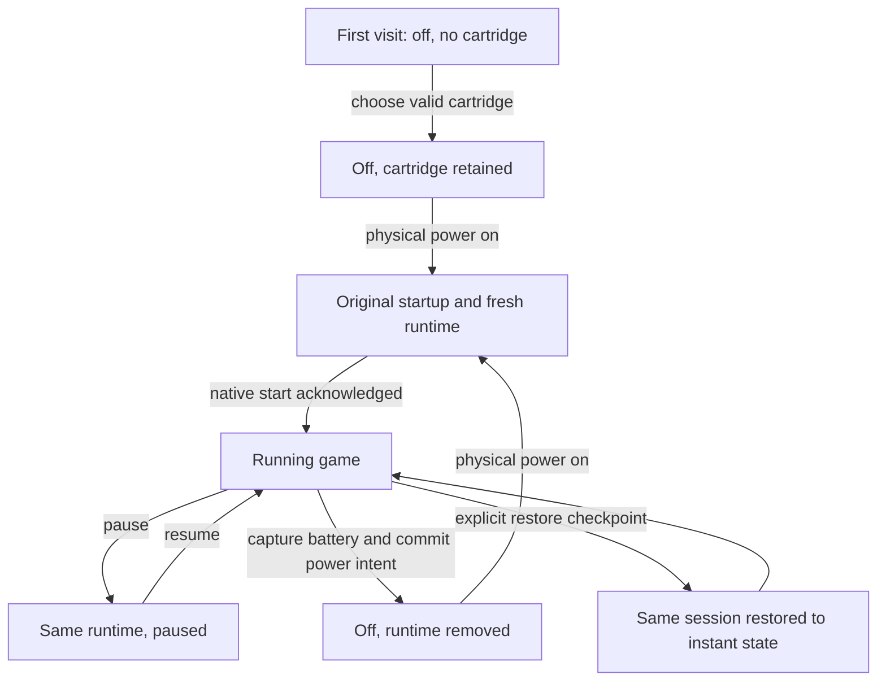

# 02 - Runtime, cartridge and power

[Previous](../01-static-console/README.md) | [Book index](../../README.md) | [Next](../03-saves-and-recovery/README.md)

## Power is not a synonym for pause

Pause retains the running machine. Physical power off destroys it. A checkpoint
restores an instant machine state. Battery data restores only the game's own
save medium. These four operations cannot safely share one convenient handler.

*Figure 02-01. The power-on route is a cold boot with available battery data,
not an automatic checkpoint load. Cartridge switching has its own recovery
policy.*

## Cartridge selection is a transaction of intent

`loadRom()` identifies the proposed file before disturbing the current game.
If another game is running, it checkpoints that game when automatic saving is
enabled. With automatic saving disabled, it asks before discarding progress.
The host reads the proposed game's record and rejects an incompatible runtime.

When storage is available, `rememberDevice()` records the new console intent
before the host replaces its cartridge variables. An unavailable store is
reported as a session-only limitation; a failed write is not falsely announced
as remembered state.

If power is off, selection inserts the cartridge visually but does not launch
the core. With power on, ordinary selection may resume the newest eligible
checkpoint unless the record's `bootMode` is battery. This differs deliberately
from pressing the physical power switch.

## A fresh child contains the version-sensitive machinery

`launch()` clears the previous player and creates a same-origin iframe.
It assigns a new random session ID, waits for the child's document and sends
the file, identity, preferences and chosen restore data. The host has a bounded
startup timeout and returns to a usable failure state if startup fails.

`initialize()` creates a temporary blob URL, configures the pinned native
runtime and loads its script. On native startup it configures settings,
revokes the ROM URL and either restores a checkpoint or loads battery bytes
into a fresh core and restarts it. Its acknowledgement follows that work,
not merely the iframe's HTML `load` event.

Both sides check origin, source window and session. Commands carry request
IDs. A late acknowledgement from a previous cartridge must not resolve a
new cartridge's request.

## Failure order matters

During physical power off, battery-save capture and required storage writes
happen before the host marks power off and clears the runtime. If the battery
write fails, the operation reports that power remains on. Destroying the
machine first would remove the user's chance to export the still-running
session.

The original startup animation and synthesized chime belong to the shell.
They are not a Nintendo BIOS and do not establish that the native core has
already booted. Reduced-motion mode shortens the presentation independently
of real loading.

**Exercise.** A player saves at level 3, makes a checkpoint at level 4, then
cycles physical power. Which state should appear?

**Answer.** A fresh ROM boot using available in-game save data, not the level-4
checkpoint. The checkpoint remains separately available for explicit restore.

**Source trail:** [S-01, S-02, S-04 and S-09](../../SOURCES.md);
[Saving](../../../SAVING.md).
