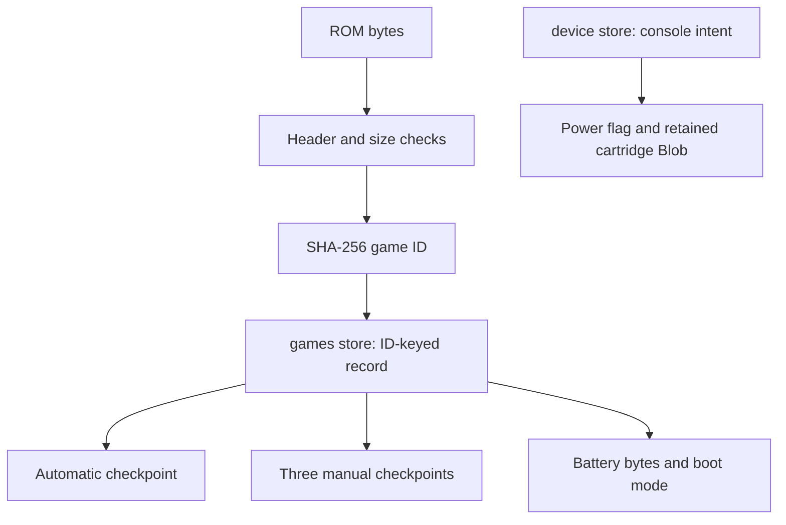

# 03 - Saves and recovery

[Previous](../02-runtime-and-power/README.md) | [Book index](../../README.md) | [Next](../04-handheld-geometry/README.md)

## Identify content, not a filename

`identifyRom()` checks an uncompressed `.gba` name, the 192-byte minimum,
32 MiB maximum and the fixed GBA header byte at offset `0xb2`. It then hashes
the file's complete bytes with SHA-256. These checks are a useful format
boundary, not a full proof that an arbitrary cartridge is valid or safe.

The hash is the storage key. Renaming a file therefore preserves its saves;
patching even one byte produces a different identity. A title is presentation
metadata, not a substitute for content identity.

*Figure 03-01. Game progress and remembered device intent have distinct
records. A device refresh is not a new game identity.*

## There are three kinds of protection

An automatic checkpoint is a rolling convenience. Three manual slots provide
independent rollback points. An exported `.bba-save` is portable recovery
outside browser storage. None is a cloud synchronization service.

Each checkpoint includes native instant-state bytes and optional battery-save
bytes. `putSlot()` also updates the record's battery field and selects checkpoint
boot mode. `putBattery()` changes the battery field and boot mode without
overwriting checkpoint slots. This is how a real power cycle can cold boot
while preserving separately restorable snapshots.

The database has a `games` store keyed by game ID and a `device` store for the
console record. An update reads and modifies a game within one read/write
transaction. The promise resolves on transaction completion, not the first
request callback. A successful `put` request followed by an aborted transaction
is not a successful save.

## Walk through a portable backup

`encodeBackup()` validates the capture, writes the format/version/runtime/ROM
identity and encodes the binary arrays as Base64. It includes SHA-256 hashes
of the state and optional battery bytes. `decodeBackup()` bounds file size,
parses JSON, checks format and runtime, requires the exact ROM identity,
validates Base64 and decoded capture sizes, then compares checksums.

The limits are deliberate: 16 MiB for native state, 1 MiB for battery bytes
and 24 MiB for the JSON backup file. Base64 expands binary data by roughly
one third, so encoded and decoded limits serve different purposes.
Chunked conversion avoids expanding a large array into one function call.

Checksums detect damaged bytes; they are not signatures or encryption.
An attacker who can rewrite a backup can also recompute its hashes. The
runtime identifier is a compatibility fence, not a promise that future native
versions can import every old snapshot.

## Recover without success-shaped fallbacks

Storage is bound to the browser profile and origin, including the port.
Switching from the public site to localhost is a different save location.
Private browsing, eviction and clearing site data can remove records.
The UI reports unavailable storage and keeps export useful instead of claiming
a session was saved permanently.

The database-opening timeout and blocked/version-change handling avoid waiting
forever behind another tab. They do not create backup copies elsewhere.

**Exercise.** A renamed ROM has the same bytes; a patched ROM has the same title.
Which can import the original backup?

**Answer.** The renamed byte-identical ROM. Title equality does not bypass the
exact content identity check. Export before migration; do not edit the backup's
ROM field to disguise incompatibility.

**Source trail:** [S-03 and S-04](../../SOURCES.md);
[recovery procedures](../../../SAVING.md).
