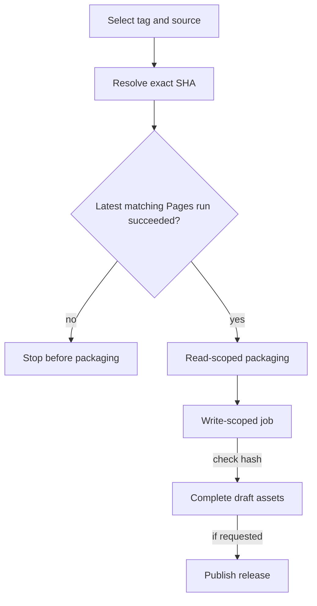

# 13 - Parallel tests and an exact-source release

## The question: which green result authorizes these bytes?

A release pipeline is not merely a command that uploads a ZIP. It is an
argument that the selected source passed the required gates, that the package
contains the intended files and that publication does not move an existing
identity. The argument fails if evidence for one commit is attached to another.

This chapter explains the implemented manual workflow at `9ff921b`.
It does not announce a successful release. The actual first dispatch was
blocked by its qualification check, and that block is useful evidence of
the safety boundary.

## Parallelism changes placement, not acceptance

The current browser inventory is 56 cases across nineteen single-worker
jobs: eighteen groups of three and one group of two. Retries remain zero.
Cases must appear exactly once. Native, visual and protocol requirements
remain intact; extra runners are not a reason to reduce rendering resolution,
remove difficult cases or increase deadlines.

With perfect independence, wall time is approximately the longest shard plus
setup, queueing and deployment. The sum of test durations is not that wall
time. Heavy native startup, software-GPU contention and fixed browser overhead
can prevent linear speedup. More jobs also consume more aggregate resources.
Measure the actual critical path rather than claiming nineteen times faster.

The latest source still fails reload seating in one shard. Isolation is an
implemented technique, not proof that every scheduling problem is solved.
The earlier fully qualified visual release remains valid for its own bytes.

*Figure 13-01. Qualification and publication are distinct jobs. A checksum
protects artifact transfer identity; it cannot replace source qualification.*

## Resolve once, preserve existing names

The workflow accepts a version tag, optional source reference and draft and
prerelease flags. It resolves the checkout's exact SHA. A tag must have the
expected version form; an existing tag pointing elsewhere is rejected rather
than moved. An existing release is not silently overwritten.

The qualification step asks for the latest existing Pages run for that
exact SHA and requires completed success. A pending, failed or absent run
cannot be replaced with "main was green yesterday." The workflow does not
dispatch new verification as a side effect of this question.

The packaging job uses read permissions, runs the existing checks and builds
the allowlisted static output. Its notes identify source and successful
qualification. The archive contains the static site plus notices and notes,
not the whole repository, book source, context store or ROM collection.

## Grant write authority only where needed

The publication job downloads the completed artifact, verifies its checksum
and has the scoped permission needed to create a GitHub Release. It initially
creates a draft with all intended assets, then optionally publishes it.
This ordering reduces the chance of publicly presenting an incomplete upload.
It is not a universal atomic transaction: remote APIs and network failures
still need explicit operational handling.

Concurrency is grouped by release tag without canceling an in-progress request.
That controls overlapping attempts for the same identity; it does not create
permission to move tags or bypass verification. A package that passes local
validation is still not an externally published release.

## CH13-W01 - An absent exact-source success

Suppose commit A has a successful Pages run, but the owner selects commit B.
B's latest run is in progress. The correct release result is failure before
packaging/publication. No source-specific success exists yet. The workflow
does not guess that B will pass and does not quietly use A's package.

This matches the important boundary of the first real manual request:
it stopped safely while its chosen source had no successful exact-source
Pages qualification. A subsequent failed Pages result did not turn that
earlier block into a defect in the guard.

## CH13-R01 - A changed tag destination

Now B qualifies, but the requested tag already points to A. Should the pipeline
move the tag to B because B is newer? No. Tag identity is part of the contract.
Choose an appropriate new version through the owner's normal process.
Qualification and naming are independent gates.

## CH13-Q01 - Does a static ZIP include the native core?

The archive contains the allowlisted site. Does extracting it make native
startup fully offline and preserve origin-local saves from the public site?

## CH13-A01 - Packaging does not erase runtime boundaries

No. The runtime still fetches the pinned upstream distribution. Saves belong
to the browser profile and origin, so a different host or port has a different
store. Serve the extracted package over HTTP, preserve notices and export
saves before changing hosts. The package checksum identifies bytes, not
network availability, licensing clearance or save migration.

## What you can now decide

For a release request, you can name the exact source, exact qualification,
exact tag and exact archive. If one is missing, say which one. A blocked
release can be the correct implementation result while operational delivery
remains incomplete.

**Source:** `.github/workflows/release.yml`, `.github/workflows/pages.yml`,
`docs/releases/README.md` and the dated receipts in `docs/VERIFICATION.md`.
