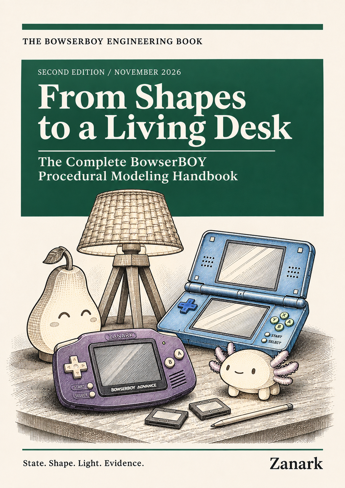
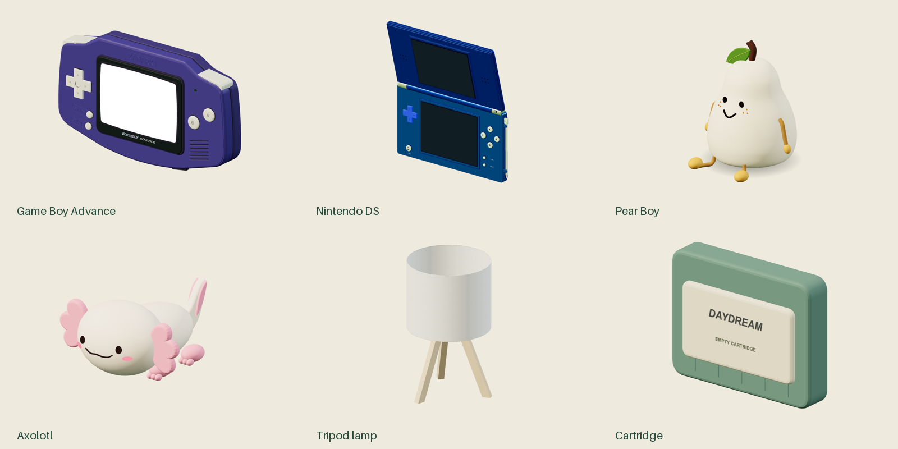

# From Shapes to a Living Desk

## The complete BowserBOY procedural modeling handbook



*Figure M-C. Owner-supplied cover, used unchanged in the PDF and offline reader.
This November 8 cover revision preserves the original modeling-book interior.*

An independent, detailed construction manual for the GBA, Nintendo DS, cartridges, stylus, Pear Boy, axolotl, tripod lamp, desk and room. It explains actual libraries, geometry, material and texture techniques, transform ownership, movement, lighting, debugging, algorithms, design principles and a reusable agent workflow.



*Figure M.1. Actual factory geometry under declared neutral-studio lighting, with model emission disabled. The DS lid uses a diagnostic pose. These are construction views, not gameplay or real-room photometry.*

[Read the PDF](published/From-Shapes-to-a-Living-Desk.pdf) |
[Open the offline reader](published/Reading-Edition.html) |
[Exact edition and checks](published/edition-manifest.json) |
[Review scope](REVIEW.md) |
[Standalone agent handoff](AGENT-HANDOFF.md)

The implementation is pinned to `1e4ef518d6943ab1af39cef3b4d558f209a17891`. The later manuscript, illustrations and production inputs have their own exact hashes. This book is independent of the preserved [GBA engineering book](../book/README.md) and [NDS-only development journey](../nds-book/README.md).

**328 pages, 38 chapters, 76 diagrams.** Of those pages, 268 contain actual chapter content. The [review](REVIEW.md) records mechanical qualification, bounded visual inspection and explicit limits.

## Begin with the method

Read [the orientation](orientation.md), then the relevant model part, followed by algorithms, design principles and reconstruction. Every chapter contains substantive explanation, compact vertical construction diagrams, worked examples, a changed-condition retry and an explained exercise. [Sources and limits](SOURCES.md) separate implementation, history, consulted research and proposed extensions.

### Part 1 - Foundations and the Game Boy Advance

| Chapter | Construction focus |
|---|---|
| [MD01 - Evidence and toolchain](chapters/01-evidence-and-toolchain/README.md) | Libraries, versions, provenance and what was actually used |
| [MD02 - Modeling contract](chapters/02-modeling-contract-and-references/README.md) | Silhouette, reference interpretation and explicit invariants |
| [MD03 - Coordinates and transforms](chapters/03-coordinate-systems-and-transforms/README.md) | Origins, axes, units, groups and ownership |
| [MD04 - Geometry toolkit](chapters/04-procedural-geometry-toolkit/README.md) | Paths, extrusion, rounding, lathing and topology |
| [MD05 - GBA shell](chapters/05-gba-shell-and-silhouette/README.md) | Front/rear layers, seams and speaker apertures |
| [MD06 - GBA LCD and frame](chapters/06-gba-lcd-glass-and-frame/README.md) | Fitted outline, linear UVs and the absence of a separate glass slab |
| [MD07 - Controls and grips](chapters/07-gba-controls-and-grips/README.md) | Caps, D-pad, sockets, glyph recesses and travel |
| [MD08 - Cartridges and markings](chapters/08-cartridges-details-and-markings/README.md) | Ports, battery cover, engraving and small physical cues |
| [MD09 - Textures and assets](chapters/09-procedural-textures-and-asset-boundaries/README.md) | Canvas textures, contour recovery and supplied artwork |

### Part 2 - The articulated Nintendo DS

| Chapter | Construction focus |
|---|---|
| [MD10 - Assembly and parameter map](chapters/10-ds-assembly-and-parameter-map/README.md) | Lower deck, lid and returned model handles |
| [MD11 - Hinges and articulation](chapters/11-hinges-lids-and-articulation/README.md) | Local pivot, opening-angle complement and state guards |
| [MD12 - Shells and hardware](chapters/12-ds-shells-recesses-and-hardware/README.md) | Recess topology, floors, pads, battery and slots |
| [MD13 - Controls and markings](chapters/13-ds-controls-and-readable-markings/README.md) | Clearance, ownership, legends and cap response |
| [MD14 - Dual LCDs and glass](chapters/14-dual-lcds-and-curved-glass/README.md) | Planar DS displays, reflective off-state and active pixel invariants |
| [MD15 - Stylus and touch](chapters/15-stylus-and-touch-geometry/README.md) | Pen geometry, contact anchor, UV conversion and queue |
| [MD16 - Loading choreography](chapters/16-cartridge-insertion-and-loading/README.md) | Card pose, elapsed-time interpolation and LCD handoff |
| [MD17 - Inspection and camera](chapters/17-inspection-camera-and-manipulation/README.md) | Bounds, fitting, manipulation and projected targets |
| [MD18 - DS regression atlas](chapters/18-ds-model-regression-atlas/README.md) | Model contracts, ray evidence and honest coverage limits |

### Part 3 - Characters, softness and movement

| Chapter | Construction focus |
|---|---|
| [MD19 - Pear body](chapters/19-pear-body-parametric-surface/README.md) | Parametric surface and recognizable proportions |
| [MD20 - Curved face projection](chapters/20-pear-face-and-curved-projection/README.md) | Expression-first projection and shell clearance |
| [MD21 - Expressions and gaze](chapters/21-expressions-gaze-and-freckles/README.md) | Cute features, movement range and all six freckles |
| [MD22 - Limbs and rope](chapters/22-limbs-rope-and-soft-motion/README.md) | Soft-looking construction and motion ownership |
| [MD23 - Axolotl body](chapters/23-axolotl-silicone-body/README.md) | Silicone-like volume and material roles |
| [MD24 - Gills and features](chapters/24-gills-tail-and-cute-features/README.md) | Tail, gills, feet and facial detail |
| [MD25 - Companion emission](chapters/25-companion-light-emission/README.md) | Surface emission, point lights and readable faces |
| [MD26 - Dragging and dropping](chapters/26-drag-gravity-and-drop/README.md) | Pointer ownership, gravity, settling and painted poses |
| [MD27 - Clearance and homes](chapters/27-clearance-and-home-poses/README.md) | Complete bounds, sweep envelopes and safe rest positions |

### Part 4 - A complete, verifiable 3D world

| Chapter | Construction focus |
|---|---|
| [MD28 - Desk, room and lamp](chapters/28-desk-room-and-tripod-lamp/README.md) | Environment geometry, scale and tripod construction |
| [MD29 - Light and color](chapters/29-light-units-exposure-and-color/README.md) | Units, exposure, color management and controlled tuning |
| [MD30 - Shadows and reflections](chapters/30-shadows-reflections-and-shaders/README.md) | Update policy, reflected environment and shader boundaries |
| [MD31 - Screen materials](chapters/31-screen-materials-and-pixel-preservation/README.md) | Native pixels, sampling, glass and illumination |
| [MD32 - Picking and ownership](chapters/32-picking-occlusion-and-input-ownership/README.md) | Foremost surfaces, ancestor visibility and competing input |
| [MD33 - Render lifecycle](chapters/33-render-loop-gpu-budgets-and-lifecycle/README.md) | Time, GPU budget, resource ownership and cleanup |
| [MD34 - Algorithms](chapters/34-algorithms/README.md) | Equations, data structures, costs and invariants |
| [MD35 - Design principles](chapters/35-design-principles/README.md) | Boundaries, representations and failure containment |
| [MD36 - Validation and recovery](chapters/36-validation-recovery-and-history/README.md) | Layered evidence, bounded fixes and explicit coverage debt |
| [MD37 - Causal history](chapters/37-causal-modeling-history/README.md) | Verified changes, failed approaches and superseded assumptions |
| [MD38 - Agent reconstruction](chapters/38-agent-reconstruction-and-extension/README.md) | Repeatable implementation and responsible extension |

## Reproduce the edition

From the repository root, with the established dependencies and supported browser:

```powershell
node --test docs\book\production\production.test.mjs
python -B -m unittest discover -s docs\book\production -p native_rules_test.py
node docs\book\production\build-models.mjs
node docs\book\production\render.mjs --models
```

Set `BOOK_REVIEW_DIR` to an explicitly chosen private directory when native review images are needed. The modeling route has its own ignored candidate and output directories. It does not rebuild either preserved book.

The assembler enforces meaningful chapter prose, source-span validity, model inventories, required learning markers and approved illustrations. Both browser and native checks require at least 200 actual pages **and** 200 unique chapter-content pages, excluding openers and reference appendices. The exact artifact review records real counts and bounded visual inspection; page count alone is not proof of quality.

To reproduce the separate eighteen-view atlas, run `tools/capture-model-atlas.mjs`, then `tools/make-atlas-plates.py --review` with an explicit review-directory argument. The [capture manifest](assets/atlas/capture-manifest.json) documents the actual conditions and hashes. No ROM or private recording is needed.

Published artifacts are repository downloads, not extra emulator Pages assets. The offline reader is self-contained and scriptless. This book does not claim complete agent-memory replication, fresh-machine or cross-browser qualification, PDF/UA, printer prepress, user aesthetic approval or independent rights clearance.
