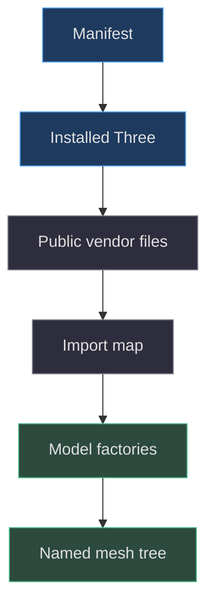
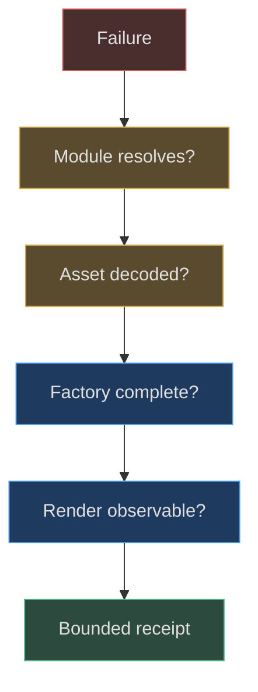

# Evidence, libraries and the actual toolchain

## What this reconstruction can establish

A useful modeling book must explain how to rebuild an object, not merely identify the library that draws it. This part reconstructs the Game Boy Advance family from executable geometry, image-processing operations, materials, tests, and recorded changes. Its implementation baseline is commit `1e4ef518d6943ab1af39cef3b4d558f209a17891`. Numbers described as implementation values belong to that baseline. Exercises and proposed diagnostics are teaching additions, not claims that the original author used those procedures.

The central evidence is unusually direct: `createHandheld()` creates a group and populates it with named meshes; `createCartridge()` creates a second group; `createWood()` paints a texture. These are construction programs rather than imported finished models. Reading them reveals shapes, coordinate relationships, material sharing, and initial visibility. It does not reveal the author's unrecorded reasoning, physical measurements, or subjective approval. See [the factory boundaries](https://github.com/Zanark/BowserBoy/blob/1e4ef518d6943ab1af39cef3b4d558f209a17891/src/handheld.js#L392-L410) (`src/handheld.js:392`) and [the cartridge and wood factories](https://github.com/Zanark/BowserBoy/blob/1e4ef518d6943ab1af39cef3b4d558f209a17891/src/handheld.js#L645-L685) (`src/handheld.js:645`).

Use three evidence categories throughout this part. **Implementation** means behavior visible in the pinned source. **Historical record** means a commit diff or public workstream says something happened; that statement retains its date and limitations. **Recommendation** means a reproducible technique proposed here. These categories prevent a common documentation error: converting a sensible present-day workflow into an invented account of how a model was originally made.

## The small runtime toolchain

The root manifest declares one runtime npm dependency, Three.js `0.186.1`, and the development dependency `@playwright/test` `1.64.1`. It declares ES modules and Node `>=22`. The lock entries and installed package manifests inspected for this reconstruction agree with those two versions. Agreement verifies this workspace's declarations and installation; it is not evidence that a clean machine was installed or tested during this writing. [Manifest](https://github.com/Zanark/BowserBoy/blob/1e4ef518d6943ab1af39cef3b4d558f209a17891/package.json#L1-L24) (`package.json:1`); [locked packages](https://github.com/Zanark/BowserBoy/blob/1e4ef518d6943ab1af39cef3b4d558f209a17891/package-lock.json#L20-L28) (`package-lock.json:20`).

Three.js provides the scene graph, shapes, triangulation, extrusions, lathe geometry, materials, and textures used by these factories. Browser Canvas 2D supplies text rasterization and image processing. Neither a Blender project nor a GLTF loader participates in the construction path examined here. This is a bounded claim about these sources, not a claim that no external creative tool ever existed. In particular, supplied brand artwork is an input asset whose earlier creation cannot be reconstructed from the geometry factory.

The browser resolves the bare module name `three` through an import map to `./vendor/three.module.js`. This is not a bundler rewriting application imports. The build copies allowlisted public files, including the Three module, core, light helpers, and license. Its separate demo-generation calls do not turn cartridge props into ROM-derived meshes. [Browser entry](https://github.com/Zanark/BowserBoy/blob/1e4ef518d6943ab1af39cef3b4d558f209a17891/web/index.html#L8-L12) (`web/index.html:8`); [delivery map](https://github.com/Zanark/BowserBoy/blob/1e4ef518d6943ab1af39cef3b4d558f209a17891/scripts/site-files.mjs#L4-L25) (`scripts/site-files.mjs:4`).



Figure MD01.1. The application resolves a packaged library into procedural factories; the delivery step does not author geometry.

## Separate construction, presentation, and publishing

The book-production directory has its own manifest. Its Markdown parser, Mermaid, Paged.js, and browser automation dependencies produce documentation, not the handheld. Sharing a package family or version between production and tests does not merge their responsibilities. When recording a toolchain, assign each dependency to the operation it actually performs; otherwise a future agent might look for a CAD export that never existed. [Production manifest](https://github.com/Zanark/BowserBoy/blob/1e4ef518d6943ab1af39cef3b4d558f209a17891/docs/book/production/package.json#L1-L18) (`docs/book/production/package.json:1`).

Similarly, a diagnostic render is a presentation of factory output. It can expose topology, layering, silhouette, or missing assets under controlled light. It cannot prove the room's final lighting behavior, emulator upload cadence, or accessible interaction. Those require integration evidence. The browser test that raycasts the LCD, speaker slot, and D-pad well is stronger evidence of those particular surfaces than a flattering front image, but it does not establish an accurate physical replica.

The historical record supports this distinction. The initial tabletop workstream records an actual-mesh requirement and later records rejection of the first shape despite passing tests. The reference correction explicitly separates independent geometry from extraction of a supplied reference model. Those records teach why visual and technical acceptance are different, without granting either one today. [Recorded correction](https://github.com/Zanark/BowserBoy/blob/1e4ef518d6943ab1af39cef3b4d558f209a17891/TODO/07_REFERENCE_SHAPE.todo#L18-L34) (`TODO/07_REFERENCE_SHAPE.todo:18`).

## MD01-W01 Trace one visible object to its dependencies

Consider the A button. Begin at the named `A button` mesh, not a screenshot. The factory uses a lathed cap, selects a cloned rubber material, and attaches recessed lettering. The letter outline is recovered from browser-rendered Arial alpha; contour extraction turns that raster boundary into geometry. Thus the button depends on Three.js and browser text rasterization even though its final letter is not a painted decal. The distinction matters when comparing machines: the system font can affect a geometric cut.

Next identify dependencies that do **not** belong to that object. The loaded cartridge's title canvas does not determine the A glyph. The book renderer does not determine the lathe profile. The native emulator shader does not manufacture the cap. A rigorous receipt names these negative boundaries only after following the positive construction chain. [Cap and glyph construction](https://github.com/Zanark/BowserBoy/blob/1e4ef518d6943ab1af39cef3b4d558f209a17891/src/handheld.js#L116-L137) (`src/handheld.js:116`); [glyph recovery](https://github.com/Zanark/BowserBoy/blob/1e4ef518d6943ab1af39cef3b4d558f209a17891/src/handheld.js#L232-L252) (`src/handheld.js:232`).

The following original diagnostic is runnable in the browser developer console of an already-served project page. It does not load a ROM, call the complete handheld factory, or change the application. It creates a separate cartridge and reports its structural receipt. Its assumptions are a functioning page import map and browser Canvas 2D. Expected outcomes are five named grip meshes and two text planes, not a pixel-identical image across all operating systems.

```js
// Pedagogical diagnostic; not application implementation.
const { createCartridge } =
  await import('./src/handheld.js');
const prop = createCartridge('#666574', 'TEST', 'LOCAL');
const names = [];
prop.traverse(node => {
  if (node.isMesh) names.push(node.name || '(text plane)');
});
console.table(names);
console.assert(
  names.filter(n => n === 'Cartridge grip').length === 5
);
```

Why inspect the object without rendering it? It isolates factory assembly from camera, lighting, and the live scene's state. A missing grip count is a construction problem. A present grip that cannot be seen in a render may instead be behind another surface or below image resolution. This staged distinction reduces speculative parameter editing.

## MD01-R01 Retry when the library appears correct but imports fail

Suppose the installed package version is correct, yet the browser reports that `three` cannot be resolved. Reinstalling packages is not the first justified repair. Check whether the served HTML contains the import map, whether its relative vendor URL resolves under the current base path, and whether both module and core files were delivered. The build maps source locations to public destinations; a filesystem import that works in Node does not demonstrate browser delivery.

Now change the condition: the import succeeds, but `createHandheld()` fails while drawing the wordmark. This is a different boundary. `brandImage` is a live export populated by asynchronous image loading. The factory draws it directly. The relevant repair investigation is initialization order and asset decoding, not Three.js geometry segmentation. [Brand loader](https://github.com/Zanark/BowserBoy/blob/1e4ef518d6943ab1af39cef3b4d558f209a17891/src/brand.js#L1-L15) (`src/brand.js:1`).

Record each retry with its changed condition and observable result. “Dependencies fixed” is too broad. “Vendor module now resolves; brand image still undecoded” preserves useful causal information. It also avoids claiming clean-machine reproduction merely because a warm workspace recovered. A future agent should be able to repeat the narrow observation without inheriting an unexplained success label.



Figure MD01.2. Diagnose the earliest failed boundary before changing a later modeling parameter.

## MD01-Q01 Decide what a successful test proves

An agent reports: “The real-3D browser case passed, so the GBA is dimensionally accurate, the source model was imported legally, every control remains illuminated while pressed, and the book is ready to publish.” Identify which parts follow from the inspected evidence. Design a stronger replacement report without running a publishing operation.

## MD01-A01 Evidence has a measurable scope

The report overreaches in four different directions. The real-3D case checks a triangle threshold, movement into play, front orientation, particular raycast surfaces, and further interaction behavior. Its surface assertions establish an unobstructed center LCD, a recessed speaker comparison, and a bounded pivot well. They do not compare a caliper measurement or CAD reference. Replace “dimensionally accurate” with those explicit observations. [Surface assertions](https://github.com/Zanark/BowserBoy/blob/1e4ef518d6943ab1af39cef3b4d558f209a17891/tests/browser/scene.spec.mjs#L1351-L1391) (`tests/browser/scene.spec.mjs:1351`).

The reference workstream says the geometry was independently authored and the external model was unavailable for extraction. That is a historical provenance statement, not a license grant discovered by a geometry test. The complete-press-response test is explicitly parked in the pinned suite, while separate aperture-lighting cases contain active assertions. Their existence cannot be summarized as a fresh pass of all controls under every light. Publication readiness requires its own authorized integration process; neither a mesh test nor this chapter performs it.

A defensible replacement report identifies the pinned revision, exact inspected or executed cases, active versus skipped status, and unmeasured properties. This writing inspected tests but did not execute them. That limitation is useful rather than embarrassing: it tells the next agent precisely where new evidence is required.

## Research that informs recommendations, not history

### Build a receipt that another agent can challenge

A useful reconstruction receipt has an input identity, an operation, an observation, and a limitation. For example, identify the pinned handheld factory, describe creating an independent cartridge, report five grip meshes, and state that no rendering or runtime insertion was exercised. A later agent can challenge any one of these elements without discarding the whole account. “Looks correct” has no comparable structure.

Line citations serve a related purpose. Cite the helper that defines a bevel convention as well as the call site that chooses a particular bevel. Citing only the call site leaves readers guessing whether the geometry is centered or how thickness expands. Citing only the helper cannot prove that the shell actually uses it. The source pair creates a short, auditable construction chain.

For version-sensitive recommendations, record the gap between what documentation describes and what the implementation invokes. A current API page can contain features added after the project was pinned. It is not safe to retrofit those features into the historical account simply because they would simplify the explanation. Prefer the subset confirmed by the source, then label newer alternatives explicitly.

Finally, preserve failures and skipped checks as first-class evidence. An unresolved retained-frame reload issue belongs beside the otherwise useful CRT assertions, not in an unrelated footnote. An unavailable font is an input limitation, not an excuse to claim exact contours anyway. This approach makes a book useful as an engineering handoff: the next agent receives both a construction method and the edges beyond which it must gather new evidence.

The current [Three.js Object3D documentation](https://threejs.org/docs/pages/Object3D.html), [BufferGeometry documentation](https://threejs.org/docs/pages/BufferGeometry.html), and [CanvasTexture documentation](https://threejs.org/docs/pages/CanvasTexture.html) were consulted on 2026-11-07. They support teaching about local/world transforms, indexed attributes and normals, and canvas-backed textures. They are latest documentation, not a frozen description of the project's original development environment. The implementation and lockfile remain authoritative for what this project actually calls and installs.
