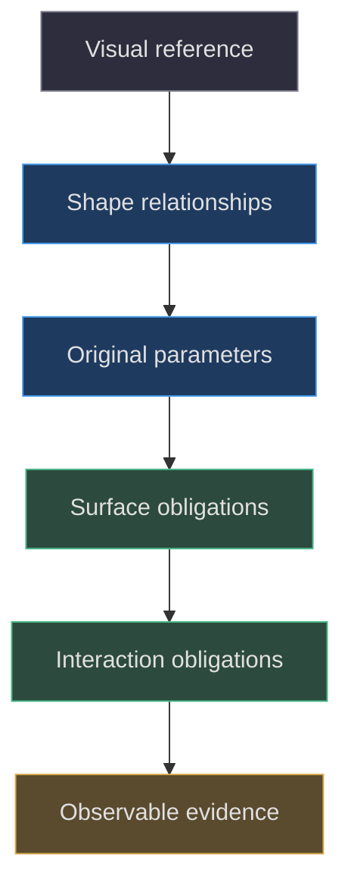
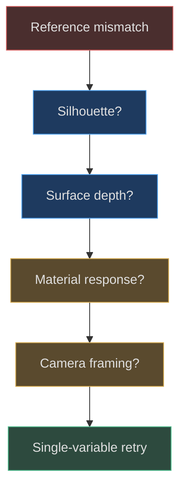

# The modeling contract and visual references

## A reference is a question, not a mesh specification

The hardest modeling decision often precedes the first vertex: deciding what the object must communicate. Here the historical reference correction names a stepped upper crown, straighter sides, outward lower bow, lower-profile controls, and an angled recessed grille. These are actionable shape relationships. “Make it look more like a GBA” is not. The record also says the first model was rejected despite technical test success. Treat that as a warning against letting a passing runtime suite define aesthetic correctness. [Reference contract](https://github.com/Zanark/BowserBoy/blob/1e4ef518d6943ab1af39cef3b4d558f209a17891/TODO/07_REFERENCE_SHAPE.todo#L1-L24) (`TODO/07_REFERENCE_SHAPE.todo:1`).

This chapter reconstructs a contract from public artifacts; it does not recover the author's thoughts. The external reference's recorded download and license availability are historical observations, not a current audit of that service. The implemented model remains a set of independently specified curves and primitives. No dimensional drawing, calibrated photograph, or measurement survey is present in the evidence read for this part. Consequently, source units must remain scene units, not retroactively invented millimeters.

Begin with observable relationships: the crown is narrower than the widest side region; the screen sits centrally; the D-pad and action buttons occupy opposite sides; the speaker slots descend on the right; the rear has a separate battery cover. Each relationship can be traced to source coordinates. None requires reproducing copyrighted reference artwork. This distinction makes the workflow reusable: analyze organization and silhouette, then author original geometry whose parameters and limitations are explicit.

## Translate appearance into layers of obligation

A useful contract has four layers. **Identity** asks whether the outline and landmark arrangement read as the intended device. **Construction** asks whether holes, floors, relief, and depth ordering actually exist. **Behavior** asks whether the assembled hierarchy can move and be inspected without separating parts. **Evidence** asks how each previous claim will be observed. Keeping these layers separate prevents an easy screenshot from becoming the only acceptance test.

The implementation provides a concrete identity scaffold. The outline reaches the central crown at `y=2.42`, uses side control points around `x=±4.28`, and bows downward through a control point at `y=-2.61`. These are path controls, not guaranteed final extrema. Extrusion bevels also expand the eventual surface. A bounding-box test must measure the generated geometry rather than substitute the largest literal found in the path. [Outline construction](https://github.com/Zanark/BowserBoy/blob/1e4ef518d6943ab1af39cef3b4d558f209a17891/src/handheld.js#L410-L430) (`src/handheld.js:410`).

Construction obligations are more specific. The thin front face receives control and speaker holes; recessed dark surfaces lie behind those openings. A mark intended to be molded uses geometry, while the bezel wordmark uses a processed texture. Behavior obligations preserve cap-child lettering and the loaded cartridge's parent relationship. These distinctions are not cosmetic bookkeeping: they decide which transformations and materials should change together.



Figure MD02.1. A reference becomes useful when translated into independent parameters and bounded observations.

## Choose landmarks before choosing detail density

Landmarks make comparisons interpretable. For this device, use the crown center, shoulder transitions, widest sides, bottom bow, screen center, control centers, and battery cover. Compare these before screw slots or chrome tint. A beautiful screw cannot repair an oval silhouette that violates the reference contract. This is a recommended analysis order, not a claim that the original implementation was written in this sequence.

The source's control table is especially valuable because it separates functional locations from visual commentary. A is at `(3.55,.50)`, B at `(2.76,-.02)`, Start at `(-2.64,-.98)`, and Select at `(-2.70,-1.5)`. Their socket radii differ from cap radii. That gives two independent checks: landmark position and local clearance. The D-pad opening is constructed from a scaled cross rather than a circular placeholder. [Control landmarks](https://github.com/Zanark/BowserBoy/blob/1e4ef518d6943ab1af39cef3b4d558f209a17891/src/handheld.js#L434-L456) (`src/handheld.js:434`).

Assets need their own contract. The brand loader decodes four supplied PNGs, whereas the factory derives a wordmark from `brandImage`. An independently modeled shell does not imply independently authored input artwork. Conversely, supplied artwork does not mean the shell came from an imported model. Document these ownership boundaries separately so a future agent does not confuse provenance of pixels with provenance of triangles. [Asset inputs](https://github.com/Zanark/BowserBoy/blob/1e4ef518d6943ab1af39cef3b4d558f209a17891/src/brand.js#L1-L15) (`src/brand.js:1`).

## MD02-W01 Derive a measurable speaker requirement

Suppose a reference review says “the grille should be recessed, not raised rails.” Translate that sentence into a surface experiment. First select a point near a slot center, `(3.02,-.79)`. Then select the neighboring solid face at `(3.02,-.87)`. Shoot both rays from the front along the device's negative local Z direction. Convert both hit positions back into root-local coordinates and subtract their depths. A positive face-minus-slot result shows a recession at these sample locations.

The existing browser case does exactly this kind of comparison and requires a difference above `.02` scene units. It is not a measurement of every point in all six slots. It does, however, reject a surface arrangement where both probes land on a raised decorative strip. [Existing sample and threshold](https://github.com/Zanark/BowserBoy/blob/1e4ef518d6943ab1af39cef3b4d558f209a17891/tests/browser/scene.spec.mjs#L1370-L1391) (`tests/browser/scene.spec.mjs:1370`).

An original pseudocode recipe extends the reasoning without pretending to be an existing test:

```text
Pedagogical recipe; use a factory root with fresh matrices.
For each of six speaker slots:
  Raycast the center from local positive Z.
  Raycast a neighboring solid-face point.
  Convert both hits into root-local coordinates.
  Record faceZ minus slotZ and both mesh names.
Expect every chosen center to hit a lower receiving surface.
Reject missing hits; do not convert them into zero depth.
```

This recipe assumes the neighboring point really lies between slots, not inside a rotated aperture. The slots are angled `.23` radians, so a naive vertical offset can become ambiguous near their ends. Begin at the shared X center where the original comparison is understood, then derive offset points in the slot's local frame if broadening coverage. The experiment is geometric; it does not prove the opening looks good under every material or light.

Now connect the requirement to construction. The face receives a rounded hole path; the dark grille is a separate shape behind it. If the ray hits an underlying shell instead of the named grille, the depth result may still be positive. Recording hit names prevents silently accepting the wrong ownership. This is why a good modeling contract specifies both shape and observable component identity.

## MD02-R01 Retry when a closer view changes the judgment

Imagine the front diagnostic looks convincing at thumbnail scale, but an oblique close-up makes the controls appear pasted on. Do not immediately increase bevel segments. First ask which obligation failed: missing cap curvature, missing socket clearance, floating marks, or wrong material response? The source uses a lathed cap and genuine A/B cutouts, so a current failure might instead arise from view angle, an altered transform, or loss of the intended floor depth.

Change one condition at a time. Hold the model pose and replace decorative lighting with neutral studio light for shape diagnosis. Then hold light and rotate to inspect depth. Finally restore the room to check presentation. The parent-provided atlas images in this book are diagnostic factory renders under neutral lighting; they are not historical screenshots or evidence of live-room behavior. That limitation is the reason for using them, not an apology for them.

The old geometry chapter records successive changes from raised markings through recessed shapes to recovered Arial contours. It demonstrates that “softer” can refer to color, outline, or shadow depth. A retry should therefore name the changed property explicitly. “Reduced groove depth while preserving contour and cap material” is reproducible; “made letters nicer” is not. [Historical distinctions](https://github.com/Zanark/BowserBoy/blob/1e4ef518d6943ab1af39cef3b4d558f209a17891/docs/book/chapters/04-handheld-geometry/README.md#L39-L79) (`docs/book/chapters/04-handheld-geometry/README.md:39`).



Figure MD02.2. Separate shape, material, and presentation hypotheses before deciding which parameter to change.

## Precision without false metrology

Precision means controlling a defined quantity. It does not require pretending scene units are physical dimensions. A raycast depth comparison is precise in the model's coordinate system. A shortest-distance screen-edge fit is precise in sampled framebuffer pixels. A claim of hardware accuracy needs additional calibrated evidence that these sources do not supply. Keep the unit beside every threshold and explain the sample domain.

The LCD workstream is a useful precedent: it requires sampled image edges inside the geometry and a thin keyline, but explicitly calls the outline a fit rather than a guarantee for arbitrary shaders. Similarly, the player test changes native presets and checks that only CRT Geom uses curved geometry. That contract is conditional on the selected presentation, not an absolute requirement that every screen corner always be curved. [LCD acceptance](https://github.com/Zanark/BowserBoy/blob/1e4ef518d6943ab1af39cef3b4d558f209a17891/TODO/13_CURVED_LCD_BORDER.todo#L17-L26) (`TODO/13_CURVED_LCD_BORDER.todo:17`); [preset distinction](https://github.com/Zanark/BowserBoy/blob/1e4ef518d6943ab1af39cef3b4d558f209a17891/tests/browser/player.spec.mjs#L265-L273) (`tests/browser/player.spec.mjs:265`).

## Choose comparisons that survive camera changes

A front silhouette comparison should use the device frame rather than the screen's current pixel rectangle. Perspective changes apparent spacing: a nearer shoulder can look wider without any geometry change. For a proposed parameter study, hold the camera fixed or compare orthographic diagnostic views, then use an oblique view to expose depth. This is a recommended experimental design, not a statement that the historical reference was calibrated.

Likewise, normalize a landmark comparison deliberately. Dividing every horizontal distance by shell width is useful for proportion, but it can hide an absolute clearance loss when the shell changes size. Record both the raw scene-unit gap and its normalized ratio. If the screen stays fixed while the case widens, these two quantities answer different questions: available space versus visual balance.

Do not treat every reference feature as mandatory. Some details may be occluded, licensed only for viewing, or ambiguous in perspective. Place those in an uncertainty list and author a bounded approximation instead of inventing unseen structure. That discipline is especially important for the simplified cartridge rear, whose absence of connector geometry is known from the factory rather than solved by imaginative reconstruction.

## MD02-Q01 Define a contract for a wider handheld

A future agent proposes widening the shell by ten percent while leaving the screen unchanged. What observations should be required before accepting the change? Distinguish a visual redesign from faithful reconstruction, and explain why simply scaling the root is not the same experiment.

## MD02-A01 Preserve the distinction between redesign and reconstruction

A wider shell is a proposed extension unless new evidence establishes it belongs to the pinned design. Record it as such. Keeping the LCD unchanged means root scaling is unsuitable: root scaling also widens the screen, changes control spacing, stretches text, and alters all child geometry. Instead define which shell path coordinates change and which landmarks remain fixed. Then regenerate or reposition dependent openings deliberately rather than let them drift as an accidental side effect.

Acceptance should compare front and oblique silhouettes, distances from controls to shell edges, speaker clearance, shoulder alignment, and actual LCD visibility. It should also inspect rear cover placement and screw locations, because a wider front with an unchanged rear can look assembled from unrelated parts. Interaction targets need fresh projection checks in the host, although those runtime changes lie beyond this part's factory analysis.

The answer is not “all tests pass.” Existing tests sample the old arrangement and may miss a new collision. Derive new probe points from the changed geometry, preserve the original baseline as a separate specimen, and report which observations are source-grounded versus proposed. That is how a modeling contract supports future agents without falsely freezing every aesthetic decision into universal truth.
