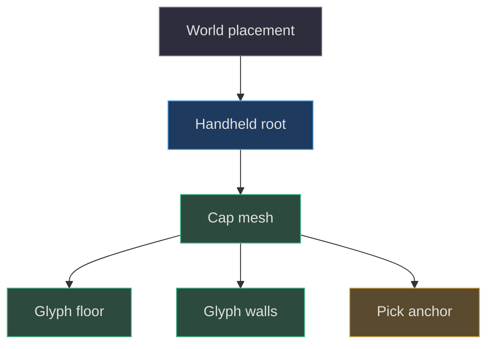
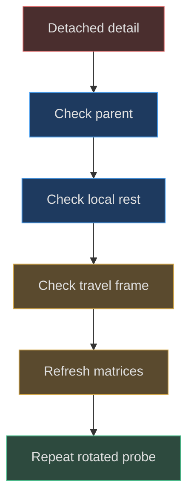

# Coordinate systems and transform ownership

## The device is modeled in its own frame

Before editing any dimension, establish the local axes. The handheld's major outlines lie in XY. Positive X runs toward the action buttons, positive Y toward the cartridge edge, and positive Z toward the display side. The rear cover sits at negative Z. These conventions follow the factory positions, not a global law imposed by Three.js. Once the device is placed on a desk, its root may rotate; the device's front is no longer necessarily world positive Z. [Front assembly](https://github.com/Zanark/BowserBoy/blob/1e4ef518d6943ab1af39cef3b4d558f209a17891/src/handheld.js#L462-L474) (`src/handheld.js:462`); [rear assembly](https://github.com/Zanark/BowserBoy/blob/1e4ef518d6943ab1af39cef3b4d558f209a17891/src/handheld.js#L631-L642) (`src/handheld.js:631`).

Scene units are consistent within that frame but are not documented physical units. A value of `.075` can be a meaningful cap travel relative to a `.29` cap radius without being millimeters. Preserve this distinction in calculations. Ratios and clearances remain useful; undocumented conversions create false precision and can corrupt camera and light reasoning elsewhere in the book.

Geometry coordinates and object coordinates are separate layers. `solid()` extrudes a shape then translates its vertices by negative half the nominal depth. The returned mesh can therefore be positioned around a convenient center. Bevel thickness still extends the resulting geometry beyond the nominal extrusion interval. A mesh's `position.z` alone is not its front surface. [Centered extrusion](https://github.com/Zanark/BowserBoy/blob/1e4ef518d6943ab1af39cef3b4d558f209a17891/src/handheld.js#L19-L30) (`src/handheld.js:19`).

## Ownership is the reason to use a hierarchy

The root owns placement of the entire device. A button owns its cap-relative lettering. The underside power group owns a track, slider, grip ridges, and printed label in a rotated frame. The rear engraving group owns the replacement cap, colored floor, and walls after turning them to face backward. These are not merely organizational containers: they encode which pieces inherit motion and orientation.

In mathematical terms, a local point reaches world space through the product of its ancestors' transforms and its own transform. Moving a parent changes every descendant consistently. Moving only a child changes that child's relationship to the assembly. The current [Object3D documentation](https://threejs.org/docs/pages/Object3D.html), consulted 2026-11-07, describes local position, quaternion, scale, and world matrices. That is present-day explanatory guidance; the pinned factory remains evidence for which hierarchy this project actually constructs.



Figure MD03.1. Cap-relative marks inherit cap motion; an independently positioned root-level label would not.

The `control()` helper records both a moving mesh and an anchor. All four D-pad directions share the same mesh, but each gets a different anchor. This separates the object that rocks from the point used to locate a directional target. It also stores rest position and rest quaternion only when motion metadata is absent, avoiding four independent rest definitions on one D-pad. [Control metadata](https://github.com/Zanark/BowserBoy/blob/1e4ef518d6943ab1af39cef3b4d558f209a17891/src/handheld.js#L553-L582) (`src/handheld.js:553`).

## Rotated geometry versus rotated objects

The cylinder helper rotates its geometry by ninety degrees around X so the cylinder's axis aligns with the device depth direction. That operation changes vertex coordinates before a mesh owns them. By contrast, the headphone mesh receives an additional object rotation later. Do not cancel or duplicate these transforms by intuition; inspect the helper and the call site together. A primitive's default axis is not necessarily the axis of the helper's output. [Cylinder helper](https://github.com/Zanark/BowserBoy/blob/1e4ef518d6943ab1af39cef3b4d558f209a17891/src/handheld.js#L110-L114) (`src/handheld.js:110`).

The power assembly makes the distinction concrete. Its group sits at `(1.55,-2.385,.12)` and has Euler rotation `(π/2,.15,0)`. Its children are authored as if looking straight at the local track face. The group turns that face toward the curved lower edge. This permits small parts to use simple local coordinates instead of repeating complicated world-space values. The code comment identifies local X as following the shell tangent; do not extend that into an unsupported exact surface-normal derivation. [Underside assembly](https://github.com/Zanark/BowserBoy/blob/1e4ef518d6943ab1af39cef3b4d558f209a17891/src/handheld.js#L611-L621) (`src/handheld.js:611`).

## MD03-W01 Derive a transform-invariant depth probe

Suppose the console has been turned around for inspection and a test still needs the LCD's device-local depth. A world-space ray fixed along negative Z is now wrong. Instead define the ray origin and direction in the handheld frame, transform them into world space, intersect the world-space hierarchy, then transform the hit back. The root-local result remains meaningful despite the device pose.

The existing browser case follows this pattern: it updates world matrices, transforms a front origin with `localToWorld`, transforms the direction through `matrixWorld`, and calls `worldToLocal` on the hit. It then compares named surfaces and local depths. [Existing transform-safe probe](https://github.com/Zanark/BowserBoy/blob/1e4ef518d6943ab1af39cef3b4d558f209a17891/tests/browser/scene.spec.mjs#L1370-L1386) (`tests/browser/scene.spec.mjs:1370`).

The following original recipe assumes an already-created, finite, nonsingular factory root stored as `root`, and a browser import map. It is a reusable diagnostic rather than copied implementation. The expected center hit on an untouched handheld is `Live LCD`; its root-local Z is approximately `.782`, subject to float precision.

```js
// Pedagogical diagnostic; root is an existing factory root.
const { Raycaster, Vector3 } = await import('three');
root.updateWorldMatrix(true, true);
const origin = root.localToWorld(new Vector3(0, .22, 4));
const direction = new Vector3(0, 0, -1)
  .transformDirection(root.matrixWorld);
const hit = new Raycaster(origin, direction)
  .intersectObject(root, true)[0];
if (!hit) throw new Error('No front surface');
console.log(hit.object.name);
console.log(root.worldToLocal(hit.point.clone()).z);
```

Why clone the point? Coordinate conversion mutates the vector passed to it. Keeping the original world-space point preserves evidence for later projection or distance analysis. Why update ancestors as well as children? A root can itself be attached to a moving parent. Stale matrices make an otherwise correct coordinate derivation produce inconsistent observations.

Under nonuniform scale, the ray still follows the transformed local depth direction, but Euclidean world distances no longer equal local distances. Compare local Z to local Z, not a ray distance in world units. Surface normals require their own transformation rule; a position transform is not a general normal transform. Avoid introducing nonuniform root scale merely to fit a viewport, because it changes the physical interpretation of every ratio.

## MD03-R01 Retry when lettering stays behind during a press

A modified A button moves inward but its letter appears to float in place. Inspect parentage before changing Z offsets. The source adds cap face, floor, and walls as children of the button, so all inherit its motion. If an extension attached a new label to the handheld root using a copied current position, that copied position describes only one pose. It does not encode ownership. Reparenting with an explicit local transform is the conceptual repair.

Now suppose the parentage is correct but the letter slides sideways during compression. Check whether motion was applied in world space while the cap's rest position was recorded locally. The factory stores `restPosition` from `mesh.position.clone()` and a local travel vector. Runtime consumption lies beyond this chapter, but the factory contract is unambiguous: these values belong to the parent frame of that mesh, not the camera frame.

The original book describes markings as manufactured relief rather than detached decoration and distinguishes actual mesh motion from visual effects. That historical explanation supports the ownership requirement but does not replace reading current hierarchy construction. [Earlier explanation](https://github.com/Zanark/BowserBoy/blob/1e4ef518d6943ab1af39cef3b4d558f209a17891/docs/book/chapters/04-handheld-geometry/README.md#L26-L47) (`docs/book/chapters/04-handheld-geometry/README.md:26`).



Figure MD03.2. A transform failure is investigated through ownership and coordinate frames before appearance parameters.

## Pivots, mirrored views, and labels

The rear engraving group rotates around Y by π and starts at the rear surface of the battery cover. Its negative local groove depth therefore points inward relative to the backward-facing local artwork. Reading only the sign of a child Z value would give the wrong world-space interpretation. Follow the parent rotation before declaring a floor outside or inside. [Rear transform](https://github.com/Zanark/BowserBoy/blob/1e4ef518d6943ab1af39cef3b4d558f209a17891/src/handheld.js#L285-L309) (`src/handheld.js:285`).

Text has a second coordinate conversion: Canvas Y increases downward, whereas the glyph's geometric Y increases upward. The alpha projection explicitly uses `.5-py/height`. That sign change is not a rear-view mirror operation. Confusing the two can reverse counters or vertically invert a label while leaving its bounding rectangle correct. Brand decoding belongs to a separate input stage and cannot correct an erroneous projection sign. [Glyph projection](https://github.com/Zanark/BowserBoy/blob/1e4ef518d6943ab1af39cef3b4d558f209a17891/src/handheld.js#L232-L250) (`src/handheld.js:232`); [decoded inputs](https://github.com/Zanark/BowserBoy/blob/1e4ef518d6943ab1af39cef3b4d558f209a17891/src/brand.js#L6-L15) (`src/brand.js:6`).

The reference contract's front/back inspection requirement makes these distinctions operational. A model that looks correct only from its initial camera pose fails that contract even if every mesh has plausible coordinates. Check at least one turned pose whenever adding a detail to a rotated subgroup. [Inspection obligation](https://github.com/Zanark/BowserBoy/blob/1e4ef518d6943ab1af39cef3b4d558f209a17891/TODO/07_REFERENCE_SHAPE.todo#L18-L24) (`TODO/07_REFERENCE_SHAPE.todo:18`).

## Avoid compensating transforms that erase useful origins

A tempting repair for a misplaced detail is to bake its current world transform into its vertices and reset its object position. That can preserve one visible pose while destroying a useful local origin. For a cap, the origin is part of the motion contract: rest position, travel, lettering offsets, and anchors all assume a coherent parent frame. Baking only one component turns future edits into compensating offsets scattered across several objects.

Prefer a named subgroup when a set of details needs a new pivot. Place the subgroup at the desired mechanism center, express children relative to it, and verify that the rest pose is unchanged before animating. This is a proposed extension technique; the pinned factory already uses groups for the underside mount and rear engraving but does not expose a generalized pivot utility.

There is also a numerical reason to keep measurements local. Subtracting two large world coordinates can magnify floating-point sensitivity when the useful gap is tiny. Here the relevant clearances are small fractions of the device width. Converting both points back into the device frame makes the quantity being compared explicit and avoids confusing a global placement change with a surface-depth change. It does not create physical accuracy, but it improves the clarity and repeatability of model-space diagnostics.

## MD03-Q01 Move the underside switch without moving its label

A redesign moves only the power slider along its track. Which children should follow the slider, which should remain on the mount, and how would you detect an accidental double transform? Explain the answer using the existing ownership structure rather than proposing a new global-coordinate table.

## MD03-A01 Separate the moving part from its mounting frame

The five grip ridges belong to the slider and must follow it. The track and POWER label belong to the mount and should remain fixed while the slider moves. Moving `powerMount` would move all of them and relocate the entire assembly; moving `power` changes only the slider and its descendants. This division is visible directly in the factory's `add()` calls, so it is stronger evidence than interpreting a screenshot.

An accidental double transform occurs when a child is assigned already-transformed world coordinates and then inherits the same mount transform again. Detect it by comparing the child's local position to the simple authored offsets, then comparing world positions before and after a known mount rotation. A ridge should remain at the same slider-relative location through that rotation. A label should remain mount-relative but not slider-relative.

Use the transform-invariant probe from the worked example to test the physical surface, and separately inspect the host's projected target if the change reaches integration. The browser suite includes underside-orientation and target checks, but this chapter did not execute them. The proper conclusion is a derived ownership rule and an available verification path, not a new claim of working interaction. [Underside verification context](https://github.com/Zanark/BowserBoy/blob/1e4ef518d6943ab1af39cef3b4d558f209a17891/tests/browser/scene.spec.mjs#L846-L863) (`tests/browser/scene.spec.mjs:846`).
