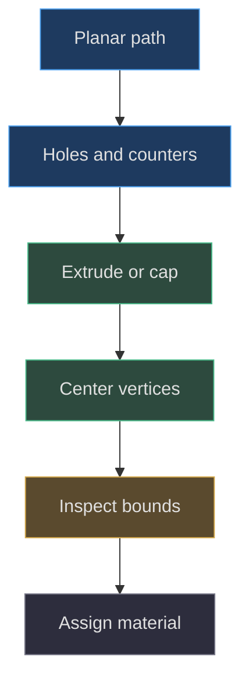
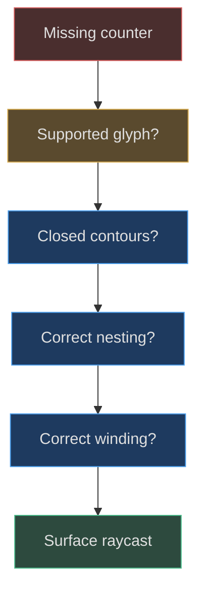

# The procedural geometry toolkit

## Match the representation to the geometric problem

Procedural modeling becomes manageable when a small toolkit expresses recurring construction patterns. This project uses planar paths for outlines, extrusions for thickness and bevels, lathes for rotationally symmetric caps, and explicit triangle buffers for groove walls. It does not solve every object with the same primitive. Choosing the representation is consequential: a texture can describe color but cannot create an inward raycast hit; a dense sphere cannot conveniently preserve a flat manufactured face with exact holes.

The smallest reusable unit is `roundedShape(width,height,radius)`. It starts at the lower edge of a centered XY rectangle, connects straight segments with quadratic corner curves, and returns a shape. `solid()` extrudes that shape with one depth step, three bevel segments, and eighteen curve segments, then translates it by half its depth. `box()` composes these helpers. These operations are the actual toolkit, not an inferred CAD workflow. [Core helpers](https://github.com/Zanark/BowserBoy/blob/1e4ef518d6943ab1af39cef3b4d558f209a17891/src/handheld.js#L4-L32) (`src/handheld.js:4`).

The rounded corners are quadratic curves, not mathematically exact circular fillets. The radius argument controls where the straight segment ends and the corner control lies. Its practical meaning is a visual corner size. The helper does not clamp unreasonable radii; a proposed reusable API should validate positive dimensions and a radius compatible with the smaller dimension. That validation is a recommendation, not behavior already present.

## Extrusion produces more than nominal depth

For nominal depth `d`, the helper recenters the extrusion's main interval around zero. Bevel thickness adds material beyond that interval. Therefore a box placed at Z `.3` with depth `.36` and bevel `.1` is not bounded simply by `.12` and `.48`. Its generated bounding box is the authoritative envelope. This matters when stacking the front face above the shell or locating a groove at the rear surface.

Bevel size and bevel thickness share the same argument here, but they describe different effects. Size changes the planar edge treatment; thickness changes depth. Keeping them equal is a compact stylistic convention, not a physical manufacturing law. Larger bevels can round a narrow feature out of existence or make a recess cover the surface it was meant to frame. More segments smooth tessellation; they do not repair an inappropriate bevel envelope.



Figure MD04.1. Outline, topology, envelope, and material are separate decisions in the reusable geometry pipeline.

## Holes need topology, not dark paint

A Three.js shape can contain hole paths. The front face uses them for controls and speaker apertures. Molded glyphs use counter paths for enclosed letter spaces. The rear engraving requires more elaborate nesting because supplied artwork can contain islands inside holes inside larger regions. Preserving this hierarchy is essential: a letter's counter is solid cap material in a recessed inscription, not another dark cavity.

The rear algorithm sorts contours by absolute area, identifies a containing parent using bounds plus point-in-polygon testing, assigns a nesting level, and adjusts winding according to parity. It then uses even and odd levels for different surface roles. Winding affects which side of a triangle or contour is interpreted as front-facing; nesting affects which regions are material versus void. These related concepts must not be collapsed into “reverse every path until it looks right.” [Nested regions](https://github.com/Zanark/BowserBoy/blob/1e4ef518d6943ab1af39cef3b4d558f209a17891/src/handheld.js#L255-L284) (`src/handheld.js:255`).

The old geometry chapter documents why counter islands and inward hits mattered in the lettering revisions. It is historical explanation, not a replacement specification for the pinned algorithm. When extending the toolkit, follow the current contours and surface construction, then use older records to understand which visible failure modes motivated additional checks. [Earlier relief explanation](https://github.com/Zanark/BowserBoy/blob/1e4ef518d6943ab1af39cef3b4d558f209a17891/docs/book/chapters/04-handheld-geometry/README.md#L39-L47) (`docs/book/chapters/04-handheld-geometry/README.md:39`).

## Lathes preserve cap profiles efficiently

The button cap is a lathe generated from seven profile points and forty radial segments. The profile closes toward the center near its bottom and dome. Rotating the resulting geometry around X aligns its depth with device Z. This is economical because the same profile governs every azimuth; editing one radial section changes the entire cap consistently.

Action buttons need an open center region for their reconstructed cap faces. The factory removes only triangles touching the upper center pole, retaining the original rim normals. It does not flatten the whole lathe into a cylinder. The later face uses a shallow radial dome and custom normals to continue the cap's appearance. That preserves the rim's highlight behavior while allowing genuine holes. [Lathe and center removal](https://github.com/Zanark/BowserBoy/blob/1e4ef518d6943ab1af39cef3b4d558f209a17891/src/handheld.js#L116-L137) (`src/handheld.js:116`).

## MD04-W01 Build and measure a centered rounded solid

The following original browser-console recipe uses the exported helper, not a copied implementation. It assumes the project's import map is active and does not require the brand assets because it never calls the complete handheld factory. It is safe to inspect without attaching anything to the running scene.

```js
// Pedagogical geometry experiment.
const { roundedBox } = await import('./src/handheld.js');
const geometry = roundedBox(2, 1, .2, .12, .03);
geometry.computeBoundingBox();
const b = geometry.boundingBox;
console.table({
  minZ: b.min.z,
  maxZ: b.max.z,
  centered: Math.abs(b.min.z + b.max.z) < 1e-6
});
console.assert(b.max.z > .1);
console.assert(b.min.z < -.1);
geometry.dispose();
```

The nominal un-beveled half-depth is `.1`. The expected bounds extend beyond it because bevel thickness is `.03`; symmetry remains approximately centered. Inspecting the actual values is better than asserting a long decimal literal because float-buffer storage and tessellation are implementation details. The meaningful invariant is symmetric extra extent around the nominal interval.

Now derive a stacking rule. If a second surface must sit entirely in front of this object, its nearest depth must exceed the first object's maximum depth in their common frame. Comparing only the two mesh centers is insufficient. If either object is rotated, transform its geometry bounds or use an appropriate object-space measurement before comparing. For overlapping manufactured layers, intentional penetration may be valid, but record that choice rather than calling every intersection a bug.

Finally vary bevel from `.03` to zero and repeat. The helper disables bevels when the argument is not positive, so the nominal depth becomes the principal Z extent. A wider-looking silhouette after enabling bevel is not a camera error. This derivation teaches an immediately reusable distinction between an authored dimension and the generated envelope.

## Explicit triangles require explicit normal reasoning

Groove walls use two triangles per contour edge. For edge endpoints A and B, the vertices connect the surface edge to its deeper floor. The order of the cross product of triangle edges determines the face normal. Reverse triangle order and the front face reverses; merely changing material color cannot fix that orientation. The factory computes vertex normals after filling the position buffer. [A/B wall triangles](https://github.com/Zanark/BowserBoy/blob/1e4ef518d6943ab1af39cef3b4d558f209a17891/src/handheld.js#L347-L359) (`src/handheld.js:347`).

The latest [BufferGeometry documentation](https://threejs.org/docs/pages/BufferGeometry.html), consulted 2026-11-07, distinguishes indexed triangles from non-indexed groups of three positions and explains normal averaging. For these explicit non-indexed walls, duplicated positions do not automatically share smoothed normals. That is useful for crisp cavity walls. For a smooth shell, blindly duplicating every triangle would create faceting unless normals were assigned deliberately. This is recommendation-level reasoning grounded in the representation, not proof of an undocumented optimization.

## MD04-R01 Retry when a new glyph loses its enclosed center

Suppose a proposed letter P renders as a filled disk-shaped patch rather than a stem with an enclosed counter. First determine which alphabet is involved. `moldedShapes()` only knows the explicitly listed polygon glyphs; it is not a general font engine. `actionButtonGlyph()` explicitly accepts only A and B. Passing P is outside both current contracts unless its polygons are added to the first or the second is redesigned.

If a new contour importer is being developed, inspect closed loops before triangulation. Record contour count, signed area, containment, and expected counter count. If the boundary graph is not closed, the extractor throws rather than silently returning a partial inscription. If the graph closes but nesting is wrong, a counter can become a cavity floor. If topology is right but the wall vanishes from one side, investigate winding and material sidedness.

The reference workstream's insistence on actual apertures is relevant here: a dark texture that visually suggests a counter cannot substitute for correct geometry when raycasts and oblique views must observe it. [Geometric obligation](https://github.com/Zanark/BowserBoy/blob/1e4ef518d6943ab1af39cef3b4d558f209a17891/TODO/07_REFERENCE_SHAPE.todo#L18-L23) (`TODO/07_REFERENCE_SHAPE.todo:18`).



Figure MD04.2. A missing counter can originate in the input contract, contour graph, region classification, or triangle orientation.

## Sampling changes topology as well as smoothness

The alpha contour extractor does more than outline occupied pixels. It examines four alpha samples per cell, finds threshold crossings on cell edges, assigns shared edge keys, and stitches a graph whose vertices must each have two neighbors. Crossings interpolate using the threshold and endpoint alpha values. This gives subpixel boundary positions rather than a staircase following whole pixel corners. [Extractor](https://github.com/Zanark/BowserBoy/blob/1e4ef518d6943ab1af39cef3b4d558f209a17891/src/handheld.js#L174-L229) (`src/handheld.js:174`).

Cells with four crossings need a connectivity decision. The implementation chooses paired edges according to the first corner's threshold state. That is a specific saddle-case rule, not a general proof that arbitrary noisy artwork will produce the intended topology. Very thin bridges or diagonal contacts can therefore change which regions connect when resolution or threshold changes.

For a new importer, save contour statistics before building triangles. Closed-loop count, signed area, minimum edge length, and nesting depth can reveal a problem earlier than a shaded render. A smooth-looking image is insufficient if a single bridge merges two cavities or removes a counter. Conversely, more sampling is not automatically safer: it can recover tiny noise islands and greatly increase wall triangles. Choose resolution against an explicit detail budget and preserve the original source image for comparison.

## MD04-Q01 Choose between a decal and a cut

A future agent must add a tiny serial number to the cartridge and a deep logo to a replacement battery cover. Which representation should each use, and what evidence would justify changing that choice? Include performance and ownership tradeoffs rather than treating “more polygons” as automatically better.

## MD04-A01 Spend geometry where shape must be observable

A small serial number can reasonably begin as a transparent canvas-backed label if its purpose is readable color on an otherwise unchanged surface. It is cheap to author, supports arbitrary browser text, and does not require a complete polygon alphabet. The existing cartridge title uses this approach. Its limits include font dependence, transparent sorting, finite texture resolution, and no physical relief. Attach it to the cartridge so it follows the prop rather than the scene.

A deep battery logo needs geometry if the requirement includes inward ray hits, edge shadows, or visible walls under oblique inspection. Reuse a contour-and-floor construction with explicit nesting rather than placing a dark picture below an uncut cap. Preserve the surrounding bevel and material relationship; a deep logo must not accidentally replace the entire cover with a different surface.

Evidence can reverse either initial choice. If the serial number must be felt visually through grazing highlights, shallow relief may become justified. If the logo is only a distant printed label and never examined obliquely, geometry may be needless cost. The decision follows the observation contract. Existing browser surface probes demonstrate how specific geometry properties can be tested, but they do not automatically cover newly added details. [Current surface probes](https://github.com/Zanark/BowserBoy/blob/1e4ef518d6943ab1af39cef3b4d558f209a17891/tests/browser/scene.spec.mjs#L1370-L1391) (`tests/browser/scene.spec.mjs:1370`); [browser asset decoding boundary](https://github.com/Zanark/BowserBoy/blob/1e4ef518d6943ab1af39cef3b4d558f209a17891/src/brand.js#L6-L15) (`src/brand.js:6`).
