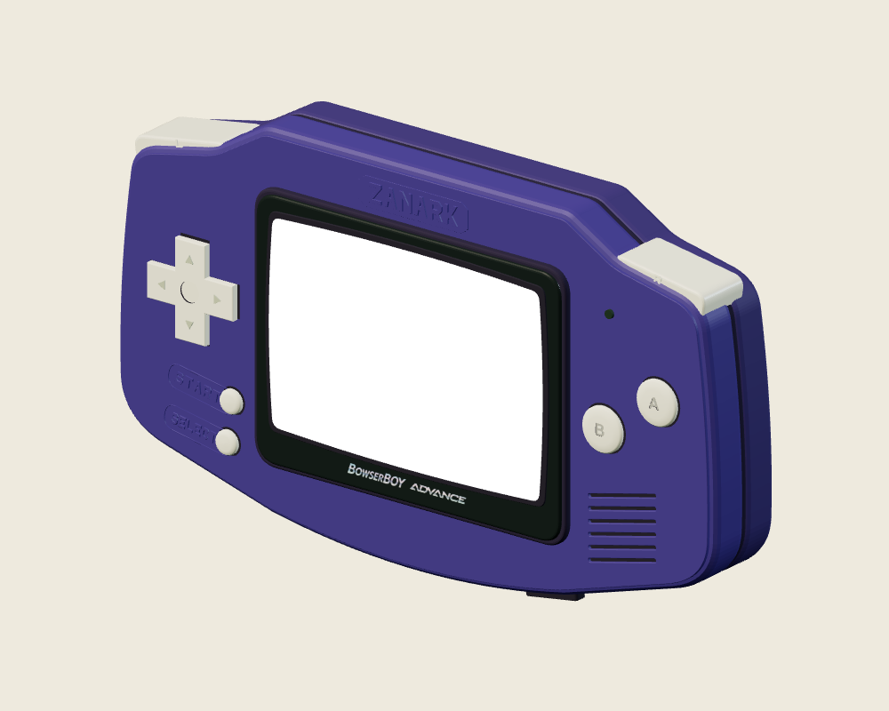
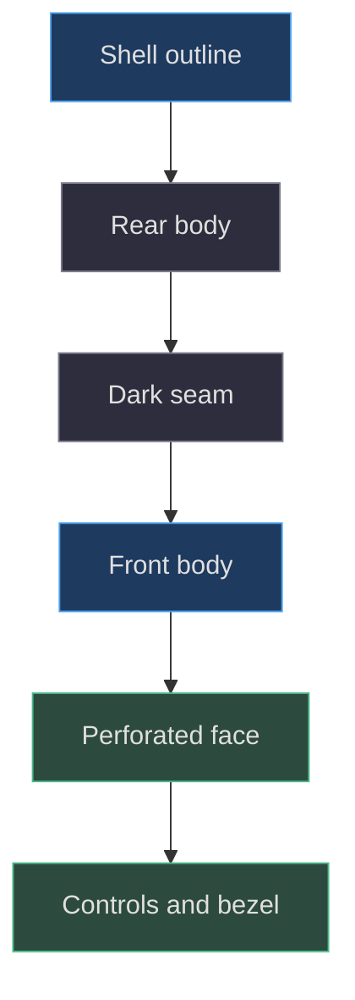
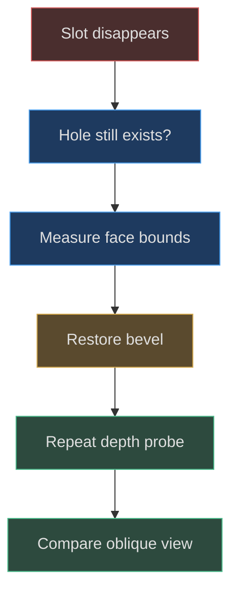

# GBA shell, silhouette and layered construction

## Start with the silhouette that carries identity

The shell is not a scaled ellipse or a rounded rectangle. Its path explicitly describes a raised central crown, descending shoulders, broad sides, sloping lower corners, and a bowed bottom. This matters because the historical reference correction rejected an earlier oval impression. The pinned source's curves are the reconstruction target; the reference record explains the type of mismatch being corrected without proving physical accuracy. [Historical shape correction](https://github.com/Zanark/BowserBoy/blob/1e4ef518d6943ab1af39cef3b4d558f209a17891/TODO/07_REFERENCE_SHAPE.todo#L18-L31) (`TODO/07_REFERENCE_SHAPE.todo:18`).

Begin at the upper-left side point `(-4.1,1.45)`. A short quadratic transition reaches `(-3.78,1.8)`, then line and curve segments climb toward the central crown. The top spans from approximately `x=-2.08` to `x=2.08` at `y=2.42`. The right half descends through the shoulder before bowing toward the lower-right corner. The bottom curve connects `(2.12,-2.17)` to `(-2.12,-2.17)` using `(0,-2.61)` as its control. The left side returns to the start. [Complete shell path](https://github.com/Zanark/BowserBoy/blob/1e4ef518d6943ab1af39cef3b4d558f209a17891/src/handheld.js#L410-L430) (`src/handheld.js:410`).

Those coordinates are scene units and Bézier controls, not measured hardware dimensions. In particular, the curve does not necessarily pass through its control point. Editing the bottom control changes curvature without placing the bottom at `-2.61`. This is a practical reason to distinguish path parameters from sampled silhouette bounds whenever documenting exact numbers.



Figure MD05.1. Diagnostic factory render under neutral studio lighting, used to inspect casing layers and silhouette; not a historical design screenshot or live-room proof.

## Understand the crown as transitions, not a point list

The top's shape is communicated by changes in slope. Straight central segments read as a crown; the small curved joins soften transitions; lower shoulder slopes lead toward the side lobes. If an extension simply raises every top vertex, it may preserve width while destroying the stepping relationship. If it increases curve sampling, it makes the same incorrect outline smoother.

A recommended reconstruction sequence is to plot the major endpoints first, add transition controls second, and only then extrude. This is a teaching workflow derived from the source structure, not a recovered authoring timeline. Compare the outline as a flat silhouette before tuning materials. Otherwise a specular highlight can hide a kink in one view and exaggerate it in another.

The path is largely mirrored in X, which supplies a useful diagnostic. Sample the outline and compare left and right envelopes at corresponding heights. Do not require the whole assembled console to be symmetric: the control layout, speaker, ports, and switch are intentionally not mirrored. Symmetry is a property of the base shell construction, not a universal model requirement.

## The casing is a stack of related solids

Four named pieces establish the primary depth structure. The seam uses nominal depth `.08`, bevel `.08`, and center Z `.05`. Rear and front shells each use depth `.36` and bevel `.1`, positioned at `-.26` and `.3`. A thin perforated face uses depth `.04`, bevel `.008`, and center `.592`. These are overlapping visual layers, not a watertight manufacturing assembly with documented wall thickness. [Layer construction](https://github.com/Zanark/BowserBoy/blob/1e4ef518d6943ab1af39cef3b4d558f209a17891/src/handheld.js#L450-L468) (`src/handheld.js:450`).

Why keep the face separate? It allows the visible front surface to carry apertures while the broader shell establishes body thickness and rounded edges. Dark receiving surfaces behind holes create visible recesses without boolean subtraction through every underlying shell. This is an efficient visual model, but it has a limitation: an aperture is not automatically a continuous hollow tunnel through the casing. Backside inspection of the internal stack is not equivalent to a solid-model manufacturing check.

The material ownership supports the stack. Front shell and face share the purple material, while the rear and battery cover share rear plastic. The seam has a darker rough material. Changing the shared purple changes multiple surfaces together; changing one mesh's material reference can deliberately break that relationship. Record whether a finish experiment edits a shared material or assigns a clone. [Material definitions](https://github.com/Zanark/BowserBoy/blob/1e4ef518d6943ab1af39cef3b4d558f209a17891/src/handheld.js#L392-L409) (`src/handheld.js:392`).



Figure MD05.2. The visual shell is built as a depth stack; the diagram is assembly logic, not a claim of disjoint physical solids.

## MD05-W01 Calculate why the front face clears the body

Use the centered-extrusion convention to derive nominal envelopes. The front body at `.3` with depth `.36` occupies `.12` to `.48` before bevel thickness. With bevel `.1`, the generated extreme reaches approximately `.58`. The face at `.592` with depth `.04` spans `.572` to `.612` before its `.008` bevel, placing its outer face near `.620`. Thus the thin face intentionally overlaps the main body while presenting a higher visible surface.

That overlap is not an error by itself. It prevents a crack between two independently tessellated surfaces and lets holes reveal lower surfaces. The important requirements are stable depth ordering and the absence of an unwanted cap covering a feature. Exact generated bounds should still be measured rather than assumed; the helper's geometry translation and bevel options establish the calculation. [Extrusion convention](https://github.com/Zanark/BowserBoy/blob/1e4ef518d6943ab1af39cef3b4d558f209a17891/src/handheld.js#L19-L25) (`src/handheld.js:19`).

The following original console recipe assumes the project's page is served and the model factory may be instantiated independently. It loads the public brand images because the complete factory requires them. It does not attach the new model to the application or mutate the live model.

```js
// Pedagogical envelope diagnostic.
const { loadBrand } = await import('./src/brand.js');
const { createHandheld } = await import('./src/handheld.js');
await loadBrand();
const specimen = createHandheld();
for (const name of ['Front shell',
  'Front face with speaker apertures']) {
  const mesh = specimen.root.getObjectByName(name);
  mesh.geometry.computeBoundingBox();
  const b = mesh.geometry.boundingBox;
  console.log(name,
    mesh.position.z + b.min.z,
    mesh.position.z + b.max.z);
}
```

Expected output places the face's outer bound ahead of the body's outer bound. The recipe assumes these two meshes are unrotated direct children, as in the pinned factory. Reusing the arithmetic on a rotated subgroup without transforming bounds would be incorrect. The diagnostic allocates an isolated model; a repeated production tool should explicitly manage disposal of its unique geometries, materials, and textures.

Now lower the face center hypothetically by `.05`. Its front bound approaches the body's front bound, and holes may become visually ambiguous or disappear behind the body. The correct diagnosis is a layer-order change, not loss of hole paths. This example shows how an invisible aperture can exist topologically while failing the visible-surface contract.

## Apertures are manufactured cues with local rules

Six speaker slots share width `1.02`, height `.065`, and angle `.23`, with vertical centers descending by `.16`. Their hole paths are rotated around their own origin before translation into the face. The dark slot surfaces repeat the same angle and dimensions behind the face. Using the same parameter table avoids a common mismatch where the hole rotates but its backing remains horizontal. [Speaker definitions and holes](https://github.com/Zanark/BowserBoy/blob/1e4ef518d6943ab1af39cef3b4d558f209a17891/src/handheld.js#L431-L461) (`src/handheld.js:431`).

Control openings use a cross enlarged by `1.09` and circular paths wider than their caps. These openings are not interchangeable with raised socket lids. Historical commit `706563fe0355d6455a3c1ba1ff8fd9bafd3fa2a4` replaces such lids with face holes and receiving floors. That diff supports a concrete construction change; it does not license a claim that every possible lighting condition is now correct. [Scoped historical change](https://github.com/Zanark/BowserBoy/commit/706563fe0355d6455a3c1ba1ff8fd9bafd3fa2a4).

## MD05-R01 Retry when a wider bevel hides a slot

Suppose an extension increases the thin face bevel to soften its appearance, and the narrow speaker openings nearly close. Investigate planar bevel expansion relative to slot height. A `.065`-high slot has only `.0325` half-height before accounting for curvature and bevel behavior. Increasing a bevel by a value comparable to that scale is not a small edit simply because it looks numerically small beside an eight-unit-wide shell.

Retry by holding path dimensions fixed and restoring the original bevel. If visibility returns, the hypothesis is supported. Then decide whether to reduce bevel, widen the aperture, or separate edge rounding from thickness. Widening is a redesign of the grille proportions; reducing bevel preserves the existing silhouette more closely. Do not silently change both and claim to have identified the cause.

The browser surface test offers an objective partial check: neighboring solid face depth must exceed the selected slot depth by more than `.02`. A neutral diagnostic render adds oblique readability, while the real room checks lighting response. These observations answer different questions. [Depth assertion](https://github.com/Zanark/BowserBoy/blob/1e4ef518d6943ab1af39cef3b4d558f209a17891/tests/browser/scene.spec.mjs#L1382-L1391) (`tests/browser/scene.spec.mjs:1382`).



Figure MD05.3. A narrow opening can fail through bevel envelope or layer occlusion even when its path remains valid.

## Derive the bottom bow instead of guessing its depth

The lower central segment is a quadratic Bézier with equal endpoint heights. At its midpoint, the weights are one quarter, one half, and one quarter. Applying them to endpoint Y values of negative two point one seven and control Y of negative two point six one gives a midpoint near negative two point three nine. This is already enough to show why reading the control point as the shell's lowest point would overstate the bow.

Because the endpoint X values are equal and opposite and the control X is zero, the midpoint also lies on the centerline. For this symmetric quadratic, the vertical derivative vanishes there. That makes it a useful local landmark for comparing the lower outline before extrusion. Bevel expansion then changes the rendered envelope, so keep the planar landmark separate from the final mesh bound.

This derivation suggests a disciplined parameter experiment. Move only the bottom control downward, leave endpoints fixed, and predict that the center deepens while the lower corner positions remain unchanged. Then sample the generated path and verify the prediction. If the whole bottom translates instead, the edit changed endpoints or a parent transform as well. This isolates curvature adjustment from overall scaling and makes “more bowed” a reproducible instruction rather than an aesthetic guess.

## MD05-Q01 Is a watertight shell automatically a better model?

An agent proposes replacing the four casing layers with one boolean-subtracted watertight mesh. Explain what this could improve, what it could break, and which claims cannot be resolved from the inspected sources. Include the effect on material ownership and the existing diagnostic names.

## MD05-A01 Representation quality depends on the contract

A unified solid could improve internal consistency, remove hidden intersecting surfaces, and support physical cross-sections or manufacturing export. Those benefits matter if the new contract requires them. This project instead exposes an inspectable visual device whose named pieces support material assignment and targeted probes. A replacement must preserve front/back appearance, aperture behavior, movement ownership, and accessible integration rather than merely reduce the number of objects.

Boolean output can introduce sliver triangles, shading discontinuities, or difficult material groups. A single mesh also removes convenient names used by current tests unless equivalent component metadata is retained. The rear cover's separate geometry is modified by its engraving algorithm; merging it into the shell would require redesigning that operation. None of these risks proves booleans are wrong, but they establish work that a “cleaner mesh” claim must account for.

The sources do not provide physical wall thickness, tolerances, or watertightness acceptance criteria. Therefore one cannot certify the replacement as a more accurate manufactured replica from these records alone. Preserve the layered model as the pinned baseline, describe a unified solid as an extension, and derive fresh observations before accepting it. The brand loader and public delivery map further remind us that a shell rewrite must not inadvertently sever asset inputs or static module delivery. [Brand initialization](https://github.com/Zanark/BowserBoy/blob/1e4ef518d6943ab1af39cef3b4d558f209a17891/src/brand.js#L6-L15) (`src/brand.js:6`); [public source delivery](https://github.com/Zanark/BowserBoy/blob/1e4ef518d6943ab1af39cef3b4d558f209a17891/scripts/site-files.mjs#L18-L25) (`scripts/site-files.mjs:18`).
