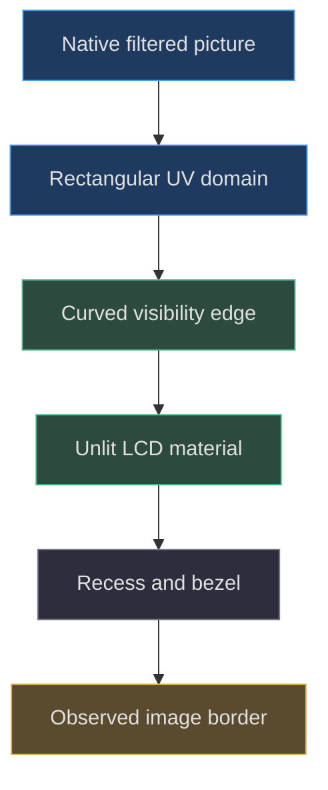
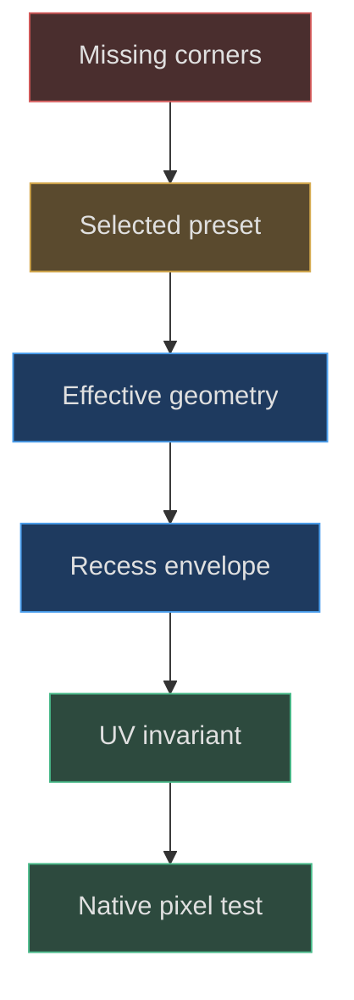

# GBA LCD, curved glass and frame

## Name the actual modeled surface

The chapter title includes glass because a screen assembly must be discussed as a visual surface, but the inspected GBA factory does not create a separately named transmissive glass slab. It creates a bezel surround, charcoal bezel, LCD recess, and live LCD mesh. Do not infer thickness, refraction, or a transparent material merely from the word glass. The visible display uses `MeshBasicMaterial` with tone mapping disabled and both shadow flags false. [Actual assembly](https://github.com/Zanark/BowserBoy/blob/1e4ef518d6943ab1af39cef3b4d558f209a17891/src/handheld.js#L467-L474) (`src/handheld.js:467`).

That distinction protects the image pipeline. A live picture should not become brighter or darker merely because a room lamp illuminates its material. The factory's basic material provides an unlit display surface; the runtime later supplies the picture. This chapter analyzes the geometry and initial material, not the complete runtime texture lifecycle. The player test separately checks that native video directly supplies the material map rather than a host-side replacement CRT effect. [Direct-video assertion](https://github.com/Zanark/BowserBoy/blob/1e4ef518d6943ab1af39cef3b4d558f209a17891/tests/browser/player.spec.mjs#L265-L273) (`tests/browser/player.spec.mjs:265`).

## A curved outline is not a curved framebuffer mapping

`createLcdGeometries(curved)` fixes width at `4.05` and height at two thirds of width, giving `2.7` scene units. Flat mode uses a plane. Curved mode triangulates a specially authored shape with thirty-two curve segments. Both represent an image-bearing face in XY; the curved mode changes its boundary, not the Z curvature of a thick lens. [LCD geometry factory](https://github.com/Zanark/BowserBoy/blob/1e4ef518d6943ab1af39cef3b4d558f209a17891/src/handheld.js#L49-L65) (`src/handheld.js:49`).

The outline is a series of quadratic curves. Its bottom begins near `(-.451w,-.483h)` and bows through a control at `y=-.521h`; sides use controls near `x=±.503w`. These coefficients describe a fitted perimeter around the native CRT picture. They are not a physical lens equation or a universally correct CRT model. Like the shell's controls, curve control points are not guaranteed sampled extrema.

The decisive operation follows triangulation: every curved-screen UV becomes `u=x/w+.5`, `v=y/h+.5`. This preserves rectangular framebuffer coordinates across the clipped perimeter. It avoids applying another image warp after the native CRT shader has already shaped the picture. Geometry chooses where the image can be seen; UVs choose which image pixel appears there. Those are different responsibilities. [Boundary and UV construction](https://github.com/Zanark/BowserBoy/blob/1e4ef518d6943ab1af39cef3b4d558f209a17891/src/handheld.js#L34-L59) (`src/handheld.js:34`).



Figure MD06.1. The fitted boundary clips visibility while preserving the original image-coordinate mapping.

## Stack the frame without burying the display

The surround is `4.47×3.39` with nominal depth `.045`; the charcoal bezel is `4.35×3.27` with nominal depth `.055`. Their centers share Y `.1`, while recess and screen share Y `.22`. Z centers progress from `.65` and `.685` to `.748` and `.782`. These values are not interchangeable: changing the screen center without the recess changes alignment; changing the bevel can alter occlusion without changing any center.

The recess outline is enlarged by `.12` in both width and height, then extruded with depth `.015` and bevel `.009`. In flat mode it uses a rounded rectangle with corner argument `.025`; in curved mode it uses the matching CRT outline. Thus the surrounding frame follows the effective screen mode. An overly thick recess bevel could cover the image plane, a problem the reference record explicitly notes was corrected during earlier shape work. [Recorded occlusion correction](https://github.com/Zanark/BowserBoy/blob/1e4ef518d6943ab1af39cef3b4d558f209a17891/TODO/07_REFERENCE_SHAPE.todo#L43-L49) (`TODO/07_REFERENCE_SHAPE.todo:43`).

The source revision introducing curved geometry had smaller dimensions than the pinned implementation. Historical commit `72da407f03ddf872bdd7b3c19e4a9bba92445998` is evidence for the change from rectangular border to fitted boundary and explicit UV restoration. It is not the source of today's `4.05` width. Keep historical values beside their commit rather than copying them into current parameter tables. [Scoped historical diff](https://github.com/Zanark/BowserBoy/commit/72da407f03ddf872bdd7b3c19e4a9bba92445998).

## MD06-W01 Derive the no-second-warp invariant

At the screen center, `x=0,y=0`, so the mapping gives `u=.5,v=.5`. At an arbitrary point `x=.25w,y=-.2h`, it gives `u=.75,v=.3`. These coordinates are independent of whether the outer edge is rectangular or bowed. A native pixel at three quarters of framebuffer width is not moved again simply because the border is curved.

The following original browser-console recipe is runnable without brand loading or a ROM. It checks all vertices of both modes against the same formula. The expected maximum error is near float precision, below `1e-6`; the recipe does not assert pixel content or rendered border quality.

```js
// Pedagogical UV invariant check.
const { createLcdGeometries } =
  await import('./src/handheld.js');
for (const curved of [false, true]) {
  const { screen, recess } = createLcdGeometries(curved);
  const p = screen.getAttribute('position');
  const uv = screen.getAttribute('uv');
  const { width: w, height: h } = screen.userData.viewport;
  let error = 0;
  for (let i = 0; i < p.count; i++) {
    error = Math.max(error,
      Math.abs(uv.getX(i) - (p.getX(i) / w + .5)),
      Math.abs(uv.getY(i) - (p.getY(i) / h + .5)));
  }
  console.log({ curved, error });
  console.assert(error < 1e-6);
  screen.dispose(); recess.dispose();
}
```

Why check all vertices if the formula is already visible? The check catches future geometry replacements that inherit default shape UVs or change dimensions without updating viewport metadata. It is cheap and independent of screenshots. It still cannot detect clipping of native lit pixels: a perfectly linear UV mapping can sit on an outline that is too small.

For clipping, the existing browser case samples lit edges from the actual native output, raycasts corresponding positions onto the screen, and measures distance to a sampled perimeter. It requires more than two hundred samples, zero sampled clipping, maximum keyline distance below nine native pixels, and UV error below `.00001`. Those are separate invariants, not four names for the same visual judgment. [Edge-fit assertions](https://github.com/Zanark/BowserBoy/blob/1e4ef518d6943ab1af39cef3b4d558f209a17891/tests/browser/scene.spec.mjs#L1475-L1517) (`tests/browser/scene.spec.mjs:1475`).

## Why shortest distance matters near a curved tangent

A horizontal gap from an image edge to a curved border can grow large near a nearly horizontal tangent even if the border is close in the normal direction. The test computes closest distance to each sampled line segment of the outline and takes the minimum. That quantity better matches “thin keyline” than a fixed-axis distance.

This remains a sampled approximation. The perimeter is discretized, rows are sampled at intervals, and lit pixels are selected by a brightness threshold. An all-black frame provides no useful image-edge sample. The historical LCD workstream explicitly limits its claim to a fitted outline for the pinned native shader. Do not generalize it into proof for every cartridge, shader parameter, output resolution, or browser. [Recorded fit limits](https://github.com/Zanark/BowserBoy/blob/1e4ef518d6943ab1af39cef3b4d558f209a17891/TODO/13_CURVED_LCD_BORDER.todo#L17-L26) (`TODO/13_CURVED_LCD_BORDER.todo:17`).

## MD06-R01 Retry when unfiltered corners disappear

Suppose CRT Geom looks correct, but switching to unfiltered output cuts off rectangular corners. The first hypothesis is stale curved geometry, not bad texture filtering. The player case checks that `screenCurved` is true only for `crt-geom.glslp`, while retaining the same native runtime identity across preset changes. That condition prevents a curved-only screen from becoming an unconditional model feature.

Retry with geometry inspection before image tuning. Record viewport dimensions, geometry type, curved-state flag, and the first raycast object at a corner-adjacent point. Then switch back and verify the corresponding border changes. If the mode updates but corners still vanish, inspect the recess envelope and material map; if the geometry does not update, changing anisotropy cannot solve the error.

The long CRT case is parked under CI in the pinned source because retained reload readiness remains unresolved. Its assertions are valuable specifications but not evidence of a current CI pass. A separate preset-loop case remains a different source of coverage. This distinction must survive future summaries, particularly when a chapter cites a test's thresholds. [Skip condition](https://github.com/Zanark/BowserBoy/blob/1e4ef518d6943ab1af39cef3b4d558f209a17891/tests/browser/scene.spec.mjs#L1438-L1447) (`tests/browser/scene.spec.mjs:1438`).



Figure MD06.2. Missing corners are investigated through mode, geometry, occlusion, mapping, and only then actual pixel output.

## Separate image sharpness from perimeter density

Increasing the number of boundary segments adds triangles around the curved perimeter. It does not add native game pixels. If the image looks blurred throughout its interior, inspect texture filtering, source resolution, display scaling, and the renderer rather than increasing shape tessellation. If the perimeter looks faceted while interior pixels remain crisp, boundary sampling is a more plausible cause. These symptoms point to different representations.

The reverse mistake is to sharpen the image while ignoring geometric clipping. A nearest-sampled texture can still lose its corners if the outline is too tight. A high-resolution source can still sit behind an overly thick recess. The worked UV check, center raycast, and native edge fit form a useful diagnostic ladder precisely because each isolates a different property.

When comparing screen modes, hold the native output and camera as stable as the experiment permits. A moving game scene can change which edge pixels are lit, so a difference in sampled keyline distance may reflect content rather than geometry. The existing original-demo case uses a specific running environment; this chapter does not generalize its threshold into an arbitrary-content theorem.

## Treat viewport metadata as a geometric promise

The screen geometry stores width and height in `userData.viewport`. The edge test uses that metadata to map framebuffer pixels into local coordinates. If an extension changes the geometry's scale by modifying vertex positions but leaves metadata unchanged, the test's rays can sample the wrong physical location even though its arithmetic still looks correct.

A safe extension updates the outline parameters, UV mapping, and viewport metadata as one coherent operation. If only the mesh object scale changes, make clear whether viewport dimensions remain local or describe the scaled result. Mixing those meanings produces subtle errors in picking and pixel measurements. The pinned factory's metadata describes its unscaled local screen.

Finally, do not interpret a dark border as missing alpha without inspecting material and source content. Native CRT output may include black pixels outside its visible curved picture, while the mesh itself remains fully opaque. Transparent glass, opaque black picture pixels, and absent geometry create different raycast and compositing behavior. A debugging receipt should name which of those quantities was actually measured.

## MD06-Q01 Add a genuinely transparent glass layer

A future agent proposes a reflective transparent sheet above the live LCD. Explain why this is an extension, what new coordinate and material decisions it introduces, and why the existing “LCD center hit is Live LCD” assertion may need a carefully justified replacement rather than deletion.

## MD06-A01 Preserve display ownership while adding optics

It is an extension because the inspected factory has no separate glass slab. The new layer needs its own Z envelope, thickness policy, outline, material, shadow behavior, and ownership. If placed above the display, it may become the first raycast hit at the center even when the image is still correctly visible. A transparent surface is not automatically ignored by picking.

The existing assertion protects against an opaque bezel burying the image. Replace its literal first-object expectation only with an equally strong observation: for example, require an approved glass object first, then an unobstructed LCD intersection behind it, and verify actual image visibility. Otherwise a test “fix” could accept a new occluding panel.

Reflection should not be confused with image emission. Keep the image on its direct unlit material; let the optical layer contribute bounded reflection rather than multiply room lighting into game pixels. Current Three.js material guidance can inform a proposed design, but it cannot prove the original project used that design. The old pixels chapter explains the native-picture boundary, while the asset loader clarifies that supplied brand images are not the live framebuffer. [Earlier pipeline account](https://github.com/Zanark/BowserBoy/blob/1e4ef518d6943ab1af39cef3b4d558f209a17891/docs/book/chapters/05-pixels-and-light/README.md#L5-L10) (`docs/book/chapters/05-pixels-and-light/README.md:5`); [brand inputs](https://github.com/Zanark/BowserBoy/blob/1e4ef518d6943ab1af39cef3b4d558f209a17891/src/brand.js#L6-L15) (`src/brand.js:6`).
