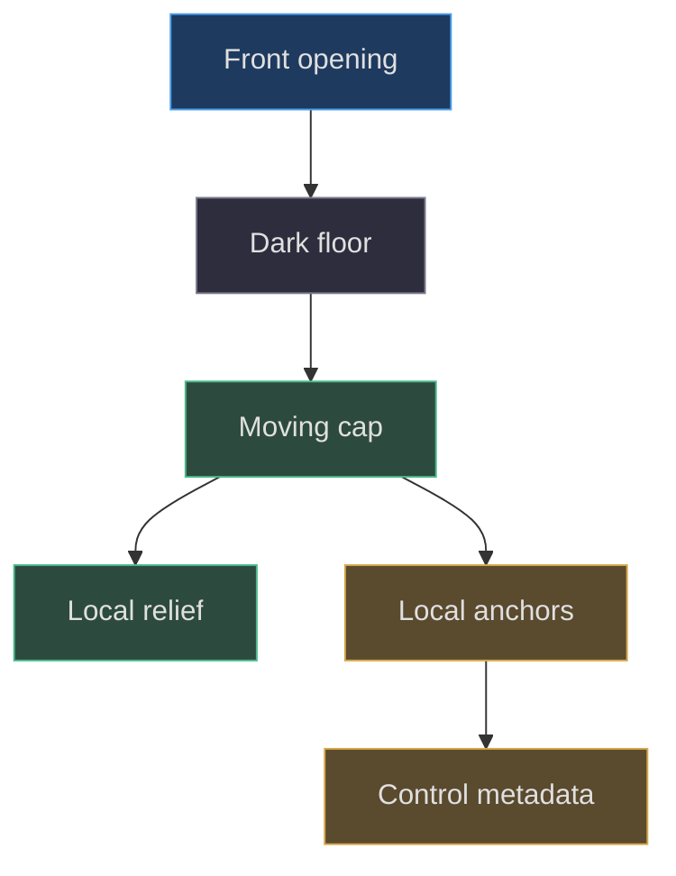
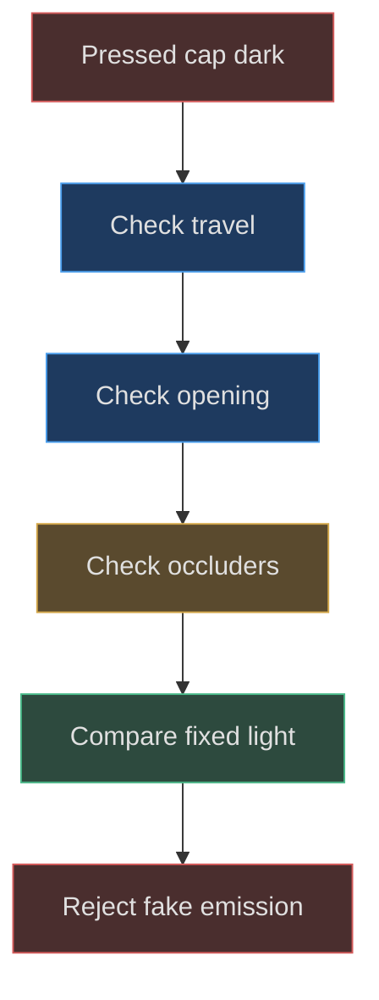

# GBA controls, grips and tactile details

## Tactility begins with clearance

A button cannot convincingly move into a case if the case is a solid lid beneath it. The factory therefore separates openings, receiving floors, moving caps, and cap-relative markings. This is a geometric contract before it is an animation effect. The historical aperture correction replaces intersecting raised socket surfaces with actual holes in the front face and lower dark floors. That change is visible in commit `706563fe0355d6455a3c1ba1ff8fd9bafd3fa2a4`, not inferred from a current screenshot. [Historical change](https://github.com/Zanark/BowserBoy/commit/706563fe0355d6455a3c1ba1ff8fd9bafd3fa2a4).

A and B use opening radius `.315` and cap radius `.29`, leaving a nominal radial gap `.025` before detailed bevel and pose effects. Start and Select use `.18` openings around `.155` caps, the same nominal gap. The source also stores target size separately: `.65` for action buttons and `.38` for Start/Select. Target dimensions are interaction metadata, not measurements of cap diameter. [Control parameter table](https://github.com/Zanark/BowserBoy/blob/1e4ef518d6943ab1af39cef3b4d558f209a17891/src/handheld.js#L444-L456) (`src/handheld.js:444`).

These are scene-unit clearances. They are not molding tolerances or guarantees against all animated intersections. A cap's curved profile, face bevel, and rocking motion can change the visible gap. The correct question is whether the complete surface remains coherent at rest and through its supported motion envelope, not whether one radius subtraction is positive.

## The D-pad is one body with four directional anchors

The cross outline uses arm extent `.61` and half-arm width `.205`. Its opening is the same cross scaled by `1.09` and translated to `(-3.2,.26)`. The visible pad face contains a circular center hole of radius `.135`, with a lower circular pivot-well surface. Its nominal depth `.07` and bevel `.015` create a short manufactured profile rather than a flat sticker. [D-pad construction](https://github.com/Zanark/BowserBoy/blob/1e4ef518d6943ab1af39cef3b4d558f209a17891/src/handheld.js#L563-L583) (`src/handheld.js:563`).

Four directional controls share that one mesh. Their anchors sit at offsets of `.40` along the cardinal axes and local Z `.055`. Four small extruded arrows use rotated copies of a triangular path. This arrangement lets the pad rock as a body while preserving separate directional target locations. Creating four independent pads would change the physical model and could open cracks at their joins.

Material ownership adds a second layer of tactility. Rubber is cloned from a physical material initially used for silver-colored parts, then roughness rises to `.68` and clearcoat drops to `.06`. Arrow marks use another clone with a different color. Shared mesh motion does not require every marking to share exactly the same material object; it requires deliberate parentage and bounded finish differences. [Material clones](https://github.com/Zanark/BowserBoy/blob/1e4ef518d6943ab1af39cef3b4d558f209a17891/src/handheld.js#L399-L408) (`src/handheld.js:399`).



Figure MD07.1. Openings and floors provide physical clearance; moving caps own relief and target anchors.

## Recessed A/B letters are surface reconstruction

The action cap begins as a forty-segment lathe. For action buttons, center-closing triangles are removed while rim normals remain. The letter is then recovered from browser-rendered `bold 95px Arial`, projected into a `.25×.28` footprint with Y offset `-.005`. A must produce two contours and B three, including their enclosed spaces. The extractor throws if that expectation fails. [Glyph recovery contract](https://github.com/Zanark/BowserBoy/blob/1e4ef518d6943ab1af39cef3b4d558f209a17891/src/handheld.js#L232-L252) (`src/handheld.js:232`).

The reconstructed top is a circular face with the glyph cut out and counter islands added back at cap height. Its dome follows `z=.055-.003*r/(radius*.6)`. The glyph floor lies at `.047`; walls connect floor and dome along all outer and counter contours. This is why the result remains a recessed letter from an oblique angle. Lowering a dark letter plane under an intact cap would hide it rather than engrave it. [Recess construction](https://github.com/Zanark/BowserBoy/blob/1e4ef518d6943ab1af39cef3b4d558f209a17891/src/handheld.js#L324-L359) (`src/handheld.js:324`).

Normals deserve attention because the new center meets an existing lathe rim. The implementation assigns top normals using a normalized profile-related vector rather than recomputing a flat face normal everywhere. Walls receive computed normals from their explicit triangles. This separates smoothly continued cap shading from the cavity's edge behavior. A visible circular seam after an edit suggests a normal-continuity problem before it suggests a material-color problem.

The old geometry chapter records why replacing the original font with hand-drawn rounded contours was rejected. The later contour recovery preserves browser-font dependence; it does not bundle or license Arial. A future reproducibility effort should record browser and font availability, or explicitly propose a licensed deterministic outline asset as an extension. [Historical typography distinction](https://github.com/Zanark/BowserBoy/blob/1e4ef518d6943ab1af39cef3b4d558f209a17891/docs/book/chapters/04-handheld-geometry/README.md#L55-L79) (`docs/book/chapters/04-handheld-geometry/README.md:55`).

## MD07-W01 Derive resting and pressed action-cap heights

An action cap's mesh center is `.653`. Its uncut center dome reaches approximately local `.055`, so its resting center height is about `.708`. Factory motion metadata gives ordinary action controls travel `(0,0,-.075)`. At full nominal translation, the corresponding cap center surface is near `.633`. The visible face's outer envelope is near `.620`, so the cap approaches the opening while remaining slightly proud at that central location.

This is a local geometric derivation, not an assertion that the runtime always reaches exactly full travel or never intersects at every radial point. The groove floor is lower than the cap dome and moves with it. Its full-translation height would be `.653+.047-.075=.625`, which explains why tiny depth changes can matter to perceived occlusion. [Motion and cap placement](https://github.com/Zanark/BowserBoy/blob/1e4ef518d6943ab1af39cef3b4d558f209a17891/src/handheld.js#L553-L561) (`src/handheld.js:553`); [button creation](https://github.com/Zanark/BowserBoy/blob/1e4ef518d6943ab1af39cef3b4d558f209a17891/src/handheld.js#L584-L593) (`src/handheld.js:584`).

The following original browser-console recipe assumes a freshly created independent `model` from `createHandheld()`, after `loadBrand()`. It checks factory metadata without driving the live application. The observable outcomes are one shared D-pad mesh and `.075` nominal action travel.

```js
// Pedagogical metadata check on an independent model.
const controls = model.controls;
console.assert(
  controls.get('up').mesh === controls.get('right').mesh
);
const a = controls.get('a').mesh.userData.motion;
console.log(a.restPosition.z, a.travel.toArray());
console.assert(Math.abs(a.travel.z + .075) < 1e-9);
console.assert(controls.get('up').anchor !==
  controls.get('right').anchor);
```

Next calculate why Start/Select should not inherit the same travel blindly. Their metadata uses `.04` inward motion and their caps are smaller. Shoulder controls move along negative local Y by `.12`, not along Z. Uniformly changing every control's Z coordinate would violate these different mechanisms. Geometry and interaction share a parameter map, but the mechanism remains control-specific.

## Shoulders and grips complete the tactile vocabulary

L/R are rounded boxes `1.3×.39×.7` at `x=±3.45`, Y `1.81`, Z `.15`, with opposite small Z rotations. Their extruded L/R marks belong to the button. An anchor above the local surface locates the target independently of the button's center. Start/Select instead receive molded shell labels attached to the casing, so those words do not compress with the round caps.

The underside slider has five grip ridges; the battery cover has four thumb grips. Neither set is a generic “texture”: both are separate meshes whose depth can catch light. Grip spacing and ownership must follow the moving part they describe. A power ridge belongs to the slider; a battery grip belongs to the cover. The source's parent arguments encode that distinction directly.

## MD07-R01 Retry when deeper motion makes a cap dark

An extension increases action travel and finds the pressed cap unexpectedly black. Do not repair this with emission or an unlit cap material. First verify that the opening still clears the cap and that the front face or another socket surface is not intercepting light. Then compare rest and pressed samples under the same light and camera. A geometry-induced shadow failure should be solved geometrically before changing finish.

The active aperture-lighting cases require resting probes above a brightness threshold and pressed probes above sixty percent of rest. A separate complete compression/release/unlit-response case is explicitly skipped in the pinned source. These are not interchangeable receipts. This writing inspected the assertions but did not run them. [Aperture lighting assertions](https://github.com/Zanark/BowserBoy/blob/1e4ef518d6943ab1af39cef3b4d558f209a17891/tests/browser/scene.spec.mjs#L946-L983) (`tests/browser/scene.spec.mjs:946`); [parked response case](https://github.com/Zanark/BowserBoy/blob/1e4ef518d6943ab1af39cef3b4d558f209a17891/tests/browser/scene.spec.mjs#L986-L989) (`tests/browser/scene.spec.mjs:986`).



Figure MD07.2. Increased travel can recreate occlusion; artificial cap emission would conceal rather than solve that construction error.

## Distinguish travel, rocking, and visual compression

The factory metadata records travel vectors and rest quaternions, but it does not itself execute a press. That boundary matters when writing reusable instructions. A correct factory can be driven incorrectly by a host animation, and a forgiving animation can conceal a geometric collision. Diagnose the rest assembly first, then inspect the host's supported pose envelope as a separate task.

For the shared D-pad, four anchors do not imply four independent travel accumulators. If simultaneous directions are represented by repeatedly translating the same mesh once per control, the result can exceed the intended movement. The factory's shared motion object is evidence that the pad is one body. A future host should combine directional intent into one bounded pose rather than sum unrelated mesh displacements.

Visual compression should also not be implemented by scaling the cap unless a redesign explicitly calls for squash. Scaling changes the glyph width, rim profile, and socket clearance, whereas the source metadata describes translation and orientation around a preserved rest shape. The old book's stronger-feedback discussion distinguishes deeper motion from altered cap shape; current factory values establish the baseline being explained. [Historical feedback account](https://github.com/Zanark/BowserBoy/blob/1e4ef518d6943ab1af39cef3b4d558f209a17891/docs/book/chapters/04-handheld-geometry/README.md#L129-L141) (`docs/book/chapters/04-handheld-geometry/README.md:129`).

## Diagnose finish without confusing it with shape

A rougher cap spreads highlights and may make a shallow groove less legible under broad light. That does not mean the groove disappeared. Compare raycast depth and grazing illumination before changing its contour. Conversely, a high-contrast dark floor can make a tiny cavity seem deeper than it is. Neither appearance alone measures geometry.

A practical proposed study holds the cap mesh fixed and varies only light direction, then holds light fixed and varies only floor depth. The first reveals shading sensitivity; the second reveals geometric depth sensitivity. Keep screenshots labeled with the changed condition and retain the same camera. This simple experiment avoids treating material roughness, letter color, and cut depth as interchangeable controls named “softness.”

## MD07-Q01 Make only the action-letter grooves deeper

A request asks for more pronounced A/B engraving while preserving the original cap silhouette, lettering footprint, and all other controls. Which parameters and surfaces belong to the change? What must not change, and why is darkening the material alone insufficient?

## MD07-A01 Change the cavity, not the alphabet or cap

The change belongs to the A/B floor depth and walls connecting that floor to the unchanged dome. Preserve recovered contours, counter islands, cap radius, rim normals, and mesh position. Lowering the floor requires rebuilding the wall vertices consistently; otherwise the cavity may have a gap or walls ending at the old depth. Do not edit the shared molded alphabet, because it also supplies shell labels and shoulder marks.

Darkening the groove material changes contrast but not depth, ray intersections, or wall shadows. It may make letters look heavier without satisfying the geometric request. Conversely, deeper walls can make an unchanged font look sharper through occlusion. The historical record documents that distinction, so a good retry includes front and grazing-angle comparisons while holding light fixed.

Recheck pressed clearance because a lower floor approaches the shell's visible depth. Verify actual floor hits and cap-height counters, not mesh names alone. The broader input suite confirms that physical controls reach the native core, but those integration assertions do not measure newly changed engraving depth. [Input integration boundary](https://github.com/Zanark/BowserBoy/blob/1e4ef518d6943ab1af39cef3b4d558f209a17891/tests/browser/player.spec.mjs#L693-L716) (`tests/browser/player.spec.mjs:693`); [asset initialization prerequisite](https://github.com/Zanark/BowserBoy/blob/1e4ef518d6943ab1af39cef3b4d558f209a17891/src/brand.js#L6-L15) (`src/brand.js:6`).
