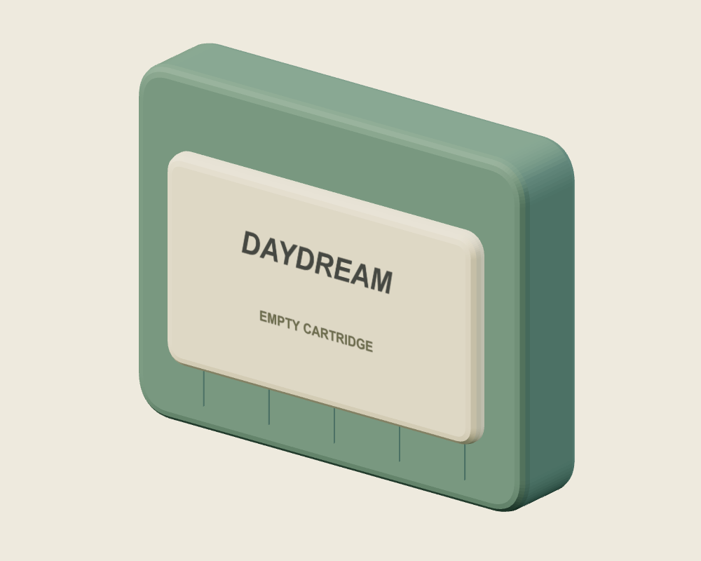
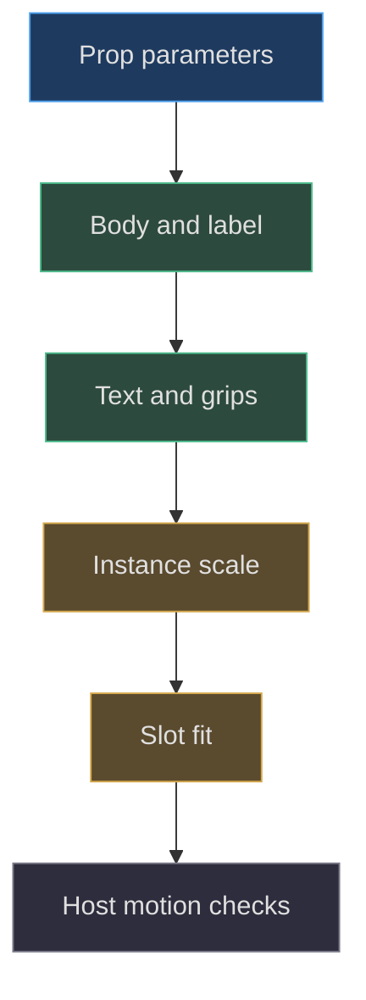
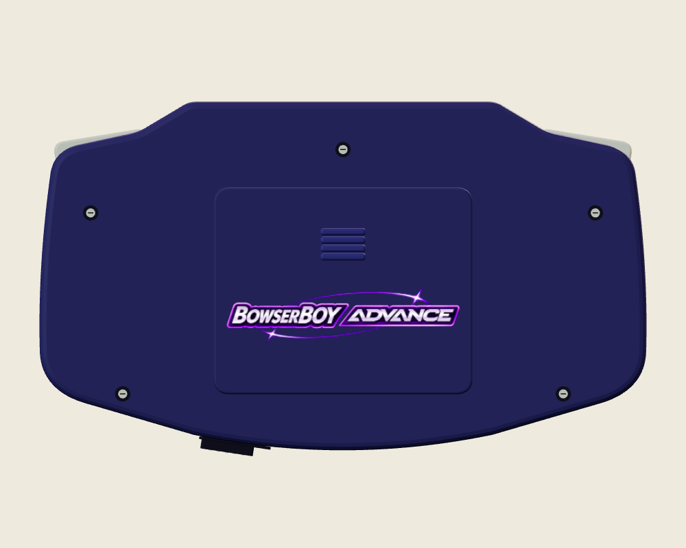
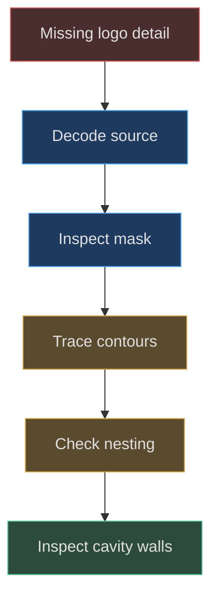

# Cartridges, small details and markings

## Small parts explain what the large shape is

The shell carries silhouette, but a cartridge slot, battery cover, screw sockets, and edge controls explain how the object is used. These details should be modeled according to their observable role. A screw slot needs a thin dark geometric cue; a deep rear logo needs an actual cut surface; a cartridge title can be a canvas-backed label. Treating every detail as an image loses depth, while extruding every pixel adds complexity without a corresponding observation requirement.

The pinned factory returns a cartridge reference alongside root, screen, recess, controls, LED, and bezel texture. That return contract makes the cartridge a manipulable component rather than an anonymous decoration. Its initial state is invisible; host behavior later makes it meaningful during loading. This chapter explains the factory structure, not the full insertion choreography. [Returned model and loaded cartridge](https://github.com/Zanark/BowserBoy/blob/1e4ef518d6943ab1af39cef3b4d558f209a17891/src/handheld.js#L622-L643) (`src/handheld.js:622`).



Figure MD08.1. Diagnostic cartridge factory render under neutral studio lighting, showing prop thickness, label layering, and grip cues; not a historical loading screenshot.

## The reusable cartridge is deliberately simple

`createCartridge(color,title,subtitle)` returns a group. Its body is a rounded extruded box `1.48×1.13×.22` with corner argument `.1`. A cream label backing `1.17×.65×.025` sits at Y `-.02`, Z `.15`. Two transparent text planes sit at Z `.21`, one centered at Y `.11`, the other at `-.12`. Five box grips span the lower region at X `-.53+i*.26`, Y `-.43`, Z `.14`. [Complete prop factory](https://github.com/Zanark/BowserBoy/blob/1e4ef518d6943ab1af39cef3b4d558f209a17891/src/handheld.js#L645-L655) (`src/handheld.js:645`).

The body uses roughness `.72`; the label backing uses `.85`. These choices describe a matte prop, not a measured material sample. The text helper creates a standard lit material with transparency and disabled depth writing. That lets antialiased letter edges reveal the backing while avoiding writing the full rectangular plane into the depth buffer. It does not remove all transparent-ordering limitations.

No separate contacts, connector cavity, rear screw, or detailed molded seam is created in this factory. A future chapter must not describe a cartridge back render as evidence for geometry that the factory lacks. Its value is precisely that it reveals the simplified rear boundary. Adding contacts would be a proposed extension with new dimensions, materials, and tests, not an explanation of existing implementation.

## MD08-W01 Fit the loaded cartridge to the top slot

The handheld creates a default prop with body color `#666574`, title `BBA`, and subtitle `LOCAL CARTRIDGE`. It scales X and Y by `1.9` while leaving Z at one, then positions the group at `(0,1.52,-.3)`. Nominal body width becomes `1.48*1.9=2.812`; nominal body height becomes `1.13*1.9=2.147`. Thickness remains `.22` before bevel effects. These calculations are dimensions of the base body, not the complete label-and-grip envelope.

The named slot is `3.05` wide, so comparing nominal widths leaves `.238` total horizontal difference before bevel expansion and other geometry. This is a first check, not a collision guarantee. The factory's nonuniform scaling also changes corner proportions in the XY plane relative to depth; that is an authored prop-fitting choice, not a physical cartridge standard.

The following original recipe assumes a browser page with the project import map. It creates only the standalone prop, so it needs no brand decoding. It measures the full visible group after the same scale used by the handheld and compares that envelope with the nominal slot width.

```js
// Pedagogical fitting diagnostic.
const { Box3, Vector3 } = await import('three');
const { createCartridge } =
  await import('./src/handheld.js');
const prop = createCartridge('#666574', 'TEST', 'LOCAL');
prop.scale.set(1.9, 1.9, 1);
prop.updateWorldMatrix(true, true);
const size = new Box3().setFromObject(prop)
  .getSize(new Vector3());
console.log(size.toArray());
console.log('Width remaining:', 3.05 - size.x);
console.assert(size.x < 3.05);
```

The expected width is larger than the un-beveled `2.812` because the body helper adds bevel extent. Measuring all children also catches a future grip or label that protrudes sideways. The check assumes no rotation and does not prove the cartridge clears the tabletop throughout insertion. The scene tests sample actual motion and table clearance; a factory envelope is only one part of that integration story. [Insertion sampling](https://github.com/Zanark/BowserBoy/blob/1e4ef518d6943ab1af39cef3b4d558f209a17891/tests/browser/scene.spec.mjs#L229-L251) (`tests/browser/scene.spec.mjs:229`); [motion assertions](https://github.com/Zanark/BowserBoy/blob/1e4ef518d6943ab1af39cef3b4d558f209a17891/tests/browser/scene.spec.mjs#L283-L296) (`tests/browser/scene.spec.mjs:283`).



Figure MD08.2. Reusable cartridge geometry is distinct from instance fitting and runtime loading motion.

## Rear cover engraving preserves the original rim

The rear cover is a rounded `3.65×2.9×.06` box at `(0,-.2,-.57)`. Four small thumb grips are children of the cover. Its logo is not simply a plane pasted above the plastic. `engraveRearLogo()` reads the supplied image alpha through a `512×171` mask, projects contours into a `3.45`-wide local region centered at Y `-.35`, and cuts a `.024`-deep engraving.

The algorithm computes the original cover's minimum geometry Z, removes triangles lying wholly on that rear cap, and retains side and bevel geometry. A subgroup at that surface rotates around Y by π so its front-facing shapes point backward. A replacement face contains the cut regions, colored floors sit inward, and explicit wall triangles connect the boundaries. Keeping the original outer bevel avoids replacing the entire cover with a visibly different object. [Rear-cap replacement](https://github.com/Zanark/BowserBoy/blob/1e4ef518d6943ab1af39cef3b4d558f209a17891/src/handheld.js#L285-L321) (`src/handheld.js:285`).

Nested contours preserve plastic islands inside transparent counters. Bounds accelerate containment selection, but an actual point-in-polygon test determines the relationship. Winding is adjusted by nesting parity. The floor UVs map back into the original artwork, so the colored logo survives as recessed color rather than becoming a uniformly dark silhouette. The floor's basic material is transparent, not tone-mapped, and does not cast or receive shadows; the plastic walls carry geometric shading.

Historical commit `cf53ecc05ea27a9c26e60a87d0306de1bce78bc5` changes width from `2.95` to `3.45` and depth from `.006` to `.024`. This supports the current enlargement and deeper cavity as an observed source change. It does not establish a measured real-world engraving depth or a new human approval. [Scoped enlargement diff](https://github.com/Zanark/BowserBoy/commit/cf53ecc05ea27a9c26e60a87d0306de1bce78bc5).



Figure MD08.3. Diagnostic rear factory render under neutral studio lighting, intended to reveal cover relief, grips, and screw cues rather than prove live-room illumination.

## Molded marks and edge hardware use different ownership

The maker mark is a shell-owned group at `(0,2.10,.625)`. It contains extruded polygon lettering and a chamfered outline. Start/Select labels use rounded outline rings and molded text, rotated together on the shell. These letters come from an explicit small polygon alphabet, unlike the recovered Arial action glyphs and canvas cartridge text. Reusing the wrong alphabet would change appearance and could fail for unsupported characters. [Molded labels and maker mark](https://github.com/Zanark/BowserBoy/blob/1e4ef518d6943ab1af39cef3b4d558f209a17891/src/handheld.js#L362-L389) (`src/handheld.js:362`).

Five screw positions each receive a dark socket, a smaller silver cylinder, and a thin dark slot box. These are visual hardware cues, not threaded fasteners. The link port is a box; the headphone socket uses an additionally rotated cylinder. Their simplified representations are adequate for the inspected exterior contract but do not describe internal electronics. Documenting that limit makes extension safer: a future agent knows which details are abstractions rather than missing pieces of an unseen CAD model.

The brand loader is responsible for decoding the PNGs before the rear mask is generated. A blank engraving can therefore originate at input loading, alpha extraction, region classification, or surface replacement. These boundaries should be investigated independently. [Brand decoding](https://github.com/Zanark/BowserBoy/blob/1e4ef518d6943ab1af39cef3b4d558f209a17891/src/brand.js#L6-L15) (`src/brand.js:6`).

## MD08-R01 Retry when a new logo loses thin features

Suppose a licensed replacement logo has fine translucent lines that disappear from the cavity while the colored floor still contains them. The mask is sampled at `512×171` and uses alpha threshold `16`, while the color texture remains `1024×342`. Geometry and color therefore have different sampling responsibilities. Inspect the mask before increasing depth or brightening the floor.

A line narrower than the mask's effective sampling can merge, vanish, or create unexpected contour connections. Increasing mask resolution is a proposed change with higher contour and wall cost. Lowering the threshold may recover faint pixels but also admit noise and detached regions. Neither is automatically correct. Compare contour count, nesting, and wall complexity against the intended licensed artwork, then inspect an oblique render for artifacts.

Do not silently edit the original PNG to suit a cavity algorithm. Preserve the source asset and derive a documented mask. The historical reference record explicitly distinguishes independently authored geometry from extracted assets, and the same provenance discipline applies to replacement marks. [Provenance boundary](https://github.com/Zanark/BowserBoy/blob/1e4ef518d6943ab1af39cef3b4d558f209a17891/TODO/07_REFERENCE_SHAPE.todo#L19-L30) (`TODO/07_REFERENCE_SHAPE.todo:19`).



Figure MD08.4. Rear-logo failures are traced from source alpha to the final cavity rather than treated as generic material problems.

## Keep tiny detail readable without falsifying construction

Small parts face a sampling limit: a real geometric slot may project to less than one pixel in a distant view. Increasing its contrast can improve recognition, but enlarging the slot changes the model. Decide whether the contract is close inspection or distant readability before choosing a remedy. The same source can reasonably support a detailed inspection view and a simpler distant presentation, but this factory does not implement a separate level-of-detail system.

Screw slots illustrate the distinction. The thin dark box communicates orientation and recess-like contrast, yet it is not a modeled helical thread or a fully subtracted driver cavity. Describe the actual cue without promoting it into absent engineering detail. A future physically detailed fastener would require a new profile and an observation budget that makes those triangles useful.

For the rear engraving, detail scale is coupled to mask sampling rather than only camera distance. Enlarging the final mesh makes existing contour segments more visible but does not recover alpha detail discarded during extraction. Rebuilding the mask at a different resolution changes geometry; scaling the subgroup does not. This is another reason to record source resolution, projection width, and groove depth as separate parameters.

The cartridge title has a similar separation. A wider plane can stretch existing text without changing its raster input, while rerasterizing at a different aspect changes layout. Preserve readable naming by editing the intended stage rather than compensating with a transform somewhere else.

## MD08-Q01 Add rear contacts to the cartridge

Design a bounded extension for visible cartridge contacts. What must be established before choosing a gold material and placing strips? Explain how to avoid claiming that a diagnostic back image already proves those contacts exist.

## MD08-A01 Establish the missing geometry contract first

The current factory has no contacts, so the extension must define a connector region, strip count, spacing, recess, thickness, and rear-facing orientation from an authorized reference or an explicitly fictional design. A metallic color alone does not establish any of these. Keep dimensions in scene units unless calibrated evidence supports a physical conversion.

Attach contact geometry to the cartridge root or a named connector subgroup. Its rear-facing transform must be derived from the prop's frame, not copied from the handheld's battery-cover engraving. Preserve the existing label and grips, then measure the complete envelope again: a new rear protrusion may affect slot fitting or table clearance even if width is unchanged.

A back diagnostic of the old factory documents absence and simplification, not hidden detail. Produce separate baseline and extension observations and label them accordingly. Existing loading tests check motion and seating relationships; they would need additional contact visibility and clearance observations before covering the new geometry. The original book's relief-versus-color explanation provides a useful conceptual test, but it does not supply missing contact dimensions. [Earlier geometry principle](https://github.com/Zanark/BowserBoy/blob/1e4ef518d6943ab1af39cef3b4d558f209a17891/docs/book/chapters/04-handheld-geometry/README.md#L26-L32) (`docs/book/chapters/04-handheld-geometry/README.md:26`).
