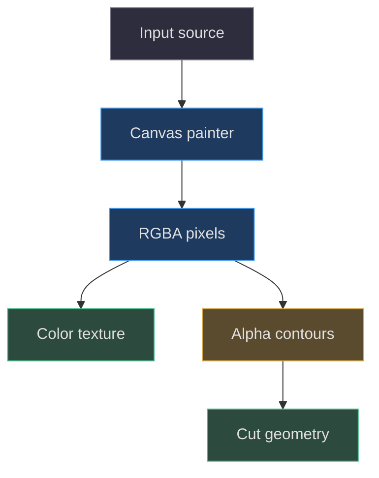
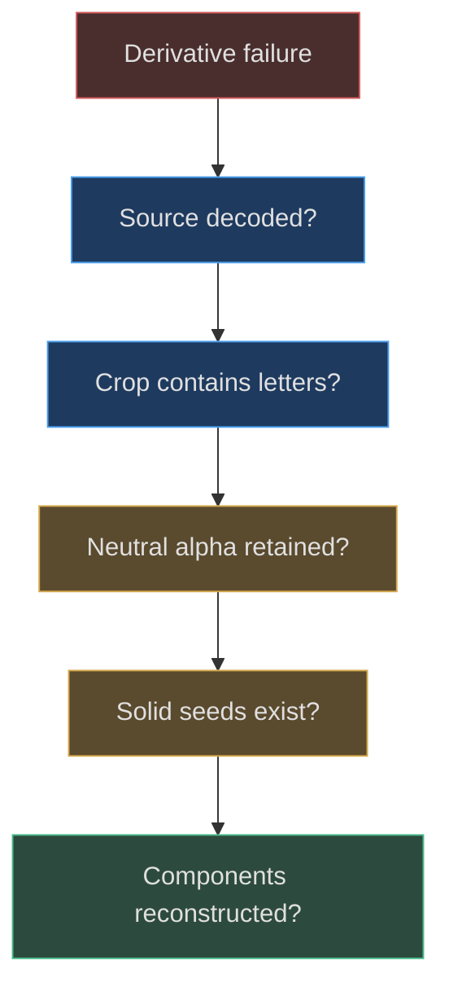

# Procedural textures and asset boundaries

## Procedural does not mean asset-free

The project creates many textures at runtime, but their inputs differ. Wood grain is generated from seeded arithmetic. Cartridge text is rasterized by the browser. The bezel wordmark is derived from supplied artwork. Rear engraving turns supplied alpha into geometry while retaining image color on the cavity floor. Calling all of these “generated textures” hides important reproducibility and provenance boundaries.

The shared `canvasTexture(width,height,paint)` helper creates a canvas, obtains a 2D context, invokes a painter, and wraps the result in `THREE.CanvasTexture`. It throws an explicit error if drawing is unavailable. The texture is marked sRGB and assigned anisotropy `4`. These are actual implementation settings; they do not prove every consuming material or renderer uses the same sampling behavior. [Texture helper](https://github.com/Zanark/BowserBoy/blob/1e4ef518d6943ab1af39cef3b4d558f209a17891/src/handheld.js#L68-L79) (`src/handheld.js:68`).

The current [CanvasTexture documentation](https://threejs.org/docs/pages/CanvasTexture.html), consulted 2026-11-07, describes canvas-backed texture construction and inherited sampling defaults. Use it as explanatory guidance, not a version-pinned historical receipt. This project explicitly overrides color space and anisotropy, so copying generic defaults into a parameter table would be wrong.

## Color data and coverage data have different jobs

sRGB marks how encoded color should be interpreted. Alpha describes coverage, not brightness. The bezel derivative uses source RGB to decide which pixels belong to neutral lettering, but ultimately preserves a reconstructed alpha silhouette and fills that silhouette with stylized color. The rear engraving uses alpha to create contours, while its floor samples the color image. A bright RGB pixel with zero alpha contributes no visible mark; a dim but opaque pixel may still be important to geometry.

This distinction explains why debugging should inspect channels separately. If a logo is missing, first determine whether the color is dark, alpha was removed, UVs point elsewhere, or another surface occludes it. Increasing light only addresses one of those possibilities. Disabling depth writing on a transparent label addresses a different problem again: whether the plane's rectangle prevents later geometry from drawing.

Text labels use a canvas height of `128` and width `ceil(128*aspect)`, centered text alignment, middle baseline, and a maximum drawing width eighteen pixels smaller than the canvas. The world plane's width-to-height ratio supplies the aspect. Thus text size, canvas resolution, and world footprint are related but not identical. A font size in canvas pixels is not a world-space letter height. [Text and label helpers](https://github.com/Zanark/BowserBoy/blob/1e4ef518d6943ab1af39cef3b4d558f209a17891/src/handheld.js#L81-L98) (`src/handheld.js:81`).



Figure MD09.1. The same RGBA input can supply visible color or geometric coverage, but those outputs have different contracts.

## The bezel wordmark is a derived asset

`loadBrand()` decodes `logo.png`, `star.png`, `orbit.png`, and `glow.png`. The handheld module imports `brandImage`; it does not use all four images directly. The full wordmark texture is drawn at `1024×342` for rear artwork. A separate bezel canvas is `1536×174`, cropped from the supplied image and placed into a centered region occupying sixty percent of each canvas dimension. Preserve that distinction: the rear uses full artwork, while the front derives letter-only branding. [Input loader](https://github.com/Zanark/BowserBoy/blob/1e4ef518d6943ab1af39cef3b4d558f209a17891/src/brand.js#L1-L15) (`src/brand.js:1`); [initial derivative](https://github.com/Zanark/BowserBoy/blob/1e4ef518d6943ab1af39cef3b4d558f209a17891/src/handheld.js#L475-L485) (`src/handheld.js:475`).

The derivative first computes the minimum RGB channel and uses it to attenuate alpha, rejecting saturated orbital accents while retaining neutral lettering and highlights. It then finds solid alpha cores using a seven-by-seven neighborhood. Those seeds flood into connected nonzero-alpha pixels. The seed test selects components; the flood reconstructs their original edge pixels rather than simply eroding the whole mark.

This algorithm has a concrete failure boundary: if no solid cores remain, it throws. A replacement artwork with thin lettering may therefore be unsupported even when it looks valid as a PNG. Broadening the threshold is not automatically safe because detached exterior contours may return. Inspect the retained components before changing the test. [Core selection and flood](https://github.com/Zanark/BowserBoy/blob/1e4ef518d6943ab1af39cef3b4d558f209a17891/src/handheld.js#L487-L528) (`src/handheld.js:487`).

Finally the canvas applies vertical chrome color bands with `source-in`, adds a horizontal iridescent tint with `source-atop`, and restores `source-over`. The resulting material uses roughness `.4` and metalness `.1`. The colored bands are baked stylization, not physically traced reflections or a thin-film simulation. Their appearance can coexist with room lighting, but the gradient itself does not respond to camera movement. [Compositing and material](https://github.com/Zanark/BowserBoy/blob/1e4ef518d6943ab1af39cef3b4d558f209a17891/src/handheld.js#L529-L551) (`src/handheld.js:529`).

## MD09-W01 Reproduce the wood generator's controlled variation

`createWood()` paints a `1024×1024` canvas. It starts from seed `41` and advances a 32-bit linear congruential generator using multiplier `1664525` and increment `1013904223`. Eight bands of `128` pixels establish planks. Each receives low-alpha tonal variation, then `110` grain strokes whose paths combine sampled Y positions with sine displacement. Thin dark and light seams separate planks. The texture repeats twice along both axes. [Complete wood painter](https://github.com/Zanark/BowserBoy/blob/1e4ef518d6943ab1af39cef3b4d558f209a17891/src/handheld.js#L657-L684) (`src/handheld.js:657`).

The seed makes the arithmetic sequence repeatable. It does not promise identical raster pixels across every browser implementation, GPU, and operating system. Canvas line rasterization and color handling can differ. The useful invariant is stronger within one environment: two calls follow the same painter and seeded sequence, so their pixel results should agree there.

The following original browser-console recipe assumes the project's import map and a usable 2D canvas. It hashes canvas pixels, not GPU readback, and creates no scene. Expected results are equal hashes in the same execution environment and repeat values `[2,2]`. It is a diagnostic proposal, not a historical test.

```js
// Pedagogical deterministic-painter check.
const { createWood } = await import('./src/handheld.js');
function hash(texture) {
  const c = texture.image;
  const bytes = c.getContext('2d')
    .getImageData(0, 0, c.width, c.height).data;
  let value = 2166136261;
  for (const byte of bytes) {
    value = Math.imul(value ^ byte, 16777619);
  }
  return value >>> 0;
}
const a = createWood(), b = createWood();
console.assert(hash(a) === hash(b));
console.log(a.repeat.toArray());
a.dispose(); b.dispose();
```

Derive what changing seed versus repeat means. A seed change alters the generated grain arrangement while preserving canvas size and the eight-band structure. A repeat change alters how often the same image tiles over the receiving geometry; it does not repaint new planks. If a desk looks too repetitive, changing only seed cannot remove the fact that the same tile repeats twice. If grain appears stretched, inspect mesh UVs and aspect before repainting.

The function returns a texture, not a desk mesh or material. Its placement and physical scale belong to the consumer outside this part's scope. Recording that boundary prevents “wood model” from becoming an unsupported claim about desk dimensions or UV orientation.

## MD09-R01 Retry when a replacement wordmark fails

Suppose a new licensed wordmark decodes correctly but the factory throws that it has no solid lettering. Begin with the derivative canvas, not the mesh. The crop constants refer to the current source artwork layout. A differently arranged image may place its letters outside that crop or make them too thin after resampling. Successful decode proves only that the image loaded.

Retry by inspecting crop coverage, alpha thresholds, and seed neighborhoods separately. First verify that the crop contains intended letters. Then inspect neutral-channel selection. Finally inspect whether any seven-by-seven solid regions survive. Changing all three at once can produce a plausible output while leaving the cause unknown. A replacement should carry its own explicit derivation parameters rather than silently inheriting assumptions about the old image.

The earlier geometry chapter records why threshold-only filtering damaged lettering and why component reconstruction was introduced. That historical explanation supports retaining component identity, but the exact current loop remains authoritative. It also distinguishes the later colored finish from earlier neutral ink; do not describe both as simultaneous source behavior. [Recorded derivative evolution](https://github.com/Zanark/BowserBoy/blob/1e4ef518d6943ab1af39cef3b4d558f209a17891/docs/book/chapters/04-handheld-geometry/README.md#L95-L120) (`docs/book/chapters/04-handheld-geometry/README.md:95`).



Figure MD09.2. Wordmark diagnosis follows each image-processing boundary instead of treating every missing pixel as an asset-loading error.

## Asset delivery and legal provenance remain separate

The static allowlist copies top-level JS, SVG, and PNG files from `src` and `assets`, maps the inspection logo separately, and vendors selected Three files and license. A runtime-generated texture need not exist as an exported PNG to be reproducible. Conversely, a local asset outside the allowlist is not automatically available at the same browser URL. [Public delivery rules](https://github.com/Zanark/BowserBoy/blob/1e4ef518d6943ab1af39cef3b4d558f209a17891/scripts/site-files.mjs#L4-L25) (`scripts/site-files.mjs:4`).

The root manifest's Three dependency establishes the geometry library; it does not establish rights to every supplied image or system font. The historical reference workstream explicitly avoids extracting unavailable model assets. Preserve that discipline when adding references: use authorized inputs, document derivation, and do not infer permission from technical accessibility. This chapter does not perform a new rights audit. [Library declaration](https://github.com/Zanark/BowserBoy/blob/1e4ef518d6943ab1af39cef3b4d558f209a17891/package.json#L7-L11) (`package.json:7`); [historical provenance limit](https://github.com/Zanark/BowserBoy/blob/1e4ef518d6943ab1af39cef3b4d558f209a17891/TODO/07_REFERENCE_SHAPE.todo#L19-L30) (`TODO/07_REFERENCE_SHAPE.todo:19`).

## Own the lifetime of generated resources

Each helper call creates a new canvas and texture. The text contour routine disposes its temporary texture after reading pixels, and the rear-mask routine similarly disposes the mask. Those calls release texture resources; they do not imply that every scene object is automatically cleaned up when removed from a group. [Temporary glyph resource](https://github.com/Zanark/BowserBoy/blob/1e4ef518d6943ab1af39cef3b4d558f209a17891/src/handheld.js#L232-L240) (`src/handheld.js:232`); [temporary rear mask](https://github.com/Zanark/BowserBoy/blob/1e4ef518d6943ab1af39cef3b4d558f209a17891/src/handheld.js#L255-L263) (`src/handheld.js:255`).

An agent writing a repeated diagnostic should therefore distinguish temporary extraction inputs from textures retained by materials. Disposing a shared retained texture while another material still uses it can invalidate the display. Failing to release unique diagnostic resources can accumulate allocations across many specimens. Track ownership explicitly instead of assuming traversal and removal constitute disposal.

The same principle applies to caches. The brand loader returns early only when all four image exports are present; that is an input cache, not a cache of generated handheld geometries or wordmark textures. Calling the factory twice still constructs two model trees and derived canvases. A proposed factory cache would need rules for material mutation, texture reuse, and disposal, especially because cloned finishes and mutable control state belong to individual instances. Resource reuse is an extension design, not something established by the current loader's early return.

## MD09-Q01 Make the book fully reproducible across fonts

An agent wants every A/B contour and cartridge title to match across machines. Is a fixed random seed enough? Propose a bounded extension and explain what existing behavior it would change. Include why matching the bezel bitmap would not solve the action glyph problem.

## MD09-A01 Control the actual source of variability

A seed controls wood's arithmetic choices, not browser font rasterization. Action glyph geometry begins with Arial text rendered to a canvas, and cartridge labels use browser text as well. If the selected font differs, contours and line breaks can differ even with identical Three versions. The bezel is derived from a supplied image, so matching its bitmap does not determine the separately rendered A/B letters.

A deterministic extension could supply appropriately licensed font data and await its loading before rasterization, or provide authorized fixed vector contours for the required glyphs. Each changes the input contract and should be labeled as a new design. The first retains rasterization dependence but controls font selection; the second removes raster contour recovery for those glyphs but introduces vector-asset maintenance and provenance responsibilities.

Verification should compare contour topology, footprint, counter preservation, and actual rendered readability, not only a file hash. Keep the existing baseline available so the extension is not misrepresented as recovered historical tooling. The player test's direct-video assertion further reminds us that decorative texture reproducibility must not replace the live framebuffer with a baked image. The model's labels, brand derivations, and game display are three different asset boundaries. [Live-video boundary](https://github.com/Zanark/BowserBoy/blob/1e4ef518d6943ab1af39cef3b4d558f209a17891/tests/browser/player.spec.mjs#L265-L273) (`tests/browser/player.spec.mjs:265`).
