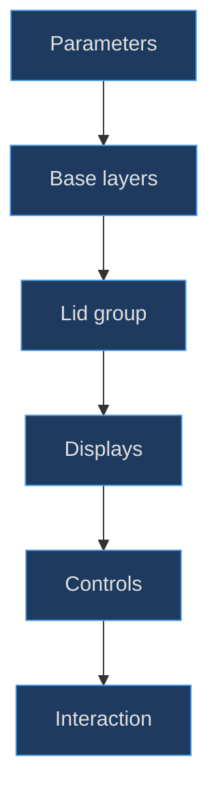
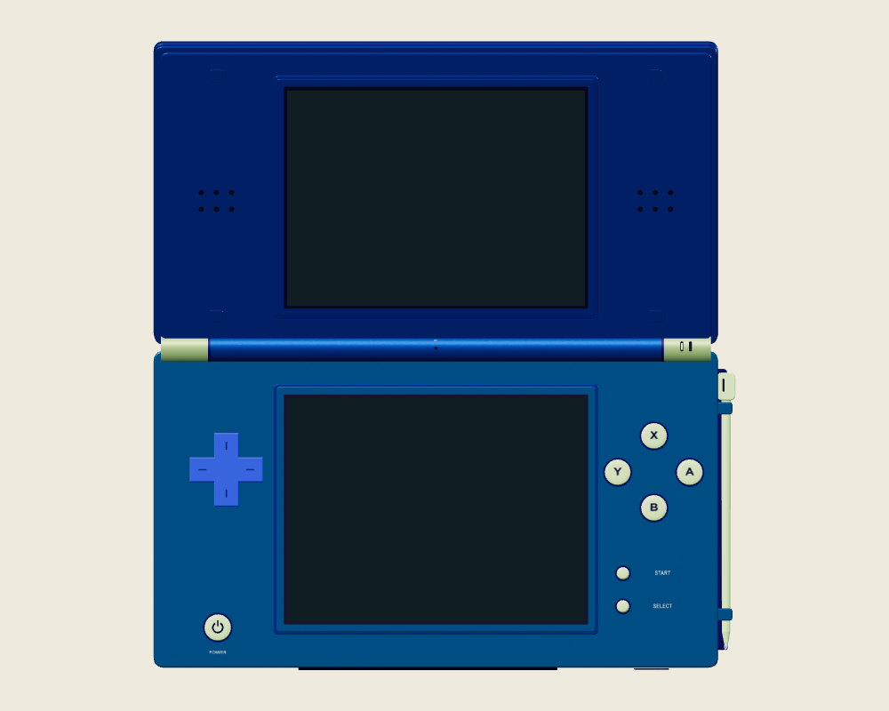
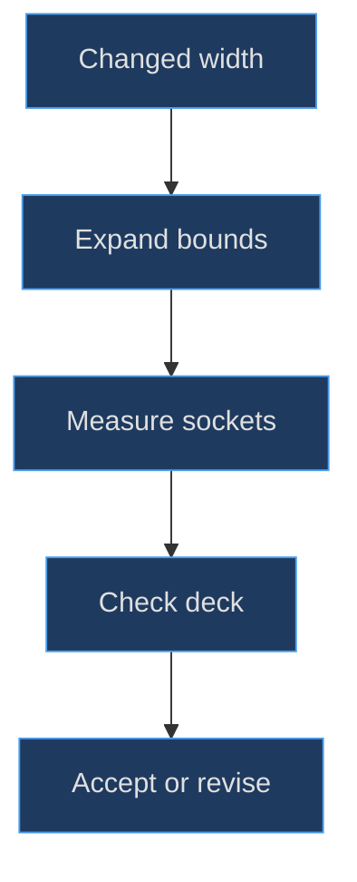

# DS assembly and the parameter map

## Read the assembly as a set of contracts

The DS is not one sculpted object. It is an assembly whose convincing appearance depends on separate transform spaces, layered solids, readable controls and a stable pixel surface. The reconstruction problem is therefore not “make a blue rectangle.” It is to preserve relationships while parts move: the upper display follows the lid, the lower display stays with the base, and the stylus remains available without stretching the camera envelope toward the pointer.

**Implemented evidence.** `createDsHandheld()` imports Three.js and three helpers from `handheld.js`; it constructs groups, extrusions, cylinders, lathed caps, planes and canvas textures. There is no model-file loader in this factory. The repository and installed package both identify Three.js **0.186.1**. This chapter describes JavaScript procedural authoring, not a Blender, CAD or imported-mesh workflow. Read the [factory entry and materials](https://github.com/Zanark/BowserBoy/blob/1e4ef518d6943ab1af39cef3b4d558f209a17891/src/ds-handheld.js#L1-L45) (`src/ds-handheld.js:1`) and [dependency declaration](https://github.com/Zanark/BowserBoy/blob/1e4ef518d6943ab1af39cef3b4d558f209a17891/package.json#L1-L10) (`package.json:7`).

Numbers below are **model-space units**, not measured millimetres. A screen width of 4.5 establishes a useful internal scale, but it does not establish a manufactured part's dimensions. Surface names are authoring labels, not a promise of mechanical equivalence to every Nintendo DS revision. Begin a reconstruction by recording those limits; otherwise seemingly precise arithmetic becomes misleading hardware documentation.


Figure MD10.1. Reconstruct in dependency order: silhouette and ownership precede decorative details and interactive targets.

## Build a parameter ledger before changing geometry

The lower assembly contains a parting line, rear shell and control deck centered at local Y −2.43. Their common nominal width is 8.5 and height 4.75. The lid's nominal footprint is 8.5 by 4.65, centered at its own Y 2.43. The opposing signs place the joint near the root origin instead of at either shell's center. This origin choice makes articulation simpler: the lid rotates around its parent origin while its geometry is offset away from that origin.

| Parameter | Implemented value |
|---|---:|
| Lower footprint | 8.5 × 4.75 |
| Upper footprint | 8.5 × 4.65 |
| Lower center Y | −2.43 |
| Upper center Y | 2.43 |
| LCD viewport | 4.5 × 3.375 |
| Hinge radius | .255 |
| Default lid X rotation | 70 degrees |

These are nominal constructor inputs, not final beveled bounds. The DS wrapper supplies bevel `min(.02, depth/3, radius/3)` to the shared rounded-box helper. Extrusion bevels extend the outline and thickness; an 8.5-wide shape can therefore occupy more than 8.5 in its generated bounding box. The [shell construction](https://github.com/Zanark/BowserBoy/blob/1e4ef518d6943ab1af39cef3b4d558f209a17891/src/ds-handheld.js#L68-L103) (`src/ds-handheld.js:68`) must be read with the [centered extrusion helper](https://github.com/Zanark/BowserBoy/blob/1e4ef518d6943ab1af39cef3b4d558f209a17891/src/handheld.js#L4-L32) (`src/handheld.js:19`). That combination explains why center-to-center spacing is insufficient for clearance work.

The lower rear shell uses depth .19 at Z −.135; the control deck uses depth .22 at Z .105. The parting line is much thinner, .025 at Z −.025. These layers establish visible seams without requiring a single watertight enclosure. Do not silently reinterpret them as a production injection-molding cross-section: intersecting layered meshes are acceptable here, but manufacturing wall thickness and internal fasteners are not being solved.

## Assign transform ownership before assembly

The root owns the base, lower LCD, controls, card and stylus. The `lid` owns its shell layers, upper LCD, speaker details, bumpers and hinge leaves. The separate `hinge` group is root-owned; its barrel does not rotate merely because the lid rotates. This distinction prevents double articulation. Attaching the hinge under the lid and then rotating both would create a plausible-looking but structurally wrong joint.

The return object is the public assembly interface: `root`, `lid`, `hinge`, `screens`, `screen`, `controls`, `led`, `power`, `cartridge`, stylus references, branding and accent materials. `screen` aliases the second entry of `screens`, so downstream lower-touch logic can address the intended surface directly. The [returned interface](https://github.com/Zanark/BowserBoy/blob/1e4ef518d6943ab1af39cef3b4d558f209a17891/src/ds-handheld.js#L248-L274) (`src/ds-handheld.js:273`) is more reliable than guessing targets from traversal order.

**Research guidance, not pinned implementation evidence.** Current [Three.js Object3D documentation](https://threejs.org/docs/pages/Object3D.html), consulted 2026-11-07, distinguishes local transforms, world matrices and radian rotations. Use that model to reason about parent-child composition. Do not adopt a newer documented property merely because it appears on the current page; this implementation uses group origins and offsets, not a newly introduced pivot API.



Figure MD10.2. Parent-supplied neutral-studio constructor diagnostic, intended for silhouette and layering inspection; it is not native gameplay, historical development evidence or a claim that every control is unobstructed in every pose.

## Separate visual construction from application completion

A factory instance is not the finished application state. Its branding plane starts invisible and without the supplied logo map. `DsController.initialize()` loads the image, assigns an sRGB texture and reveals the plane. Its screens initially use unlit materials, but the controller constructor subsequently selects reflective powered-off glass. A bare-constructor diagnostic must therefore identify which initialization stages it includes.

The [controller initialization](https://github.com/Zanark/BowserBoy/blob/1e4ef518d6943ab1af39cef3b4d558f209a17891/src/ds-controller.js#L186-L201) (`src/ds-controller.js:186`) establishes this asset boundary. It is a supplied artwork texture on procedural geometry, not evidence that the whole console was imported. Likewise the scene puts the root into a desk or focused-play transform; a local positive Y coordinate is not automatically “up” in the room.

The [scene pose constants](https://github.com/Zanark/BowserBoy/blob/1e4ef518d6943ab1af39cef3b4d558f209a17891/src/scene.js#L18-L23) (`src/scene.js:18`) use a rotated table quaternion and an identity default play quaternion. Keeping that distinction in the ledger prevents mistaken descriptions of the card's travel or the lower expansion slot. The modeled front/bottom expansion opening is separate from the rear DS game-card slot near the hinge; the factory names and places both.

## MD10-W01 Audit a face-button clearance numerically

Consider the leftmost face button, Y, at X 2.75 with cap radius .195. Its recessed socket has radius `.195 + .025 = .220`, so the socket's leftmost nominal X is `2.75 − .220 = 2.530`. The outer touchscreen bezel starts with width 4.88, giving half-width 2.440, but its .035 depth limits the DS wrapper bevel to `.035/3 ≈ .011667`. The outer bound is therefore approximately 2.451667. The nominal horizontal gap is about **.078333**.

That result explains two decisions. First, the socket, not just the smaller cap, is the limiting feature. Second, ignoring the bezel's extrusion bevel would overstate the available gap. The browser test requires greater than .05 between every cap/socket bound and the actual bezel, and greater than .1 toward the deck edge. Read the [bound-based assertions](https://github.com/Zanark/BowserBoy/blob/1e4ef518d6943ab1af39cef3b4d558f209a17891/tests/browser/ds.spec.mjs#L1297-L1360) (`tests/browser/ds.spec.mjs:1309`).

Original diagnostic pseudocode follows. Assumptions: a browser has constructed the model, matrices are current, and `boundsInBase()` transforms all eight geometry-box corners into root space. The expected result is positive margins, not an assertion that this recipe was executed here.

```text
bezel = boundsInBase("Touch fine cyan bezel edge")
deck = boundsInBase("Metallic blue control deck")
for label in X, A, B, Y:
  for part in button, recessed_socket:
    box = boundsInBase(label, part)
    require box.minX - bezel.maxX > .05
    require deck.maxX - box.maxX > .10
```

For a beveled corner, an axis-aligned box is conservative: it can reject space that is geometrically empty near the rounded edge. That is useful for a readable diagram and predictable safety margin, but it is not exact mesh-to-mesh distance. Record which measurement you use rather than switching between them when a test fails.

## MD10-R01 Retry after widening the screen surround

Suppose a proposed surround change increases its width by .12 without changing controls. Its right edge advances .06. The previously calculated .078333 gap becomes about .018333 and violates the .05 criterion. Moving only the Y legend does nothing; moving only its cap leaves the socket overlapping. Shrinking the LCD would change a separate display contract.

The corrected proposal must move the entire diamond or redesign the surround, then recalculate both inner and outer margins. Moving all four controls outward by .04 might recover the inner threshold but consumes .04 of the A button's deck-edge margin. Inspect both limits before choosing a value. Historical commit [89d905f](https://github.com/Zanark/BowserBoy/commit/89d905fd0a31de6f7364e75a73e0c607885497f9) moved the complete cluster outward by .2; that recorded correction supports the method, not permission to move it indefinitely.


Figure MD10.3. A parameter change is accepted only after checking both adjacent constraints; passing one side does not preserve the assembly.

## Make parameter changes transactional

**Proposed reconstruction practice.** Keep a small change ledger with four columns: parameter, dependent geometry, dependent behavior and evidence to regenerate. For example, changing LCD width affects the plane, all three surround layers, illumination viewport metadata, control clearance and camera bounds. Changing only shell roughness affects appearance but should not change those dimensions. This classification keeps an agent from treating every visual complaint as a material problem.

Work from a reversible baseline. Change one relationship, rebuild the affected geometry and capture numerical bounds before interpreting a new image. A plane becoming wider without a matching viewport metadata change is an internal inconsistency even if the image still looks acceptable. A moved cap with an unmoved shell label may be visually inconsistent even though its input anchor follows correctly.

Resource lifetime is another dependency. The existing controller disposes replaced display materials and maps; proposed geometry replacement should similarly account for the old geometry rather than retaining every revision indefinitely. Do not copy that disposal strategy blindly onto shared objects: first determine whether another mesh still references the resource. The factory intentionally shares several materials, including the shell/rim relationship, so mutation has a wider scope than one named mesh.

Finally, save both the intended effect and the invariant that must remain unchanged. “Move the diamond outward while keeping screen size” is testable; “improve the controls” is not. This makes later debugging a comparison of contracts rather than a reconstruction of undocumented taste.

## MD10-Q01 Exercise: choose the correct editable object

A diagnostic operator wants the top display to fold while the lower touchscreen, battery cover and branding remain fixed. They propose rotating `root`, then counter-rotating every lower component. Explain the ownership error, choose the minimal correct transform, and identify one downstream calculation that must be refreshed.

## MD10-A01 Explained answer

Rotate `lid.rotation.x`, not the root. Counter-rotation replaces a clear hierarchy contract with many compensating transforms; every later base detail becomes another opportunity for a missed correction. The upper LCD already belongs to the lid and therefore follows automatically. The battery cover and underside branding remain root-owned. The hinge barrel also remains root-owned while the lid-owned leaves move with the shell.

Refresh articulated bounds and view matrices before trusting projected input. `dsPoseBounds()` evaluates separate root and lid transforms; a single cached flat rectangle cannot describe both poses. This is a geometric correctness requirement, not merely a camera convenience. The [pose/bounds implementation](https://github.com/Zanark/BowserBoy/blob/1e4ef518d6943ab1af39cef3b4d558f209a17891/src/scene.js#L484-L518) (`src/scene.js:502`) supplies the actual application mechanism. This chapter read source and assertions; it did not rerun browser tests, render production images or establish owner approval.
