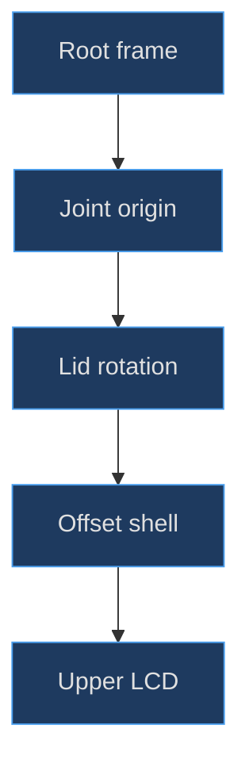
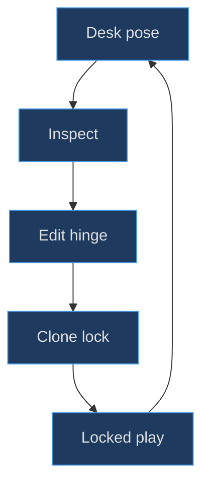

# Hinges, lids and articulation

## A hinge is first a coordinate-system decision

An articulated object fails when its pivot is chosen after its geometry. A lid centered on its own origin spins like a signboard; it does not fold around its lower edge. This factory instead places the lid group's origin at the joint and offsets its visible shell to local Y 2.43. The group receives an initial X rotation of 70 degrees and a Z offset of .07. The upper screen and surrounding details are children, so one transform carries the complete upper assembly.

**Implemented evidence.** The [lid creation](https://github.com/Zanark/BowserBoy/blob/1e4ef518d6943ab1af39cef3b4d558f209a17891/src/ds-handheld.js#L71-L103) (`src/ds-handheld.js:71`) precedes the separately created barrel group. That ordering makes the visual joint independent of the mathematical articulation. No torque, detent spring, hinge friction or collision-constrained rigid-body joint is implemented by these groups. The physical mechanism is approximated through recognizable geometry and bounded pose editing.


Figure MD11.1. Offset geometry creates the lever arm; rotation belongs to the joint frame rather than the shell center.

## Construct the barrel without confusing its axis

Three.js cylinders are initially aligned along their local Y axis. The central barrel uses radius .255, width 6.90 and 48 radial segments, then rotates around Z by π/2 so its length lies along the hinge's X axis. A right lime cap at X 3.80 uses width .72. The left end is assembled from two half-cylinder sections at X −3.80 with angular starts −π/2 and π/2. Their names distinguish front and rear sections, but both use the same lime material at this cutoff.

Two collars sit at X ±3.43 with radius .258 and width .035. The slight radial increase creates a legible seam without making the joint look like disconnected cylinders. Lid-owned leaves at those X positions bridge the upper shell toward the barrel. The microphone, MIC legend and indicator recesses belong to the barrel frame, so they do not unexpectedly orbit the upper LCD. Inspect the [complete joint details](https://github.com/Zanark/BowserBoy/blob/1e4ef518d6943ab1af39cef3b4d558f209a17891/src/ds-handheld.js#L111-L137) (`src/ds-handheld.js:111`).

The barrel is a visual approximation rather than a mechanically interlocking mesh. A continuous cylinder and narrow collars are inexpensive and readable at desk scale; modeling internal axles would add surfaces that the current interaction does not expose. If an extension requires an exploded mechanism, add that as a new documented model contract rather than claiming the existing continuous barrel already contains one.

## Opening degrees and stored rotation are different quantities

The scene's getter reports `180 − radToDeg(lid.rotation.x)`. Its setter clamps an opening angle to 30–180 degrees and stores the complement in radians. Thus an opening of 180 corresponds to zero stored rotation, 145 corresponds to 35 degrees, and the factory's 70-degree rotation corresponds to a 110-degree opening. These conversions are not interchangeable descriptions of one raw number.

| Human opening | Lid X rotation |
|---|---:|
| 180 degrees | 0 radians |
| 145 degrees | about .610865 radians |
| 110 degrees | about 1.221730 radians |
| 30 degrees | about 2.617994 radians |

The [actual setter and lock guards](https://github.com/Zanark/BowserBoy/blob/1e4ef518d6943ab1af39cef3b4d558f209a17891/src/scene.js#L452-L481) (`src/scene.js:467`) reject non-finite angles and edit only an unlocked DS in Inspect outside a transition. A correct-looking console command can do nothing if those preconditions are false. That is deliberate state ownership, not a conversion failure.

**Research guidance.** Current [Object3D documentation](https://threejs.org/docs/pages/Object3D.html), consulted 2026-11-07, describes rotations in radians and local positions relative to parents. This supports the mathematical explanation; it does not establish version-specific behavior beyond the pinned Three.js 0.186.1 implementation actually read. The factory uses ordinary groups and rotations, not a physics-joint library.

## MD11-W01 Calculate a useful diagnostic pose

Use the lid center point `(0, 2.43, 0)` in the lid's local coordinates, ignoring shell thickness for this calculation. After an X rotation θ, the root-space point becomes approximately `(0, 2.43 cos θ, .07 + 2.43 sin θ)`. At a 145-degree opening, θ is 35 degrees, giving Y about 1.9905 and Z about 1.4638. The center rises away from the lower assembly in root space while retaining the joint origin.

This is not yet a room-space prediction. If the root has the tabletop quaternion, multiply the result by that root transform before calling a direction world-up or world-forward. The useful diagnostic outcome is relative: the upper screen changes orientation and the lower screen's local transform does not. A root rotation would move both, exposing a hierarchy error immediately.

The following original browser-module recipe assumes a constructor-capable DOM and imported Three.js. It creates a new diagnostic instance, not a live application mutation. Expected result: a 145-degree opening under the scene convention, with updated world matrices. No production render is requested.

```js
import * as THREE from 'three';
import { createDsHandheld } from './src/ds-handheld.js';

const ds = createDsHandheld();
ds.lid.rotation.x = THREE.MathUtils.degToRad(35);
ds.root.updateWorldMatrix(true, true);
console.assert(
  Math.abs(ds.lid.rotation.x - Math.PI * 35 / 180) < 1e-12
);
```

There is **no hinge setter returned by the factory**. The returned `lid` is the exact factory API for this operation. In the application, use `view.setDsHinge(145)` only after entering unlocked DS Inspect and waiting for the transition to finish; that method accepts opening **degrees** and also reframes the camera. Do not call `setDsHinge(35)` expecting a 35-degree stored rotation.

## Preserve three pose purposes

Desk pose, Inspect pose and optional gameplay lock serve different jobs. The desk has a remembered placement and resting hinge. Inspect allows independent root rotation and hinge edits. Locking records a clone of the root quaternion plus the current lid rotation; it does not rewrite the saved desk arrangement. Unlocked gameplay defaults to the flat, front-facing configuration.

Historical commit [e885636](https://github.com/Zanark/BowserBoy/commit/e8856369620d4afd49af9967d205bcb1383243b4) introduced independent hinge controls and locked gameplay poses. The associated [construction task](https://github.com/Zanark/BowserBoy/blob/1e4ef518d6943ab1af39cef3b4d558f209a17891/TODO/87_DS_HINGE_GAMEPLAY_POSE.todo#L1-L30) (`TODO/87_DS_HINGE_GAMEPLAY_POSE.todo:1`) explicitly separates the desk's 110-degree resting opening from gameplay. Those records ground the feature's purpose; they are not a fresh execution or a substitute for reading the current setter.

The pose lock is session state, not permanent storage. Cloning the quaternion matters because keeping a mutable reference would allow later root edits to mutate the supposed saved pose. Clearing drag and pinch state at the lock boundary similarly prevents an earlier gesture from continuing through a new ownership rule.


Figure MD11.2. A gameplay lock captures a chosen pose without converting that pose into the console's remembered desk placement.

## MD11-R01 Retry with a nearly folded lid

Change the opening from 145 to 30 degrees. The stored rotation becomes 150 degrees, placing much of the upper assembly over the lower half. A previously visible control may now be covered even if the whole console remains inside the camera frustum. The correct retry does not increase exposure, disable depth testing or keep invisible controls clickable.

Recompute articulated bounds and update matrices, then let occlusion decide availability. `projectControls()` checks facing, clip-space limits and lid intersections before exposing projected HTML buttons. Its [projection path](https://github.com/Zanark/BowserBoy/blob/1e4ef518d6943ab1af39cef3b4d558f209a17891/src/ds-controller.js#L677-L701) (`src/ds-controller.js:684`) explains why a folded control can disappear correctly. For touch, the first relevant root intersection must be the lower LCD, not simply any intersection farther down the ray.

Also recheck materials at an oblique angle. Shared rounded solids obtain their bevels through [ExtrudeGeometry construction](https://github.com/Zanark/BowserBoy/blob/1e4ef518d6943ab1af39cef3b4d558f209a17891/src/handheld.js#L19-L32) (`src/handheld.js:19`). A highlight vanishing on a grazing face is not automatically a missing normal; first determine whether the face points away from the lamp or is physically hidden.

## Precision checks for a convincing joint

**Recommended diagnostic procedure.** Inspect the joint from front, rear and a grazing side direction while holding the root transform fixed. A front view checks continuity across barrel sections; a rear view checks whether the leaves remain attached to the shell; the side view reveals an offset pivot that a frontal image can conceal. These are complementary questions rather than three decorative views of the same proof.

Measure in the joint's local frame before measuring in world space. A collar radius .258 versus barrel radius .255 creates a radial difference of .003. That is a deliberate small geometric distinction in the source, not a reason to round every number to two decimals. A rounded diagnostic export could erase the distinction even though the original geometry retains it. Conversely, do not report the .003 as a manufacturing clearance: both are visual surfaces and are not an axle-and-bearing tolerance pair.

If a collar appears detached, inspect its width and axial position independently of radius. A larger radius repairs a radial silhouette gap but cannot repair an axial separation. If a leaf penetrates the barrel, first decide whether the overlap is intentional cover geometry or a visible discontinuity. A mechanical mesh requires different checks from an economical visual joint, and the current source promises the latter.

For a proposed alternate shell size, preserve the pivot origin and change the child offset deliberately. Moving the lid center without revisiting its nearest edge can create an exposed gap at the joint. Calculate the edge position from half-height, center offset and bevel extension, then inspect the resulting seam through the allowed opening range. Checking only the 145-degree diagnostic pose can miss a collision or gap near 30 degrees.

Finally distinguish geometry precision from input precision. A correctly rotating lid can still leave stale hit targets if the scene matrix refresh is omitted. Record the opening angle, stored radians, root quaternion and matrix-update stage together. That record turns an intermittent “hinge bug” into a reproducible question about either geometry, state guards or projection.

## MD11-Q01 Exercise: diagnose a lid that translates while folding

A reconstruction rotates a shell mesh about its own center and then updates the lid group's position on each frame to make the lower edge “approximately stay put.” The barrel is also parented under that group. Why is the result fragile, and what should a replacement validation measure?

## MD11-A01 Explained answer

The implementation has replaced one stable joint frame with two coupled approximations: rotation plus corrective translation. Small changes to shell dimensions invalidate the correction, and the barrel moves with the lid even though it should identify the fixed joint axis. Put the lid origin at the joint, offset shell geometry in the child frame, and keep the barrel root-owned. The replacement needs only one articulation transform.

Measure a joint-adjacent reference point over several openings and confirm it follows the intended hinge neighborhood rather than circling the shell center. Check that the lower LCD, battery cover and branding retain their root-local transforms. Then validate occlusion and actual input in the articulated pose. The browser's [independent-hinge scenario](https://github.com/Zanark/BowserBoy/blob/1e4ef518d6943ab1af39cef3b4d558f209a17891/tests/browser/ds.spec.mjs#L927-L1018) (`tests/browser/ds.spec.mjs:927`) is read evidence for those application expectations, not a test rerun in this authoring task. A stationary hinge point alone cannot prove usable screens or correct projected input.
