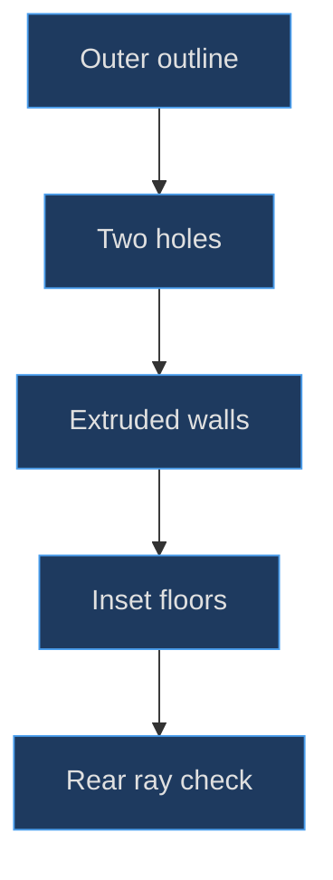
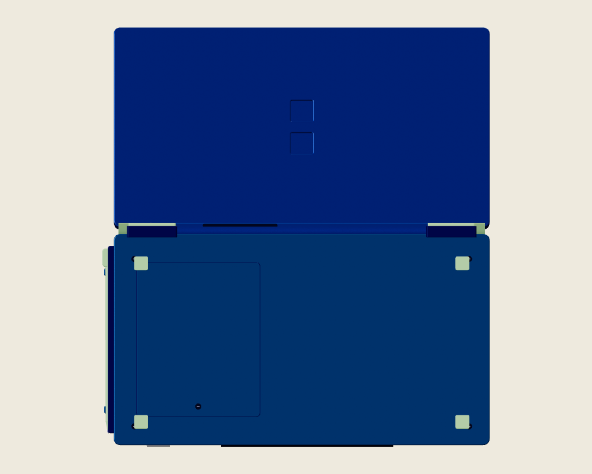
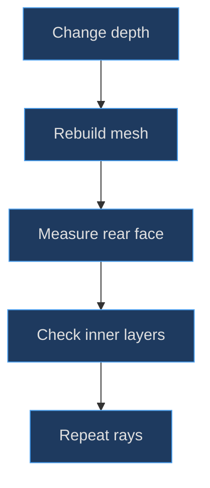

# DS shells, recesses and hardware

## Use depth where depth is part of the evidence

Small hardware details communicate how an object is assembled. A seam says two shells meet; a screw recess suggests fastening; an inset floor says a depression has depth. These meanings are not interchangeable. Painting a dark square can suggest a recess from one camera, but it does not create an aperture that a ray can pass through before hitting a lower surface.

**Implemented evidence.** The DS outer lid actually contains holes in its `Shape`. Two rounded-square paths are added before extrusion, while separate blue floors sit behind them. By contrast, the speaker openings are small dark cylinder meshes and the rear card slot is a dark rounded box. The construction deliberately mixes true outline topology with economical surface approximations. The [lid aperture construction](https://github.com/Zanark/BowserBoy/blob/1e4ef518d6943ab1af39cef3b4d558f209a17891/src/ds-handheld.js#L76-L92) (`src/ds-handheld.js:77`) is the authority for which technique applies.


Figure MD12.1. A genuine modeled recess needs an open outline and a separately positioned floor, not merely a darker top-facing patch.

## Reconstruct the outer lid cross-section

Start with a centered rounded outline 8.5 by 4.65 and corner radius .14. Generate each hole from a .54-by-.54 rounded shape with radius .055, sample its points and shift them by local Y ±.38. The hole X offset is zero. When the complete lid mesh is placed at Y 2.43, the hole centers become Y 2.05 and 2.81 in the lid group.

The outer geometry extrudes .12 with bevel size and thickness .02, three bevel segments and eighteen curve segments, then translates Z by −.06. Its mesh position adds another −.10. Ignoring curvature at the bevel, the main extrusion therefore spans approximately Z −.16 to −.04 before the bevel thickness expands that range to about −.18 through −.02. The inset-floor centers are at Z −.14, with .008 nominal thickness and the DS helper's small depth-limited bevel.

This arrangement is most usefully understood from the **rear**, looking along positive local Z. A ray through intact outer shell first encounters the rear skin around −.18. At a hole center that skin is absent, allowing the ray to continue to the floor around −.147. The floor is deeper into the lid from that rear viewpoint. Saying “behind” without specifying the viewing side can reverse the explanation.

The [shared solid helper](https://github.com/Zanark/BowserBoy/blob/1e4ef518d6943ab1af39cef3b4d558f209a17891/src/handheld.js#L4-L32) (`src/handheld.js:19`) explains centered extrusion and bevel expansion. **Research guidance:** the current [ExtrudeGeometry documentation](https://threejs.org/docs/pages/ExtrudeGeometry.html), consulted 2026-11-07, distinguishes depth, bevel size, bevel thickness and segment counts. It also notes that modifying the recorded constructor parameters does not rebuild geometry. Treat that documentation as current guidance; the pinned factory's actual values and geometry creation remain the implementation evidence.

## MD12-W01 Verify two recesses and the land between them

The diagnostic needs three rear rays, not a screenshot of two dark squares. Cast along positive local Z through `(0, 2.05)`, `(0, 2.81)` and `(0, 2.43)`. The first two should hit the named inset-floor meshes; the midpoint should hit the metallic outer lid. Transform both origins and directions through the lid's current world matrix so the same test works after articulation.

Original pseudocode, assuming a constructed instance and current matrices:

```text
for y in 2.05, 2.81, 2.43:
  origin = lid.localToWorld(0, y, -1)
  direction = transformDirection(lid.matrixWorld, 0, 0, 1)
  first = raycast(lid, origin, direction)
  record y, first.object.name
expect floor, floor, outer_lid
```

The expected names correspond to the [actual browser surface test](https://github.com/Zanark/BowserBoy/blob/1e4ef518d6943ab1af39cef3b4d558f209a17891/tests/browser/ds.spec.mjs#L1284-L1355) (`tests/browser/ds.spec.mjs:1324`). This chapter read that assertion; it did not execute it. If all three rays hit the outer lid, the hole paths are not cutting the intended outline. If the first two miss everything, inspect floor placement and face orientation before changing ray distances.

A rear-side ray is important because planes and mesh triangles have oriented faces. Blindly making every material double-sided can hide a reversed-normal defect. Diagnose winding, geometry transforms and viewing side first. Double-sided shading is a deliberate rendering choice, not a general repair for uncertain construction.

## Lower-shell hardware is its own subsystem

The battery cover is root-owned on the underside: a 2.81-by-3.51 seam at X 2.35, Y −2.43, Z −.27, then a slightly smaller cover at Z −.278. Five screw recesses include one associated with that cover; their head slots sit farther toward negative Z. Four pale-green square pads occupy X ±3.65 and Y −.70/−4.30 at Z −.30.

The [underside hardware construction](https://github.com/Zanark/BowserBoy/blob/1e4ef518d6943ab1af39cef3b4d558f209a17891/src/ds-handheld.js#L217-L238) (`src/ds-handheld.js:227`) uses overlapping shallow solids, not boolean cavities cut into every base layer. Screw slots are boxes, not full threaded fasteners. The pads clone button plastic and raise roughness to .9, separating a matte support surface from the metallic hinge trim. These approximations are appropriate to the existing desk model but should be disclosed in a reusable reconstruction manual.



Figure MD12.2. Parent-supplied neutral-studio underside diagnostic for shell layers, battery-area layout and rear detail placement; constructor-only branding may remain hidden until its supplied texture is initialized.

The lower-base branding plane is centered at X −1.65, Y −2.43, Z −.265, faces outward after a Y rotation of π, and preserves a 2149:732 artwork aspect. It belongs to the lower root, clear of the right-side battery cover, not to the swinging lid. `initialize()` supplies its image later. See [branding geometry](https://github.com/Zanark/BowserBoy/blob/1e4ef518d6943ab1af39cef3b4d558f209a17891/src/ds-handheld.js#L138-L143) (`src/ds-handheld.js:138`) and [texture initialization](https://github.com/Zanark/BowserBoy/blob/1e4ef518d6943ab1af39cef3b4d558f209a17891/src/ds-controller.js#L186-L201) (`src/ds-controller.js:196`).

## Distinguish the two slots explicitly

The front navy expansion opening is placed at local Y −4.842 and rotated around X by π/2. It represents the lower/front expansion-slot feature, not the original hardware's rear DS-card slot. The separately named rear DS game-card slot is a 1.68-by-.18-by-.24 dark rounded box at X 1.4, Y .1, Z −.02. The insertable DS card is aligned to that rear-side region.

Do not infer insertion direction from the word “bottom” in a caption. Local Y becomes a different room direction after the root's table rotation. Nor should a dark slot-shaped box be described as a fully hollow connector with modeled contacts: the source supplies a visual opening approximation. The scene's [root placement constants](https://github.com/Zanark/BowserBoy/blob/1e4ef518d6943ab1af39cef3b4d558f209a17891/src/scene.js#L18-L23) (`src/scene.js:18`) establish the transform boundary that makes direction language conditional.

## Historical correction: topology and parenting changed together

Commit [6f5083a](https://github.com/Zanark/BowserBoy/commit/6f5083a56a55d9ba526f8952811d4cfc8b44d7d7) changed the hole-point offsets and inset-floor X positions from −2.8 to zero. The same diff moved the emblem from the lid to the base underside. This is stronger evidence than a generic statement that the rear “looked better”: both the topology and the floor placements were corrected, while branding changed ownership.

The [rear-markings task](https://github.com/Zanark/BowserBoy/blob/1e4ef518d6943ab1af39cef3b4d558f209a17891/TODO/95_DS_REAR_MARKINGS.todo#L1-L28) (`TODO/95_DS_REAR_MARKINGS.todo:5`) records the requested centerline and battery-clearance requirements. Its historical verification is not a new verification of this manuscript. Preserve that distinction when turning a development ledger into teaching material.

## MD12-R01 Retry after increasing the floor thickness

Suppose a proposed floor depth changes from .008 to .08 while its center stays at −.14. Its rear face moves much farther toward the outer skin and may become flush with or protrude beyond the aperture entrance once bevel thickness is included. The source name “inset floor” would no longer guarantee an inset appearance.

Compute the floor's actual geometry bounds after rebuilding, compare the rear-most floor Z against the aperture entrance, and repeat the three rays. If the goal is a deeper recess, moving the floor farther positive Z from the rear viewpoint may be appropriate, but check the inner shell and display layers too. Making a floor thinner or darker cannot compensate for incorrect world-space occlusion.


Figure MD12.3. A depth edit changes both exterior evidence and interior clearance; rebuilding and remeasuring are separate from changing a parameter label.

## Debug topology without hiding it under materials

**Recommended diagnostic procedure.** Temporarily reason about the aperture with a single neutral material and explicit ray origins before comparing metallic highlights. This is a proposed inspection technique, not a change made to the shipped model. A blue floor can visually merge with a blue shell under diffuse illumination even when the recess topology is correct; a sharp reflection can make a shallow overlap look deeper than it is.

The floor is slightly wider than the nominal hole: .56 versus .54. That gives a nominal .01 overlap on each side before bevel details. The overlap helps avoid an uncovered edge when looking obliquely, but its sufficiency should be judged from generated geometry and the intended viewing range. It is not a universal anti-crack constant. If the hole radius or floor corner radius changes independently, the edge relationship changes even when both widths stay the same.

Inspect boundary continuity separately from shading continuity. A hole can exist while its side-wall normals produce an unexpected highlight, and a smoothly shaded decal can look recessed without any hole. The rear rays establish surface ordering; a side view establishes wall visibility; a normal-oriented lighting pass can help isolate shading. No single one of those observations replaces the others.

Also account for layered shell intersections. The rear skin, inset floors, perimeter lip and inner lid are separate meshes. A proposed deeper aperture might expose an unrelated layer rather than create empty interior space. Trace a ray through the entire lid hierarchy and record all relevant hit distances when diagnosing that condition, instead of stopping at a conveniently named first hit.

These practices preserve the distinction between an aesthetic recess and a physically bored opening. The existing paired recesses intentionally terminate at floors. Calling them through-holes into an empty enclosure would be as inaccurate as calling them flat dark decals.

## MD12-Q01 Exercise: can a logo be moved onto the battery cover?

A proposed wider emblem still fits inside the total lower-shell rectangle but overlaps the battery-cover region. Its author argues that transparent pixels make the overlap harmless. Identify the missing geometric constraint and the ownership rule that must remain unchanged.

## MD12-A01 Explained answer

The constraint is not only the shell boundary. The emblem must remain in the clear area beside the battery cover, with positive measured separation from that cover. Transparent pixels do not change the plane's layout contract or preserve a readable service-panel boundary. Measure the actual plane bounds, not only its opaque artwork, and compare them with the battery cover in the same root space.

Keep the emblem root-owned and outward-facing. Moving it onto the lid to find more area would violate the documented lower-base placement even if the image became easier to see. The regression requires battery gap greater than .25 and meaningful shell margins; these are explicit model checks, not inferred hardware tolerances. The same discipline applies throughout this chapter: preserve named relationships, then improve appearance within them.
