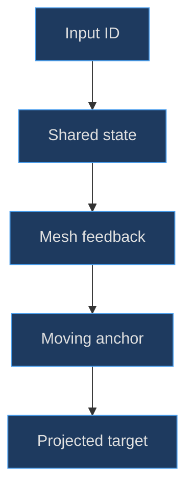
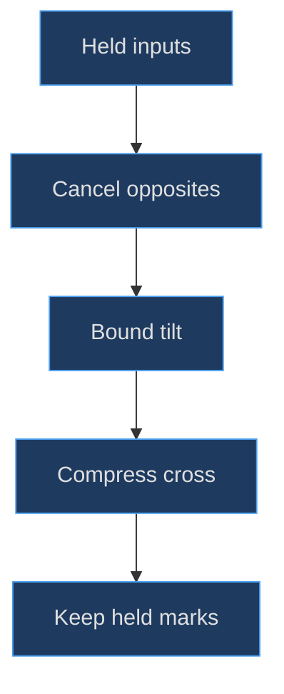

# DS controls and readable markings

## A control has more than a visible cap

For this model a control combines geometry, a rest transform, an input identifier and a projection anchor. Those components solve different problems. A cap communicates touchability; its socket communicates mounting; its anchor places an HTML input target; its identifier routes native button state. Editing only one can make a screenshot look corrected while the actual control still overlaps a bezel or receives input in the wrong place.

**Implemented evidence.** The factory stores controls in a `Map`. Face buttons use their mesh as anchor, while the D-pad uses four separate child anchors on one shared cross. The [cap builder and face layout](https://github.com/Zanark/BowserBoy/blob/1e4ef518d6943ab1af39cef3b4d558f209a17891/src/ds-handheld.js#L144-L159) (`src/ds-handheld.js:145`) establish that construction. Socket radius is cap radius plus .025; clearing only cap centers cannot prove the whole assembly fits.


Figure MD13.1. Geometry and interaction meet at the anchor: a pressed visual should not leave its input target behind.

## Lathe the caps rather than stacking flat discs

The cap profile starts on the axis, moves outward across the underside, climbs a rounded side and returns toward the axis over the top. For radius r, the radial samples include `r − .018`, `r`, `r − .015` and `.65r`; axial samples range from −.0425 to .047. `LatheGeometry` revolves this profile with 32 segments, then the geometry rotates around X by π/2 before placement at Z .29.

That rotation has a useful consequence: the lathe's original axial coordinate becomes local Z. The subsequent press animation can move `mesh.position.z` inward without changing the cap's orientation. The visible legend is a child plane at Z .052, so it follows the cap instead of floating above the deck. This is a geometric reason to attach a marking to its moving owner, not simply a convenient grouping habit.

The four .195-radius caps form a diamond at X/Y `(3.3, −1.32)`, `(3.84, −1.87)`, `(3.3, −2.41)` and `(2.75, −1.87)`. START and SELECT use smaller .095-radius blank caps with separate light labels on the shell. Power uses radius .20 plus actual torus-and-stem icon geometry. These differences prevent a one-size-fits-all label helper from dictating the hardware layout.

The text helper paints bold Arial into a canvas, then uses a transparent `MeshBasicMaterial` with depth writing disabled and tone mapping disabled. It chooses 96 pixels for a single character and 512 for longer labels. See the [text and circle helpers](https://github.com/Zanark/BowserBoy/blob/1e4ef518d6943ab1af39cef3b4d558f209a17891/src/ds-handheld.js#L54-L66) (`src/ds-handheld.js:54`) and the [shared texture helper](https://github.com/Zanark/BowserBoy/blob/1e4ef518d6943ab1af39cef3b4d558f209a17891/src/handheld.js#L68-L78) (`src/handheld.js:68`). These are procedural raster markings on modeled parts, not engraved font outlines.

## Build one molded D-pad with four semantic directions

The cross is a twelve-corner `Shape`, extruded .085 with .018 bevel size and thickness. It is placed in a group at `(−3.17, −1.83, .285)`. Four small rectangular direction marks occupy its arms, and four child anchors sit near the arm tips. All direction entries refer to the **same mesh group**; they differ in anchor and indicator.

The [cross and anchors](https://github.com/Zanark/BowserBoy/blob/1e4ef518d6943ab1af39cef3b4d558f209a17891/src/ds-handheld.js#L160-L187) (`src/ds-handheld.js:165`) explain why the controller must compute one composite pose. Rotating the cross once per input entry would apply competing updates to one object. Instead, held inputs become a signed two-axis vector, normalized so a diagonal does not exceed the intended .16-radian combined tilt.

The response uses elapsed-time damping, with stronger release response than press response. A .012 compression accompanies any directional hold. Opposing directions cancel the corresponding rotational axis but still count as held and still highlight their individual marks. That combination distinguishes physical pose from semantic input state: zero tilt does not necessarily mean no buttons are held.

## MD13-W01 Derive the Up-plus-Right pose

For Up and Right held, the controller computes `x = down − up = −1` and `y = right − left = 1`. Magnitude is √2, so target pitch is approximately −.113137 radians and target yaw approximately .113137 radians. Their Euclidean magnitude is .16, matching the cardinal target rather than exceeding it by √2.

Rest Z .285 becomes .273. For an approximate arm-surface point at local Y .5 and local Z .068, negative pitch lowers the upper arm in root-local Z. A small-angle estimate gives a top-versus-bottom edge difference around `sin(−.113137) ≈ −.1129` across unit separation, while the simultaneous yaw tilts the horizontal axis. Exact transformed heights should be measured with the mesh matrix, not inferred from Euler signs alone.

Original runnable arithmetic recipe, requiring only JavaScript:

```js
const held = new Set(['up', 'right']);
const x = +held.has('down') - +held.has('up');
const y = +held.has('right') - +held.has('left');
const n = Math.max(1, Math.hypot(x, y));
const target = { pitch: x * .16 / n, yaw: y * .16 / n };
console.assert(Math.abs(Math.hypot(
  target.pitch, target.yaw
) - .16) < 1e-12);
console.log(target);
```

The expected output has negative pitch and positive yaw. It calculates targets, not damped intermediate frames. The [actual feedback implementation](https://github.com/Zanark/BowserBoy/blob/1e4ef518d6943ab1af39cef3b4d558f209a17891/src/ds-controller.js#L634-L660) (`src/ds-controller.js:634`) applies damping and exact near-target snapping. The [unit assertions](https://github.com/Zanark/BowserBoy/blob/1e4ef518d6943ab1af39cef3b4d558f209a17891/tests/unit/ds-controls.test.mjs#L29-L76) (`tests/unit/ds-controls.test.mjs:29`) check signed edge heights, diagonal bounds, neutral return and a surface remaining above .235.

## Shoulder orientation turns local travel into edge travel

L/R housings sit at X ±3.4, Y .08, Z −.255 and rotate around X by −π/2. Their sockets and caps are children of those rotated housings. The existing generic depression moves cap local Z by −.065; under the housing rotation that becomes motion into the top-edge mounting direction rather than through the underside.

The [shoulder construction](https://github.com/Zanark/BowserBoy/blob/1e4ef518d6943ab1af39cef3b4d558f209a17891/src/ds-handheld.js#L188-L205) (`src/ds-handheld.js:192`) is a reusable recipe: orient the control frame once, then retain a consistent local press axis. Do not scatter world-axis exceptions throughout the animator. However, the controller's projected facing normal is derived from the root, so do not claim every shoulder target is a full perspective-correct projection of its rotated cap surface.

## Contrast is deliberately split between surfaces

The pale accent is `#C5F2B1`. Button lettering and the power symbol are dark navy; shell-mounted START, SELECT and POWER labels remain light. Metallic lime hinge trim uses physical paint, while matte pads use rough plastic. Read the [material setup](https://github.com/Zanark/BowserBoy/blob/1e4ef518d6943ab1af39cef3b4d558f209a17891/src/ds-handheld.js#L27-L45) (`src/ds-handheld.js:35`). A single universal text color would lose contrast on either the pale caps or the darker shell.

**Documented history.** Commit [c59de69](https://github.com/Zanark/BowserBoy/commit/c59de69157ac6a090436f57c448bb3f0e5a8e4a9) replaced repeated flat depression with bounded rocking and held-direction material changes. The [D-pad task history](https://github.com/Zanark/BowserBoy/blob/1e4ef518d6943ab1af39cef3b4d558f209a17891/TODO/97_DS_DIRECTIONAL_DPAD.todo#L1-L28) (`TODO/97_DS_DIRECTIONAL_DPAD.todo:5`) records readability as the purpose. It does not justify adding extra lights or changing native input timing merely to improve a screenshot.

## MD13-R01 Retry with Up and Down held together

Change the example to Up plus Down. Both signed axes become zero, but `held` remains true. The correct result is neutral rotation with .012 compression and both direction marks highlighted. An implementation that uses only vector magnitude to decide whether anything is pressed would incorrectly lift the cross and clear the cues.

Now add Right. The vertical axis still cancels; yaw reaches the cardinal .16 target. Release only Up and verify Down continues to contribute. Native state ownership matters here: the controller receives authoritative `bba:control` messages and uses them for visual feedback, rather than assuming a local keydown is the only source.

Projected controls also need current matrices and occlusion checks. The [scene's immediate update path](https://github.com/Zanark/BowserBoy/blob/1e4ef518d6943ab1af39cef3b4d558f209a17891/src/scene.js#L484-L499) (`src/scene.js:494`) avoids waiting for another eligible GPU paint before refreshing target alignment. This is essential when the pose changes under sparse rendering.


Figure MD13.2. Opposite directions cancel rotation, not their individual held state or the cross's shared compression.

## Diagnose legends, normals and travel independently

**Recommended reconstruction practice.** Begin a marking check in the unpressed state, with a known camera and deterministic lighting. Confirm that the label is on the intended parent and lies in front of the visible cap surface. Then press the control and compare the relative transform. If the label remains at the old world height, its ownership is wrong; changing font size will not repair that defect.

The cap's lathed profile includes both a side wall and a gently raised top. Its appearance depends on the generated surface normals as well as color. A bright ring at the shoulder of the profile can be a legitimate specular highlight, while a discontinuity repeated at every segment can indicate insufficient tessellation or a shading issue. The current 32-segment lathe is a concrete implementation choice, not proof that more segments always improve the result. Evaluate projected size before increasing geometry.

Travel must be checked in the correct local frame. Face caps start at Z .29 and depress by .065, leaving their group origins at .225. That origin can lie below the deck's front region while the cap's raised surface remains visible. Testing the origin alone would produce a false penetration diagnosis. The D-pad unit test correctly samples a surface point, not just the group center.

Contrast diagnosis likewise needs the right surface. Dark navy text on a pale cap and light text on a blue shell solve different contrast problems. A blanket rule such as “all legends should be white” discards the material context. If a label becomes unreadable only under one light, first separate a low-contrast legend from an overexposed cap, and compare the same geometry point across conditions.

For a proposed alternate theme, keep identifiers, anchor sizes and native mappings unchanged while evaluating new colors. That isolates visual design from behavior. Only after the theme passes geometry and contrast checks should a separate interaction change be considered. A reusable agent manual should make these change boundaries explicit so a typography edit cannot accidentally become an input remap.

## MD13-Q01 Exercise: separate a geometry bug from a key-map bug

The Y cap is visually clear of the screen, but pressing A on the keyboard activates a shoulder when the emulator frame has focus. Should the modeler move the Y cap, enlarge its hit target or change the runtime mapping? Explain the evidence needed before editing.

## MD13-A01 Explained answer

This symptom depends on keyboard focus, not geometry. Inspect fixed DS mappings and the runtime owner before moving any mesh. `DS_CONTROLS` assigns KeyA to Y and KeyS to X, while shoulders use Q/W. The [mapping declaration](https://github.com/Zanark/BowserBoy/blob/1e4ef518d6943ab1af39cef3b4d558f209a17891/src/ds-cartridge.js#L7-L12) (`src/ds-cartridge.js:7`) establishes the intended routing, and the [browser native-key scenario](https://github.com/Zanark/BowserBoy/blob/1e4ef518d6943ab1af39cef3b4d558f209a17891/tests/browser/ds.spec.mjs#L271-L338) (`tests/browser/ds.spec.mjs:271`) checks scene and runtime focus separately.

A geometry repair cannot prevent an inherited keyboard preference from shadowing a DS binding. Conversely, correct native button IDs do not prove sockets clear the beveled screen. Keep both classes of evidence, name the failed boundary, and avoid using one successful test as a substitute for the other. The cited tests were read, not rerun here.
