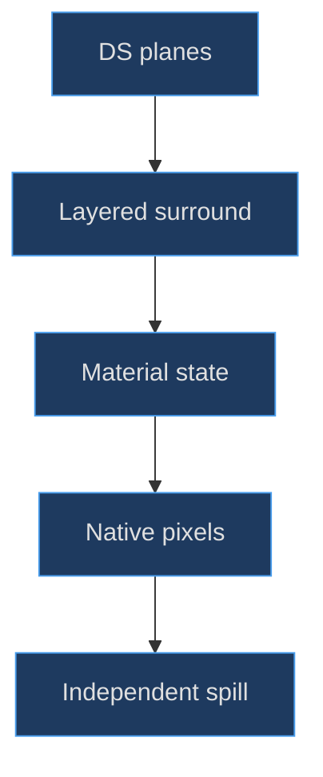
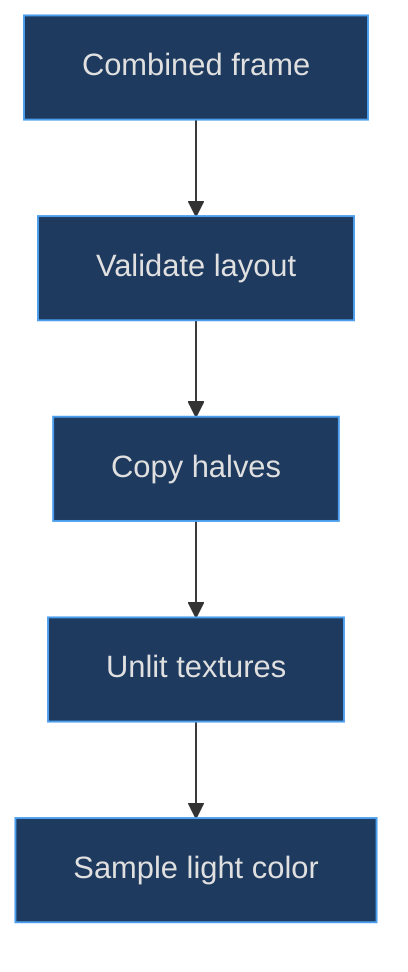

# Dual LCDs and curved glass

## Correct the premise before modeling the glass

The chapter title names a useful topic boundary, not a claim that the DS constructor contains curved display glass. **At this cutoff both DS active surfaces are planar** `PlaneGeometry(4.5, 3.375)` meshes. The repository has a separate curved-outline LCD helper, but the scene's curve setter applies it to the GBA `this.model`, not to `this.ds`. Applying that helper to the DS by association would invent an authoring step and risk breaking lower-screen UV input.

The [DS display loop](https://github.com/Zanark/BowserBoy/blob/1e4ef518d6943ab1af39cef3b4d558f209a17891/src/ds-handheld.js#L93-L104) (`src/ds-handheld.js:98`) is decisive. Read it alongside the [shared curved-outline helper](https://github.com/Zanark/BowserBoy/blob/1e4ef518d6943ab1af39cef3b4d558f209a17891/src/handheld.js#L34-L65) (`src/handheld.js:49`) and [GBA curve setter](https://github.com/Zanark/BowserBoy/blob/1e4ef518d6943ab1af39cef3b4d558f209a17891/src/scene.js#L1122-L1130) (`src/scene.js:1122`). “Curved” there describes a shaped outline with explicitly remapped UVs, not evidence of a bulging DS surface.


Figure MD14.1. The DS display illusion comes from geometry layers and state-specific materials, not an undocumented curved overlay.

## Construct a display cross-section from outside inward

Each screen assembly starts with a fine cyan bezel edge, nominally 4.88 by 3.77 and .035 deep. A 4.80-by-3.69 metallic surround follows at Z offset .018, then a 4.60-by-3.475 black recess at offset .048. The active 4.5-by-3.375 plane sits at offset .085. The upper assembly's base Z is .18; the lower assembly's base Z is .265.

Thus the active upper plane is at lid-local Z .265 and the active lower plane at root-local Z .350. Each is forward of its recess. These offsets separate visible layers and reduce coplanar competition. They do not form a physically simulated stack of polarizers, liquid crystal, cover glass and air gaps. Using that manufacturing vocabulary without qualification would overstate what the meshes contain.

The common aspect is `4.5 / 3.375 = 4/3`, matching `256 / 192`. Both geometry objects expose `userData.viewport` width and height for illumination. The lower surface also carries a touchscreen flag. The upper parent is `lid`; the lower parent is `root`. Parenting is part of the display definition because the upper emission and picking surfaces must fold with their shell.

Short, nonzero layer offsets should be evaluated relative to the camera's depth precision. If flicker appears only at certain distances, first inspect nearly coplanar triangles and material depth settings. Do not solve every flicker by increasing all offsets: that can make the screen look detached from the bezel and alter occlusion near the controls.

## Powered-off glass and active LCDs obey different invariants

The bare factory creates dark unlit screen materials. The controller subsequently uses `showPowerOff()` to replace them with `MeshPhysicalMaterial`: dark green-black color, roughness .24, clearcoat 1 and clearcoat roughness .22. This is reflective powered-off glass. It is expected to respond to lighting and view angle.

Status and active native screens instead use `MeshBasicMaterial` with `toneMapped: false`. Status screens use procedural 512-by-384 canvases; native outputs use 256-by-192 canvases with nearest filtering and mipmaps disabled. The controller disposes replaced materials and maps before assigning new ones. See the [power-off and status states](https://github.com/Zanark/BowserBoy/blob/1e4ef518d6943ab1af39cef3b4d558f209a17891/src/ds-controller.js#L266-L294) (`src/ds-controller.js:266`) and [native material handoff](https://github.com/Zanark/BowserBoy/blob/1e4ef518d6943ab1af39cef3b4d558f209a17891/src/ds-controller.js#L414-L435) (`src/ds-controller.js:426`).

The active invariant is narrow and important: scene-light changes should not relight or tone-map the active pixel surface. It does **not** say powered-off glass must remain unchanged, or that screen pixels are unaffected by texture sampling, browser color management or the selected framebuffer content. The [upright-lighting regression](https://github.com/Zanark/BowserBoy/blob/1e4ef518d6943ab1af39cef3b4d558f209a17891/tests/browser/ds.spec.mjs#L1413-L1486) (`tests/browser/ds.spec.mjs:1425`) deliberately selects static status LCDs before comparing pixels across lighting states.

## Split the combined framebuffer without resampling twice

`dsScreenRegions(width, height)` accepts a top/bottom image whose width is an integer multiple of 256 up to 2048 and whose height is 1.5 times its width. It returns equal upper and lower halves. For native width 256 and height 384, the regions are `(0,0,256,192)` and `(0,192,256,192)`.

The [region validator](https://github.com/Zanark/BowserBoy/blob/1e4ef518d6943ab1af39cef3b4d558f209a17891/src/ds-cartridge.js#L48-L59) (`src/ds-cartridge.js:48`) rejects side-by-side layouts and gaps rather than trying to guess. `paintScreens()` copies each region into its own output canvas with smoothing disabled. The [copy path](https://github.com/Zanark/BowserBoy/blob/1e4ef518d6943ab1af39cef3b4d558f209a17891/src/ds-controller.js#L662-L675) (`src/ds-controller.js:665`) then marks the textures for update.

This separation matters for debugging: a wrong half-image can be a region-layout failure even when geometry, materials and UVs are correct. Conversely, correct output canvases can still appear wrong if the upper and lower texture references are swapped. Inspect the intermediate canvas before touching the model.

## MD14-W01 Calculate pixel scale and a touch location

One horizontal pixel corresponds to `4.5/256 = .017578125` model units. One vertical pixel corresponds to `3.375/192`, exactly the same value. This equality is a useful construction check: the planar display has square source pixels in its own coordinate system, independent of perspective foreshortening.

At UV `(0.25, 0.75)`, the touch converter yields X `floor(.25 × 256) = 64` and Y `floor((1 − .75) × 192) = 48`. The vertical reversal maps the plane's upward-increasing UV coordinate to the native screen's downward-increasing row index. At UV 1, clamping prevents the inclusive edge from producing an out-of-range pixel.

Original arithmetic recipe, suitable for Node or a browser:

```js
const width = 4.5, height = 3.375;
console.assert(width / 256 === height / 192);
const uv = { x: .25, y: .75 };
const pixel = {
  x: Math.min(255, Math.floor(uv.x * 256)),
  y: Math.min(191, Math.floor((1 - uv.y) * 192))
};
console.log(pixel); // { x: 64, y: 48 }
```

Assumptions are an accepted lower-LCD ray hit and UVs inside zero through one. This recipe does not perform the raycast or permit clicks through the lid. Preserving those preconditions is as important as preserving the arithmetic.

## Emission is modeled separately from displayed color

Two `ScreenIllumination` instances attach area lights to their respective screens. Each uses the viewport metadata, a small sampled canvas, linear-channel averaging and damped light color. The additional control-spill emitter is explicitly labeled experimental in source; it approximates first-bounce visibility for nearby controls rather than solving global illumination.

The [illumination implementation](https://github.com/Zanark/BowserBoy/blob/1e4ef518d6943ab1af39cef3b4d558f209a17891/src/lighting.js#L126-L188) (`src/lighting.js:126`) samples live sources at intervals of 125 ms and derives intensity from the peak averaged channel. The [scene update](https://github.com/Zanark/BowserBoy/blob/1e4ef518d6943ab1af39cef3b4d558f209a17891/src/scene.js#L1351-L1365) (`src/scene.js:1353`) clears and hides DS illumination when no powered source exists. This keeps lighting separate from the active LCD material.

**Research guidance.** Current [Object3D documentation](https://threejs.org/docs/pages/Object3D.html), consulted 2026-11-07, supports the explanation that child emitters inherit their screen transform. That current reference is not a claim that every newer rendering feature is used by Three.js 0.186.1 here. Inspect actual light classes and renderer paths before proposing a different illumination system.


Figure MD14.2. Pixel presentation and illumination share a source image but use different materials and update responsibilities.

## MD14-R01 Retry with a proposed curved DS surface

Change the assumption: an extension now requests an actually bulging DS cover. That is a **proposal**, not the existing workflow. A geometric bulge changes normals, silhouette and ray intersections; an outline-only shape changes the boundary but remains planar. Decide which effect is needed before choosing an algorithm.

For a true bulge, define a height function, preserve a well-understood UV map, recompute appropriate normals and test lower-screen ray-to-pixel correspondence over the full surface. Keep active pixel material behavior separate from any reflective overlay. A transparent overlay can become the first ray hit and block input unless picking ownership explicitly accounts for it. Never add it and then globally ignore every non-LCD hit; that would also allow touches through the folded lid.

## A failure tree for apparently damaged pixels

**Recommended diagnostic procedure.** Start at the output canvas rather than the final camera image. If the canvas already contains the wrong half-frame, investigate layout validation and region copying. If it contains correct pixels but the model shows the other display, investigate screen-array ownership and map assignment. If both are correct but diagonal edges look soft, investigate filtering and projected scale before changing geometry.

Nearest filtering preserves discrete source samples; it cannot guarantee every source pixel occupies an integer number of final screen pixels under perspective. A tilted plane naturally foreshortens, and minification can produce uneven apparent cell widths. The honest invariant is that the application avoids an additional smoothing copy and uses nearest texture sampling for native outputs. “Perfect integer pixels at every angle” would be an unsupported stronger claim.

The status-texture path and native-output path also have different source resolutions. Status is drawn at 512 by 384, while native output canvases are 256 by 192. Both share the same physical viewport aspect, but a text edge in one is not an appropriate one-pixel reference for the other. Choose a deterministic fixture that matches the property being measured.

For a proposed reflective active overlay, write the visibility and input consequences before implementing it. A clearcoat-like sheen on the same material is not equivalent to a separate transparent mesh. A separate mesh can introduce additional depth ordering, reflections and first-hit ownership. If the overlay should not receive native input, that exception must remain narrow enough that shell and lid occlusion still work.

Finally inspect normals and front/back visibility in an oblique pose. The planar LCD has a defined front side; rotating the entire console behind the camera-facing direction does not make the display physically visible through its back. Making the material double-sided may be appropriate for a diagnostic, but it changes the presentation contract and must not silently become the production repair.

These recommendations extend the source-grounded workflow without claiming an unimplemented glass stack. They give a later modeler an ordered experiment: source image, texture, geometry, material, projection and occlusion. Changing all six at once prevents a useful causal diagnosis and makes any apparent improvement difficult to preserve.

## MD14-Q01 Exercise: why did the lighting test fail with power off?

A test expects identical LCD RGB values with the lamp on and off, but it never powers the DS or installs status textures. It observes different pixels and proposes making all screens unlit permanently. Identify the mistaken fixture and the functionality that proposal would remove.

## MD14-A01 Explained answer

The fixture selected reflective powered-off glass, not an active LCD. Its lighting response is intentional. Install a deterministic active status texture before testing the unlit, non-tone-mapped invariant; qualify reflective glass separately with view-dependent expectations. Making every state permanently unlit would remove the powered-off material distinction rather than repair the test.

The historical [upright-lighting task](https://github.com/Zanark/BowserBoy/blob/1e4ef518d6943ab1af39cef3b4d558f209a17891/TODO/116_DS_UPRIGHT_LIGHTING.todo#L25-L43) (`TODO/116_DS_UPRIGHT_LIGHTING.todo:40`) records exactly this fixture correction. Its reported outcomes are historical evidence, not tests rerun for this chapter. The lesson is to state the material state before stating the invariant.
