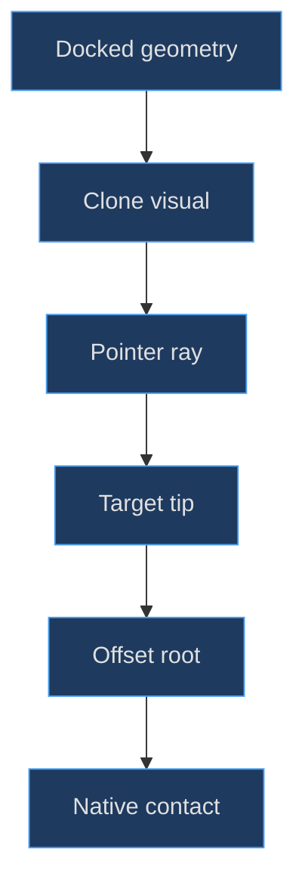
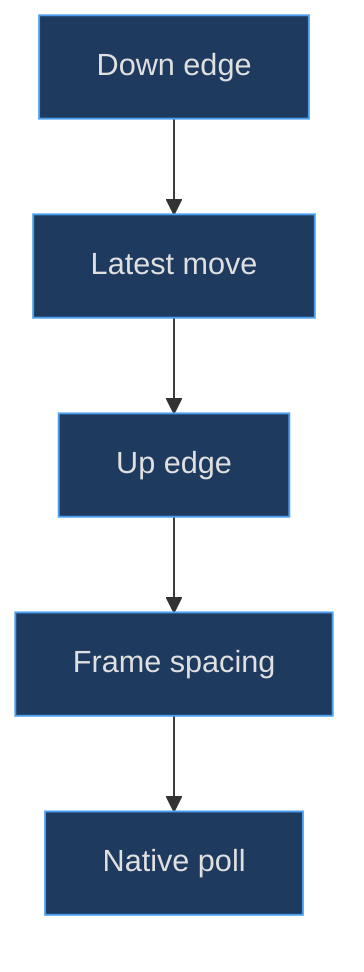

# Stylus construction and touch geometry

## Separate the prop, the pointer and the contact

A stylus appears simple until it must work over an articulated screen. Three distinct systems are involved: the docked pen is part of the console silhouette; the held pen is a camera-oriented visual; the native touch contact is a pixel coordinate plus a pressed state. Making the held mesh itself the input sensor couples decoration to gameplay and can cause the pen to intercept its own ray.

**Implemented evidence.** The constructor creates a docked group at `(4.39, −2.43, −.025)`, while the controller clones that group into a separate scene object, scales it to .8 and disables raycasting on every clone descendant. The original remains in the DS hierarchy and is hidden while held. See the [docked construction](https://github.com/Zanark/BowserBoy/blob/1e4ef518d6943ab1af39cef3b4d558f209a17891/src/ds-handheld.js#L248-L274) (`src/ds-handheld.js:248`) and [held-clone setup](https://github.com/Zanark/BowserBoy/blob/1e4ef518d6943ab1af39cef3b4d558f209a17891/src/ds-controller.js#L23-L34) (`src/ds-controller.js:25`).


Figure MD15.1. The held mesh illustrates the contact; it does not replace the lower LCD's ray-to-pixel input contract.

## Assemble the pen around a known contact point

The shaft is a 3.64-long cylinder with radii .073 and .065, positioned slightly off the group center. A flat pull tab, short retention hook and release groove establish the docking end. The other end uses a .20-long tapered cylinder, followed by a sphere of radius .032 scaled by `(1, 1.8, 1)` to make a short rounded nib.

The exact contact anchor lies at Y `−2.07 − .032 × 1.8 = −2.1276`, not at the sphere center. That distinction matters when solving a held pose. Aligning the group origin or nib center to the pointer would leave the visible tip systematically displaced. A named `Object3D` anchor records the intended extreme without requiring the controller to rediscover mesh topology.

The shaft's cylinder orientation already follows the pen's local Y direction, unlike the button cylinders rotated to face local Z. Keeping those conventions explicit avoids an incorrect held quaternion. The controller aligns local positive Y toward the camera-side “back” direction; the nib lies toward negative Y.

The docking channel is a separate dark rounded box at X 4.27; two shell-owned clips remain on the base. The hover halo is a back-sided transparent cylinder with depth writing disabled, hidden by default. Stylus plastic is cloned from button material so hover emissive changes do not recolor every console cap. These are small ownership choices with large debugging value.

## Solve the held pose from the tip backward

`paintStylus()` converts the pointer into normalized device coordinates and casts through the camera. It takes the first non-stylus intersection with the DS root, falling back to a camera-facing plane through the lower display's world position. That fallback keeps the visual moving outside the screen; it does not create valid native touches outside the LCD.

The target tip is lifted along the **pointer ray**, by −.06 while hovering or −.008 during contact. A shift along a perspective ray changes depth without moving the projected point. A shift along the LCD normal generally changes screen position in an oblique pose. This is the geometrical reason for the implementation's direction choice.

The controller chooses a camera-relative back vector with X/Y signs adjusted near the top and right edges, rotates local positive Y to it with `setFromUnitVectors`, then computes the transformed tip offset. The group position becomes `targetTip − rotatedScaledLocalTip`. The [complete placement algorithm](https://github.com/Zanark/BowserBoy/blob/1e4ef518d6943ab1af39cef3b4d558f209a17891/src/ds-controller.js#L599-L620) (`src/ds-controller.js:611`) is a tip-constraint solver, not a cursor sprite approximation.

## MD15-W01 Calculate the root-to-tip offset

With uniform scale .8, the local tip's Y magnitude becomes `2.1276 × .8 = 1.70208`. If a diagnostic orientation maps local positive Y to world positive Z, the nib offset is `(0,0,−1.70208)`. To put the nib at target `(1,2,3)`, place the group root at `(1,2,4.70208)`. The back extends toward the camera while the tip remains at the requested contact.

Original pseudocode, assuming a unit quaternion q, scale s and an already chosen world target:

```text
localTip = (0, -2.1276, 0)
offset = rotate(q, componentMultiply(localTip, s))
rootPosition = targetTip - offset
reconstructedTip = rootPosition + offset
require distance(reconstructedTip, targetTip) < tolerance
```

The expected reconstruction error is numerical roundoff. This recipe isolates attachment math from raycasting, so it can diagnose a wrong anchor or scale without needing native gameplay. For nonuniform scale, component multiplication must happen before quaternion rotation, matching the source's operation order.

**Research guidance.** Current [Three.js Raycaster documentation](https://threejs.org/docs/pages/Raycaster.html), consulted 2026-11-07, describes NDC input, distance-sorted intersections and hit UVs. Its face-orientation warning is relevant when a rotated display unexpectedly stops receiving hits. The recommendation is to inspect facing and ownership first, not to assume the current documentation proves every behavior of the pinned 0.186.1 application.

## Native touch belongs to the lower display only

`touchAt()` casts through the entire model, ignores stylus-tagged hits only while the pen is held, and accepts a contact only if the first remaining object is `screens[1]`. It does not search arbitrarily deeper for any LCD hit. A folded lid or shell in front of the screen therefore blocks input.

The [touch hit gate](https://github.com/Zanark/BowserBoy/blob/1e4ef518d6943ab1af39cef3b4d558f209a17891/src/ds-controller.js#L490-L507) (`src/ds-controller.js:490`) feeds [UV conversion](https://github.com/Zanark/BowserBoy/blob/1e4ef518d6943ab1af39cef3b4d558f209a17891/src/ds-cartridge.js#L55-L59) (`src/ds-cartridge.js:55`). Finite UVs within zero through one map to X 0–255 and Y 0–191, with vertical inversion. Input capture preserves a single active pointer, while cancellation and lost capture release the native contact.

Direct mouse or touch drawing remains valid without holding the modeled pen. This is important for accessibility and testing: the decorative pickup workflow should not become an unexplained prerequisite for the actual touchscreen. Conversely, moving the held visual off the LCD must not produce out-of-bounds contact coordinates.

## Contact edges must survive asynchronous delivery

`DsTouchQueue` stores down, move and up samples. Consecutive move samples can replace one another, but contact edges remain separate. After each dispatched sample, the queue waits for `nextFrame`, preserving observable transitions across native polls. A generation counter invalidates stale work after cancellation; cancellation also releases a previously dispatched down contact immediately.

The [queue implementation](https://github.com/Zanark/BowserBoy/blob/1e4ef518d6943ab1af39cef3b4d558f209a17891/src/ds-touch.js#L1-L46) (`src/ds-touch.js:11`) and [unit cases](https://github.com/Zanark/BowserBoy/blob/1e4ef518d6943ab1af39cef3b4d558f209a17891/tests/unit/ds-touch.test.mjs#L16-L72) (`tests/unit/ds-touch.test.mjs:16`) distinguish edge preservation from throughput. Coalescing an entire quick tap into a final unpressed sample would be efficient but wrong: the native game might never observe contact.


Figure MD15.2. Move compression is safe only when the beginning and end of contact remain independently observable.

## MD15-R01 Retry under an oblique locked pose

Change the assumption from a flat front-facing display to a rotated body with a partially folded lid. A constant screen-space offset may appear correct at the center yet drift at the corners. The corrected approach keeps using a camera ray, obtains the actual hit point and solves the tip offset in world space. Do not repair drift with a hand-tuned X/Y cursor correction.

Refresh camera and root matrices immediately after pose or viewport changes. The [scene update boundary](https://github.com/Zanark/BowserBoy/blob/1e4ef518d6943ab1af39cef3b4d558f209a17891/src/scene.js#L484-L499) (`src/scene.js:495`) explicitly avoids waiting for another GPU paint before projection and touch rays become current. When debugging, separate stale matrices from a wrong UV map: the first shifts intersections; the second shifts pixels after a correct intersection.

The browser [orientation scenarios](https://github.com/Zanark/BowserBoy/blob/1e4ef518d6943ab1af39cef3b4d558f209a17891/tests/browser/ds.spec.mjs#L413-L495) (`tests/browser/ds.spec.mjs:413`) cover locked orientations, zoom and high-DPI touch. They were read, not rerun here. Historical commit [0fdd81b](https://github.com/Zanark/BowserBoy/commit/0fdd81b259cfbb0703b13078c9d56c77901c1673) introduced the pickable pen; that history supports feature provenance, not a universal accuracy guarantee.

## Debug the pen with three separate errors

**Recommended diagnostic procedure.** Record visual-tip error, hit-point error and native-pixel error independently. Visual-tip error is the distance between the projected nib anchor and pointer. Hit-point error asks whether the ray reached the intended visible surface. Native-pixel error compares the accepted UV conversion with the game-space location. A correct-looking pen can still draw at the wrong pixel, and correct drawing can coexist with a visibly misplaced pen.

To isolate the first error, hold a deterministic quaternion and scale and test the tip reconstruction formula without a raycaster. To isolate the second, remove only the held clone from consideration and record the first real DS hit. To isolate the third, log accepted UVs and converted coordinates without introducing a hand-tuned cursor offset. These are proposed diagnostic steps, not operations performed during this authoring task.

The pen's cloned material references also deserve care. The model separately clones stylus plastic from the button material, which isolates hover treatment from console buttons. Cloning the object hierarchy does not imply a fresh independent material for every descendant. A later extension that recolors only the held pen should inspect material sharing first rather than assuming scene ownership guarantees material ownership.

At pointer exit, the held visual may disappear while its held state remains available for return. That is distinct from a native pressed contact, which must be released when the input path no longer has a valid lower-LCD hit. Treat visibility, pickup state and contact state as separate booleans in a debugging log. Otherwise an invisible cursor can be misdiagnosed as a stuck native press.

For touch cancellation, verify the release edge as well as the final queue contents. Emptying pending samples alone does not release a contact already dispatched to the runtime. The generation mechanism and immediate release in `cancel()` address that distinction. This is a reusable principle for any modeled tool whose visual movement is more frequent than the native consumer's polling: preserve semantic edges even when intermediate motion is compressed.

## MD15-Q01 Exercise: why keep an invisible docked pen?

A proposed optimization removes the docked pen from the DS hierarchy while held and reparents it to the scene. The camera then changes framing as the pointer moves. Explain the coupling and choose a safer visual strategy.

## MD15-A01 Explained answer

The pose-bounds calculation traverses geometry in the DS hierarchy, including geometry whose visibility may be false. The original implementation deliberately retains the docked geometry as a stable part of that envelope and moves only a scene-owned clone. Reparenting changes the envelope; moving a still-parented held pen can make the envelope chase the pointer. Neither effect is desirable for stable gameplay framing.

Keep the original docked transform, hide its visual during pickup and move the non-pickable clone. Return paths should restore visibility, release contact and reset cursor state. This is not a general claim that invisible meshes never matter: here they remain relevant to the specific bounds traversal. Read ownership and consumers together before deleting apparently redundant geometry.
