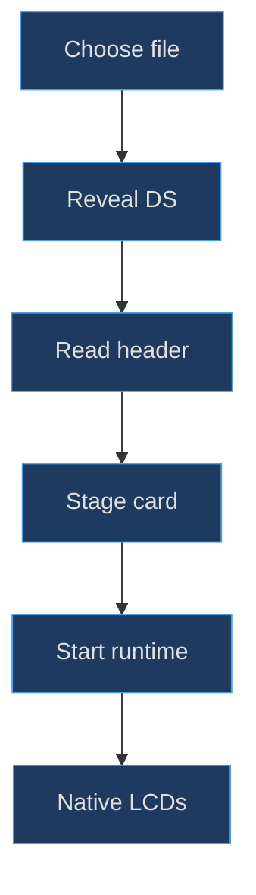
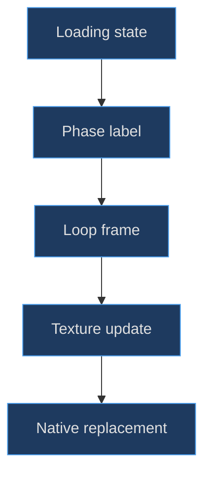

# Cartridge insertion and loading choreography

## There are three different loading stories

Selecting a file begins application work, not merely a mesh animation. The console must become visible while identification is pending; a loading LCD must communicate progress or waiting; a card prop may move toward its seated position. Native startup is a fourth boundary whose completion is not determined by the prop's position.

**Implemented evidence.** `load()` closes DS tools, selects the DS and enters play before awaiting ROM identification. It calls `loadingStatus('READING LOCAL ROM')` before the expensive asynchronous work. Only after identification and retained-state lookup does it clear the old session, retain the new file and configure card insertion. The [load ordering](https://github.com/Zanark/BowserBoy/blob/1e4ef518d6943ab1af39cef3b4d558f209a17891/src/ds-controller.js#L345-L368) (`src/ds-controller.js:345`) is the authoritative workflow, not a generic “load then show console” sequence.


Figure MD16.1. Presentation begins before slow file work, while native readiness remains a separate success condition.

## Model the card and identify the correct opening

The root-owned card group starts at `(1.4, .44, −.02)` and is hidden until needed. Its dark shell is 1.46 by 1.56 by .13, with a smaller raised label and two procedural text lines. It is not a detailed scan of a commercial cartridge. The [card geometry](https://github.com/Zanark/BowserBoy/blob/1e4ef518d6943ab1af39cef3b4d558f209a17891/src/ds-handheld.js#L239-L247) (`src/ds-handheld.js:239`) uses the same rounded-box and text vocabulary as the console.

The nearby rear DS game-card slot sits at X 1.4, Y .1, Z −.02. The front navy expansion opening sits near Y −4.842 and has a different orientation. **The modeled bottom/front expansion slot is not the actual original hardware's rear DS-card slot.** Describing the animated DS card as entering the bottom opening would conflate two separately authored features.

The card translates along **root-local Y**, from 3.1 toward .44. Depending on the root quaternion, that is not necessarily world-down, room-back or screen-down. The [scene pose constants](https://github.com/Zanark/BowserBoy/blob/1e4ef518d6943ab1af39cef3b4d558f209a17891/src/scene.js#L18-L23) (`src/scene.js:18`) show why a direction must name its coordinate space. A camera-facing image can be useful evidence of presentation, but not proof of a mechanically exact connector path.

The slot is a dark rounded box, not a fully modeled socket with contacts, retention spring and collision-tested internal cavity. The card visibly approaches a representative slot region. If an extension requires physical insertion tolerances, it needs new cavity topology and clearance tests rather than stronger adjectives for the existing animation.

## DS insertion uses painted updates

When motion is allowed, `load()` places the card at Y 3.1 and creates `{elapsed: 0, lastPaint: null}`. Reduced motion seats it directly at .44 and creates no insertion motion. During controller `paint()`, elapsed time increases by the nonnegative difference from the previous paint; the first call adds zero. Fraction is clamped at `elapsed/1800`, eased with `f²(3−2f)` and used to interpolate Y.

The [DS animation code](https://github.com/Zanark/BowserBoy/blob/1e4ef518d6943ab1af39cef3b4d558f209a17891/src/ds-controller.js#L622-L633) (`src/ds-controller.js:624`) is called after the scene's eligible-paint gate. Read the [scene scheduling boundary](https://github.com/Zanark/BowserBoy/blob/1e4ef518d6943ab1af39cef3b4d558f209a17891/src/scene.js#L1336-L1342) (`src/scene.js:1339`). It is inaccurate to call this an unconditional wall-clock timer independent of rendering.

The nuance is equally important: elapsed differences between painted calls can include a long real-time gap. The DS path does not reserve a midpoint boundary inside its 1800 ms slide. A sparse subsequent paint can therefore advance a long way. “Paint-driven” does not guarantee every intermediate pose is shown.

## Do not borrow the GBA's timing contract

The shared `cartridge-motion.js` helper belongs to the scene's other cartridge path. It defines 850 ms framing and 1350 ms sliding, preserves elapsed time when paint is not due, and clamps advancement at a framing boundary before allowing seating. `transition-motion.js` similarly reserves a painted midpoint for desk transitions.

The [cartridge helper](https://github.com/Zanark/BowserBoy/blob/1e4ef518d6943ab1af39cef3b4d558f209a17891/src/cartridge-motion.js#L1-L11) (`src/cartridge-motion.js:4`) and [transition helper](https://github.com/Zanark/BowserBoy/blob/1e4ef518d6943ab1af39cef3b4d558f209a17891/src/transition-motion.js#L1-L8) (`src/transition-motion.js:1`) explain the repository's broader sparse-paint strategy. They do **not** make the DS card use those exact durations or boundaries. Reusable-agent documentation must identify which caller owns a helper before transferring its guarantees.

## MD16-W01 Calculate the DS halfway position

Assume the first eligible DS paint records time 100 ms and elapsed remains zero. A later paint at 1000 ms adds 900 ms. Fraction is .5, and smoothstep easing is also .5. The card position is `3.1 + (.44−3.1) × .5 = 1.77`. Another 900 ms of painted-call interval reaches elapsed 1800, Y .44 and the seated dataset state.

Original arithmetic recipe:

```js
function cardY(elapsed) {
  const f = Math.min(1, Math.max(0, elapsed) / 1800);
  const e = f * f * (3 - 2 * f);
  return 3.1 + (.44 - 3.1) * e;
}
console.assert(Math.abs(cardY(900) - 1.77) < 1e-12);
console.assert(Math.abs(cardY(1800) - .44) < 1e-12);
```

Assumptions are the current DS endpoints and duration, not a physically measured insertion speed. The zero derivative at both ends reduces abrupt starts and stops in the displayed motion. It does not simulate friction, a latch click or card mass. The expected result is a reproducible root-local position at a chosen interpolation fraction.

For comparison, a 450 ms elapsed value gives fraction .25 and ease .15625, producing Y 2.684375. Equal time steps do not produce equal travel distances. This is useful when checking captures: a slowly moving initial card can be correct easing rather than a stalled loader.

## The loading LCD is an illustration, not a progress meter

`paintLoading()` chooses one of twelve frames with `floor(time/160) % 12`; reduced motion fixes frame zero. It draws an original card and slot illustration, text and three cycling dots onto the lower status texture. Its card Y is `52 + min(frame/8,1) × 148`, with clipping around the illustrated slot.

The [loading painter](https://github.com/Zanark/BowserBoy/blob/1e4ef518d6943ab1af39cef3b4d558f209a17891/src/ds-controller.js#L305-L343) (`src/ds-controller.js:310`) does not measure bytes downloaded or native initialization percentage. Calling its loop “90% complete” would invent information. It communicates that the application is working and names the current phase: reading a local file or starting DeSmuME.

Canvas generation uses the [shared texture helper](https://github.com/Zanark/BowserBoy/blob/1e4ef518d6943ab1af39cef3b4d558f209a17891/src/handheld.js#L68-L78) (`src/handheld.js:68`), while native success replaces status maps with separate 256-by-192 outputs. The visual card loop and 3D card can coexist without being synchronized mechanical representations of the same event.


Figure MD16.2. The loading illustration signals a phase, while real native startup determines when live display textures replace it.

## MD16-R01 Retry with a rejected replacement file

Change the assumption: an existing session is running and the replacement file is invalid. `loadingStatus()` avoids replacing active screen materials when `running` is true, although it still records loading state. Identification occurs before `clear()`. A rejection therefore need not destroy the previous source, frame or game identity.

The [browser upload scenario](https://github.com/Zanark/BowserBoy/blob/1e4ef518d6943ab1af39cef3b4d558f209a17891/tests/browser/ds.spec.mjs#L80-L166) (`tests/browser/ds.spec.mjs:116`) explicitly checks retained session objects and restored native pixels after an invalid replacement. It also checks reduced-motion loading and cancelled startup separately. These assertions were read, not rerun here.

A corrected retry preserves the prior session until a new file passes identification, clears loading state in the finalizer and surfaces the existing error UI. Do not equate a failed file read with successful replacement merely because the 3D prop reached its seat. Conversely, do not erase the old game at the first upload event just to simplify the visual state machine.

**Documented history.** Commit [e1896ce](https://github.com/Zanark/BowserBoy/commit/e1896cebf4b2b75d3849abaa00433c1d378fcb8b) moved visible DS feedback ahead of slow identification. The [immediate-loading task](https://github.com/Zanark/BowserBoy/blob/1e4ef518d6943ab1af39cef3b4d558f209a17891/TODO/115_DS_IMMEDIATE_LOADING.todo#L1-L25) (`TODO/115_DS_IMMEDIATE_LOADING.todo:5`) records the motivating sidebar delay. That history supports the ordering explanation, not a fresh startup-performance measurement.

## Validate choreography without private content

**Recommended diagnostic procedure.** Use the repository's original homebrew integration fixture or synthetic phase control when validating presentation; do not introduce private cartridge images merely to make the loading path look authentic. The browser cases deliberately hold the upload read so the immediate UI transition and changing LCD can be observed before native startup. This isolates an ordering property that a fast local file might conceal.

For a purely geometric check, inspect the card shell and slot bounds in root space at staged fractions. Their construction uses the [same centered extrusion helper](https://github.com/Zanark/BowserBoy/blob/1e4ef518d6943ab1af39cef3b4d558f209a17891/src/handheld.js#L19-L32) (`src/handheld.js:19`), so nominal width and depth are not necessarily final outer bounds. A card fitting within the nominal slot width does not establish a physically valid cavity when the slot itself is represented by a dark solid.

For timing, record the sequence of eligible paint timestamps, not only the upload timestamp and a final screenshot. An 1800 ms nominal interpolation duration describes elapsed differences consumed by DS paint calls. A blocked or skipped interval can change which intermediate positions are actually visible. That observation should be reported as scheduling evidence rather than rounded into a guaranteed smooth frame rate.

The loading illustration's twelve-frame loop has another important limit: its phase can jump when time advances. It is an animation frame selector, not a queue that must display every preceding illustration. Reduced motion selects a static frame by policy. A static image under reduced motion is therefore expected behavior, while a static image under ordinary motion needs investigation of loading state, frame selection and texture upload.

Cancellation deserves its own evidence record. A failed runtime launch should remove the pending frame, clear loading and busy state, and surface a retryable explanation through the established operation path. A rejected replacement while an old session is running has a different preservation requirement. Combining those into a single “error case” hides whether the application retained or discarded the right state.

Keep proposed refinements separate from implemented guarantees. A future DS-specific midpoint reservation could make a sparse paint show a staged insertion pose before seating, but that is not present in the current controller's slide loop. It would require explicit new tests and should not be inferred from the neighboring shared GBA helper.

## MD16-Q01 Exercise: can seated mean ready?

A proposed UI hides Cancel as soon as the card reaches Y .44. The native runtime is still fetching and has not sent its started message. Explain why this couples unrelated completion conditions and choose the proper readiness evidence.

## MD16-A01 Explained answer

Seating is visual interpolation completion; readiness is a validated native display handoff. The controller checks framebuffer layout and retained drawing-buffer support before installing output canvases and setting `running`. Cancel belongs to the pending launch callbacks, not to the mesh's Y coordinate. A seated prop can accompany a slow or failed native launch.

Keep the loading state and error recovery until native success or failure resolves the operation. Preserve the 90-second startup timeout and explicit cancellation rather than inventing readiness from animation duration. This separation makes the model choreography useful feedback without allowing it to misrepresent actual application state.
