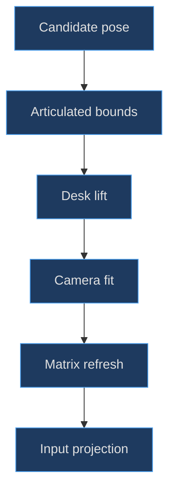
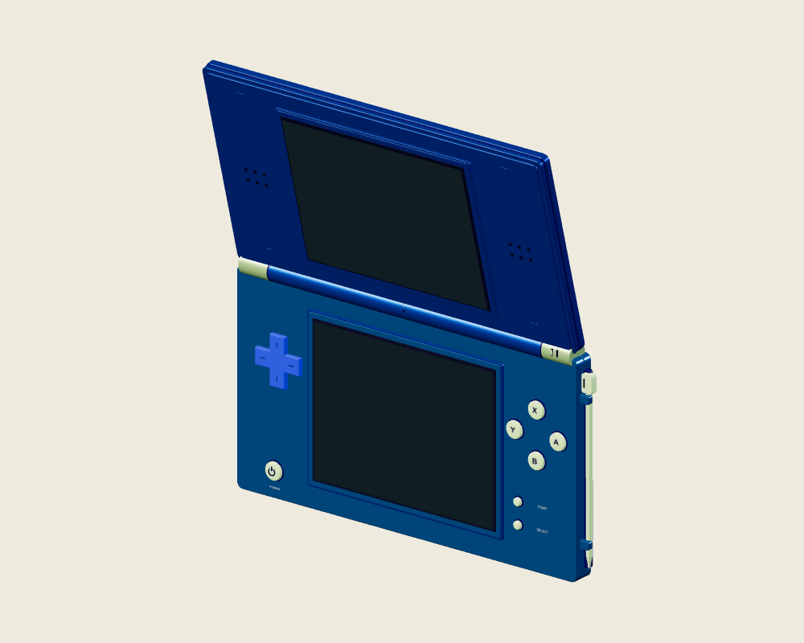
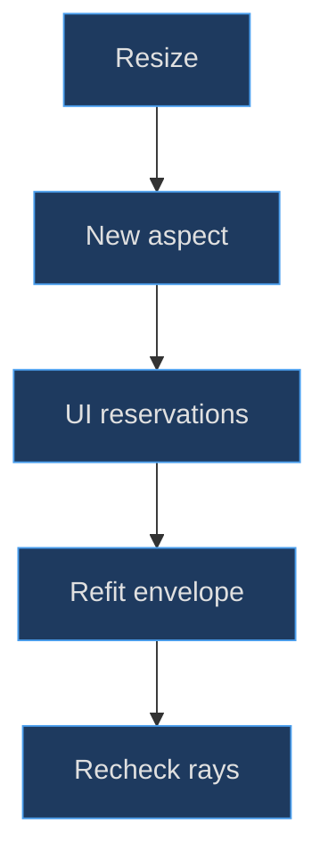

# Inspection, camera and manipulation

## A good model needs a truthful viewing instrument

A procedural assembly can be correct and still look broken if its camera crops the lid, places the shell outside the lamp's useful region or leaves projected controls aligned to an old pose. Inspection is therefore part of the modeling workflow. It must expose geometry without rewriting the object merely to flatter one view.

**Implemented evidence.** The DS camera uses articulated geometry bounds, not a hard-coded flat-screen rectangle. Body rotation and hinge edits are separate actions; an optional gameplay lock preserves both. The [Inspect controls and pose setters](https://github.com/Zanark/BowserBoy/blob/1e4ef518d6943ab1af39cef3b4d558f209a17891/src/scene.js#L452-L499) (`src/scene.js:460`) define those ownership rules. The constructor supplies a root and a lid, so the camera must respect two transform spaces rather than pretending the whole object is rigid.


Figure MD17.1. Pose editing must update geometry envelopes and input matrices, not merely the rendered root rotation.

## Evaluate a candidate pose without flattening its hierarchy

`dsPoseBounds(rotation, hinge)` first updates current world matrices. It composes a candidate root matrix at the shared play position and calculates a root delta relative to the current root matrix. It separately composes the candidate lid transform, then derives a lid delta relative to the current lid world matrix.

For each geometry object, the traversal determines whether its ancestry reaches the lid or root first. It computes a geometry bounding box when needed, applies the appropriate delta multiplied by the object's current world matrix, then unions the transformed box into an assembly envelope. The [bounds implementation](https://github.com/Zanark/BowserBoy/blob/1e4ef518d6943ab1af39cef3b4d558f209a17891/src/scene.js#L502-L518) (`src/scene.js:502`) preserves nested local details while evaluating a different overall pose.

This is conservative box geometry, not an exact silhouette or a minimum-volume oriented hull. Rotated boxes can include empty corners. The advantage is predictable fitting and inexpensive computation across many separate meshes. The limitation is extra framing space around some oblique poses. Do not describe that slack as a mesh defect without checking the actual rendered silhouette.

Visibility is not filtered in that traversal. Hidden card or stylus geometry can still contribute to the envelope. This is especially relevant to the held stylus: its docked original remains in the DS hierarchy while only a clone moves in the scene. The [controller clone rationale](https://github.com/Zanark/BowserBoy/blob/1e4ef518d6943ab1af39cef3b4d558f209a17891/src/ds-controller.js#L23-L34) (`src/ds-controller.js:25`) deliberately preserves stable bounds.

## Fit width, height and depth with interface reservations

The DS camera path gets the candidate envelope, then lifts the focused target so its minimum world Y is at least 2. It extracts size and computes a distance using field-of-view tangent, aspect ratio, width padding, height padding and half-depth. Narrow Inspect viewports reserve more top space for controls.

The [fit formula](https://github.com/Zanark/BowserBoy/blob/1e4ef518d6943ab1af39cef3b4d558f209a17891/src/scene.js#L929-L948) (`src/scene.js:940`) uses top reservation 260 for phone Inspect and 90 otherwise; bottom reservation is 140 below width 600 and 120 otherwise. A minimum usable height prevents division by an arbitrarily tiny content area. A minimum width envelope of 12 also participates, so the formula is not merely the tightest possible fit to visible shell vertices.

The look target shifts vertically to account for asymmetric top and bottom reservations. The camera then sits along positive world Z from that target. Changing the object quaternion changes the evaluated bounds, not necessarily the camera's world viewing axis. This separation is useful when comparing front, back and three-quarter diagnostic poses.



Figure MD17.2. Parent-supplied neutral-studio constructor diagnostic for thickness and articulated relationships; the verified capture pose belongs to the parent render, not to an inferred native room or gameplay camera.

## MD17-W01 Work a camera-fit term by hand

Assume a hypothetical candidate envelope of width 9, height 10 and depth 3, a 960-by-720 viewport, a 40-degree vertical field of view, Inspect mode and zoom 1. These are teaching assumptions, not a claim about a captured production camera. Aspect is 4/3, and tangent of half-FOV is about .36397.

The width term is `max(12, 9+1.2)/(4/3) = 9`. With top 90 and bottom 120, usable height is 510, so the height term is `(10+.8) × 720/510 ≈ 15.2471`. Height wins. Distance is approximately `15.2471/(2×.36397) + 1.5 ≈ 22.45`. This demonstrates why leaving room for UI can dominate a shell-only fit.

Original arithmetic recipe:

```js
const w = 960, h = 720, fov = 40;
const size = { x: 9, y: 10, z: 3 };
const tangent = Math.tan(fov * Math.PI / 360);
const widthNeed = Math.max(12, size.x + 1.2) / (w / h);
const heightNeed = (size.y + .8) * h / (h - 90 - 120);
const distance = Math.max(widthNeed, heightNeed)
  / (2 * tangent) + size.z / 2;
console.log(distance);
```

Expected output is about 22.45 model units under those assumptions. The real path additionally applies zoom and the gameplay play-zoom factor. A fit calculation should report those multipliers rather than silently treating every mode as Inspect.

## Input matrices cannot wait for an expensive paint

`reframeDsPose()` marks visuals and reflections dirty, updates camera targets, moves the root to the play target, copies the camera and look positions, then calls `updateViewMatrices()`. That function runs `lookAt`, refreshes camera and active-model matrices, and projects controls immediately.

The [matrix-update contract](https://github.com/Zanark/BowserBoy/blob/1e4ef518d6943ab1af39cef3b4d558f209a17891/src/scene.js#L484-L499) (`src/scene.js:494`) explicitly decouples input correctness from the next eligible GPU paint. Under rendering backpressure, waiting for another painted frame could leave rays using a previous camera pose. The correct repair is not a permanent cursor offset; it is current transform data.

**Research guidance.** Current [Object3D documentation](https://threejs.org/docs/pages/Object3D.html) distinguishes local and world matrices, and current [Raycaster documentation](https://threejs.org/docs/pages/Raycaster.html) specifies normalized-device coordinates and nearest-first hits. Both were consulted 2026-11-07. They support this diagnostic method, while the repository's pinned Three.js 0.186.1 code remains the version-specific implementation authority.

The controller's projected HTML buttons also have explicit limits. They use anchor world positions, a root-derived facing normal and a distance-based size estimate, with minimum sizes of 44 pixels for power and 14 for other controls. They test lid occlusion but are not exact projected cap polygons. Read the [projection implementation](https://github.com/Zanark/BowserBoy/blob/1e4ef518d6943ab1af39cef3b4d558f209a17891/src/ds-controller.js#L677-L701) (`src/ds-controller.js:684`) before calling it physically exact.

## Lighting diagnosis begins with position, not paint

A dark metallic shell is not automatically a bad material. The model uses roughness, grain, clearcoat and environment reflections; its appearance depends on actual room geometry and emitters. Moving the focused console outside the lamp's emitting region can make the front unreadable even though the same paint looks good on the table.

The [upright-lighting history](https://github.com/Zanark/BowserBoy/blob/1e4ef518d6943ab1af39cef3b4d558f209a17891/TODO/116_DS_UPRIGHT_LIGHTING.todo#L25-L43) (`TODO/116_DS_UPRIGHT_LIGHTING.todo:25`) records an initial lighting improvement at `(−2,5.1,−2)` that failed rotation clearance, followed by the final shared target `(−2,5.1,−8)`. Commit [9be851e](https://github.com/Zanark/BowserBoy/commit/9be851e96098e0dfd4beedffd911185cf33a11a6) grounds that correction. These are historical measurements, not readings repeated during chapter authoring.

The lesson is causal: inspect which surface a sample ray actually hits, then inspect light direction and object placement. Increasing emissive intensity or global exposure can hide the symptom while breaking dark-room behavior and active-screen comparisons. Material tuning belongs after spatial diagnosis.

## MD17-R01 Retry on a phone-sized Inspect viewport

Change the example to a 390-by-844 viewport in Inspect. Aspect drops sharply and the top reservation becomes 260, while bottom becomes 140. Reusing the desktop distance can crop the stylus or force the hinge controls over the display. Recompute the same envelope under the new reservations rather than reducing renderer resolution or shrinking the physical model.

Then verify actual picking at the lower-screen corners. A fit that includes the whole object does not guarantee that the lid leaves the touchscreen exposed. Also check the projected power target after resizing; its minimum touch size and anchor alignment are separate from the shell's visibility. The [browser phone and hinge scenarios](https://github.com/Zanark/BowserBoy/blob/1e4ef518d6943ab1af39cef3b4d558f209a17891/tests/browser/ds.spec.mjs#L1018-L1107) (`tests/browser/ds.spec.mjs:1063`) encode those expectations. They were read, not rerun here.


Figure MD17.3. Responsive fitting preserves geometry and pixel resolution while changing the viewing envelope and projected interaction layout.

## Keep inspection instruments calibrated

The model's nominal dimensions depend on the shared [centered rounded-solid helper](https://github.com/Zanark/BowserBoy/blob/1e4ef518d6943ab1af39cef3b4d558f209a17891/src/handheld.js#L19-L32) (`src/handheld.js:19`). That helper's bevel expansion is one reason the camera measures generated geometry rather than rebuilding an envelope from a table of nominal dimensions. If a future toolkit change increases bevel thickness, an unchanged DS constructor can still need a different fitted distance.

**Recommended diagnostic procedure.** Record the candidate envelope before applying camera padding. This separates a larger geometry envelope from a larger UI reservation. If the model suddenly looks smaller on screen, compare those intermediate values: the shell may be unchanged while the viewport's reserved region grew, or an unexpectedly moved hidden child may have enlarged the measured bounds.

Also separate body rotation from camera orbit. The existing inspection interaction rotates the active model; a different tool might orbit the camera around a fixed model. Both can produce similar images, but their effects on world-space lighting and picking are not identical. A camera-relative highlight change is not interchangeable with rotating a metallic shell relative to a fixed lamp.

Avoid reusing local normals as world directions. A normal `(0,0,1)` on the control deck must be transformed by the root matrix before comparing it with the vector toward the camera. The controller performs that transformation for its broad facing check. A diagnostic that compares the untransformed vector can label a rear-facing console as front-facing after root rotation.

For a proposed alternative camera, preserve immediate matrix updates and rerun corner rays after resize, zoom and hinge edits. Then check scene clearance separately. A camera can fit an object that physically overlaps a companion, and collision-free placement can still be cropped. Combining those as one generic “framing pass” makes it difficult to identify which constraint failed.

Finally distinguish a stable mathematical fit from a pleasing composition. The source formula reserves interface space and fits conservative geometry, not an art-directed photographic composition for every angle. A proposed manual diagnostic camera may choose a tighter crop, provided its caption states that scope and does not present it as the native application's default view.

## MD17-Q01 Exercise: why does fitting not prove accessibility?

A folded DS fits entirely inside the camera frustum. The author concludes that every control should remain enabled because no geometry is cropped. Explain the missing visibility test and identify the correct behavior for a hidden lower LCD.

## MD17-A01 Explained answer

Frustum inclusion only means the assembly envelope lies within the view. It says nothing about one component occluding another. The lid can cover the lower display while both remain inside that envelope. Projected controls must respect lid intersections, and touch must accept only a first relevant hit on the lower LCD.

Do not force hidden controls to remain clickable by searching through occluders. That would make the model visually truthful but behaviorally false. Preserve the [lower-screen hit gate](https://github.com/Zanark/BowserBoy/blob/1e4ef518d6943ab1af39cef3b4d558f209a17891/src/ds-controller.js#L490-L496) (`src/ds-controller.js:494`) and teach operators to open the hinge or change pose. Inspection is useful precisely because it exposes such constraints rather than concealing them.
