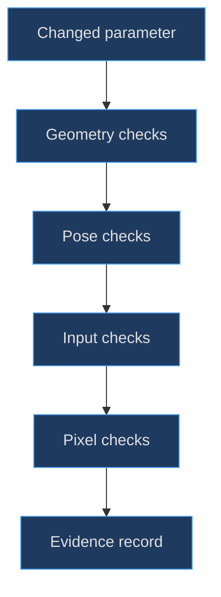
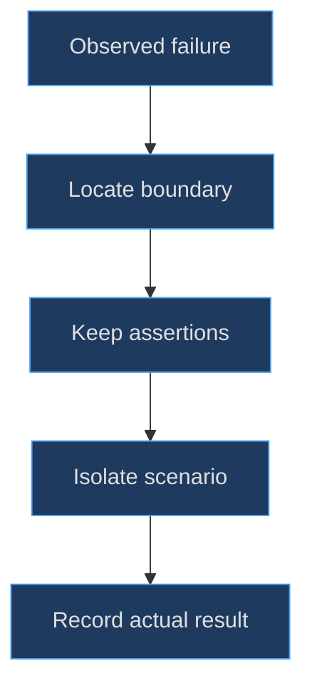

# The DS model regression atlas

## An atlas records questions, not just attractive images

A useful model atlas explains what each observation can establish. A front image can reveal a control overlap; an underside ray can establish that branding faces outward; a unit test can establish a bounded D-pad target. None alone proves the whole console is correct. The goal is to preserve independent evidence channels so a later agent can diagnose a changed model without confusing appearance, geometry and native behavior.

**Evidence status for this part.** Source, selected TODO histories, scoped commit diffs and test assertions were read at cutoff `1e4ef518d6943ab1af39cef3b4d558f209a17891`. This authoring task did not rerun browser or unit suites, produce production renders, inspect supplied images, publish or establish owner approval. Parent-supplied constructor PNGs are diagnostic illustrations with a separate verified capture pose; they are not native-runtime or historical-development proof.


Figure MD18.1. Independent checks narrow the failure boundary; an attractive final image does not replace the earlier measurements.

## Establish a minimal constructor baseline

The constructor baseline should identify the root quaternion, lid rotation, camera, lights, renderer and material initialization stage. Without those facts two images can disagree even when the factory source is identical. In particular, a bare factory has hidden branding and initial unlit screens; the controller later loads the supplied emblem and selects reflective powered-off glass.

The [factory return interface](https://github.com/Zanark/BowserBoy/blob/1e4ef518d6943ab1af39cef3b4d558f209a17891/src/ds-handheld.js#L269-L274) (`src/ds-handheld.js:273`) identifies the stable diagnostic handles. The [controller initialization](https://github.com/Zanark/BowserBoy/blob/1e4ef518d6943ab1af39cef3b4d558f209a17891/src/ds-controller.js#L186-L201) (`src/ds-controller.js:196`) and [power-off material state](https://github.com/Zanark/BowserBoy/blob/1e4ef518d6943ab1af39cef3b4d558f209a17891/src/ds-controller.js#L266-L294) (`src/ds-controller.js:266`) explain why a constructor image is not the same fixture as a running application.

For an open diagnostic pose, set the returned `lid.rotation.x` to `degToRad(35)`, corresponding to a 145-degree opening under the scene convention. This is a safe value within the scene's supported 30–180-degree opening range, not a factory-enforced constraint. The factory exposes no setter; direct diagnostic assignment bypasses the application's guards and reframe logic.

The shared [rounded-solid helper](https://github.com/Zanark/BowserBoy/blob/1e4ef518d6943ab1af39cef3b4d558f209a17891/src/handheld.js#L19-L32) (`src/handheld.js:19`) must also be pinned. Changing its bevel behavior can change many apparent dimensions without editing the DS file. A regression atlas that records only `ds-handheld.js` can therefore miss a real geometry dependency.

## Geometry atlas: surfaces, envelopes and ownership

The browser placement scenario combines several distinct checks. Rear rays hit the two inset floors and intact shell between them. The underside emblem is root-owned, faces outward and clears the battery cover. Face-cap and socket bounds clear the actual beveled touchscreen bezel and remain inside the deck. Four pads are square, matte and hittable from the rear; shoulders have the intended top-edge location and press normal.

The [surface and bound assertions](https://github.com/Zanark/BowserBoy/blob/1e4ef518d6943ab1af39cef3b4d558f209a17891/tests/browser/ds.spec.mjs#L1284-L1373) (`tests/browser/ds.spec.mjs:1347`) are a compact regression specification. Notice the measurement diversity: names from rays, parent identity, axis-aligned gaps, material properties and transformed normals. They are not redundant ways to prove the same fact.

| Atlas view/check | What it can establish |
|---|---|
| Front diagnostic | Silhouette and obvious overlap |
| Rear surface rays | Apertures and outward surfaces |
| Root-space bounds | Numeric layout margins |
| Articulated envelope | Pose-dependent camera fit |
| Native contact sample | Actual pixel/input behavior |

Conservative boxes are especially useful for repeatable clearance checks. They do not prove exact Euclidean distance between rounded surfaces. The atlas should say “root-space bounding gap” when that is what was measured, instead of implying a manufactured minimum air gap.

## MD18-W01 Design a regression for a wider Y socket

Assume a proposed edit increases only face-socket radius from .220 to .250 while keeping the Y center at X 2.75. Its left bound moves from 2.530 to 2.500. The current beveled bezel right bound is approximately 2.451667, leaving .048333. That falls below the existing greater-than-.05 requirement even though the cap radius remains .195 and the cap itself still appears clear.

The correct regression selects both cap and socket, calculates their boxes in root coordinates and compares against the generated bezel, not the nominal width alone. It should report which named part failed and the measured gap. Then it should check the outer A-side deck margin before accepting any outward correction.

Original pseudocode, assuming a browser fixture with current world matrices:

```text
for part in all_face_caps_and_sockets:
  b = rootSpaceBounds(part)
  innerGap = b.minX - bezel.maxX
  outerGap = deck.maxX - b.maxX
  report part.name, innerGap, outerGap
  require innerGap > .05
  require outerGap > .10
```

Expected result under the changed assumption: the enlarged Y socket fails the inner criterion. Do not weaken the threshold to accommodate the edit. The threshold expresses a preserved model contract, while the proposed radius is the variable under evaluation. An implementation change can be rejected without treating the existing test as an obstacle.

## Pose atlas: fixed references and editable poses coexist

An atlas needs both reproducible reference poses and varied interaction poses. A fixed historical lighting pose supports color comparisons; an unlocked default play pose supports everyday usability; a 30-degree opening tests occlusion; a tilted lock tests preserved articulation. Substituting one for another can make an otherwise valid photometric expectation fail for the wrong reason.

The [hinge setter and bounds path](https://github.com/Zanark/BowserBoy/blob/1e4ef518d6943ab1af39cef3b4d558f209a17891/src/scene.js#L452-L518) (`src/scene.js:467`) define allowed edits and candidate evaluation. The [camera-fit formula](https://github.com/Zanark/BowserBoy/blob/1e4ef518d6943ab1af39cef3b4d558f209a17891/src/scene.js#L929-L948) (`src/scene.js:935`) includes viewport reservations and desk lift. Record those conditions before interpreting a crop or brightness difference as a model defect.

Current [Object3D documentation](https://threejs.org/docs/pages/Object3D.html), consulted 2026-11-07, supports explicit world-matrix reasoning. Current [Raycaster documentation](https://threejs.org/docs/pages/Raycaster.html), consulted the same day, supports nearest-first hit and face-orientation diagnostics. These are researched recommendations, not evidence that a different current Three.js release was used to author the pinned model.

## Input atlas: measure behavior independently of artwork

The D-pad unit test uses a lightweight fixture and checks signed physical edge heights, diagonal magnitude, opposite-direction cancellation, exact rest return and idle-settled behavior. It also checks that the cap surface remains above the deck. The [unit cases](https://github.com/Zanark/BowserBoy/blob/1e4ef518d6943ab1af39cef3b4d558f209a17891/tests/unit/ds-controls.test.mjs#L29-L76) (`tests/unit/ds-controls.test.mjs:49`) are valuable arithmetic evidence but do not instantiate the complete shell.

The touch queue tests separately preserve quick down/up edges, coalesce drags and cancel stale work. Their [fixture and expectations](https://github.com/Zanark/BowserBoy/blob/1e4ef518d6943ab1af39cef3b4d558f209a17891/tests/unit/ds-touch.test.mjs#L5-L72) (`tests/unit/ds-touch.test.mjs:29`) establish asynchronous sequencing, not native-game success. The implementation is [DsTouchQueue](https://github.com/Zanark/BowserBoy/blob/1e4ef518d6943ab1af39cef3b4d558f209a17891/src/ds-touch.js#L11-L46) (`src/ds-touch.js:28`).

Browser scenarios then connect the pieces: real dual-screen startup, scene/runtime keyboard focus, stylus placement, quick taps, rotated poses and resize under deferred painting. Read the [scenario inventory and native case](https://github.com/Zanark/BowserBoy/blob/1e4ef518d6943ab1af39cef3b4d558f209a17891/tests/browser/ds.spec.mjs#L168-L270) (`tests/browser/ds.spec.mjs:168`) as integration intent. Reading an assertion is not observing its current pass status.

## Pixel atlas: choose the material state first

The active-LCD invariant applies to unlit, non-tone-mapped status or native textures. Reflective powered-off glass is expected to change with lighting. The upright-lighting browser case explicitly installs static status LCDs, verifies sampled shell hits and compares LCD RGB values across lamp, dark and room states. That fixture avoids confusing a legitimate reflection with a pixel-presentation regression.

The [pixel and material assertions](https://github.com/Zanark/BowserBoy/blob/1e4ef518d6943ab1af39cef3b4d558f209a17891/tests/browser/ds.spec.mjs#L1421-L1485) (`tests/browser/ds.spec.mjs:1455`) require actual surface identity as well as color. Sampling a nearby background pixel can produce a plausible brightness number with no evidence about the shell. Keep the ray-hit name in the diagnostic output.

## MD18-R01 Retry after a slow integrated browser case

Change the failure condition: an overpacked browser scenario times out after several correct native direction checks. Do not immediately reverse D-pad signs, reduce rendering quality or add retries. First inspect which checks completed and whether the deadline expired before the remaining independent behaviors were exercised.

The [D-pad historical task](https://github.com/Zanark/BowserBoy/blob/1e4ef518d6943ab1af39cef3b4d558f209a17891/TODO/97_DS_DIRECTIONAL_DPAD.todo#L40-L77) (`TODO/97_DS_DIRECTIONAL_DPAD.todo:40`) records splitting scene keys, runtime keys, diagonal/opposite holds and mixed-source cleanup into independently booted scenarios while retaining assertions and deadlines. That is historical failure isolation, not evidence that every timeout has the same cause.


Figure MD18.2. Recovery changes the diagnostic arrangement only after evidence identifies the boundary; it must not silently relax the model contract.

## Build a reusable evidence packet

**Proposed agent procedure.** For each model edit, retain a small packet containing the exact source cutoff, parameter delta, relevant constructor names, expected invariant, test selection and actual execution status. Add diagnostic images only when their fixture is known. A packet with fewer but well-scoped observations is more useful than many unlabeled screenshots.

For geometry, include generated bounds and the coordinate frame in which they were measured. For ray evidence, include origin, direction, first-hit name and relevant distance. For motion, include input state and timestamps or interpolation fraction. For pixel evidence, include the material state, light state, sampled surface identity and viewport. These fields make a failure reproducible without requiring the next agent to infer hidden conditions.

Keep source-read status distinct from execution status in the packet. “Assertion exists at this line” is a useful fact. “Passed locally on a historical commit” is another useful fact. Neither means “passed now.” Likewise a successfully produced constructor image does not establish native framebuffer readiness. The atlas should preserve those categories rather than flatten them into one completion badge.

When updating documentation after a model change, recalculate arithmetic examples as well as replacing images. A moved Y button changes the worked socket gap; a new lid offset changes the pivot example; a new screen dimension changes pixel scale and illumination metadata. Leaving old arithmetic next to a fresh image can make a handbook internally inconsistent even when every individual source link still resolves.

The same principle applies to coverage. This part covers the DS shell, hinge, controls, screens, card, stylus, markings and interaction boundaries actually discussed. It does not claim exhaustive explanation of save formats, emulator internals, all renderer code or every source line. A precise boundary lets a future extension add missing topics honestly instead of accidentally inheriting an impossible completeness claim.

## MD18-Q01 Exercise: write an honest atlas conclusion

You have read a geometry test, produced a neutral-studio front image and found a historical task reporting local passes. You have not run the current browser suite or inspected native drawing. What can the coverage record claim, and what must remain unverified?

## MD18-A01 Explained answer

It can claim source construction coverage, an identified assertion contract and a separately described diagnostic image. It can report the historical result explicitly as historical, with its source. It cannot claim fresh integration success, hosted qualification, native touch accuracy in the current environment or owner approval.

The coverage JSON for this part therefore names models, source symbols, components, chapters and tests **read**, then records limitations and unverified work. It is not a claim that every source line was explained or every hardware detail reproduced. This restraint makes the handbook reusable: a later agent can see exactly which evidence to regenerate rather than inheriting an inflated green status.
