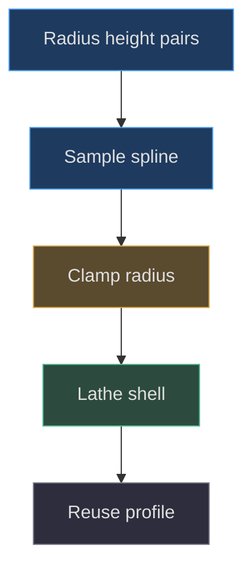
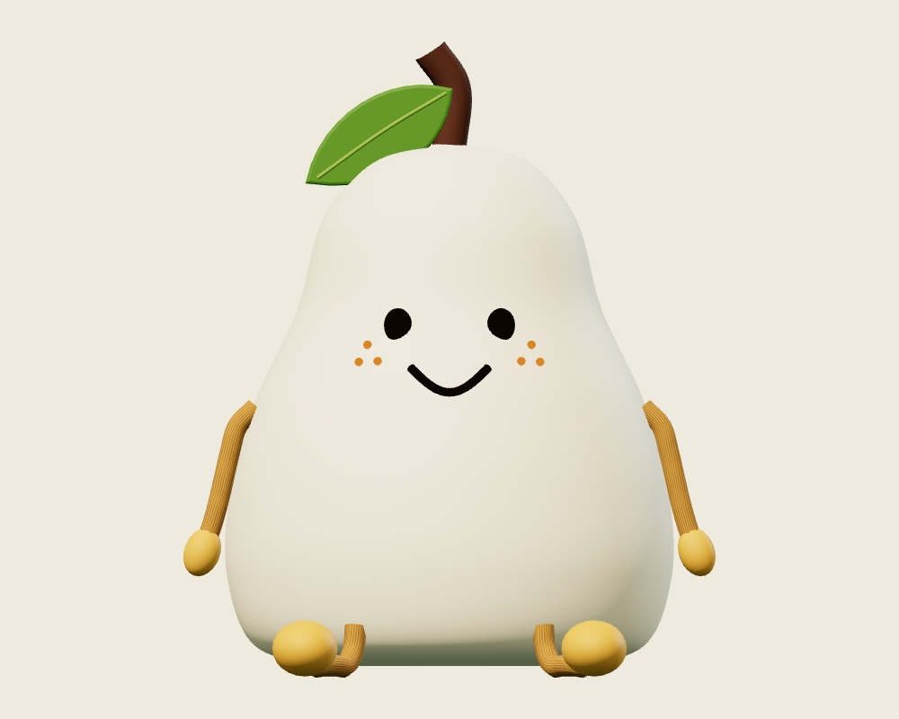
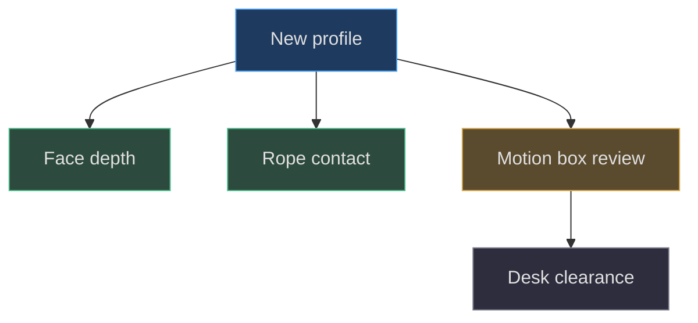

# Pear Boy: the parametric body

## Evidence boundary and construction objective

**Implemented behavior.** Pear Boy is authored by `createPearBoy`, not imported
from a sculpting package. The factory assembles a lathed shell, projected facial
geometry, simulated rope limbs, decorative stem and leaf, contact shadow, and
interior lights. This chapter reconstructs the shell first because its sampled
profile becomes the geometric authority for both facial depth and rope collision.
The implementation baseline is commit
`1e4ef518d6943ab1af39cef3b4d558f209a17891`; measurements below are model units,
not inferred manufacturing dimensions. See
[factory and profile](https://github.com/Zanark/BowserBoy/blob/1e4ef518d6943ab1af39cef3b4d558f209a17891/src/pear-boy.js#L5-L89)
(src/pear-boy.js:5).

**Design interpretation.** A broad lower body and narrower upper neck can read
as soft, stable, and toy-like. That is an interpretation of the silhouette, not
proof that a user approved it or that a physical silicone prototype exists.
The useful procedural objective is more concrete: preserve a continuous,
rotationally symmetric shell whose front surface can be sampled consistently
by independent features.

## Build the profile before the surface

The profile starts as ten radius-height pairs in the XY plane. The endpoints
are `(0,.16)` and `(0,6.85)`. Intermediate radii grow through `1.6`, `2.5`,
and `2.85`, then taper through `2.8`, `2.5`, `1.95`, `1.6`, and `1`.
The widest authored control point is therefore at height `1.3`, not at the
middle of a generic sphere. The control-point list is interpolated with
`CatmullRomCurve3`, sampled with `getPoints(96)`, converted to `Vector2`, and
clamped to nonnegative radius. This produces 97 sampled profile points.

There are two distinct resolutions: 96 curve divisions describe the vertical
silhouette; 64 lathe segments describe angular sampling. Increasing one cannot
repair undersampling in the other direction. A coarsely sampled profile can
produce a stepped shoulder despite a smooth circular cross-section. Conversely,
a fine profile with too few radial segments can look polygonal from above.
Do not silently replace `getPoints` with evenly spaced arc-length samples:
that would change the correspondence used by the downstream height lookup.
The actual choices appear together at
[shell construction](https://github.com/Zanark/BowserBoy/blob/1e4ef518d6943ab1af39cef3b4d558f209a17891/src/pear-boy.js#L66-L76)
(src/pear-boy.js:66).

Figure MD19.1. One sampled profile supplies the lathe and the later shell queries; those consumers must not drift into independent approximations.

## Derive the shell coordinates

For explanatory purposes, let `r(y)` denote the radius interpolated between
neighboring sampled profile points. A rotational shell can be described by
`x=r(y) sin(theta)` and `z=r(y) cos(theta)`. This is a derivation of the
surface of revolution, not a transcription of Three.js's internal vertex
ordering. Positive Z is the authored face direction. At each fixed height,
the ideal cross-section satisfies `x²+z²=r(y)²`.

The code does not solve the original spline analytically for height.
`radiusAt` finds the first sample after index eight with height at least the
requested value, then linearly interpolates its radius against the preceding
sample. The index guard avoids the beginning of the rounded base. Its validity
depends on the authored profile behaving sensibly over the queried heights.
A proposed profile with loops or decreasing height needs a new lookup contract;
the existing function is not a general spline inversion algorithm.

This distinction explains why a visually plausible replacement sphere is
insufficient. The face and collision code would continue asking the old profile
for radii. A faithful rebuild must retain one authority, or deliberately update
every dependent consumer and its tests.

## Topology, normals, and ownership

The body uses `LatheGeometry(profile,64)` and a `MeshStandardMaterial`.
The factory does not manually recalculate its normals after construction.
Do not describe the body as a subdivision surface, voxel remesh, or normal-map
sculpt: none of those stages appears here. The mesh helper marks the object
with `userData.pearBoy`, sets `receiveShadow`, and adds it to the root. The root
owns model placement; the body geometry remains in local coordinates.

**Researched guidance.** Current
[Three.js BufferGeometry documentation](https://threejs.org/docs/pages/BufferGeometry.html)
distinguishes indexed shared vertices from non-indexed triangles and explains
that normal recomputation behaves differently for each. That reference was
consulted on 2026-11-07; it is not an immutable description of this repository's
dependency internals. If a proposed extension edits lathe positions directly,
inspect its actual index and normal attributes before deciding how to rebuild
shading. Updating positions alone is not a complete geometry-editing policy.

The material's cream base, roughness `.65`, warm emissive color, and intensity
`77` are factory defaults. They suggest a luminous toy surface but do not
implement subsurface scattering or elastic shell deformation.

## Keep decoration separate from shell authority

The brown stem is a curved tube through heights `6.8`, `7.55`, and `8.02`,
with radius `.22`. The leaf is a planar Bézier outline extruded `.08`, with
`.04` bevel size and thickness. Its root translation is `(0,7.5,.2)`;
the vein is another small tube. These parts extend the recognizable silhouette
without changing `radiusAt`. See
[stem, leaf, and vein](https://github.com/Zanark/BowserBoy/blob/1e4ef518d6943ab1af39cef3b4d558f209a17891/src/pear-boy.js#L285-L301)
(src/pear-boy.js:285).

That separation matters in collision interpretation. A profile-radius query
describes the pear shell, not the leaf or every decorative protrusion.
Conversely, an object-wide box can include protrusions that are not intended
as physical support. Neither representation replaces the other. The source
uses several envelopes for different jobs; treating all of them as the literal
surface would produce contradictory dimensions.

Figure MD19.2. Actual original-factory diagnostic under neutral studio lighting; useful for silhouette comparison, not proof of native-room illumination or animation.

## MD19-W01 Reconstruct a cross-section consistently

Begin with the exact control points, create the 97-point profile, and select
height `4.5`, the facial anchor height. Locate the same bracketing samples
that `radiusAt` uses. Compute
`t=(4.5-a.y)/(b.y-a.y)` and then `r=a.x+t(b.x-a.x)`.
Do not substitute the radius of a neighboring control point: the sampled
interpolant is the implemented surface authority.

Next choose a test horizontal coordinate `.66`, matching one calm eye center.
Derive its shell depth as `sqrt(r²-.66²)` and add the feature's chosen offset.
Repeat with negative `.66`. The two depths should match because the shell
is rotationally symmetric. Their X coordinates differ; their Y and Z values
should not. This checks both symmetry and the sign convention without needing
a rendered screenshot.

Finally compare the derived point with the factory's `front` result and check
that all coordinates are finite. A useful observable recipe is to create the
factory in its normal browser environment, inspect the named black eyes, and
compare their neutral local positions. The texture helper needs a document
canvas, so do not claim a bare Node factory run works without a canvas adapter.
The helper's actual environment requirement is visible at
[canvas creation](https://github.com/Zanark/BowserBoy/blob/1e4ef518d6943ab1af39cef3b4d558f209a17891/src/handheld.js#L68-L79)
(src/handheld.js:68).

## MD19-R01 Widen the belly without breaking dependents

**Proposed extension.** Change the `2.85` control radius to `3.1` in an isolated
experiment, retaining its height and the sampling counts. This retry changes
geometry, not only material color. Rebuild the shell and derive radii at limb
attachment heights and the face height. A local belly change can influence
adjacent spline intervals; do not assume the effect ends exactly at the edited
control point.

Diagnose three consequences separately. First inspect the silhouette for a
new shoulder kink. Second compare projected facial depths using the new shared
profile. Third settle the ropes against the new radius function. The rope
constraint pushes points outward using body radius plus cord or tip radius,
as implemented in
[body contact](https://github.com/Zanark/BowserBoy/blob/1e4ef518d6943ab1af39cef3b4d558f209a17891/src/pear-rope.js#L140-L147)
(src/pear-rope.js:140). A rope that intersects the widened shell is not repaired
by increasing render order.

Also re-evaluate body movement bounds. `PearMotion` has a deliberately simplified
box, not a runtime extraction of every new profile vertex. Widening beyond its
half-width can invalidate collision expectations even when the visible mesh
is excellent.

## Movement and clearance are different contracts

The motion controller bounds Pear by `(-3,0,-3)` to `(3,8.1,3)`, with root
workspace from `(-22,0,-11.5)` to `(24,25,7.5)`. Those values govern upright
body motion; they are not a promise to enclose every hanging foot. See
[PearMotion configuration](https://github.com/Zanark/BowserBoy/blob/1e4ef518d6943ab1af39cef3b4d558f209a17891/src/pear-motion.js#L150-L156)
(src/pear-motion.js:150).

The factory additionally computes an object box and expands its horizontal
reach to at least `±4.5`. Scene clearance starts with that envelope and unions
current children except the contact plane. That arrangement protects broader
limb reach while avoiding a fake shadow becoming solid furniture.
[Scene envelope assembly](https://github.com/Zanark/BowserBoy/blob/1e4ef518d6943ab1af39cef3b4d558f209a17891/src/scene.js#L797-L811)
(src/scene.js:797) and the separate
[placement solver](https://github.com/Zanark/BowserBoy/blob/1e4ef518d6943ab1af39cef3b4d558f209a17891/src/desk-clearance.js#L3-L34)
(src/desk-clearance.js:3) explain why a new body shape needs integration checks,
not merely a neutral-front capture.

Figure MD19.3. A silhouette edit propagates into three geometric contracts before the model can be considered safely placeable.

## Preserve useful invariants during reconstruction

A practical reconstruction should record three independent measurements before
experimenting: the shell's local vertical span, sampled radius at the face
anchor, and full assembly bounds after settling. The first describes body
geometry, the second supports attachment math, and the third describes scene
participation. Combining them into one “size” number throws away the distinction
that makes later failures diagnosable. The factory exposes both `body` and
`bounds`, while motion supplies another explicitly configured envelope
(src/pear-boy.js:375; src/pear-motion.js:150).

For a proposed lower-resolution version, reduce only one sampling direction
at a time in an isolated copy. Compare front silhouette, top circularity,
and projected face clearance under the same coordinates. A lower polygon
count is not automatically a valid optimization if broad expression patches
start intersecting a coarser shell. Likewise, a higher count is not evidence
of a better design if it changes nothing visible at the intended desk scale.
The relevant tradeoff is observable quality against geometry cost, with the
attachment contract retained.

The existing rope tests offer a useful numerical counterpart to silhouette
inspection: finite coordinates, pinned attachment, controlled length error,
and correct edge support. Keep the tests' synthetic constant-radius fixture
distinct from the actual pear profile. Passing that fixture validates solver
mechanics, not every authored radius sample. A profile-specific extension
should sample its own critical heights rather than copying the fixture's
constant `2.8` as if it were the entire body's radius.
The fixture and its assertions are explicit in
(tests/unit/pear-rope.test.mjs:6).

## MD19-Q01 Choose the right failure detector

A rebuilt Pear looks correct from the front, but its hand enters the shell
after a lateral pickup. Should the first repair change shell roughness, add
more radial lathe segments, or inspect the shared radius/contact contract?
Explain what additional observation would distinguish a bad collision radius
from an incorrectly transformed rope.

## MD19-A01 Separate shape, contact, and coordinate failures

Inspect the radius/contact contract first. Roughness changes shading, and radial
segments change the polygonal approximation; neither necessarily changes the
constraint's requested clearance. Compare each rope point in world coordinates
against the body-local radius evaluated at `point.y-origin.y`. Then check that
painting subtracts the root position exactly once. A consistent radial shortfall
suggests wrong radius or tip clearance; a displacement that follows root
translation suggests a coordinate conversion error.

The failure boundary is important: the rope only collides with the pear and
desk, not arbitrary scene props. Existing
[rope unit cases](https://github.com/Zanark/BowserBoy/blob/1e4ef518d6943ab1af39cef3b4d558f209a17891/tests/unit/pear-rope.test.mjs#L33-L46)
exercise body contact and stale-momentum removal, but do not prove a future
profile is safe at every possible point. Use them as regression contracts,
then add focused negative controls for the changed shape. This handbook is a
reproducible reconstruction aid, not a recovered internal design memory.
