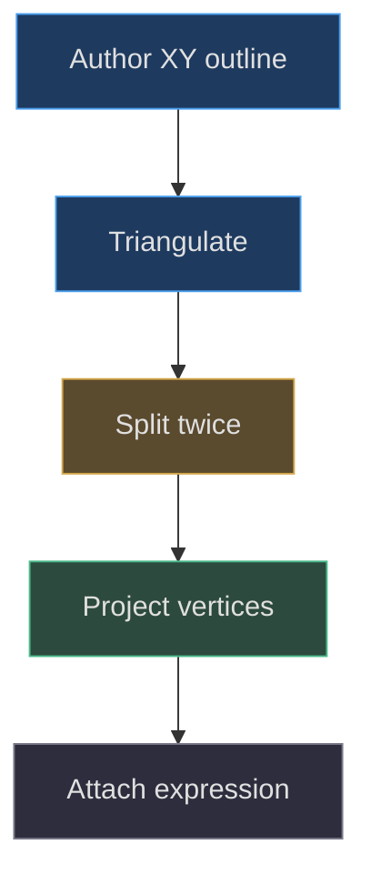
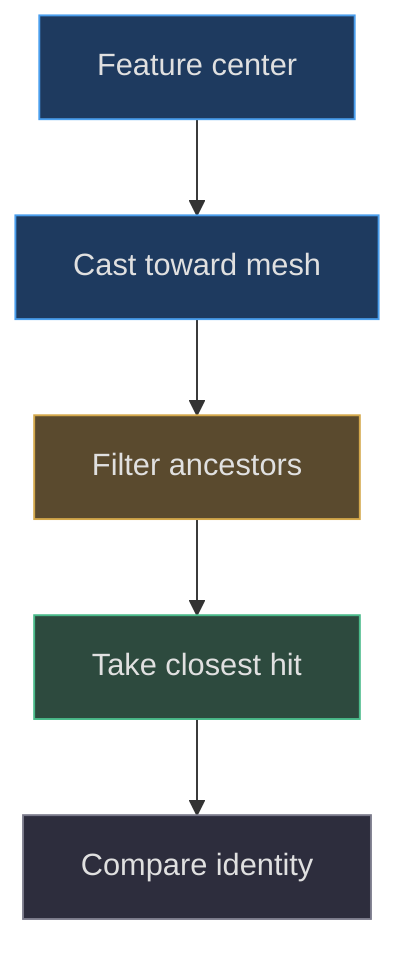

# Projecting a face onto a curved shell

## Why a flat face fails on a rounded body

**Implemented behavior.** The Pear face is real mesh geometry attached to a
curved shell. It is not a texture decal and does not use a camera-facing
billboard. Its placement function derives Z from the same sampled radius
profile that builds the body. The important dependency is therefore geometric:
a facial feature must remain outside a shell whose depth changes with both
height and horizontal coordinate. See
[profile, front projection, and patches](https://github.com/Zanark/BowserBoy/blob/1e4ef518d6943ab1af39cef3b4d558f209a17891/src/pear-boy.js#L66-L112)
(src/pear-boy.js:66).

**Design interpretation.** Keeping the markings close to the surface can make
them read as part of a soft lamp rather than floating accessories. That reading
does not establish a physical printing process. The procedural problem is
simply to balance surface clearance against conspicuous separation, including
when the face moves.

## Derive the front projection and its domain

At a chosen height, the ideal section satisfies `x²+z²=r²`. Selecting the
front half gives `z=sqrt(r²-x²)`. The code adds a positive offset, named
`inset`, although numerically it pushes the point outward along positive Z.
Its default is `.03`. A literal inward normal displacement would have a
different meaning; use the actual equation rather than interpreting the name
as a physical direction.

The function clamps the square-root argument to zero. This prevents a negative
radicand from generating NaN when `|x|>r`, but does not make such a point a
correct surface attachment. It would sit beyond the valid circular section
with depth equal to the offset. Nor does `front` include the explicit height
guard present in `radiusAt`; an out-of-range height can fail while selecting
its interpolation pair. Valid feature authoring must respect both domains.

For a broad patch, it is not enough to project only its corners. A triangle
connects projected vertices with planar edges. Across a convex shell that
flat chord can cut inward between samples, burying its interior even when the
vertices are individually clear. This is the reason to examine tessellation
before increasing offset.

## Form expressions in two dimensions first

`facePatch` constructs a `ShapeGeometry` with curve-segment argument `16`,
converts it to non-indexed triangles, copies its positions into vectors, and
disposes both intermediate geometries. It then performs two triangle subdivision
passes. Each triangle becomes four by introducing edge midpoints. After two
passes an original triangle contributes sixteen triangles. Only then are all
vertices projected using `front`.

This ordering is the central lesson: shape placement happens in its XY
description before projection. Translating an already projected patch vertically
does not re-evaluate the shell radius at the new height. A mouth can consequently
enter a region of greater shell depth and disappear behind the body;
movement toward a narrower region can instead leave it floating.
The implemented anger mark follows the safer pattern too: it adds `.42` to
the authored Y coordinate before calling `front`, rather than moving the
finished tube afterward. See
[anger mark construction](https://github.com/Zanark/BowserBoy/blob/1e4ef518d6943ab1af39cef3b4d558f209a17891/src/pear-boy.js#L215-L223)
(src/pear-boy.js:215).

Figure MD20.1. Subdivision precedes projection so the filled interior follows the rounded shell rather than remaining a large cutting plane.

## Tubes, patches, and small solid features

The calm eyes are scaled spheres at `x=±.66`, `y=4.5`, with scale
`(.18,.22,.09)`. The smile samples seventeen points from X `-.5` to `.5`,
using a sine depression of `.32` from height `3.96`, then forms a tube of
radius `.055`. These solids have their own thickness; they are not equivalent
to a zero-thickness patch with the same center coordinate.

Expression eyes, cheeks, mouth fills, and tongue use different offsets.
Typical patch clearance is `.06`; the white angry-eye interior and tongue
use `.085`; rosy cheeks use `.025`. These layers should be understood relative
to their projected surface, not as absolute world depths. The mesh helper
initially adds meshes to the model root, after which adding them to a face
group reparents them. Their coordinates were already authored in model space,
and those face groups start with identity transforms.

**Researched guidance.** Current
[BufferGeometry documentation](https://threejs.org/docs/pages/BufferGeometry.html)
states that absent indices, successive triples form triangles. That supports
the patch's `setFromPoints` construction. The returned patches do not explicitly
compute normals or retain UV coordinates; their `MeshBasicMaterial` colors do
not require the same lighting response as the standard-material shell.

## Move around the body axis, not the face center

`face.root` is a group at the body origin, containing both expression groups
and permanent freckles. Horizontal tracking rotates this group about Y.
Because its geometry is already located near the shell's front, that operation
moves features around the body axis. Rotating a group newly centered at the
face anchor would instead turn markings around their own center, an entirely
different trajectory.

Vertical tracking translates the group and scales X and Z by
`radiusAt(4.5+dy)/radiusAt(4.5)`. This is a shared center-height approximation,
not a per-vertex reprojection at every feature height. It preserves a coherent
face while accommodating the narrowing shell. The fixed anchor is a separate
object attached directly to the model root, so pointer normalization does not
chase the moving face. See
[anchor and transform update](https://github.com/Zanark/BowserBoy/blob/1e4ef518d6943ab1af39cef3b4d558f209a17891/src/pear-boy.js#L108-L109)
and
[gaze transform](https://github.com/Zanark/BowserBoy/blob/1e4ef518d6943ab1af39cef3b4d558f209a17891/src/pear-boy.js#L248-L260)
(src/pear-boy.js:248).

## MD20-W01 Derive lateral motion of a marking

Take a neutral point `(x,y,z)` on the face. Let the horizontal normalized gaze
be one, so the implemented yaw is `.55` radians. Under the conventional Y
rotation, its new horizontal coordinate is `x cos(.55)+z sin(.55)`.
This includes a contribution from shell depth. An eye can therefore move
substantially farther than a simple `.55`-unit lateral translation would
suggest. The angle is approximately 31.5 degrees; it is not a screen-pixel
distance.

Now set upward gaze to one. The implemented Y offset is `.75` model units,
not `.75` radians. Compute the radius ratio at heights `5.25` and `4.5`.
Apply that ratio to local X and Z before yaw. The exact numerical result must
come from the sampled profile, not from assuming a spherical head.

For an observable reproduction, compare world positions of both named black
eyes at neutral and extreme gaze after `updateWorldMatrix(true,true)`.
Keep the root position unchanged and separately project the fixed anchor.
The browser regression requires upward eye movement over `.65` world units
and five screen pixels, with an unchanged anchor. It also checks smile and
freckle movement. See
[pointer assertions](https://github.com/Zanark/BowserBoy/blob/1e4ef518d6943ab1af39cef3b4d558f209a17891/tests/browser/pear-boy.spec.mjs#L314-L361).

## MD20-R01 Move a broad mouth toward the shoulder

**Proposed extension.** Raise an expression mouth's XY control points by `.3`
before constructing its shape. Rebuild its triangulation and projection; do not
translate the finished mesh. The changed condition is increased shell curvature
and a smaller radius at the new height. Inspect the patch center as well as
its perimeter, because corner-only tests miss chord penetration.

If the interior disappears, first verify subdivision and the resulting vertex
depths. Increasing offset may restore visibility but can leave a floating
outline in three-quarter views. Increasing tessellation better approximates
curvature, at a geometry cost. Replacing the fill with a texture is another
tradeoff, but it would introduce UV and texture-resolution contracts absent
from the implemented expression pipeline.

Do not assume `DoubleSide` fixes buried geometry. It can expose back faces,
but the shell can still occlude the patch. Current
[Raycaster documentation](https://threejs.org/docs/pages/Raycaster.html)
also distinguishes back-face behavior from closest-hit ordering. Diagnose
the actual surface intersection instead of using material settings as a
substitute for correct placement.

## Visibility means foremost appearance

The freckle test casts toward each dot and selects the nearest intersection
whose entire ancestor chain is visible. A dot's own `visible=true` is not
sufficient if its parent is hidden. Nor does a visible flag prove the body
or another eye is not in front of it. The test examines all nine gaze
combinations for four expressions, requiring all six foremost names to be
the freckle name. See
[visibility filtering](https://github.com/Zanark/BowserBoy/blob/1e4ef518d6943ab1af39cef3b4d558f209a17891/tests/browser/pear-boy.spec.mjs#L397-L426).

Figure MD20.2. A geometric visibility check rejects hidden ancestors and intervening surfaces before accepting a facial marking.

## Integration constraints beyond the face

The same model root also carries moving limbs and lights. Rope painting
converts simulated world positions back to root-local coordinates; it must
not inherit face-group yaw. Body motion is separate again, using
`DeskMotion` integration rather than facial interpolation. These ownership
boundaries are explicit in
[limb painting](https://github.com/Zanark/BowserBoy/blob/1e4ef518d6943ab1af39cef3b4d558f209a17891/src/pear-boy.js#L330-L353),
[rope origins](https://github.com/Zanark/BowserBoy/blob/1e4ef518d6943ab1af39cef3b4d558f209a17891/src/pear-rope.js#L48-L64)
(src/pear-rope.js:48), and
[body integration](https://github.com/Zanark/BowserBoy/blob/1e4ef518d6943ab1af39cef3b4d558f209a17891/src/pear-motion.js#L59-L78)
(src/pear-motion.js:59).

Scene pointer normalization projects the immutable anchor and clamps gaze
to `[-1,1]`, independent of the current markings
(src/scene.js:1326). Texture color-space setup is centralized in the
canvas helper (src/handheld.js:68), whereas face patches use direct basic
colors. Those distinctions explain why changing emission or the canvas
gradient is not a repair for a buried mouth.

## Depth offsets are a layered budget

The patch and solid-feature offsets form a small but important depth budget.
An angry eye's white interior at `.085` sits farther forward than the black
outline's default `.06`; the tongue uses the same larger offset against its
mouth fill. Blush at `.025` is intentionally closer to the shell than many
ink features. These are source values, not universal safe distances. Their
relative arrangement is visible in the expression constructors
(src/pear-boy.js:136; src/pear-boy.js:202).

When adapting a feature, first identify which layer should be foremost and
whether it is a tube, flattened sphere, or triangulated fill. A tube radius
contributes additional geometric depth around its centerline, whereas a patch
has no comparable thickness. Equal center offsets therefore do not imply
equal front surfaces. This explains why moving every feature to the same Z
offset can introduce new occlusion even if it removes shell penetration.

A useful proposed diagnostic is to cast separate rays toward the intended
foreground layer, its surrounding outline, and a point just beyond the
feature. Record object identity, not only hit distance, because two parts can
be nearly coplanar while belonging to different expressions. Repeat after
upward and horizontal gaze, then compare the same local layer ordering.
This extends the existing freckle-center method without pretending it already
tests every mouth pixel. If a repair requires disabling depth testing, stop
and re-examine geometry: the current implementation's lesson is to construct
surface-following features, not to draw facial colors over unrelated objects.

## MD20-Q01 Diagnose a face that vanishes only upward

A new cheek fill is visible at neutral gaze but becomes partly hidden looking
up. Its object and parent are visible, and its corner vertices are outside the
shell. What should be measured next, and why is rotating the whole lamp an
invalid repair?

## MD20-A01 Inspect interior sampling and transform ownership

Measure interior triangle clearance at the changed height, then inspect the
group's center-height scale approximation. Large planar triangles may penetrate
between clear vertices; a shape extending far above the anchor may also exceed
the approximation's useful range. Rebuild with more appropriate sampling or
change its authored XY extent before projection.

Rotating the whole lamp changes body, ropes, lights, and desk collision
relationships. It conceals the local error by changing the viewing condition.
The failure boundary is that the current face transform is designed for the
authored range, not arbitrary expressions spanning the entire pear. History
records wider gaze and later upward travel, but those commits do not prove
every proposed larger face is safe. Extend the geometric test grid and inspect
actual appearance rather than converting historical qualification into universal
approval.
