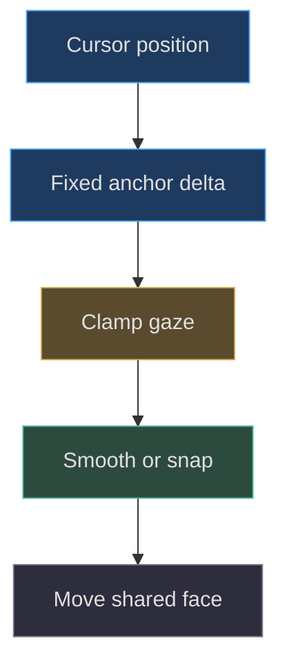
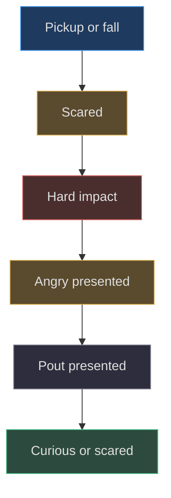

# Expressions, gaze and six visible freckles

## Separate where the face looks from what it expresses

**Implemented behavior.** `createPearBoy` builds four expression groups beneath
one movable face root: calm, scared, angry, and sad. The public expression
labels are `curious`, `scared`, `angry`, and `sad`; the final sad appearance is
a squeezed-eye pout, not the earlier glossy worried face. Gaze moves the shared
face root, while visibility selects the expression. This separation prevents
each expression from implementing slightly different tracking.
[Face ownership](https://github.com/Zanark/BowserBoy/blob/1e4ef518d6943ab1af39cef3b4d558f209a17891/src/pear-boy.js#L43-L56)
(src/pear-boy.js:43) is the authoritative hierarchy.

**Design interpretation.** The compact eyes, short brows, blush, and puckered
mouth can communicate a gentler reaction than large wedges. “Cuter” is a design
interpretation and historical task vocabulary, not a measurable shader property.
This chapter instead makes the mechanics reproducible: which geometry appears,
what triggers it, how long it remains eligible, and which markings never belong
to a temporary expression.

## Permanent freckles are structural, not duplicated decoration

Each side creates three dots at positive-coordinate pairs `(1.05,4.25)`,
`(1.16,4.03)`, and `(.92,4.04)`, mirrored in X by the side sign. Each dot is
a sphere of radius `.055`, with ten width and eight height segments, flattened
in Z by `.4`. The material is orange `MeshBasicMaterial` with tone mapping
disabled. All six are attached directly to `face.root`, not to calm or scared.
See
[freckle creation](https://github.com/Zanark/BowserBoy/blob/1e4ef518d6943ab1af39cef3b4d558f209a17891/src/pear-boy.js#L160-L165)
(src/pear-boy.js:160).

This ownership makes six a persistent inventory invariant. Duplicating the
dots into four groups would multiply maintenance points and could accidentally
leave two sets visible. Attaching them outside the moving root would preserve
their count but break whole-face tracking. Neither error is caught by simply
counting named objects in the entire model; both hierarchy and actual foremost
visibility must be checked.

## Gaze math and a fixed reference

The scene projects an immutable anchor at the original face center, converts
cursor displacement into fractions of twenty percent of viewport width and
height, and clamps each axis to `[-1,1]`. Upward screen movement reverses the
usual screen-Y direction. The anchor is separate from the animated face group,
avoiding a feedback loop in which the target moves because the face already
moved. See
[scene normalization](https://github.com/Zanark/BowserBoy/blob/1e4ef518d6943ab1af39cef3b4d558f209a17891/src/scene.js#L1326-L1334)
(src/scene.js:1326).

The gaze interpolation blend is `1-exp(-12*delta)`, or one for reduced motion.
For a constant target, the remaining error after elapsed time `t` behaves
like `exp(-12t)` until the snap threshold is reached. The characteristic time
is about `.0833` seconds. A squared error below `1e-7` copies the target
exactly, preventing perpetual microscopic changes.

Horizontal gaze produces Y-axis rotation up to `.55` radians. Positive vertical
gaze produces up to `.75` model units of rise; negative gaze produces down to
`-.18`. These are deliberately different dimensions. A radius ratio scales
X and Z to follow the changing shell width. It is not a `.75`-radian pitch.

Figure MD21.1. Gaze is derived from a stationary reference and applied once to every expression and permanent dot.

## Expression state and paint acknowledgment

`showExpression` switches group visibility, restores the wobbly scared mouth,
hides the open scream mouth, resets elapsed time, and clears `presented`.
`setFaceLifted` selects scared or curious unless an impact reaction currently
owns the face. A reset or new lift clears that reaction. `reactToImpact`
ignores speeds below ten and ignores another impact while already reacting.
[State setters](https://github.com/Zanark/BowserBoy/blob/1e4ef518d6943ab1af39cef3b4d558f209a17891/src/pear-boy.js#L224-L246)
(src/pear-boy.js:224) establish these rules.

While reacting, angry lasts at least `.9` accumulated seconds and sad at least
`1.25`, but transitions additionally require `presented=true`. The scene sets
that flag after submitting the main room render. Consequently a stalled renderer
cannot silently consume the entire reaction sequence before any expression
was submitted. This is a visibility contract layered over elapsed time, not
a promise of exact wall-clock dwell on every device.

When lifted without a reaction, the two scream mouths alternate after `.9`
seconds only if the current mouth was presented. Reduced motion suppresses
that alternation and forces the wobbly mouth if the open one was visible.
Recovery can still progress through static expressions. See
[face update](https://github.com/Zanark/BowserBoy/blob/1e4ef518d6943ab1af39cef3b4d558f209a17891/src/pear-boy.js#L247-L284).

## MD21-W01 Reproduce the mouth dwell without a stopwatch

Use the factory in its normal browser environment and explicitly call
`setFaceLifted(true)`. Acknowledge one presentation, then update with `.6`
seconds and zero gaze. The wobbly mouth remains selected. Add `.31` seconds:
the accumulated `.91` crosses `.9`, so the open mouth becomes visible and
`presented` resets.

Without another acknowledgment, advancing time does not authorize another
switch. After acknowledgment, repeat the `.6` and `.31` pair. The deterministic
browser test records `[false,true,true,false,false]`, where the final false
comes from a reduced-motion update forcing the closed variant. This recipe
distinguishes state timing from automation latency and does not require
loosening any screenshot deadline.

Then test a hard impact separately: set lifted false with reset, call
`reactToImpact(20)`, and inspect the expression label. Advance beyond `.9`
without acknowledging paint; angry should remain. Acknowledge, update, and
observe sad. Repeat beyond `1.25` to return to curious if no longer lifted.
The actual
[browser timing and visibility fixture](https://github.com/Zanark/BowserBoy/blob/1e4ef518d6943ab1af39cef3b4d558f209a17891/tests/browser/pear-boy.spec.mjs#L384-L426)
provides an existing executable model for this separation.

## MD21-R01 Retry under sparse rendering and reduced motion

Change conditions from regular paints to a long update with no paint
acknowledgment. If all expressions disappear immediately into curious, inspect
whether a caller set `presented` before rendering or bypassed the state setter.
Do not conclude that large deltas inherently require skipping intermediate
states. The implementation explicitly preserves them until presentation.

Next enable reduced motion. Gaze should snap rather than ease; mouth alternation
should stop; impact recovery remains eligible after its timing and presentation
conditions. Rope motion has a different accommodation: it settles constraints
immediately instead of swinging. See
[reduced-motion limbs](https://github.com/Zanark/BowserBoy/blob/1e4ef518d6943ab1af39cef3b4d558f209a17891/src/pear-boy.js#L355-L373)
and the settling procedure
(src/pear-rope.js:34). Reduced motion is therefore not a global instruction
to freeze every state variable or teleport a dropped body home.

**Researched guidance.** MDN's
[requestAnimationFrame reference](https://developer.mozilla.org/en-US/docs/Web/API/Window/requestAnimationFrame),
consulted 2026-11-07, warns that callback frequency varies and background
callbacks can pause. That supports elapsed-time reasoning, but does not itself
guarantee GPU completion or prove that a particular expression reached the
screen.

## Prove freckles are not merely enabled

The browser fixture iterates X and Y values `-1`, `0`, and `1` under each
expression, casting rays from a point in front of the Pear toward each dot.
It filters intersections whose object or any ancestor is invisible, then
requires the closest remaining object to be the freckle. Thirty-six combinations
times six dots provide 216 center-ray checks.

This is stronger than `visible=true`, but narrower than a complete perceptual
proof. It checks centers, not every silhouette pixel or every possible camera
angle. Antialiasing, tiny projected size, and color contrast still affect
appearance. Current
[Raycaster guidance](https://threejs.org/docs/pages/Raycaster.html)
supports nearest-first intersections and explains mesh face orientation;
the repository's explicit ancestor filter supplies its visibility policy.

Figure MD21.2. Hard-impact recovery requires time and submitted presentation; permanent freckles remain outside this expression selection.

## History explains changes, not hidden reasoning

**Documented history.** Commit `1510777ff05b82414e8e1b5958e8c76e446a0eaa`
replaced large angry-eye shapes and glossy recovery eyes, and changed scream
dwell from `.24` to `.9`. Commit
`44b5dc2213bcf9ee464357cfa68ee44b8c1d9bbe` widened yaw from `.22` to `.55`.
Commit `dd269dea6f5cc6ada0038a2245b0ec3a420768c5` increased only positive
vertical travel from `.18` to `.75`. Their scoped source diffs establish
those changes; the task records describe observed failures and qualification.
They do not recover private deliberation or imply aesthetic approval.
The numerical changes are recorded at
(TODO/118_PEAR_BOY_FACE_TRAVEL.todo:23) and
(TODO/121_PEAR_BOY_UPWARD_FACE_TRAVEL.todo:22); the approval boundary is explicit
at (TODO/113_PEAR_BOY_CUTER_RECOVERY.todo:22).

Physics supplies an impact speed rather than directly selecting facial meshes.
The motion controller resets that report per update and records downward support
contacts; horizontal wall contact is not the same event
(src/pear-motion.js:59). The scene consumes it before updating the face
(src/scene.js:1322). Desk placement remains independently responsible for
collision-free paint, rather than expression code moving the lamp aside
(src/desk-clearance.js:3). These boundaries prevent a visual reaction from
becoming an accidental collision repair.

## Geometry makes each reaction readable

The scared face uses squeezed tube eyes, projected pink cheeks, and either
a wobbly line mouth or a filled open scream. The wobbly mouth samples 33
points across width `1.2`, with a cosine oscillation of amplitude `.075`
and six half-turns across the normalized parameter. Its geometry is fixed;
the visible tremble impression comes from its contour and alternation, not
continuous random vertex motion. The open mouth is a distinct curved patch
(src/pear-boy.js:186).

Angry uses compact ellipse-based black outlines and smaller white interiors,
short curved brows, lower blush strokes, a filled shouting mouth, a pink
tongue, and an anger mark built higher on the forehead. Sad uses squeezed
eyes, small frustrated brows, rosy cheeks, and a narrow alternating-X pout.
These are different geometric vocabularies, not merely recolored calm eyes.
When reconstructing them, preserve the XY coordinates before projection;
raising a complete already-projected patch can bury it in the tapering shell.

A proposed alternative based on a single animated texture could reduce mesh
inventory, but would introduce atlas coordinates, texture filtering, and
expression-frame lifecycle concerns. The pinned assembly instead makes
individual features inspectable by name and allows ray-based occlusion checks.
Neither approach is categorically superior; the reusable lesson is to state
which representation owns expression identity and how its visibility is
proved.

## Keep acceptance layers separate

The historical task records distinguish technical qualification, public
deployment, and aesthetic approval. Repeating a recorded “passes” statement
does not execute a test in a new checkout. This authoring pass reads the
fixtures and history; the parent owns rendering and publication. Another
agent should retain that boundary rather than treating prose as an invisible
test run.

For a new expression, preserve permanent-dot count and hierarchy, test both
reduced-motion and ordinary timing, then instrument actual room submissions
for state order. Only after those mechanics pass should visual review decide
whether the reaction reads as intended. A six-dot center-ray result still
does not establish that a tiny dot is perceptually readable on every display.
The failure boundary includes projected size, contrast, camera angle, and
unreviewed combinations beyond the existing nine-point gaze grid.

## MD21-Q01 Explain a motionless angry expression

A hard drop reports speed twenty, angry is selected, and two seconds elapse,
but no room render occurs. Is remaining angry a bug? What observation would
demonstrate a genuine sequencing failure after rendering resumes?

## MD21-A01 Require the right acknowledgment

Remaining angry is expected while `presented` is false. The purpose is to
avoid consuming an expression entirely between submitted paints. After the
main room render calls `acknowledgeFacePaint`, a subsequent eligible update
can advance to sad, whose own presentation must also be acknowledged before
recovery completes.

A genuine failure would be a submitted angry frame followed directly by curious
without the sad state being presented, or an acknowledgment from an unrelated
reflection render that incorrectly unlocks progression. The boundary is main-room
submission, not proof of physical monitor scanout. Preserve that distinction
when instrumenting tests. The painted-drop browser case samples the actual
renderer call and expects `scared, angry, sad, curious` in order, rather than
using animation callbacks alone as evidence
(tests/browser/pear-boy.spec.mjs:496).
