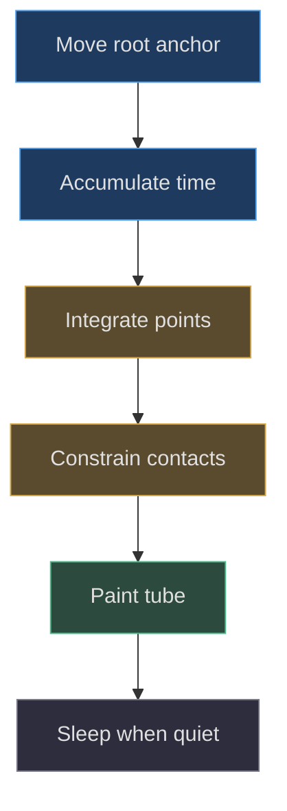
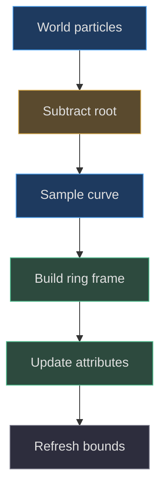

# Limbs, rope and soft motion

## What softness actually means here

**Implemented behavior.** Pear's shell does not squash. Soft motion comes from
four separately simulated ropes, each ending in a rounded hand or foot.
`PearRope` owns simulated points, prior points, segment lengths, collision
queries, and sleep state. The factory owns their tube meshes and terminal
geometry. Calling this a skinned character or finite-element silicone solver
would invent an authoring pipeline absent from the source.
[Rope state](https://github.com/Zanark/BowserBoy/blob/1e4ef518d6943ab1af39cef3b4d558f209a17891/src/pear-rope.js#L1-L38)
(src/pear-rope.js:1) and
[factory limb creation](https://github.com/Zanark/BowserBoy/blob/1e4ef518d6943ab1af39cef3b4d558f209a17891/src/pear-boy.js#L110-L123)
(src/pear-boy.js:110) define that division.

**Design interpretation.** Inertial lag, rounded tips, and resting feet can
suggest a small hanging toy. The measurable implementation contracts are
stronger and less subjective: attachment stays pinned, segment lengths remain
bounded, body and desk contact are respected, and the final tube follows
finite simulated points without allocating a new mesh every frame.

## Establish rest geometry and terminal dimensions

Each authored limb starts from a three-point Catmull–Rom curve. The factory
uses `getSpacedPoints(6)`, producing seven particles and six rest lengths.
Arms start around `(±2.48,3.45,.35)` and terminate initially around
`(±3.05,1.6,.8)`. Legs begin at `(±1.2,.65,2.35)` and extend toward
`(±2.05,.36,3.85)`. These are authoring seeds, not guaranteed final settled
particle positions.

Cord radius is `.14` in the factory, overriding the solver's `.085` default.
Hands use contact tip radius `.32`. Feet use radial contact extent `.55`
but floor height `.36`, matching their visibly wider-than-tall scale.
Distinguishing `tipRadius` and `tipFloor` is essential at the rounded desk
edge: a spherical collision assumption would lift a flattened foot too high.

The factory runs up to 600 warm-up updates, stores the settled points as rest,
resets, then later settles again at the actual model origin. This makes the
visible default depend on desk placement, not merely the original curve.
[Hand and foot seeds](https://github.com/Zanark/BowserBoy/blob/1e4ef518d6943ab1af39cef3b4d558f209a17891/src/pear-boy.js#L167-L184)
are the reproducible starting values.

## Derive Verlet-style movement

For each unpinned point, the solver computes an inertial displacement
`d=.985*(p-pPrevious)`, copies the current point into previous, adds `d`,
and subtracts `45*h²` from Y, where `h=1/120`. The gravity displacement
per step is `.003125` model units. This is a position-based integrator;
there is no independently stored velocity vector for each particle.

Root movement updates the pinned first point immediately. If a pointer
teleport moves the root farther than twice total rope length, both current
and previous free points receive the excess translation. Moving both avoids
inventing velocity from the correction. Even when less than one fixed step
has accumulated, a moved root invokes constraint solving, preventing a
rapid pointer event from leaving the rope stretched until the next tick.
[Update and integration](https://github.com/Zanark/BowserBoy/blob/1e4ef518d6943ab1af39cef3b4d558f209a17891/src/pear-rope.js#L48-L91)
(src/pear-rope.js:48) implement these safeguards.

Figure MD22.1. Solver time and visible tube updates are separate stages; root movement can constrain attachment even before a full physics step.

## Length constraints and convergence limits

For neighboring points A and B, let current separation be `d`, length `l`,
and rest length `L`. The correction vector is
`d*(l-L)/(l*(wA+wB))`. A moves by `wA` times that vector; B moves oppositely
by `wB` times it. The attachment has weight zero, ordinary particles weight
one, and the last particle weight `.3`. Thus the terminal particle receives
less positional correction than an ordinary point; it behaves as a relatively
heavy tip in this constraint distribution.

The solver performs at most 120 iterations, interleaving segment corrections
and collision corrections. It exits early when every segment differs from
its rest length by less than `.002`. A near-zero segment length is skipped
to avoid division by zero. This is bounded iterative convergence, not an
exact algebraic guarantee for every impossible configuration.

Sleep requires every free point's squared movement to remain below `2e-6`
for 24 consecutive integration steps. On sleep, previous positions are copied
to current and the accumulator clears. Those operations eliminate residual
momentum instead of merely suppressing drawing.

## Finite tabletop contact and the hanging foot

The rope's desk model has front Z `10`, bottom Y `-2.4`, and a separate
lower safety floor near Y `-35`. Points over the tabletop use their cord or
tip floor. Beyond the front edge, the solver permits hanging below the table
instead of applying an infinite horizontal plane.

At the upper front corner, contact uses an ellipse:
`((z-10)/radius)²+(y/floor)²=1`. Points inside that rounded corner are
projected outward. Below the top, the front fascia can push a particle to
`10+radius`. Supported points receive tangential damping by changing previous
X and Z. This is why a foot partly over the edge can slide down instead of
resting on an invisible square-expanded ledge.
[Contact branches](https://github.com/Zanark/BowserBoy/blob/1e4ef518d6943ab1af39cef3b4d558f209a17891/src/pear-rope.js#L94-L144)
show the actual finite geometry.

Body collision is radial around the translated root, using `radiusAt` at the
particle's local height plus cord or tip radius. Arbitrary props, rotating
supports, and other ropes are not included. Do not extend the desk result
into a claim of general scene collision.

## MD22-W01 Reproduce edge-to-table settling

Start with the exact leg seed and options from the unit test, including
`.14` cord radius, `.55` tip radius, and `.36` tip floor. Settle at origin
`(18,0,7.3)`. The terminal point should hang below `-.5` and report
`tipSupported=false`. For each point, check either top support, front clearance,
or the elliptical corner condition. Also check the first particle equals
rest attachment plus origin.

Move the origin back to `(18,0,1)` and update for sufficient fixed steps.
The terminal point should return to top support, rather than preserve its
previous hanging offset. Then return to the edge and allow settling again.
This tests the same rope under changed support topology without swapping
meshes or resetting its identity.

The executable
[finite-edge tests](https://github.com/Zanark/BowserBoy/blob/1e4ef518d6943ab1af39cef3b4d558f209a17891/tests/unit/pear-rope.test.mjs#L69-L107)
also include a foot centered only partly beyond the edge. That negative
control is valuable because an over-expanded rectangular tabletop can pass
a simple “never below floor” test while producing the wrong hanging pose.

## Paint a stable tube without rebuilding topology

Each rope mesh starts with 24 longitudinal and six radial divisions.
Painting samples the simulated curve at 25 longitudinal positions, producing
seven radial vertices per ring including the seam: 175 positions.
The first normal is derived from tangent crossed with either up or a fallback
Z vector when the tangent is nearly vertical. Subsequent rings remove the
normal's tangent component and renormalize; binormal is tangent cross normal.

For radial angle `a`, the outward direction is
`-cos(a)*normal+sin(a)*binormal`. It supplies the normal attribute; multiplying
by cord radius and adding the curve point supplies position. Both attributes
are marked dirty, and bounding box and sphere are recomputed. The tip follows
the last local curve point. Supported tips use identity orientation; hanging
tips align their up axis toward the preceding segment.
[Dynamic tube painting](https://github.com/Zanark/BowserBoy/blob/1e4ef518d6943ab1af39cef3b4d558f209a17891/src/pear-boy.js#L330-L353)
is explicit about these ownership conversions.

## MD22-R01 Retry with a multi-second callback

Replace regular `1/120` updates with a three-second callback for the same total
elapsed time. The solver accepts at most five seconds per update and integrates
fixed steps; it does not turn gravity into one giant unstable Euler jump.
The unit trajectory test compares sub-Hz, 2 Hz, 30 Hz, and 120 Hz results.
Then try a `.001`-second root movement to exercise the separate inter-step
constraint path.

If attachment is correct numerically but the rendered cord detaches, inspect
world-to-local conversion in painting. Simulated points are world coordinates;
curve points subtract `root.position`. Subtracting twice or also rotating
through the animated face root introduces a visible error unrelated to
constraint convergence.

**Researched guidance.** Current
[BufferGeometry documentation](https://threejs.org/docs/pages/BufferGeometry.html)
explains why changed vertex data needs updated bounds for culling and ray
queries. Omitting that maintenance can make a correct rope disappear at a
camera boundary. It is not evidence that the physics slept.

Figure MD22.2. The visible rope is reconstructed from world simulation into root-local rings, with explicit normals and refreshed spatial bounds.

## Integration and limits

Reduced motion settles each changed rope rather than preserving oscillation.
Body movement itself belongs to `DeskMotion`
(src/pear-motion.js:59); it is not driven by rope tip forces. Scene rendering
invalidates its clearance signature when limbs move
(src/scene.js:1367), because the envelope can change without root translation.
The horizontal placement solver then evaluates geometry-derived obstacles
(src/desk-clearance.js:3). These three supporting files establish why an idle
root does not necessarily mean a settled layout.

The braided cord appearance is a repeating canvas texture with crossing
diagonal strokes, not modeled individual fibers. The shared canvas helper
uses sRGB color space (src/handheld.js:68). This texture supplies tactile
suggestion cheaply; the six-sided tube still determines silhouette and
collision radius.

## Distinguish solver particles from visible curvature

Seven particles do not mean the viewer sees six straight cord segments.
The factory interpolates a Catmull–Rom curve through those points and samples
that curve for the dynamic tube. Conversely, collision checks act on the
particles, not every interpolated point of the visible curve. A highly curved
new limb could therefore look closer to a surface between particles than
the particle contacts suggest. This is a meaningful limit of the implemented
representation, not evidence that the present authored limbs fail.

**Proposed extension.** If longer or more tightly bent cords are needed,
compare increasing particle count against adding collision samples along the
interpolant. More particles increase constraint work and change the dynamic
system; more paint rings improve visible smoothness without necessarily
improving contact. State which problem is being solved before increasing
either resolution. The source separates `getSpacedPoints(6)` from the
24-division tube precisely enough to make this comparison reproducible
(src/pear-boy.js:112).

Another useful negative control is a root teleport exceeding twice total
rope length. Check that the solver shifts both current and previous free
points by the excess and that no enormous throw appears afterward. Then
check an ordinary short move still produces lag. Suppressing all lag would
make the teleport test pass trivially while breaking the intended soft
motion. The existing attachment-and-inertia unit case provides the positive
counterpart. Together those tests explain why the teleport correction is
bounded rather than a blanket reset on every pointer event.

## MD22-Q01 Identify the unsupported extension

A new swinging hand passes through a cartridge while still clearing the pear
and tabletop. Does that contradict the existing solver contract? Propose
the minimum additional responsibility required for a real repair.

## MD22-A01 Add collision authority, not a cosmetic offset

It does not contradict the current contract: arbitrary props are absent from
`PearRope.constrain`. A genuine extension must provide obstacle geometry in a
consistent coordinate frame and reconcile those contacts with pinned length
constraints. Merely moving the hand mesh leaves the simulated endpoint and
painted tube behind.

The failure boundary is convergence under competing contacts. Add a negative
test where the cartridge blocks the old trajectory, verify finite coordinates
and bounded length errors, and define what happens if no feasible rope shape
exists. Without that policy, increasing iteration count can hide an impossible
configuration rather than solve it.
