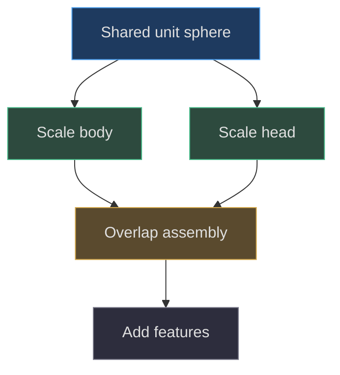
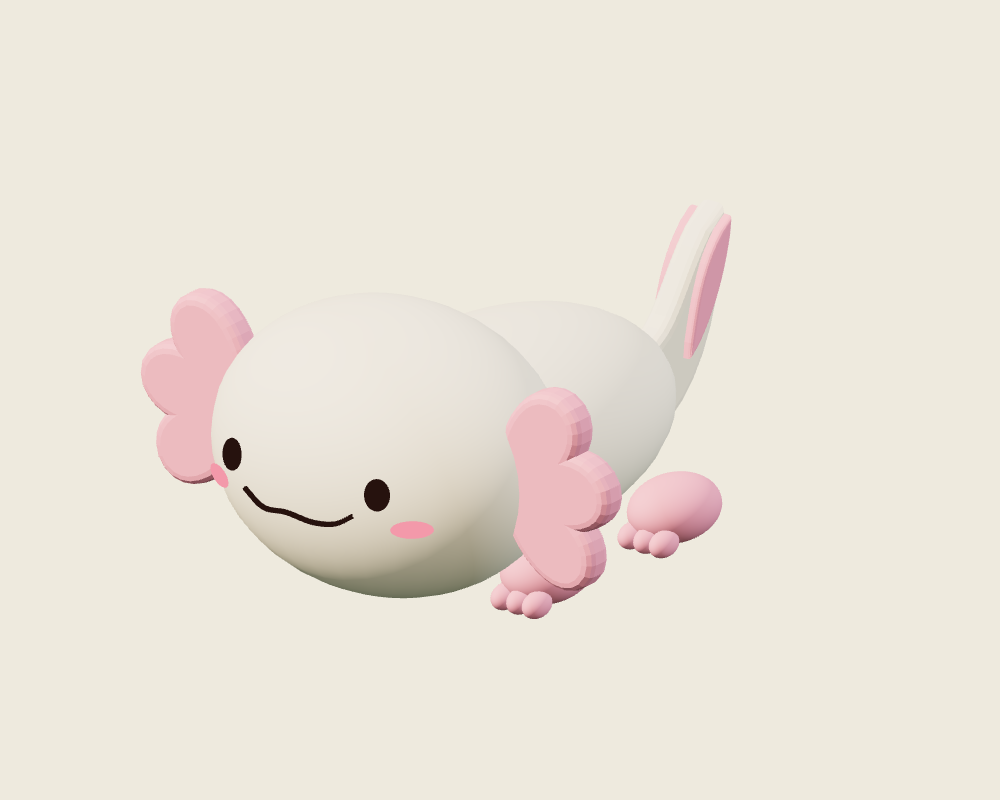
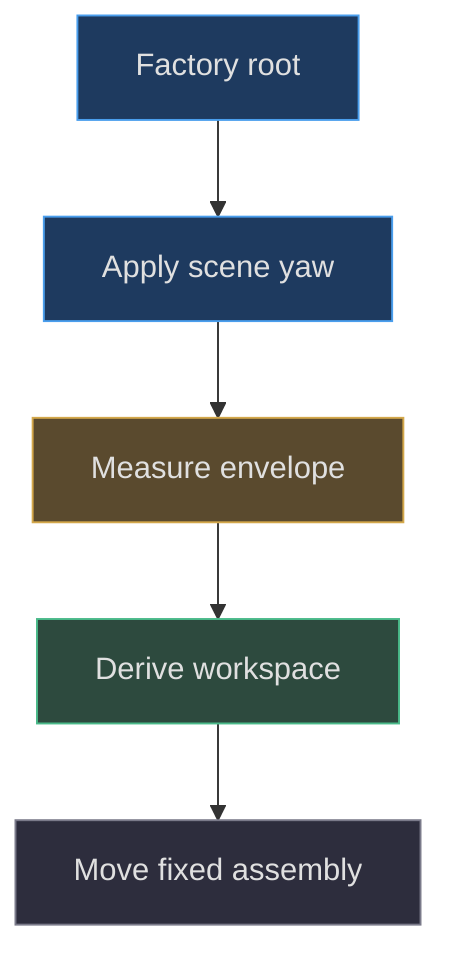

# Axolotl: the silicone body

## Reconstruct the actual primitive assembly

**Implemented behavior.** `createAxolotlLamp` creates a compact cream-and-pink
companion from shared spheres, extruded outlines, a smile tube, and an interior
point light. There is no imported organic mesh, sculpting session, skeletal
rig, or silicone deformation simulation in this factory. Its returned handles
are `root`, `head`, `silicone`, `pink`, and `light`. The smaller feature count
and lack of face animation distinguish it from Pear Boy, despite their shared
movement controller.
[Complete body setup](https://github.com/Zanark/BowserBoy/blob/1e4ef518d6943ab1af39cef3b4d558f209a17891/src/axolotl-lamp.js#L3-L34)
(src/axolotl-lamp.js:3) is the reconstruction starting point.

**Design interpretation.** A large rounded head and low elongated body can
read as a small friendly night-light. “Silicone” is the implementation's material
name and intended visual category, not proof of subsurface scattering, material
measurement, or a physical fabrication process. Build the actual geometry and
then evaluate the visual interpretation separately.

## Establish axes and the two principal ellipsoids

A single unit `SphereGeometry(1,32,24)` is shared among the oval helper's
meshes. The body center is `(0,1.12,-1.35)` and its scale is
`(1.22,.97,1.98)`. The head center is `(0,1.45,.2)` with scale
`(1.65,1.3,1.32)`. Thus the body extends mainly toward negative Z, while
the face is authored on the positive-Z hemisphere of the head.

Derive approximate principal extents before adding details. The body spans
X `±1.22`, Y `.15` to `2.09`, and Z `-3.33` to `.63`.
The head spans X `±1.65`, Y `.15` to `2.75`, and Z `-1.12`
to `1.52`. These are ellipsoid extrema from scale and translation, not
the final whole-model box: gills, feet, toes, and tail extend it.

The two meshes overlap. There is no Boolean union or watertight remeshing
step. Their common material and rounded overlap create continuity in appearance,
but a future export or physical manufacturing workflow would need an explicit
solid-union policy. Do not infer one from a smooth-looking render.

Figure MD23.1. Two transformed copies of one sphere geometry form the visible body assembly without a Boolean union.

## Geometry sharing and transform ownership

The `oval` helper adds a mesh under the root and changes object scale, not
the shared sphere's positions. That distinction makes sharing safe: changing
one eye's object scale does not resize the head. Editing the shared geometry's
vertices, however, would affect every oval using it. A proposed shape-specific
deformation must clone the geometry or introduce a separate primitive.

Each mesh is named with the `axolotl` prefix, tagged
`userData.axolotlLamp=true`, and marked to receive shadows. The entire root
owns placement and scene yaw. Eyes and cheeks receive their own quaternions
for surface orientation, while the head remains an independently returned
mesh. The factory does not animate these transforms after creation.

**Researched guidance.** Current
[BufferGeometry documentation](https://threejs.org/docs/pages/BufferGeometry.html)
describes geometry attributes, normals, and disposal. That reference explains
the general distinction between modifying a geometry and transforming an object;
the actual sharing policy here is established by the one sphere allocation and
the helper calls in pinned source.

## Project features onto the head

For head-relative coordinates, the ellipsoid equation is
`(x/1.65)²+((y-1.45)/1.3)²+((z-.2)/1.32)²=1`.
Solving the positive-Z branch gives
`z=.2+1.32*sqrt(1-(x/1.65)²-((y-1.45)/1.3)²)+offset`.
The default offset is `.035`. Unlike Pear's projection, this function does
not clamp the radicand. A proposed feature outside the ellipse produces
nonfinite coordinates and must be rejected or handled explicitly.

Eyes are placed at `x=±.79`, `y=1.55`, while cheeks use `x=±1.05`,
`y=1.24`. Their small depth scales make them surface-attached ovals rather
than large protruding spheres. The factory aligns their positive-Z axes
to an ellipsoid-gradient direction. That supports the sideward tilt needed
near the cheeks without requiring a separate facial parent rig.
[Projection and orientation](https://github.com/Zanark/BowserBoy/blob/1e4ef518d6943ab1af39cef3b4d558f209a17891/src/axolotl-lamp.js#L29-L55)
(src/axolotl-lamp.js:29) supplies both operations.

## Material identity is not optical simulation

Cream uses color `#fff0dd`, roughness `.72`, emissive `#ffdcab`, and
factory intensity `45`. Pink also uses roughness `.72`, with its own base
and emissive colors and intensity `24`. The factory's black ink and blush
use basic materials with tone mapping disabled. No transmission, thickness,
subsurface scattering, or custom skin shader is configured here.

Current
[MeshStandardMaterial guidance](https://threejs.org/docs/pages/MeshStandardMaterial.html),
consulted 2026-11-07, explains roughness and emissive modulation. It does not
justify describing a high-emission surface as physically measured silicone.
In particular, visible emission and light arriving on the desk are separate:
the factory also creates a point emitter. Scene controls later adjust both.

Pear supplies a useful implemented contrast: its shell is lathed and its
emission has a canvas gradient, whereas this lamp uses constant standard
materials and shared spheres
(src/pear-boy.js:8). The difference is an intentional procedural assembly
distinction, not evidence that either model went through Blender.

Figure MD23.2. Actual original-factory neutral-studio diagnostic showing head/body overlap; it does not establish native-room brightness or falling motion.

## MD23-W01 Calculate and orient one eye

Choose the positive eye center `x=.79`, `y=1.55`. First compute
`u=.79/1.65≈.4788` and `v=.1/1.3≈.0769`.
The radicand is about `.7648`, safely positive. Its square root is about
`.8745`; multiplying by `1.32` and adding `.2+.035` yields a front depth
near `1.389`. These rounded calculations are explanatory; use actual double
precision values for a reproduction comparison.

Next form the gradient-like vector
`(x/1.65²,(y-1.45)/1.3²,(z-.2)/1.32²)` and normalize it.
The code uses the already offset feature Z, so this is not exactly the
gradient evaluated on the unoffset ellipsoid. Reproduce that detail rather
than quietly replacing it with a mathematically cleaner variant. Set a
quaternion from local positive Z to the normalized direction.

Finally apply the eye scale `(.115,.145,.07)`. In a browser inspection,
read the named eye's position, scale, and transformed local positive-Z vector.
Compare the mirrored eye: X position and outward X direction should change
sign while the Y and Z magnitudes remain symmetric. This is observable without
claiming a new screenshot or a full rendering qualification.

## MD23-R01 Retry with a wider head

**Proposed extension.** Increase head X scale from `1.65` to `1.9` while
retaining its center and Y/Z radii. If the projection formula and gradient
denominators remain `1.65`, the features no longer follow the visible shell.
The changed condition is not repaired by scaling the eye meshes alone.
Update the authoring parameters consistently, then recompute front positions
and surface orientation.

Measure the new whole-model box after all features are assembled and after
the scene's `.3`-radian Y rotation. The scene captures axolotl motion bounds
from the actually rotated root, translates that world AABB back by its root
position, and derives root-workspace limits from its offsets. See
[scene construction and bounds](https://github.com/Zanark/BowserBoy/blob/1e4ef518d6943ab1af39cef3b4d558f209a17891/src/scene.js#L130-L140)
(src/scene.js:130).

If the shape widens but its stored motion bounds do not, side collisions can
accept visible overlap. Recreate or recompute those bounds deliberately in
the experiment. A dynamic shape editor would need an invalidation policy;
the pinned factory builds a fixed shape.

## Movement uses the assembly, not anatomical joints

The axolotl's root moves through `DeskMotion`. Its gills, head, body, toes,
tail, and light follow as children. The controller does not independently
articulate feet or change the smile during impact. It stores one velocity and
keeps orientation fixed during dragging and falling
(src/pear-motion.js:5).

Scene clearance can temporarily displace the lamp during console focus and
restore its remembered table XZ coordinates afterward. It treats the model as
a spatial participant, not as a special-case painted decoration. The
nearest-position helper expands obstacle rectangles by local envelope offsets
and a default `.25` gap
(src/desk-clearance.js:3). Thus topology choices can affect layout even when
the body center stays unchanged.

Figure MD23.3. Scene orientation is applied before the movement envelope is measured, preserving the assembled model's actual horizontal reach.

## Historical constraint versus current behavior

**Documented history.** `TODO/110_SMALL_AXOLOTL_LAMP.todo` records the initial
fixed-lamp scope, including the internal-emitter correction and independent
brightness levels. `TODO/111_MOVABLE_AXOLOTL.todo` explicitly supersedes its
fixed-position constraint with shared companion movement. The scoped
`f10fab1752c4d15167baeaaace4623820f0c2bee` source history contains the
assembled lamp. These records explain chronology, not recovered internal
reasoning or fresh user approval.
The supersession is recorded at
(TODO/111_MOVABLE_AXOLOTL.todo:40), while the earlier optical correction remains
historical evidence (TODO/110_SMALL_AXOLOTL_LAMP.todo:52).

A reconstruction agent must therefore implement the pinned movable behavior,
not revive the older fixed-position rule because it appears in an acceptance
record. Conversely, movement does not authorize inventing face animation,
rope gills, or persistent saved lamp locations. Those are absent from this
factory and would be separately labeled extensions.

## Build an inspection checklist from the representation

Begin a new reconstruction with root identity transforms and verify the
head/body centers before applying scene placement. This isolates an assembly
error from a camera or layout error. Then check the single shared sphere
geometry is used through object transforms, and that the two principal
materials remain distinct handles. Their later brightness updates depend
on shared material identity: accidentally cloning a cream material for one
part can leave that part glowing after the scene switches the original
`silicone` handle off.

That observation follows directly from the factory returning material handles
and the scene mutating them, rather than traversing every mesh to find colors
(src/axolotl-lamp.js:90; src/scene.js:586). A proposed material override needs
an explicit control policy. Either include the new material in the power
mapping or document it as deliberately nonemissive. Visual similarity at
startup is insufficient if later state changes diverge.

Next inspect front, back, and three-quarter geometry under a neutral diagnostic
setup, without treating those views as native-room evidence. A front view
checks bilateral arrangement; a back view reveals the elongated body and
tail overlap; a three-quarter view exposes attachment depth. Their value
is complementary rather than redundant. A beautiful front image cannot
prove that a tail layer is centered through its thickness.

Finally compare the complete rotated envelope with the scene workspace and
test one rejected occupied placement. This connects the local assembly to
its interactive role. The current model is smaller than Pear, but “smaller”
alone cannot guarantee clearance when gills spread laterally or a tail
extends behind the root.

## MD23-Q01 Explain an apparently seamless body

The head/body junction looks smooth under warm emission. Can another agent
claim the model is one watertight silicone mesh? What evidence would be
required before exporting it for physical manufacture?

## MD23-A01 Distinguish appearance from solid topology

No. The implemented model contains overlapping sphere-based meshes with shared
material, not a Boolean-unified shell. A manufacturing export would require
explicit union, internal-face cleanup, manifold validation, wall-thickness
decisions, and scale units. None follows from the visible overlap.

The useful failure boundary is that scene rendering tolerates intersecting
parts inside a deliberately assembled character, while inter-object desk
clearance forbids overlap between prioritized models. These are different
contracts. Do not “repair” the intentional head/body overlap with the desk
placement solver or describe the latter as an anatomical solid-model validator.
